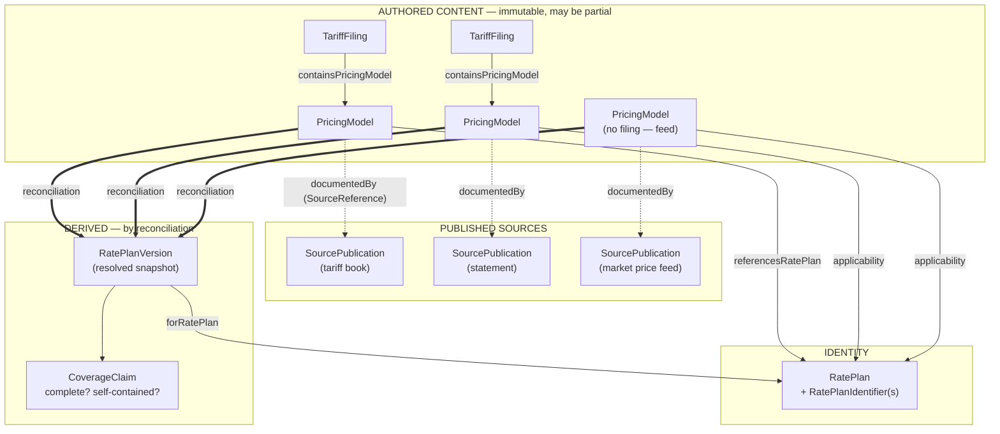
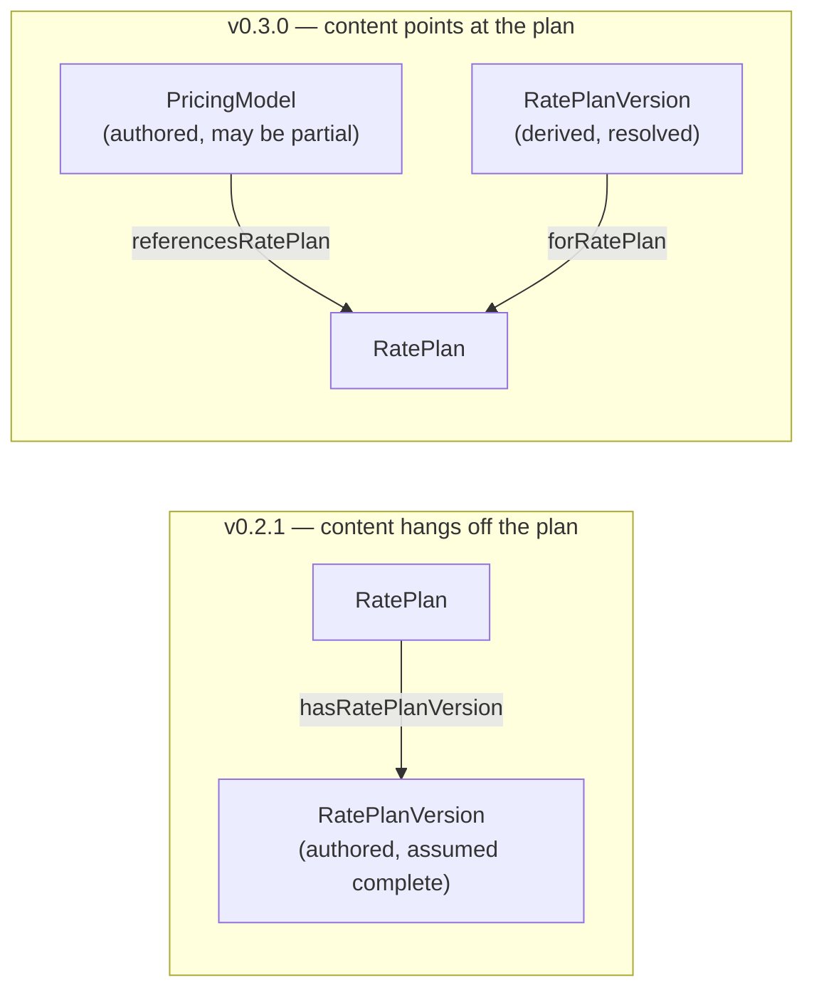
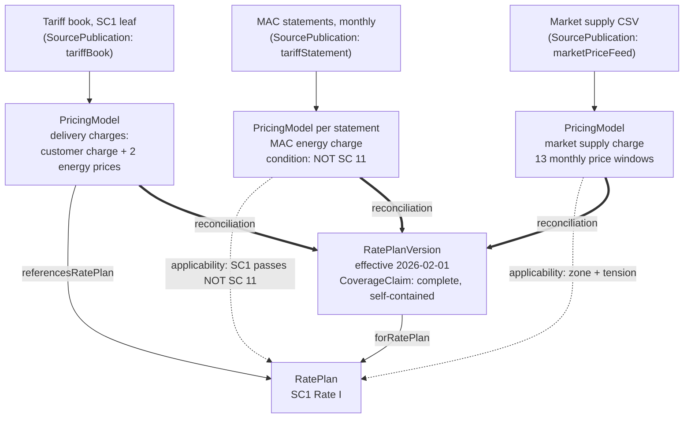

# URPX Model Update — Walkthrough of the v0.3.0 Candidate

**Pre-read for Working Group Meeting #012 — 2026-07-07**

This document walks through the revised rate plan model, the vocabulary that changed between the released v0.2.1 and the v0.3.0 candidate, and the worked example set the candidate has been validated against. It is the follow-up to the reframe discussion at meetings #010 and #011: the direction presented there has now been carried through the full vocabulary, the SHACL shapes, and an end-to-end worked example, and it is ready for the group's review.

---

## 1. Why the model changed — recap

The released model assumed that a `RatePlanVersion` covers a complete, non-overlapping "snapshot" of a `RatePlan`  that carries all of its own prices. Current publications do not work that way:

- A tariff book leaf publishes only one section's delivery charges.
- A monthly statement publishes only one adjustment charge.
- Supply charges arrive through a market price feed, on their own monthly cycle, outside the tariff book entirely.

No single published artifact carries a whole rate plan. A model that pretends otherwise forces every implementer to invent their own way of stitching sources together — and two conformant implementations would stitch differently.

## 2. The model in one paragraph

A **rate plan is a stable identity** — a name and one or more registered identifiers, with no pricing content of its own. Every published statement of pricing is a **`PricingModel`**: a package of price definitions plus the plan elements they need, which may be partial, and which reaches the plan(s) it applies to either by direct reference (`referencesRatePlan`) or by applicability conditions (service class, identifier, customer attributes). Pricing models publish inside a **`TariffFiling`** (for regulatory tariff documents) or directly (for market and dynamic feeds), and every one cites its source through a **`SourceReference`** to a **`SourcePublication`**. What a consumer reads for a given window is a **`RatePlanVersion`**: a resolved snapshot that materialises the prices from every pricing model applicable to the plan in that window, and carries an explicit **`CoverageClaim`** stating how complete it is and whether anything in it is priced externally.

The key inversion versus v0.2.1: content no longer hangs off the plan. The plan is the fixed point; published pricing content points *at* it.

## 3. What is new

| Term | What it is |
|---|---|
| `PricingModel` | The authored, citable unit of published pricing content — may cover part of a plan |
| `TariffFiling` | The regulatory wrapper a pricing model publishes in; carries effective dates and lifecycle |
| `SourcePublication` | The published artifact itself — a tariff book, a statement, a market price feed |
| `SourceReference` | A citation from content to the exact place in a source publication (file, page, retrieval date) |
| `RatePlanIdentifier` | A typed, URI-addressable identifier for a rate plan (utility tariff code, CA MIDAS RIN), with an identifier scheme |
| `CoverageClaim` | The required honesty stamp on a resolved snapshot: complete or partial, self-contained or externally priced |
| `Evaluation` | The recorded rationale behind a coverage claim |
| `ModelCollection` | A thread grouping successive pricing models from the same source |
| `PriceDefinitionReference` | The pointer a snapshot uses for components whose prices live elsewhere |

## 4. What changed

- **`RatePlanVersion` is re-meant, not renamed.** It is now the *derived, resolved* snapshot — produced by reconciliation, consumed by readers — rather than an authored artifact. It gains `forRatePlan` (the version points at the plan, replacing the old `hasRatePlanVersion` direction), a required `hasCoverageClaim`, and `selfContained`.
- **Direction of reference inverted.** A pricing model declares `referencesRatePlan`; generic market packages (one price feed serving many plans) declare no plan reference at all and are reached by applicability instead.
- **Lifecycle lives on the filing.** Supersession, cancellation, and effective dating attach to `TariffFiling` — the regulatory event — not to the resolved snapshot.
- **Source citation is uniform.** `DataSourceReference` is renamed `SourceReference`, and every pricing model can state `documentedBy` (its citation) and `pursuantTo` (the general rule it is issued under).
- **Confidence is explicit.** A pricing model carries `confidence` (verified, estimated, projected); a resolved snapshot blends inputs and reports the result.

## 5. What is retired

The document-container classes of v0.2.1 (`URPXDocument` and the per-document-type classes such as `TariffStatementDocument`) give way to the `SourcePublication` + `publicationType` pattern: one class for a published artifact, with its kind (tariff book, tariff statement, market price feed) as a value. This removes a class per document type and lets new publication kinds arrive without vocabulary changes.

## 6. The worked example set

The candidate has been validated against a worked example set built from Consolidated Edison's published SC1 Rate I material — chosen because it exercises exactly the fragmentation the model exists to handle:

1. **Identity** — the rate plan as pure identity: name, utility tariff code identifier, service class (SC1) and rate group (Rate I), publisher.
2. **Tariff book filing** — a `TariffFiling` carrying a pricing model with the delivery charges from one tariff book leaf (customer charge and two energy delivery price definitions), citing leaf and revision.
3. **Statement filings** — five `TariffFiling`s, one per monthly Statement of Monthly Adjustment Clause (January through May 2026), each carrying that month's single adjustment charge, applicable to every service class *except* SC 11 — expressed as a structured condition, not prose. Each filing cites its own statement PDF; each statement supersedes the previous one.
4. **Market price feed** — a pricing model for the market supply charge, documented by a CSV price feed rather than any tariff document, with thirteen monthly price windows. No filing, no plan reference: applicability only.
5. **Resolved snapshot** — the `RatePlanVersion` effective 2026-02-01 that consolidates all three input streams: the delivery charges, the monthly adjustment charges from the statements in effect from the snapshot's effective date through the most recent published one (each price citing its own statement, ending when its successor takes effect), and the market supply cycle prices. Its `CoverageClaim` states complete and self-contained, and its `Evaluation` records that all inputs were verified.

Every file validates against the candidate SHACL shapes. The resolved snapshot also validates entirely on its own, and the files together form one connected graph with no dangling references — the snapshot's plan reference resolves to the identity file, its price definitions to the filings and the feed.

Two structural points the example demonstrates:

- **The snapshot is self-contained, with provenance preserved.** A resolved snapshot assumes the source data cannot be accessed: everything it needs — price definitions, ledgers, metric definitions, applicability conditions, source citations — is carried in full, keeping the URI each node was published under. A consumer needs only the one file; anyone who does hold the sources can still walk the shared URIs back to them.
- **Facts keep their own dates.** The market supply price that covers the snapshot's effective date started earlier (2025-12-31) and ends on its own cycle date. The snapshot does not clip it; validity lives on the fact, not the envelope.

## 7. Open items

Three vocabulary items are drafted for a follow-up change set and do not block review of the model itself:

1. **Filing-level cancellation** — `cancelsPriceDefinition`, so a filing can retire a price definition without mutating it.
2. **Component validity dates** — effective and expiration dates on plan-element components (time-of-use schedules, season definitions), for resolved snapshots that blend a mid-window structural change.
3. **Confidence on the coverage claim** — first-class placement of the derived confidence value (currently recorded in the claim's evaluation text).

A small number of closed shapes are also missing properties the ontology declares for their class (they reject data the vocabulary permits); these are catalogued for the next shape-alignment batch and none affect the worked examples.

## 8. What we ask the group to check

- Does the model, as carried through the vocabulary, match the direction agreed at the last two meetings?
- Does the worked example set cover the publication patterns your organisation deals with? If a pattern is missing (bundled supply contracts, rider stacking, net-metering credits), name it — the same five-part exercise can be repeated against it.
- The re-meaning of `RatePlanVersion` is the one change to an already-published class. We would like explicit assent to it before the release and license transition discussed at meeting #011 move forward.
