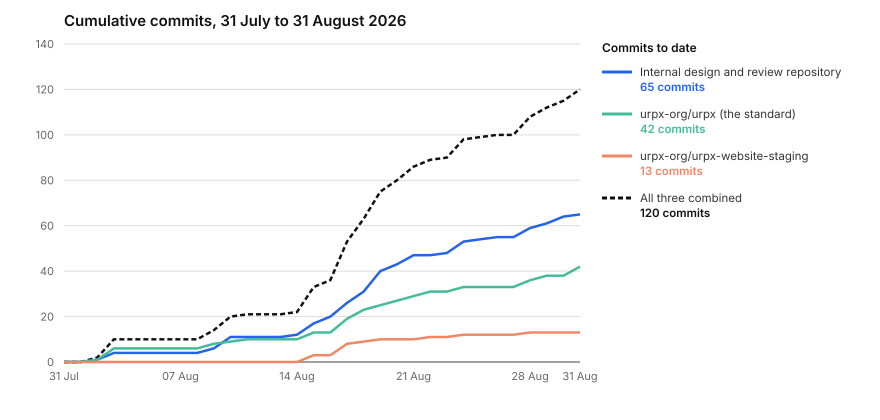
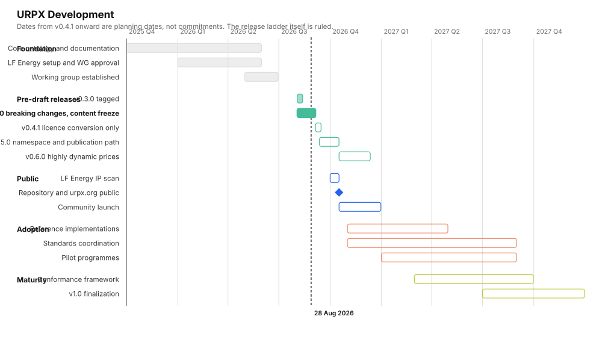
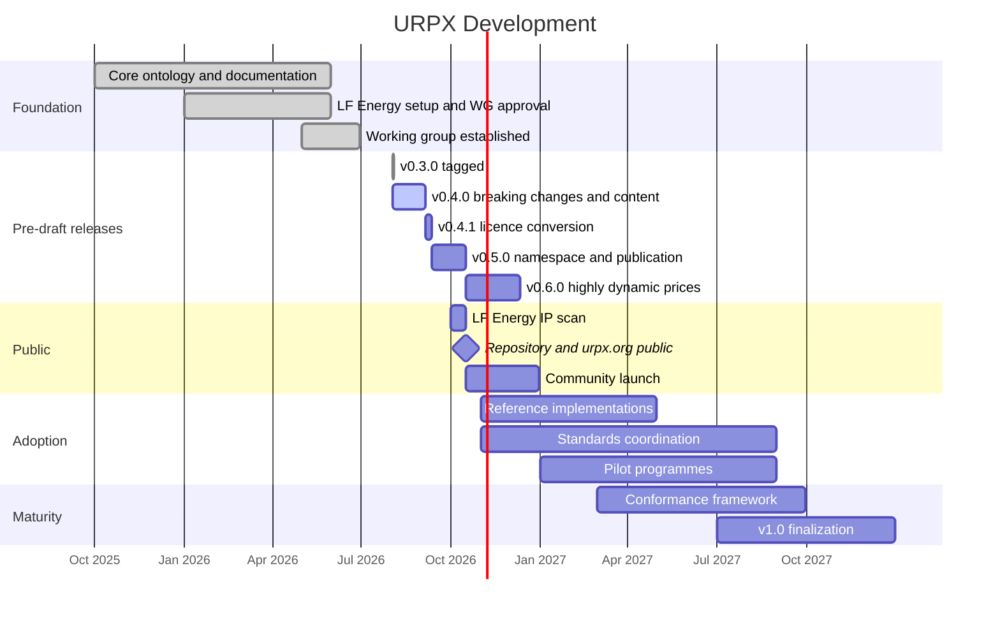
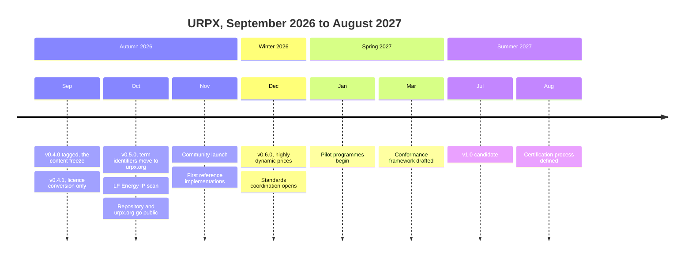

# URPX status

**31 July to 31 August 2026.** Measured from the repositories on 31 August, not estimated.

This supersedes the four-week report of 28 August and carries its content forward. The window is the same one, extended by three working days.

## Where the release stands

The v0.4.0 vocabulary is finished and the tag has not been cut. Three items are left. All three are documentation or mapping, and none of them changes the model.

**What v0.4.0 carries.** Three vocabulary changes and one new artifact.

A calculation attaches at the measurement it describes. `hasCalculationMethod` reached only prices, so an aggregation had to be restated on every price measuring the same quantity, and two prices on one metric input could disagree with nothing catching it. It now also reaches a ledger, a metric input and a measurement specification. Three of the shapes involved are closed, so this could not be layered on after the tag.

One identifier pattern covers organization, rate plan and rate plan modifier identifiers. `scheme` names the register, `skos:notation` carries the value, jurisdiction is optional on all three. The register is an open class, so an implementer running a register URPX has not published names it with an identifier of their own.

The exchange package carries every exchangeable unit through one containment property, and each of those units can now declare the URPX version it was authored against.

URPX publishes a JSON-LD context. Every shipped example carried a hand-written one, and between them they declared datatypes for 25 properties against the 100 the vocabulary declares. The published context is generated from the vocabulary's own ranges, so it covers all 100 by construction and cannot fall behind.

**The three items left before the tag.**

1. The pages that teach the inline context are rewritten onto the published one.
2. Prose wrapped at a fixed column is normalized across the shipped pages. Sixteen hand-authored files, measured.
3. The Green Button section of the interoperability page is reconciled against what the mapping now carries, and its two diagrams are refreshed.

## Green Button

The Green Button Alliance now officially supports URPX and has given permission to use its logo.

Don Coffin has been working the Green Button to URPX mapping with us. The settled part of that work is in the standard as of 31 August: the three rider enrollment-status pairings, the alignment of a Green Button tariff profile to a rate plan name with the condition under which it carries an identifier instead, and a structural note recording that in ESPI V4 a rider reference and a wholesale pricing-node reference are two distinct structures rather than one containing the other. That last one corrects the raw meeting note, which had filed the pnode structure under the rider heading.

Three questions stay open. Each is carried as a draft specification in the repository: the Green Button program-code list, which needs a code-list design; the boundary between a Green Button program enrollment and a URPX rate plan modifier; and how a service point refers to a pricing node.

Wholesale pricing-node references are out of scope for URPX itself. The mapping records the absence.

## Completed work

Each row is the change, not the process that produced it. Nineteen changes to the standard, seven to the documentation site, and eleven review and design passes.

### The standard: `urpx-org/urpx`

| Work | Landed |
|---|---|
| Test-case folders lose their date suffixes, and every reference follows | `903ad9f5` |
| One identifier pattern across organization, rate plan and rate plan modifier identifiers | `0574737b` |
| A package carries every exchangeable unit through one containment property | `55192e06` |
| Every shipped example declares the URPX version it was written against, twelve of twelve | `9f5a5464` |
| The regeneration and release workflows move to a GitHub App identity | `a5eef7f0` |
| The regeneration opens a pull request instead of writing to the target branch | `0b007370` |
| The release ladder is relabelled to v0.4.0, v0.5.0 and v0.6.0 | `0574737b` |
| The v0.4.0 release-notes page, every term verified against the shipped vocabulary | `f98b43a3` |
| Four pre-tag blockers applied: the release block, the retired identifier, the empty-package rule | `4d5b3985` |
| The version surface finished, so no declaring document still claims v0.3.0 | `98a7a559` |
| The shipped documentation agrees with the shipped vocabulary | `13483186` |
| Thirteen of fourteen teaching-page findings applied, all six worked documents conforming | `d7195848` |
| A calculation attaches at measurement level; two properties retired | `b30e2039` |
| The published JSON-LD context, its serving path, and the page that advertised the wrong one | `304eb225` |
| The published context reduced to `@context` alone | `521a05a1` |
| Every test-case fixture references the published context, twelve of twelve | `f3b9d020` |
| The settled Green Button rider, program-code and tariff-profile alignments | `1802884e` |
| A backlog task for the open Green Button pricing-node question | `ddfe3bc8` |
| The published context and the validation unit recorded as v0.4.0 decisions | `dafe353a` |

### The documentation site: `urpx-org/urpx-website-staging`

| Work | Landed |
|---|---|
| The identifier scheme reaches the data dictionary config | `7f4c2a3` |
| The publish map and the curated-example list reconciled against the standard, with a check behind them | `108f097` |
| The App identity reaches the deploy and promote workflows | `54db9bb` |
| The frontmatter guard moves downstream of the generator it validates | `e2266d6` |
| 137 property rows across 79 properties classified correctly for the first time | `c92d5c8` |
| The data dictionary stops breaking the site build on unescaped comparison operators | `81776dd` |
| The published JSON-LD context generator, and the check that proves the examples still parse the same | `6410d76` |

### Review and design

| Work | Outcome |
|---|---|
| Pre-tag implementation review, round one | Not clean, three blockers, all closed on measurement |
| Second-vendor review of the same applied vocabulary, blind to the first | Converged independently on the empty-package gap |
| Pre-tag review, round two, strictly narrower | Not clean, three blockers, none in the vocabulary |
| First read of the five teaching pages' bodies, ever | Fourteen findings, four tag-blocking |
| Where a calculation attaches, and which way of saying it survives | Seven decisions disposed, eleven edits, nothing minted |
| Two independent contests of that disposition, one per vendor | Both found the same false premise in the question underneath it |
| Independent read of the applied calculation change | Clean, to a residue already accepted |
| A gate that stops a page's declared version drifting from the vocabulary's | Built and proved in both directions |
| Reuse-ladder pass on the new Green Button mapping material | Four items dispositioned, nothing minted |
| Two reviews of that pass, one per vendor, which diverged | Routed to the chair and ruled; the mapping ships the settled residue only |
| The fixture matrix given the offline loader the context cutover requires | Runs offline, 42 local resolutions, twelfth fixture validated |

**Two of those rows are worth reading twice.** The second-vendor pass and the first-vendor pass, run blind to each other, converged on the same finding both times they were run in parallel on the vocabulary. On the Green Button material they diverged instead, and the divergence is what sent the scope question to the chair before anything was applied.

The pre-tag review also found that the vocabulary itself was sound. What failed was the layer around it: release metadata, version claims, and annotations on terms nobody was retiring.

## Commits

120 commits across the three repositories. The internal repository carries the most because review reports, decision records and session briefs all land there and none of them is a change to the standard.

The shape is the week of 14 to 20 August, which carries 59 of the 120. That is the week the two pre-tag reviews returned and everything they found was applied.

| Week | Internal dev docs | The standard | Documentation site | Total |
|---|---:|---:|---:|---:|
| 31 Jul to 6 Aug | 4 | 6 | 0 | 10 |
| 7 to 13 Aug | 7 | 4 | 0 | 11 |
| 14 to 20 Aug | 32 | 17 | 10 | 59 |
| 21 to 27 Aug | 12 | 6 | 2 | 20 |
| 28 to 31 Aug | 10 | 9 | 1 | 20 |
| **Total** | **65** | **42** | **13** | **120** |

The figures differ slightly from the 28 August report because they are re-measured on a stated convention: commits excluding merge commits, across all branches, over the whole window. The earlier report was taken mid-day on 28 August and did not see that day's later commits.

## Development chart

The chart in the working-group repository still describes a v0.1.1 core ontology and a v0.9-dev specification, neither of which is the ladder in force. This is the same chart against what is actually happening.

**Rendered in the brand palette and ready to replace `branding/graphics/urpx_development_chart.svg`** in the working-group repository, alongside the `.png` beside it. The mermaid source follows, so the chart can be re-rendered when the dates move.

**What changed against the chart it replaces.** The version numbers are the ones actually in force rather than v0.1.1 and v0.9-dev. The public flip is a dated milestone rather than an open-ended band, because it now depends on one IP scan against a known tree. And the pre-draft releases are broken out individually, because four of them ship inside five months and a single bar hides the sequence entirely.

**Dates from v0.4.1 onward are planning dates, not commitments.** The ladder itself is ruled and has not moved: v0.4.0 for the breaking-change and content window, v0.4.1 for the licence conversion, v0.5.0 for the namespace and publication path, v0.6.0 for the additive bundle.

## The year ahead

**What each release actually carries.**

| Release | What is in it | Breaking? |
|---|---|---|
| v0.4.0 | The breaking-change and content window. Identifier pattern, package containment, version declarations, calculation altitude, the published context | Yes, and deliberately, while nothing outside the group can have bound to the terms |
| v0.4.1 | The licence conversion and nothing else. Specifications to the W3C Document License, datasets to CDLA-Permissive, source and metadata staying Apache-2.0. The vocabulary is byte-identical across it. The documentation goes public at this tag | No |
| v0.5.0 | Term identifiers move to `urpx.org`. The publication path converts with them. This is the final pre-public tree, so the IP scan runs against it | Yes, every term identifier changes |
| v0.6.0 | The additive bundle, led by highly dynamic prices | No, additive only |
| v1.0 | Conformance and certification behind it | Not planned |

**The one dependency outside the project.** `urpx.org` DNS and serving sit with LF Energy, and v0.5.0 cannot publish at the new term identifiers until that answer lands. Everything up to and including v0.4.1 is unaffected.

## Method note

Every number here was measured on 31 August. The commit counts come from `git log` across the three repositories over the stated window, excluding merge commits, across all branches. The completed-work rows each name the commit that closed them, and every row names one. The fixture and corpus figures are the validation run's own output. Two review passes in this window ran on a second vendor, blind to the first-vendor pass on the same brief.
