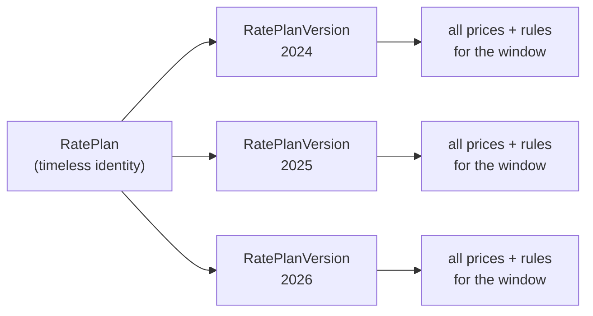
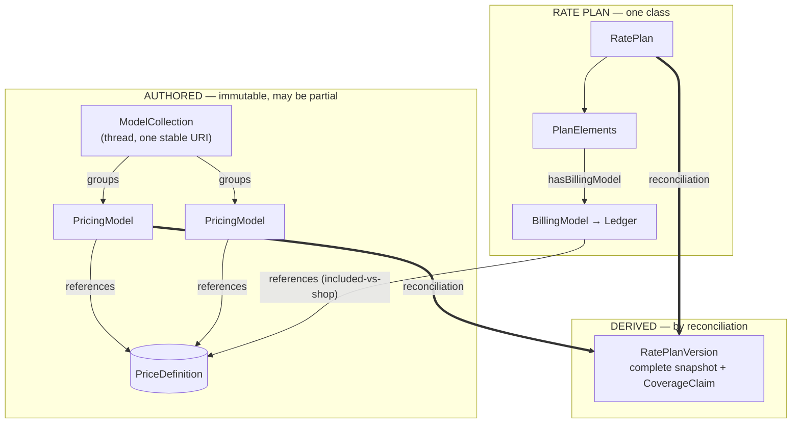

# Major URPX update: rate-plan model reframe

*Audience: the URPX working group. A proposal for review before the public release and the W3C-license transition.*

## Summary

The current rate plan model has a structural problem. URPX represents a rate plan as a sequence of complete, non-overlapping `RatePlanVersion`s, each one carrying a time-delimited part of the whole rate plan structure. Tariffs are not published that way: a plan arrives in fragments across tariff-book sections, monthly statements, dynamic feeds, and external supply contracts, and most single documents are partial.

The proposal separates what utilities publish (immutable, often partial `PricingModel`s) from what reconciliation derives (a complete `RatePlanVersion` snapshot, stamped with a `CoverageClaim`). This redefines `RatePlanVersion`, an already-published class, so it is a breaking semantic change. Working-group review is requested before it is frozen behind a public, W3C-licensed release.

## Background

URPX is built for a future where rate plan data is machine-computable rather than buried in PDF text. It also has to work against the data that exists today, which is fragmented and incomplete. Don (DCJ) put the bar well in an earlier discussion:

> "IMO URPX doesn't necessarily have to be as broken as actual tariff books."

That is the standard to aim for: URPX should be less broken than the tariff books, without pretending the brokenness in the source data isn't there. A model that only works once every utility publishes clean, complete, well-typed plans is a model that works nowhere today.

## The problem

The ontology defines `RatePlan` as the timeless identity and `RatePlanVersion` as a temporal instance whose versions must not overlap and should form a continuous timeline.

That shape mismatches how tariffs are published in three load-bearing ways:

1. **It assumes each filing is complete.** A tariff book amendment may publish only an eligibility-rule change; a statement may publish only this month's fuel-adjustment price. Neither is a complete version, and the model has nowhere honest to record them.
2. **It assumes a single clock.** A continuous, non-overlapping timeline assumes one authority sets one effective window per change. In practice the energy charge, riders, supply charges, and monthly adjustments change on different schedules from different documents.
3. **It assumes prices live inside the version.** Dynamic prices arrive on a feed; retail-supply charges live in a separate contract the network utility never publishes. A version can only reference those, not contain them.

The consequence: two conformant implementers can model the same documents incompatibly. That latitude is what this reframe removes before standardization.

## The proposal

Separate what a publisher authors from what a computer derives.

- **Authored, immutable, may be partial.** The published unit is a `PricingModel`: rules and/or prices that reference persisting `PriceDefinition`s. Related PricingModels over time (a monthly fuel-adjustment thread, a regulatory program such as HEAP) are grouped by a `ModelCollection` with one stable, subscribe-able URI.
- **Derived.** `RatePlanVersion` is redefined as the complete reconciled snapshot that reconciliation produces from the applicable PricingModels for a window. It carries a required `CoverageClaim` recording how complete it is, for which scenario and interval, and against what input cut-off.
- **Source.** A publication's internal structure stays out of URPX and is cited via `SectionReference`.

One `RatePlan` class covers both fully-authored plans (for example an EV-charging provider that publishes a complete plan) and plans assembled at compute time, distinguished per reference: each `PriceDefinition` reference is either *included* (value present) or *shop-for* (resolved externally — a feed, a supply contract, the customer's Green Button data). Completeness becomes two explicit, checkable claims: a structural `selfContained` flag (any shop-for references left?) and the reconciliation-produced `CoverageClaim` (computable for this scenario and interval now?).

## Open questions

Two smaller modeling questions remain and do not block the core change: whether the computed cost result for a customer is URPX vocabulary or a reconciliation output, and how to model collections of related pricing models. Both would be resolved before the vocabulary is frozen.

## Recommendation: hold the release and the W3C-license transition

1. The change is breaking and affects an already-published class. `RatePlanVersion` moves from an authored instance to a derived snapshot; data modelled against today's definition carries the old semantics. Better to land it before going public.
2. The current design is too ambiguous to standardize: two conformant implementers can model the same rate plan incompatibly, and an open release bakes that into every downstream tool.
3. The license transition is hard to reverse. Under LF Energy's terms the Apache-2.0 to W3C document-license move is gated on draft ratification; ratifying the fixed model once is preferable to ratifying a shape that will be revised.

This is a delay for review, not a redesign.

## Review

Reviewers can sign up via the standing URPX review sheet. The most useful contribution is a jurisdiction or plan this model cannot represent honestly, particularly around partial filings, independent price clocks, and externally-priced charges.
