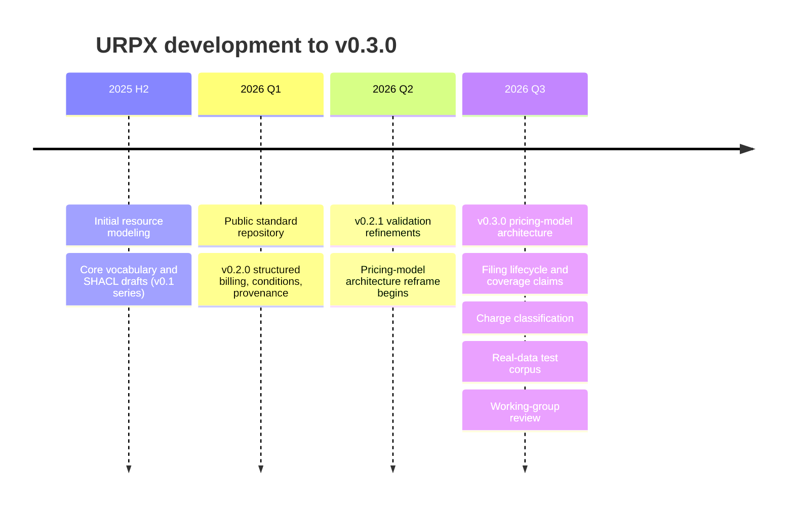

<!-- SPDX-FileCopyrightText: The URPX Authors -->
<!-- SPDX-License-Identifier: Apache-2.0 -->

# URPX Development Overview

This document describes how the URPX (Utility Rate Plan Exchange) standard reached
its current pre-Draft state (v0.3.0). It is a factual summary of the work to date;
the planned direction from here is in [urpx-roadmap.md](urpx-roadmap.md).

## Summary

URPX is an open standard for exchanging utility rate plan information using semantic
web technologies (RDF, OWL, SHACL). It grew from early resource modeling into a
consolidated vocabulary that separates a rate plan's stable identity from the
pricing content published about it, validates that content with an executable shape
suite, and is exercised against real utility filings rather than synthetic examples.

## Development milestones

**Initial resource modeling.** The first work established the core vocabulary — rate
plans, versions, prices, and the conditions and eligibility rules that govern them —
and an accompanying SHACL shape set. Early iterations were published as the v0.1
series.

**Structured billing and conditions (v0.2.0).** The billing model was reworked, a
structured condition-expression model replaced ad-hoc condition fields, and datetime
provenance was added so facts could be traced to when and where they were stated.
The v0.2.1 patch tightened validation and refreshed a test case.

**Pricing-model architecture (v0.3.0).** The largest change separated three concerns
that had been conflated: the authored pricing content (`PricingModel`), the
regulatory publication unit that carries it (`TariffFiling`), and the external
published document it came from (`SourcePublication`, typed by an enumeration rather
than a class-per-document-kind hierarchy). Rate plans and rate plan modifiers became
pure identity records, with derived content reached only from their version
snapshots.

**Filing lifecycle and coverage claims (v0.3.0).** Lifecycle facts — supersession,
in-place correction, cancellation, and validity windows — were given a clear home on
the filing chain, and every resolved version snapshot was required to carry a
coverage claim stating whether it is complete and self-contained, with an evaluation
recording the rationale.

**Charge classification (v0.3.0).** The charge-type vocabulary was reviewed and
sharpened, including separating measured quantities from billed charges where a
single term had served both roles.

## Current scope (v0.3.0)

- An OWL ontology of roughly 284 classes and 332 properties (188 object properties,
  144 datatype properties).
- A SHACL shape suite of 144 shapes bound to classes (81 of them closed), out of
  152 node shapes in total, serving as an executable conformance suite alongside a
  validation matrix.
- A generated data dictionary, a diagram gallery, and an interactive ontology
  explorer.
- SKOS mappings relating URPX terms to neighboring standards.

## Real-data test corpus

Rather than synthetic examples, URPX is validated against published utility filings,
each fixture citing its source documents per price:

- **Consolidated Edison SC1 Rate I** — a nine-file fixture set: a rate plan identity
  record, a delivery-charges filing, five monthly market-adjustment statement
  filings, a market-supply pricing model, and a fully self-contained resolved version
  snapshot. Each file validates on its own and as part of the combined graph.
- **Pacific Gas and Electric E-ELEC and E-TOU-C** — residential time-of-use rate
  plans, including a full baseline-allowance matrix modeled across territories,
  codes, and seasons.

## Current status

v0.3.0 is under working group review ahead of a formal vote to accept it as a Draft.
The path from here is described in [urpx-roadmap.md](urpx-roadmap.md).

