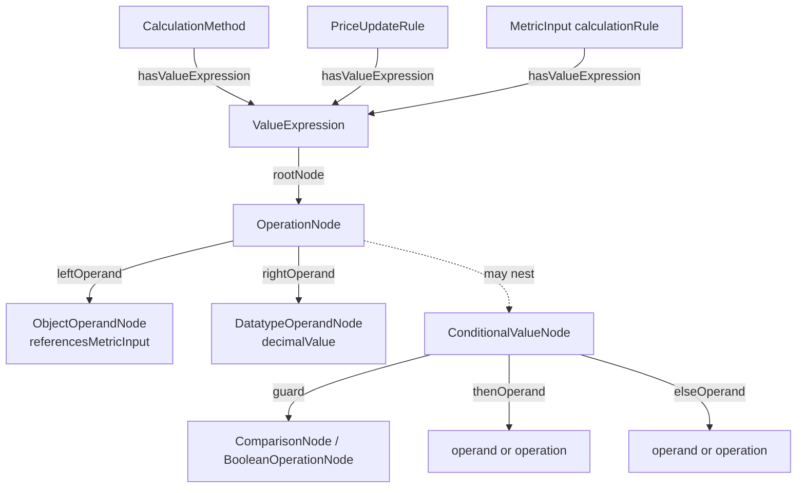

# SPEC-URPX-ONT-041 — Value expressions: machine-readable price calculation

| Field | Value |
|-------|-------|
| **Status** | Proposed — open for working group review |
| **Delivered against** | URPX v0.3.0 candidate, branch `v0.3.0-wg-review`, commit `3d474cbd` |
| **Target release** | v0.4.0 (fully additive; no change required to the v0.3.0 candidate before its tag) |
| **Targets** | `ontology/urpx-ontology.ttl`, `shacl/urpx-shacl.ttl`, documentation pages, data dictionary regen |
| **Implementation task** | [backlog.task.urpx.ont.2026-07-19.value-expressions-implementation.md](../tasks/backlog.task.urpx.ont.2026-07-19.value-expressions-implementation.md) |
| **Samples** | [dev-docs/samples/comed-rrtp-hdp/](../samples/comed-rrtp-hdp/) · [dev-docs/samples/pge-b6-pdp-event/](../samples/pge-b6-pdp-event/) |
| **Depends on** | — (specs 042/043 build on this) |

Each edit is a discrete block with copyable before/after Turtle. All edits are additive except the marked annotation demotions and range widenings.

## 1. Problem

URPX describes *that* a price component is calculated, but not *how*, in machine-readable form:

- `urpx:calculationFormula` on `CalculationMethod` and `urpx:formula` inside a `MetricInput`'s `calculationRule` are free-text `xsd:string` values. Two implementations can parse `"hourlyLMP + retailAdder"` differently — or not at all — and both claim conformance.
- `urpx:PriceUpdateRule`'s own `skos:note` says it "contains formulas and trigger conditions", but the class has **no formula-bearing property**, and its closed SHACL shape admits only `name`, `description`, and `priority`. The promise has been unkept since v0.1.x.
- Eligibility and applicability conditions already solved this problem: the adopted condition model expresses rule logic as a structured, SHACL-validated node tree (`ConditionExpression` → `rootNode` → comparison/boolean nodes), with the free-text `logicExpression` demoted to a non-authoritative audit label.

URPX is the recipe: the vocabulary must state unambiguously what a filed charge *means*, while executing that recipe (cost modeling, serving, caching) stays with consuming implementations. A machine-readable calculation is the recipe's missing step; without it, highly dynamic prices cannot be computed interoperably from their drivers.

## 2. Design in one paragraph

Mint **`urpx:ValueExpression`** as the numeric sibling of `ConditionExpression`. It reuses the entire adopted expression machinery — `rootNode`, `OperationNode` with explicit `leftOperand`/`rightOperand`, the three operand-node classes, `referencesMetricInput` for live drivers — and adds only what numbers need: three binary operators (`maxOperator`, `minOperator`, `roundOperator`) and one node class (`ConditionalValueNode`) for piecewise calculations, guarded by the existing condition-node vocabulary. It attaches at exactly three points: `CalculationMethod`, `PriceUpdateRule`, and the `calculationRule` structure of a calculated `MetricInput`. The existing string formulas remain as non-authoritative audit labels.



## 3. Touches to settled surfaces (read this first)

The condition model is adopted and stable. This spec touches it in three narrow, **additive** ways; nothing existing is renamed, retyped, or removed, and no existing instance data is invalidated:

1. **`urpx:rootNode` domain and range widen** so a `ValueExpression` can reuse it (domain gains `ValueExpression`; range gains the value-capable node classes). `ConditionExpressionShape` is untouched — it continues to restrict condition roots to comparison/boolean nodes.
2. **`urpx:leftOperand` / `urpx:rightOperand` ontology ranges widen** to admit `ConditionalValueNode`. Only `OperationNodeShape`'s `sh:or` list gains the new class; **`ComparisonNodeShape` is deliberately untouched** — condition trees never contain conditional value nodes.
3. **`urpx:OperatorValue` gains three members** (`maxOperator`, `minOperator`, `roundOperator`). `ComparisonNode` and `OperationNode` already share this enumeration; the additions follow the existing convention that SHACL, not the enumeration, scopes which operators make sense per node type.

## 4. What is deliberately not added

- **No `negateOperator`.** Negation is already expressible as `subtract(0, x)` or `multiply(-1, x)`; a dedicated operator would be redundant vocabulary.
- **No n-ary operators.** `max`/`min` are binary and chain for the n-ary case, exactly as `add` does today.
- **No unary node type.** Every new operator is binary (`round` takes the value and the number of decimal places), so `OperationNode`'s existing 1..1 `leftOperand`/`rightOperand` shape holds unchanged.
- **No execution vocabulary.** Evaluation order is defined by the tree structure itself; there is no operator precedence to standardize, no caching hints, no materialized outputs. Conformance is asserted through expected-output test vectors (SPEC-URPX-ONT-043), never through "ships a tree".

## 5. Proposed edits

### E-01 — New class `urpx:ValueExpression`

- [ ] Applied to candidate TTL
- [ ] Shape added

**Before:** (class does not exist)

**After:**

```turtle
urpx:ValueExpression a owl:Class ;
    rdfs:label "Value Expression"@en ;
    rdfs:comment "Rule-level wrapper for a structured numeric calculation, used by CalculationMethod, PriceUpdateRule, and calculated MetricInputs"@en ;
    skos:note "The numeric sibling of ConditionExpression. Carries exactly one rootNode whose tree is built from OperationNode, ConditionalValueNode, and the operand node classes. The tree is the authoritative calculation semantics; free-text formulas are non-authoritative audit labels. Output is a numeric quantity; its unit and currency ride on the referencing context (the price definition's metric specification and price currency)." .
```

**SHACL:** new shape:

```turtle
urpx-shacl:ValueExpressionShape
    a sh:NodeShape ;
    rdfs:label "ValueExpression Shape"@en ;
    sh:targetClass urpx:ValueExpression ;
    sh:closed true ;
    sh:ignoredProperties ( rdf:type urpx:hasTemporalScope ) ;
    sh:property [
        sh:path urpx:rootNode ;
        sh:or (
            [ sh:class urpx:DatatypeOperandNode ]
            [ sh:class urpx:ObjectOperandNode ]
            [ sh:class urpx:CustomOperandNode ]
            [ sh:class urpx:OperationNode ]
            [ sh:class urpx:ConditionalValueNode ]
        ) ;
        sh:minCount 1 ;
        sh:maxCount 1 ;
    ] ;
    sh:property [ sh:path urpx:description ; sh:datatype xsd:string ; sh:minCount 0 ; sh:maxCount 1 ; ] ;
    sh:property [ sh:path urpx:name ; sh:datatype xsd:string ; sh:minCount 0 ; sh:maxCount 1 ; ] .
```

A bare operand root is valid: a pass-through of a single driver (for example a wholesale price taken as-is) is an `ObjectOperandNode` with `referencesMetricInput` and no arithmetic.

### E-02 — Widen `urpx:rootNode` (domain + range)

- [ ] Applied to candidate TTL

**Before:**

```turtle
urpx:rootNode a owl:ObjectProperty ;
    rdfs:label "Root Node"@en ;
    rdfs:comment "Points from a ConditionExpression to its single root ConditionNode"@en ;
    rdfs:domain urpx:ConditionExpression ;
    rdfs:range [ a owl:Class ;
            owl:unionOf (
                urpx:ConditionNode
                urpx:ComparisonNode
                urpx:BooleanOperationNode
            ) ] ;
    skos:note "Exactly one rootNode is present on each ConditionExpression." .
```

**After:**

```turtle
urpx:rootNode a owl:ObjectProperty ;
    rdfs:label "Root Node"@en ;
    rdfs:comment "Points from a ConditionExpression or ValueExpression to its single root node"@en ;
    rdfs:domain [ a owl:Class ;
            owl:unionOf ( urpx:ConditionExpression urpx:ValueExpression ) ] ;
    rdfs:range [ a owl:Class ;
            owl:unionOf (
                urpx:ConditionNode
                urpx:ComparisonNode
                urpx:BooleanOperationNode
                urpx:OperationNode
                urpx:ConditionalValueNode
                urpx:DatatypeOperandNode
                urpx:ObjectOperandNode
                urpx:CustomOperandNode
            ) ] ;
    skos:note "Exactly one rootNode is present on each expression. SHACL restricts the admissible root classes per expression kind: condition roots are comparison or boolean operation nodes; value roots are operand, operation, or conditional value nodes." .
```

No SHACL change to `ConditionExpressionShape`; the per-class restriction quoted in the note is carried by the two expression shapes.

### E-03 — Three new operators in `urpx:OperatorValue`

- [ ] Applied to candidate TTL
- [ ] Shape updated

**Before (class):**

```turtle
urpx:OperatorValue a owl:Class ;
    rdfs:label "Operator Value"@en ;
    rdfs:comment "Enumeration class for operators used in condition evaluation and service tier boundary definitions" ;
    owl:equivalentClass [ owl:oneOf ( urpx:addOperator urpx:andOperator urpx:betweenOperator urpx:containsOperator urpx:divideOperator urpx:equalsOperator urpx:greaterThanOperator urpx:greaterThanOrEqualOperator urpx:inOperator urpx:lessThanOperator urpx:lessThanOrEqualOperator urpx:multiplyOperator urpx:notEqualsOperator urpx:notInOperator urpx:notOperator urpx:orOperator urpx:subtractOperator ) ] ;
    skos:note "Enumeration class for comparison and calculation operators. Standardized operator definitions for consistent rule evaluation." .
```

**After (class):**

```turtle
urpx:OperatorValue a owl:Class ;
    rdfs:label "Operator Value"@en ;
    rdfs:comment "Enumeration class for operators used in condition evaluation, value expressions, and service tier boundary definitions" ;
    owl:equivalentClass [ owl:oneOf ( urpx:addOperator urpx:andOperator urpx:betweenOperator urpx:containsOperator urpx:divideOperator urpx:equalsOperator urpx:greaterThanOperator urpx:greaterThanOrEqualOperator urpx:inOperator urpx:lessThanOperator urpx:lessThanOrEqualOperator urpx:maxOperator urpx:minOperator urpx:multiplyOperator urpx:notEqualsOperator urpx:notInOperator urpx:notOperator urpx:orOperator urpx:roundOperator urpx:subtractOperator ) ] ;
    skos:note "Enumeration class for comparison and calculation operators. Standardized operator definitions for consistent rule evaluation." .
```

**New individuals:**

```turtle
urpx:maxOperator rdf:type urpx:OperatorValue ;
    rdfs:label "Max Operator"@en ;
    rdfs:comment "Represents the larger of two operands in value expressions"@en ;
    skos:note "Used in OperationNode. Binary; chain nodes for more than two operands. Typical uses: demand ratchets (the larger of measured demand and a contract floor) and minimum bills." .

urpx:minOperator rdf:type urpx:OperatorValue ;
    rdfs:label "Min Operator"@en ;
    rdfs:comment "Represents the smaller of two operands in value expressions"@en ;
    skos:note "Used in OperationNode. Binary; chain nodes for more than two operands. Typical uses: caps and export compensation floors." .

urpx:roundOperator rdf:type urpx:OperatorValue ;
    rdfs:label "Round Operator"@en ;
    rdfs:comment "Rounds the left operand to the number of decimal places given by the right operand"@en ;
    skos:note "Used in OperationNode. Rounds half away from zero (the common billing convention). The right operand is the integer number of decimal places." .
```

**SHACL** — `urpx-shacl:OperatorValueShape`:

**Before:**

```turtle
urpx-shacl:OperatorValueShape
    a sh:NodeShape ;
    rdfs:label "OperatorValue Shape"@en ;
    sh:targetClass urpx:OperatorValue ;
    sh:nodeKind sh:IRI ;
    sh:in ( urpx:addOperator urpx:andOperator urpx:betweenOperator urpx:containsOperator urpx:divideOperator urpx:equalsOperator urpx:greaterThanOperator urpx:greaterThanOrEqualOperator urpx:inOperator urpx:lessThanOperator urpx:lessThanOrEqualOperator urpx:multiplyOperator urpx:notEqualsOperator urpx:notInOperator urpx:notOperator urpx:orOperator urpx:subtractOperator ) .
```

**After:**

```turtle
urpx-shacl:OperatorValueShape
    a sh:NodeShape ;
    rdfs:label "OperatorValue Shape"@en ;
    sh:targetClass urpx:OperatorValue ;
    sh:nodeKind sh:IRI ;
    sh:in ( urpx:addOperator urpx:andOperator urpx:betweenOperator urpx:containsOperator urpx:divideOperator urpx:equalsOperator urpx:greaterThanOperator urpx:greaterThanOrEqualOperator urpx:inOperator urpx:lessThanOperator urpx:lessThanOrEqualOperator urpx:maxOperator urpx:minOperator urpx:multiplyOperator urpx:notEqualsOperator urpx:notInOperator urpx:notOperator urpx:orOperator urpx:roundOperator urpx:subtractOperator ) .
```

### E-04 — New class `urpx:ConditionalValueNode` (piecewise calculation)

- [ ] Applied to candidate TTL
- [ ] Shape added

**Before:** (class does not exist)

**After:**

```turtle
urpx:ConditionalValueNode a owl:Class ;
    rdfs:label "Conditional Value Node"@en ;
    rdfs:comment "Expression node that selects between two value branches based on a condition guard"@en ;
    skos:note "Piecewise construct for value expressions: if the guard holds, the node evaluates to thenOperand, otherwise to elseOperand. The guard reuses the condition node vocabulary directly (a ComparisonNode or BooleanOperationNode), not a rule-level ConditionExpression wrapper. Both branches are required so every evaluation is total. Used only inside value expressions; condition trees never contain conditional value nodes." .

urpx:guard a owl:ObjectProperty ;
    rdfs:label "Guard"@en ;
    rdfs:comment "The condition a ConditionalValueNode tests to select its branch"@en ;
    rdfs:domain urpx:ConditionalValueNode ;
    rdfs:range [ a owl:Class ;
            owl:unionOf ( urpx:ComparisonNode urpx:BooleanOperationNode ) ] ;
    skos:note "Reuses the adopted condition node classes unchanged." .

urpx:thenOperand a owl:ObjectProperty ;
    rdfs:label "Then Operand"@en ;
    rdfs:comment "Value branch selected when the guard holds"@en ;
    rdfs:domain urpx:ConditionalValueNode ;
    rdfs:range [ a owl:Class ;
            owl:unionOf ( urpx:DatatypeOperandNode urpx:ObjectOperandNode urpx:CustomOperandNode urpx:OperationNode urpx:ConditionalValueNode ) ] .

urpx:elseOperand a owl:ObjectProperty ;
    rdfs:label "Else Operand"@en ;
    rdfs:comment "Value branch selected when the guard does not hold"@en ;
    rdfs:domain urpx:ConditionalValueNode ;
    rdfs:range [ a owl:Class ;
            owl:unionOf ( urpx:DatatypeOperandNode urpx:ObjectOperandNode urpx:CustomOperandNode urpx:OperationNode urpx:ConditionalValueNode ) ] .
```

**SHACL:** new shape:

```turtle
urpx-shacl:ConditionalValueNodeShape
    a sh:NodeShape ;
    rdfs:label "ConditionalValueNode Shape"@en ;
    sh:targetClass urpx:ConditionalValueNode ;
    sh:closed true ;
    sh:ignoredProperties ( rdf:type urpx:hasTemporalScope ) ;
    sh:property [
        sh:path urpx:guard ;
        sh:or ( [ sh:class urpx:ComparisonNode ] [ sh:class urpx:BooleanOperationNode ] ) ;
        sh:minCount 1 ;
        sh:maxCount 1 ;
    ] ;
    sh:property [
        sh:path urpx:thenOperand ;
        sh:or ( [ sh:class urpx:DatatypeOperandNode ] [ sh:class urpx:ObjectOperandNode ] [ sh:class urpx:CustomOperandNode ] [ sh:class urpx:OperationNode ] [ sh:class urpx:ConditionalValueNode ] ) ;
        sh:minCount 1 ;
        sh:maxCount 1 ;
    ] ;
    sh:property [
        sh:path urpx:elseOperand ;
        sh:or ( [ sh:class urpx:DatatypeOperandNode ] [ sh:class urpx:ObjectOperandNode ] [ sh:class urpx:CustomOperandNode ] [ sh:class urpx:OperationNode ] [ sh:class urpx:ConditionalValueNode ] ) ;
        sh:minCount 1 ;
        sh:maxCount 1 ;
    ] ;
    sh:property [ sh:path urpx:description ; sh:datatype xsd:string ; sh:minCount 0 ; sh:maxCount 1 ; ] ;
    sh:property [ sh:path urpx:name ; sh:datatype xsd:string ; sh:minCount 0 ; sh:maxCount 1 ; ] .
```

### E-05 — Widen `urpx:leftOperand` / `urpx:rightOperand` ranges; admit nesting in `OperationNodeShape`

- [ ] Applied to candidate TTL
- [ ] Shape updated

**Before (each of the two properties):**

```turtle
    rdfs:range [ a owl:Class ;
            owl:unionOf ( urpx:DatatypeOperandNode urpx:ObjectOperandNode urpx:CustomOperandNode urpx:OperationNode ) ] ;
```

**After (each of the two properties):**

```turtle
    rdfs:range [ a owl:Class ;
            owl:unionOf ( urpx:DatatypeOperandNode urpx:ObjectOperandNode urpx:CustomOperandNode urpx:OperationNode urpx:ConditionalValueNode ) ] ;
```

**SHACL** — in `urpx-shacl:OperationNodeShape`, both operand `sh:or` lists gain one entry:

**Before (each list):**

```turtle
        sh:or ( [ sh:class urpx:DatatypeOperandNode ] [ sh:class urpx:ObjectOperandNode ] [ sh:class urpx:CustomOperandNode ] [ sh:class urpx:OperationNode ] ) ;
```

**After (each list):**

```turtle
        sh:or ( [ sh:class urpx:DatatypeOperandNode ] [ sh:class urpx:ObjectOperandNode ] [ sh:class urpx:CustomOperandNode ] [ sh:class urpx:OperationNode ] [ sh:class urpx:ConditionalValueNode ] ) ;
```

`ComparisonNodeShape`'s operand lists are **not** widened: a condition tree may nest arithmetic (`OperationNode`, as today) but never a conditional value node. The RDFS range widening on `leftOperand`/`rightOperand` is global, so at the RDFS level a comparison operand could name a `ConditionalValueNode`; the closed, un-widened `ComparisonNodeShape` is what forbids it. This follows the ontology's established pattern that SHACL, not RDFS range, is the authoritative structural gate.

### E-06 — New property `urpx:hasValueExpression` (three attachment points)

- [ ] Applied to candidate TTL
- [ ] Shapes updated

**Before:** (property does not exist)

**After:**

```turtle
urpx:hasValueExpression a owl:ObjectProperty ;
    rdfs:label "Has Value Expression"@en ;
    rdfs:comment "Links a calculation surface to its authoritative structured value expression"@en ;
    rdfs:range urpx:ValueExpression ;
    skos:note "Attachment points: CalculationMethod, PriceUpdateRule, and the calculationRule structure of a calculated MetricInput. No rdfs:domain is declared because the calculationRule attachment point is a blank node structure, following the same pattern as urpx:formula. When present, the value expression is the authoritative calculation semantics and any accompanying free-text formula is a non-authoritative label." .
```

**SHACL — three insert blocks:**

Add to `urpx-shacl:CalculationMethodShape`:

```turtle
    sh:property [
        sh:path urpx:hasValueExpression ;
        sh:class urpx:ValueExpression ;
        sh:minCount 0 ;
        sh:maxCount 1 ;
    ] ;
```

Add to `urpx-shacl:PriceUpdateRuleShape`:

```turtle
    sh:property [
        sh:path urpx:hasValueExpression ;
        sh:class urpx:ValueExpression ;
        sh:minCount 0 ;
        sh:maxCount 1 ;
    ] ;
```

Add to the inline `calculationRule` node shape inside `urpx-shacl:MetricInputShape` (alongside `formula` and `calculatedBasedOn`):

```turtle
            sh:property [ sh:path urpx:hasValueExpression ; sh:class urpx:ValueExpression ; sh:minCount 0 ; sh:maxCount 1 ; ] ;
```

### E-07 — Demote the string formulas to audit labels (annotation-only edits)

- [ ] Applied to candidate TTL

Three `skos:note` rewrites; no structural change. This realizes the same authoritative-graph / audit-label split the condition model already uses for `logicExpression`.

**`urpx:calculationFormula` — before:**

```turtle
    skos:note "Optional formula when simple multiplication isn't sufficient. Example: '(basePrice * usage) + (demandCharge * peakDemand)'." .
```

**After:**

```turtle
    skos:note "Optional human-readable formula text. Example: '(basePrice * usage) + (demandCharge * peakDemand)'. Non-authoritative: when the calculation method carries hasValueExpression, the structured expression is the authoritative semantics and this text is an audit label." .
```

**`urpx:formula` — before:**

```turtle
    skos:note "String expression defining calculation logic. Example: 'generation - gridImport' for net export. Used within calculationRule blank node." .
```

**After:**

```turtle
    skos:note "Human-readable expression text. Example: 'generation - gridImport' for net export. Used within the calculationRule structure. Non-authoritative: when the calculation rule carries hasValueExpression, the structured expression is the authoritative semantics and this text is an audit label." .
```

**`urpx:PriceUpdateRule` (class) — before:**

```turtle
    skos:note "Governs dynamic price updates. Contains formulas and trigger conditions. Can reference external indices or internal calculations." .
```

**After:**

```turtle
    skos:note "Governs dynamic price updates. Carries the update calculation as a structured value expression via hasValueExpression; external drivers such as market indices enter the expression as referenced metric inputs. Trigger cadence is described by the owning DynamicPricing's updateFrequency." .
```

## 6. Worked examples

### 6.1 Hourly market pass-through with a fixed adder

Hourly supply price = hourly wholesale price + fixed retail adder. The wholesale driver is a `MetricInput` fed by a published market price feed.

```turtle
ex:pur-hourly-supply a urpx:PriceUpdateRule ;
    urpx:name "Hourly supply price from day-ahead wholesale price plus adder" ;
    urpx:hasValueExpression [
        a urpx:ValueExpression ;
        urpx:rootNode [
            a urpx:OperationNode ;
            urpx:operator urpx:addOperator ;
            urpx:leftOperand [
                a urpx:ObjectOperandNode ;
                urpx:referencesMetricInput ex:mi-hourly-wholesale-price ;
            ] ;
            urpx:rightOperand [
                a urpx:DatatypeOperandNode ;
                urpx:decimalValue "0.00735"^^xsd:decimal ;
            ] ;
        ] ;
    ] .
```

### 6.2 Demand ratchet (max)

Billed demand = max(measured monthly peak, 80% of the highest peak in the trailing twelve months).

```turtle
ex:ve-ratchet a urpx:ValueExpression ;
    urpx:rootNode [
        a urpx:OperationNode ;
        urpx:operator urpx:maxOperator ;
        urpx:leftOperand [ a urpx:ObjectOperandNode ; urpx:referencesMetricInput ex:mi-monthly-peak-demand ] ;
        urpx:rightOperand [
            a urpx:OperationNode ;
            urpx:operator urpx:multiplyOperator ;
            urpx:leftOperand [ a urpx:DatatypeOperandNode ; urpx:decimalValue "0.80"^^xsd:decimal ] ;
            urpx:rightOperand [ a urpx:ObjectOperandNode ; urpx:referencesMetricInput ex:mi-trailing-12mo-peak-demand ] ;
        ] ;
    ] .
```

### 6.3 Piecewise penalty (conditional)

Power factor charge applies only below a 0.85 threshold; otherwise zero.

```turtle
ex:ve-pf-penalty a urpx:ValueExpression ;
    urpx:rootNode [
        a urpx:ConditionalValueNode ;
        urpx:guard [
            a urpx:ComparisonNode ;
            urpx:operator urpx:lessThanOperator ;
            urpx:leftOperand [ a urpx:ObjectOperandNode ; urpx:referencesMetricInput ex:mi-power-factor ] ;
            urpx:rightOperand [ a urpx:DatatypeOperandNode ; urpx:decimalValue "0.85"^^xsd:decimal ] ;
        ] ;
        urpx:thenOperand [
            a urpx:OperationNode ;
            urpx:operator urpx:multiplyOperator ;
            urpx:leftOperand [ a urpx:ObjectOperandNode ; urpx:referencesMetricInput ex:mi-billed-demand ] ;
            urpx:rightOperand [ a urpx:DatatypeOperandNode ; urpx:decimalValue "0.25"^^xsd:decimal ] ;
        ] ;
        urpx:elseOperand [ a urpx:DatatypeOperandNode ; urpx:decimalValue "0"^^xsd:decimal ] ;
    ] .
```

Full JSON-LD instances exercising these patterns, including the dynamic pricing context around them, live in [dev-docs/samples/comed-rrtp-hdp/](../samples/comed-rrtp-hdp/) and [dev-docs/samples/pge-b6-pdp-event/](../samples/pge-b6-pdp-event/).

## 7. Why core vocabulary, not a profile

A value expression states what the filed charge *means* — the same judgment already made when condition trees went into core for eligibility. Execution strategy (whether an implementation compiles, interprets, or caches the tree) remains out of scope. A rate plan without machine-readable calculations remains valid; `hasValueExpression` is optional everywhere it attaches.

## 8. Proposed design-decision log entries

To be numbered in the canonical design-decision log at ratification, not before:

1. **Value expressions in core vocabulary.** Structured numeric calculation reuses the condition-expression idiom; string formulas demoted to audit labels. Options considered: string formulas with a standardized grammar (rejected: parsing burden, two sources of truth), a separate reified compute-graph vocabulary (rejected: duplicates the adopted node machinery).
2. **Minimal binary operator additions.** `max`, `min`, `round` added; `negate` rejected as expressible; all operators binary so the existing node shape holds.
3. **Piecewise via guarded value node.** `ConditionalValueNode` reuses condition nodes for its guard rather than introducing a second boolean vocabulary; both branches required.

## 9. Acceptance criteria

1. Both `.ttl` files parse; full SHACL validation passes on all existing test cases with zero new violations (the edits are additive).
2. The three sample expressions in §6 validate against the new shapes.
3. `PriceUpdateRuleShape` admits `hasValueExpression`; the class note no longer promises an absent property.
4. A negative test: a `ConditionalValueNode` used as a `ComparisonNode` operand fails validation.
5. Data dictionary regenerates cleanly; new terms appear with their definitions.

## 10. Open questions

1. **Rounding mode.** `roundOperator` is specified as round-half-away-from-zero (the common billing convention). Should a rounding-mode operand or enumeration be added instead, or is one fixed convention sufficient until a real tariff requires another?
2. **Shared operator enumeration.** `OperatorValue` already mixes comparison and arithmetic members across `ComparisonNode` and `OperationNode`; the three additions follow that convention. Should a future pass split the enumeration per node type, or is SHACL-level scoping sufficient?
3. **Expression reuse.** Value expressions are currently inline (blank nodes) in the examples. Should shared named expressions (one expression referenced by several calculation methods) be encouraged in authoring guidance, or left to implementers?
