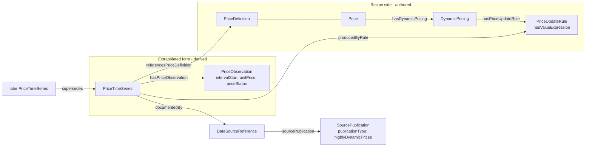

# SPEC-URPX-ONT-042 — Highly dynamic price series: the interchange payload

| Field | Value |
|-------|-------|
| **Status** | Proposed — open for working group review |
| **Author** | Flux Tailor |
| **Assignee** | Unassigned — open for any working-group member |
| **Delivered against** | URPX v0.3.0 candidate, branch `v0.3.0-wg-review`, commit `3d474cbd` |
| **Target release** | v0.5.0 (fully additive; no change required to the v0.3.0 candidate before its tag) |
| **Targets** | `ontology/urpx-ontology.ttl`, `shacl/urpx-shacl.ttl`, documentation pages, data dictionary regen |
| **Implementation task** | [backlog.task.urpx.ont.2026-07-19.highly-dynamic-price-series-implementation.md](../tasks/backlog.task.urpx.ont.2026-07-19.highly-dynamic-price-series-implementation.md) |
| **Samples** | [dev-docs/samples/comed-rrtp-hdp/](../samples/comed-rrtp-hdp/) · [dev-docs/samples/pge-nbt-export-series/](../samples/pge-nbt-export-series/) · [dev-docs/samples/pge-b6-pdp-event/](../samples/pge-b6-pdp-event/) |
| **Depends on** | SPEC-URPX-ONT-041 (value expressions describe how values are computed; this spec carries the computed values) |

**Terminology note.** URPX uses **highly dynamic prices** as the umbrella term for sub-daily resolved price streams — matching the existing `urpx:highlyDynamicPrices` publication type. "Real-Time Pricing" remains only as the specific rate plan type it names in industry usage (the `urpx:realTimePricing` enumeration member). See the companion terminology task.

## 1. Problem

A rate plan with highly dynamic prices has two faces:

1. **The recipe** — the plan's structure and calculation semantics: which charge slots exist, which drivers feed them, how the value is computed (SPEC-URPX-ONT-041).
2. **The extrapolated form** — the stream of resolved, time-stamped values a device or billing process actually consumes. This is the form machine-to-machine rate services exchange today: California's MIDAS server, for example, serves every rate as a streaming series of UTC intervals with one value per interval.

URPX v0.3.0 describes the recipe and *that* a component is dynamic (`DynamicPricing`, `priceSource`, `updateFrequency`, publication types `marketPriceFeed` and `highlyDynamicPrices`) but has **no vocabulary for the stream itself**. The ConEd SC1 test case works at monthly cadence because each value legitimately arrives as its own tariff filing; publishing a filing per five-minute interval is not a workable pattern. Without a standard payload, every URPX consumer invents its own series format at exactly the boundary where interoperability matters most.

## 2. Why not repeated `Price` instances? (reuse analysis)

The obligation to reuse before minting was tested against the existing vocabulary. One hour of one day, hourly resolution, in today's terms:

- A `urpx:Price` carries `unitPrice` and `startDate` — an `xsd:date`. Two values on the same day are indistinguishable without extra machinery: each hour needs a `TOUPeriod` + `TimeBracket` (or an `ApplicabilityGroup` with a condition tree) to pin its window. That is roughly 10–15 triples per interval; a year of hourly values approaches 100,000 triples of mostly scaffolding, against 3–4 triples per interval in the series encoding below.
- `Price` instances are **authored plan content** — they live inside a `PricingModel`, which is immutable published pricing material. A stream that appends values every hour would either mutate authored models daily or mint a pricing model per interval, misusing publication semantics either way. The resolved-values side of URPX (the derived snapshot) deliberately separates consolidation output from authored input; observations belong on that derived side.
- No `Price` property expresses settlement status (projected → provisional → final), so true-up — the ordinary lifecycle of every wholesale-indexed retail price — is inexpressible.

So the existing vocabulary *can* express a short price sequence, but not tractably and not with honest semantics at streaming cadence. The conclusion is a compact interchange pattern that reuses everything reusable:

| Reused as-is | Reused via domain widening (E-05) | Minted (E-01…E-04) |
|---|---|---|
| `IntervalTypeValue` (resolution enum) | `intervalType`, `effectiveDateTime`, `expirationDateTime`, `priceCurrency`, `unitPrice`, `touPeriodNumber`, `priceSource`, `documentedBy`, `referencesPriceDefinition`, `supersedes` | `PriceTimeSeries`, `PriceObservation`, `PriceStatusValue` (3 members), `hasPriceObservation`, `intervalStart`, `intervalEnd`, `priceStatus`, `producedByRule` |
| `PriceDefinition` (the charge slot a series resolves) | | |
| `DataSourceReference` / `SourcePublication` + `publicationType` | | |
| `DynamicPricing` / `PriceUpdateRule` (the recipe side) | | |
| `LocationDataSet` / `timezoneIdentifier` (local-time interpretation) | | |

Considered and not adopted: reusing `startDate`/`startTime` pairs for observation timing (two triples per interval and ambiguous across offset changes); reusing `effectiveDateTime` per observation (regulatory-effectiveness semantics, wrong for a measured interval); a `CoverageClaim` per series (the claim/evaluation machinery targets snapshots and cost models; a series' honesty is carried by its declared window, resolution, and per-value status).

> **Open investigation (added 2026-07-20) — reuse `Price` as the observation unit instead of minting `PriceObservation`?** This reuse analysis tested only repeated `Price` as-is (date-typed `startDate`) and concluded a mint was needed. It did not test the fact that `Price` **already carries `startDateTime`/`endDateTime`** (range `xsd:dateTime`, already admitted by the closed `PriceShape`) — so `Price` can already time an interval value to the instant. With that, an observation is close to a minimal `Price` (`startDateTime` ≈ `intervalStart`, `unitPrice` shared, `touPeriodNumber`'s domain already includes `Price`), and minting `PriceObservation` risks being a redundant parallel twin. Before ratifying the mint, evaluate using `Price` directly as the observation unit — **not by subclassing** (subclassing carries ongoing maintenance cost). The open question is whether the closed `PriceShape`'s fields that are permitted but meaningless for a resolved-interval value (`hasDynamicPricing`, `appliesInSeason`, the five-way price `sh:xone`) are acceptable on an observation, or whether a tighter dedicated unit is worth the parallel-class cost despite the reuse loss. Resolve this before the E-02 mint is treated as settled; it also feeds the observation-timing coherence question (`intervalStart`/`intervalEnd` vs. the existing `startDateTime`/`endDateTime`).

> **Third path under this investigation (profile-shape approach, added 2026-07-20).** Beyond "mint a class" and "reuse `Price` as-is," a middle path keeps observations typed as `urpx:Price` (no new class) and enforces the tight observation surface with a **separate, more closed node shape** dedicated to interval-value data, leaving `PriceShape` for authored plan content. It respects the model — a resolved interval value is arguably a `Price` in a different lifecycle role, not a new kind, and minting classes for roles is a known over-modeling smell — and it gives the lighter-weight, cleaner validation output a streaming payload wants (a four-property shape reports far better than a forty-property one). The load-bearing difficulty is **how a validator tells the two uses of `Price` apart.** A node is validated against every shape whose target matches it, and SHACL cannot delegate or suppress a shape, so `PriceShape` cannot "reject an observation and redirect it to the correct shape" — it can only be made to *fail* the observation, with no way to then exempt that node from `PriceShape` itself. A dedicated observation shape must therefore *target* observation instances, and the only discriminators for a same-typed node are context (`sh:targetObjectsOf urpx:hasPriceObservation`) or a SPARQL target — neither used anywhere in URPX today, where every shape targets by `sh:targetClass` and 81 are `sh:closed`. Consequences to weigh: an observation `Price` not reached through `hasPriceObservation` is validated only by the permissive `PriceShape`, so the tight surface silently does not apply; consumers lose the one-triple `rdf:type` dispatch an interchange payload leans on; and `PriceShape`'s verdict for a node becomes context-dependent. Against a class mint whose only extra cost is one class declaration plus one `rdf:type` triple per node — the tight closed shape (the "clean output" benefit) is obtained either way — the deciding question is ontological: **is a resolved interval observation the same *kind* as an authored `Price` (favoring reuse + a profile shape) or a distinct kind (favoring the mint)?** Record the chosen path here before E-02 is treated as settled. (Proposed direction, unnumbered: mint the class — it delivers the clean shape and keeps `rdf:type` dispatch — and drop the twin timing properties in favor of the existing `startDateTime`/`endDateTime`.)

## 3. Design



- A **`PriceTimeSeries`** is a derived artifact, sibling in spirit to the resolved snapshot: it declares which `PriceDefinition` it resolves, its resolution (`intervalType`), its coverage window (`effectiveDateTime`/`expirationDateTime`), and optionally the `PriceUpdateRule` that produced it — closing the loop to the value-expression recipe.
- A **`PriceObservation`** is one interval: a UTC `intervalStart`, a `unitPrice`, and optionally a settlement status and a TOU period number. Interval end is derived from the series resolution; `intervalEnd` exists only for irregular intervals.
- **Settlement status** makes true-up expressible: a later series of `finalPriceStatus` observations `supersedes` an earlier `projectedPriceStatus` one. *When* to re-publish stays out of vocabulary — only what a series *is* is standardized.
- **Publication fit:** a series document is described by a `SourcePublication` with `publicationType` `marketPriceFeed` or `highlyDynamicPrices` — both hooks already exist. Resolved snapshots keep their existing pattern (`PriceDefinitionReference` with `retrievedElsewhere` plus a source reference to the feed publication); they now have a standard shape to point at rather than an ad-hoc feed format.
- **Time semantics:** `intervalStart` values are UTC (`xsd:dateTime` with `Z`). Local-time interpretation (TOU labeling, day types, holidays) is governed by the plan's `timezoneIdentifier` and `LocationDataSet`, exactly as elsewhere in URPX.

This is an **optional conformance profile**: publishing series is never required for a valid rate plan; the profile standardizes the payload for those who do (the same normative-but-optional stance as the scenario-result profile).

## 4. Proposed edits

### E-01 — New class `urpx:PriceTimeSeries`

- [ ] Applied to candidate TTL
- [ ] Shape added

**Before:** (class does not exist)

**After:**

```turtle
urpx:PriceTimeSeries a owl:Class ;
    rdfs:label "Price Time Series"@en ;
    rdfs:comment "A derived, published stream of resolved price values for one price definition over a declared window at a declared resolution"@en ;
    skos:note "The extrapolated form of a highly dynamic price: the interval-value payload a consuming device or billing process reads, distinct from the authored recipe (PricingModel content and value expressions). Derived-side artifact: never published inside a tariff filing. Carries observations via hasPriceObservation; interval end times derive from intervalType unless an observation states its own intervalEnd. A later series for the same definition and window supersedes an earlier one (settlement true-up). Republication cadence is a publisher concern, out of vocabulary." .
```

**SHACL:** new shape:

```turtle
urpx-shacl:PriceTimeSeriesShape
    a sh:NodeShape ;
    rdfs:label "PriceTimeSeries Shape"@en ;
    sh:targetClass urpx:PriceTimeSeries ;
    sh:closed true ;
    sh:ignoredProperties ( rdf:type urpx:hasTemporalScope ) ;
    sh:property [ sh:path urpx:name ; sh:datatype xsd:string ; sh:minCount 0 ; sh:maxCount 1 ; ] ;
    sh:property [ sh:path urpx:description ; sh:datatype xsd:string ; sh:minCount 0 ; sh:maxCount 1 ; ] ;
    sh:property [ sh:path urpx:referencesPriceDefinition ; sh:class urpx:PriceDefinition ; sh:minCount 1 ; sh:maxCount 1 ; ] ;
    sh:property [ sh:path urpx:intervalType ; sh:node urpx-shacl:IntervalTypeValueShape ; sh:minCount 1 ; sh:maxCount 1 ; ] ;
    sh:property [ sh:path urpx:effectiveDateTime ; sh:datatype xsd:dateTime ; sh:minCount 1 ; sh:maxCount 1 ; ] ;
    sh:property [ sh:path urpx:expirationDateTime ; sh:datatype xsd:dateTime ; sh:minCount 0 ; sh:maxCount 1 ; ] ;
    sh:property [ sh:path urpx:priceCurrency ; sh:datatype xsd:string ; sh:maxLength 3 ; sh:minCount 0 ; sh:maxCount 1 ; ] ;
    sh:property [ sh:path urpx:priceSource ; sh:node urpx-shacl:PriceSourceValueShape ; sh:minCount 0 ; sh:maxCount 1 ; ] ;
    sh:property [ sh:path urpx:priceStatus ; sh:node urpx-shacl:PriceStatusValueShape ; sh:minCount 0 ; sh:maxCount 1 ; ] ;
    sh:property [ sh:path urpx:producedByRule ; sh:class urpx:PriceUpdateRule ; sh:minCount 0 ; sh:maxCount 1 ; ] ;
    sh:property [ sh:path urpx:documentedBy ; sh:class urpx:DataSourceReference ; sh:minCount 0 ; ] ;
    sh:property [ sh:path urpx:supersedes ; sh:class urpx:PriceTimeSeries ; sh:minCount 0 ; sh:maxCount 1 ; ] ;
    sh:property [ sh:path urpx:hasPriceObservation ; sh:class urpx:PriceObservation ; sh:minCount 1 ; ] .
```

One series carries values for exactly one price definition (one charge slot, one unit basis). Parallel components (import price, export price, demand charge) are parallel series — the same decomposition machine-to-machine rate services use.

### E-02 — New class `urpx:PriceObservation`

- [ ] Applied to candidate TTL
- [ ] Shape added

> Under investigation before this mint is settled — three resolution paths (see §2): (1) mint the class as written below; (2) reuse `Price` as the observation unit as-is; (3) reuse `Price` but validate observation data against a separate, more closed profile shape. All three want the tight surface shown below and should reuse the existing `startDateTime`/`endDateTime` rather than mint `intervalStart`/`intervalEnd`. The turtle below reflects path (1).

**Before:** (class does not exist)

**After:**

```turtle
urpx:PriceObservation a owl:Class ;
    rdfs:label "Price Observation"@en ;
    rdfs:comment "One interval of a price time series: interval start, resolved unit price, and optional settlement status"@en ;
    skos:note "Kept minimal by design so streaming-cadence series stay tractable. The interval end derives from the owning series' intervalType; state intervalEnd only for irregular intervals. Times are UTC; local-time interpretation is governed by the plan's timezone and location data set. Ordering within a series is by intervalStart; RDF list ordering is deliberately not used." .

urpx:hasPriceObservation a owl:ObjectProperty ;
    rdfs:label "Has Price Observation"@en ;
    rdfs:comment "Links a price time series to its interval observations"@en ;
    rdfs:domain urpx:PriceTimeSeries ;
    rdfs:range urpx:PriceObservation .

urpx:intervalStart a owl:DatatypeProperty ;
    rdfs:label "Interval Start"@en ;
    rdfs:comment "UTC start of the observation interval"@en ;
    rdfs:domain urpx:PriceObservation ;
    rdfs:range xsd:dateTime ;
    skos:note "ISO 8601 with UTC designator. Distinct from effectiveDateTime, which carries regulatory-effectiveness semantics." .

urpx:intervalEnd a owl:DatatypeProperty ;
    rdfs:label "Interval End"@en ;
    rdfs:comment "UTC end of the observation interval, exclusive; only for irregular intervals"@en ;
    rdfs:domain urpx:PriceObservation ;
    rdfs:range xsd:dateTime ;
    skos:note "Omit when the owning series' intervalType determines the interval length. Required when the series uses customInterval." .
```

**SHACL:** new shape:

```turtle
urpx-shacl:PriceObservationShape
    a sh:NodeShape ;
    rdfs:label "PriceObservation Shape"@en ;
    sh:targetClass urpx:PriceObservation ;
    sh:closed true ;
    sh:ignoredProperties ( rdf:type urpx:hasTemporalScope ) ;
    sh:property [ sh:path urpx:intervalStart ; sh:datatype xsd:dateTime ; sh:minCount 1 ; sh:maxCount 1 ; ] ;
    sh:property [ sh:path urpx:intervalEnd ; sh:datatype xsd:dateTime ; sh:minCount 0 ; sh:maxCount 1 ; ] ;
    sh:property [ sh:path urpx:unitPrice ; sh:datatype xsd:decimal ; sh:minCount 1 ; sh:maxCount 1 ; ] ;
    sh:property [ sh:path urpx:priceStatus ; sh:node urpx-shacl:PriceStatusValueShape ; sh:minCount 0 ; sh:maxCount 1 ; ] ;
    sh:property [ sh:path urpx:touPeriodNumber ; sh:datatype xsd:integer ; sh:minCount 0 ; sh:maxCount 1 ; ] .
```

### E-03 — New enumeration `urpx:PriceStatusValue`

- [ ] Applied to candidate TTL
- [ ] Shape added

**Before:** (enumeration does not exist)

**After:**

```turtle
urpx:PriceStatusValue a owl:Class ;
    rdfs:label "Price Status Value"@en ;
    rdfs:comment "Settlement lifecycle of an observed price value" ;
    owl:equivalentClass [ owl:oneOf ( urpx:projectedPriceStatus urpx:provisionalPriceStatus urpx:finalPriceStatus ) ] ;
    skos:note "Enumeration class for price observation settlement status. Distinct from ConfidenceValue, which grades the epistemic quality of authored pricing content; price status tracks where a value stands in the publication-to-settlement lifecycle." .

urpx:projectedPriceStatus rdf:type urpx:PriceStatusValue ;
    rdfs:label "Projected Price Status"@en ;
    skos:definition "A forecast or extrapolated value published ahead of its interval"@en ;
    skos:prefLabel "Projected"@en .

urpx:provisionalPriceStatus rdf:type urpx:PriceStatusValue ;
    rdfs:label "Provisional Price Status"@en ;
    skos:definition "A published value for an elapsed interval that remains subject to settlement revision"@en ;
    skos:prefLabel "Provisional"@en .

urpx:finalPriceStatus rdf:type urpx:PriceStatusValue ;
    rdfs:label "Final Price Status"@en ;
    skos:definition "A settled value no longer subject to revision"@en ;
    skos:prefLabel "Final"@en .

urpx:priceStatus a owl:ObjectProperty ;
    rdfs:label "Price Status"@en ;
    rdfs:comment "Settlement status of a price observation or, as a default, of a whole series"@en ;
    rdfs:domain [ a owl:Class ;
            owl:unionOf ( urpx:PriceTimeSeries urpx:PriceObservation ) ] ;
    rdfs:range urpx:PriceStatusValue ;
    skos:note "A series-level priceStatus is the default for all its observations; an observation-level priceStatus overrides it. When neither is stated the status is unspecified." .
```

**SHACL:** new value shape:

```turtle
urpx-shacl:PriceStatusValueShape
    a sh:NodeShape ;
    rdfs:label "PriceStatusValue Shape"@en ;
    sh:targetClass urpx:PriceStatusValue ;
    sh:nodeKind sh:IRI ;
    sh:in ( urpx:projectedPriceStatus urpx:provisionalPriceStatus urpx:finalPriceStatus ) .
```

### E-04 — New property `urpx:producedByRule`

- [ ] Applied to candidate TTL

**Before:** (property does not exist)

**After:**

```turtle
urpx:producedByRule a owl:ObjectProperty ;
    rdfs:label "Produced By Rule"@en ;
    rdfs:comment "Links a price time series to the price update rule whose calculation produced its values"@en ;
    rdfs:domain urpx:PriceTimeSeries ;
    rdfs:range urpx:PriceUpdateRule ;
    skos:note "Provenance link from the extrapolated form back to the recipe: the referenced rule's value expression states how each observation was computed from its drivers. Enables output-based conformance checking of the calculation." .
```

### E-05 — Domain widenings on ten reused properties

- [ ] Applied to candidate TTL

Each is a one-line change to an existing `rdfs:domain`; annotations are untouched except where quoted.

1. **`urpx:intervalType`** — domain union gains `urpx:PriceTimeSeries`:

   **Before:** `owl:unionOf ( urpx:BillingCycle urpx:CalculationMethod urpx:MetricSpecification )` **After:** `owl:unionOf ( urpx:BillingCycle urpx:CalculationMethod urpx:MetricSpecification urpx:PriceTimeSeries )`

2. **`urpx:effectiveDateTime`** — domain union gains `urpx:PriceTimeSeries`:

   **Before:** `owl:unionOf ( urpx:DataSourceReference urpx:RatePlan urpx:RatePlanModifier urpx:PricingModel urpx:SourcePublication urpx:URPXPackage urpx:TariffFiling urpx:PriceDefinition urpx:TOUSchedule urpx:Season urpx:HolidayCalendar urpx:ServiceTiers )` **After:** append `urpx:PriceTimeSeries` to the union.

3. **`urpx:expirationDateTime`** — same widening as 2.

4. **`urpx:priceCurrency`** — domain union gains `urpx:PriceTimeSeries` (series-level currency; the dual-level inheritance note already covers container-level declaration).

5. **`urpx:unitPrice`** — **Before:** `rdfs:domain urpx:Price ;` **After:**

   ```turtle
   rdfs:domain [ a owl:Class ;
           owl:unionOf ( urpx:Price urpx:PriceObservation ) ] ;
   ```

6. **`urpx:touPeriodNumber`** — domain union `( urpx:Price urpx:PriceDefinition urpx:PriceSet urpx:TOUPeriod )` gains `urpx:PriceObservation`.

7. **`urpx:priceSource`** — **Before:** `rdfs:domain urpx:DynamicPricing ;` **After:**

   ```turtle
   rdfs:domain [ a owl:Class ;
           owl:unionOf ( urpx:DynamicPricing urpx:PriceTimeSeries ) ] ;
   ```

8. **`urpx:documentedBy`** — domain union `( urpx:PricingModel urpx:PriceDefinitionReference )` gains `urpx:PriceTimeSeries`.

9. **`urpx:referencesPriceDefinition`** — domain union `( urpx:Price urpx:PriceSet urpx:PriceSetAlternative urpx:PriceDefinitionReference )` gains `urpx:PriceTimeSeries`.

10. **`urpx:supersedes`** — domain and range unions `( urpx:PricingModel urpx:TariffFiling )` each gain `urpx:PriceTimeSeries`, and the class-level `skos:note` gains one sentence:

    **Append to note:** "A price time series supersedes the earlier series it revises for the same price definition and window (settlement true-up)."

No existing SHACL shape changes: every widened property is constrained per-class by the new shapes in E-01/E-02, and existing shapes do not target the new classes.

### E-06 — Declare the two feed publication-type members

- [ ] Applied to candidate TTL

`urpx:marketPriceFeed` and `urpx:highlyDynamicPrices` are members of the `urpx:SourcePublicationType` enumeration but today exist only as bare IRIs inside its `owl:oneOf` and the corresponding `sh:in` — no labels, no definitions. This spec depends on both, so it adds their declarations:

**Before:** (no individual declarations)

**After:**

```turtle
urpx:marketPriceFeed rdf:type urpx:SourcePublicationType ;
    rdfs:label "Market Price Feed"@en ;
    skos:definition "A published stream of wholesale market or index prices used as a pricing driver"@en ;
    skos:prefLabel "Market Price Feed"@en .

urpx:highlyDynamicPrices rdf:type urpx:SourcePublicationType ;
    rdfs:label "Highly Dynamic Prices"@en ;
    skos:definition "A published stream of resolved retail price values at sub-daily cadence"@en ;
    skos:prefLabel "Highly Dynamic Prices"@en .
```

The four other undeclared members of this enumeration (`tariffSupplement`, `tariffAddendum`, `supplyCharges`, `derExports`) are out of scope here.

## 5. Worked example

A three-observation excerpt of the shape (full-day, fully valid instances live in the linked samples):

```turtle
ex:series-hourly-supply-20260115-da a urpx:PriceTimeSeries ;
    urpx:name "Hourly supply price, 2026-01-15, day-ahead" ;
    urpx:referencesPriceDefinition ex:pd-hourly-energy-supply ;
    urpx:intervalType urpx:hourlyInterval ;
    urpx:effectiveDateTime "2026-01-15T06:00:00Z"^^xsd:dateTime ;
    urpx:expirationDateTime "2026-01-16T06:00:00Z"^^xsd:dateTime ;
    urpx:priceCurrency "USD" ;
    urpx:priceSource urpx:wholesaleMarketSource ;
    urpx:priceStatus urpx:projectedPriceStatus ;
    urpx:producedByRule ex:pur-hourly-supply ;
    urpx:hasPriceObservation
        [ a urpx:PriceObservation ; urpx:intervalStart "2026-01-15T06:00:00Z"^^xsd:dateTime ; urpx:unitPrice "0.03135"^^xsd:decimal ] ,
        [ a urpx:PriceObservation ; urpx:intervalStart "2026-01-15T07:00:00Z"^^xsd:dateTime ; urpx:unitPrice "0.03835"^^xsd:decimal ] ,
        [ a urpx:PriceObservation ; urpx:intervalStart "2026-01-15T08:00:00Z"^^xsd:dateTime ; urpx:unitPrice "0.04235"^^xsd:decimal ] .
```

A settled series for the same day later supersedes it:

```turtle
ex:series-hourly-supply-20260115-final a urpx:PriceTimeSeries ;
    urpx:supersedes ex:series-hourly-supply-20260115-da ;
    urpx:priceStatus urpx:finalPriceStatus ;
    # same definition, window, resolution; settled values
    .
```

## 6. Explicit non-goals

Honoring the settled vocabulary boundaries:

- **No materialized lookup index** (TOU matrix or equivalent) — an index consumers build.
- **No pruning or execution hints.**
- **No endpoint service levels** — discovery metadata is SPEC-URPX-ONT-043; service levels are a publisher concern.
- **No republication cadence rules** — when to supersede a projected series with a final one is governed by the publisher's settlement process, not by vocabulary.

## 7. Proposed design-decision log entries

To be numbered in the canonical design-decision log at ratification, not before:

1. **Series and observation as derived-side classes.** Streams of resolved values are not authored `Price` content; encoding them as repeated prices was analyzed and rejected (triple weight, date-only granularity, immutability misuse, no settlement status).
2. **Settlement status as a three-member enumeration** distinct from `ConfidenceValue`; series-level default with observation-level override.
3. **Maximal reuse via domain widening** — ten existing properties widened instead of minting parallel ones.

## 8. Acceptance criteria

1. Both `.ttl` files parse; all existing test cases validate with zero new violations.
2. The linked samples validate against the merged candidate + edit set, including one supersession pair (projected → final).
3. A negative test: a `PriceObservation` without `intervalStart` or `unitPrice` fails validation; an observation with a status outside the enumeration fails.
4. Data dictionary regenerates cleanly; the two newly declared publication-type members appear with definitions.

## 9. Open questions

1. **Status member naming.** `projectedPriceStatus` / `provisionalPriceStatus` / `finalPriceStatus` follow the `…Status` member convention; shorter bare names collide with `ConfidenceValue`'s `projected`. Is the verbosity acceptable?
2. **Correction parity.** Series carry `supersedes` only. Should `replaces`/`cancelledBy` also widen to series for same-window corrections and withdrawals, mirroring tariff filings? (Lean: defer until a publisher needs to void rather than supersede a series.)
3. **Snapshot linkage.** Resolved snapshots reference feed publications through the existing source-reference machinery. Should a direct snapshot-to-series property be added, or does the publication-level link suffice? (Lean: publication-level suffices; a direct link adds a second path to the same fact.)
4. **Observation compactness.** Is the JSON-LD weight of one node per observation acceptable up to five-minute resolution, or should a packed literal encoding (e.g. a values array with a base timestamp) be profiled for very high cadence? (Lean: keep nodes; packing sacrifices SHACL validation of individual values.)
