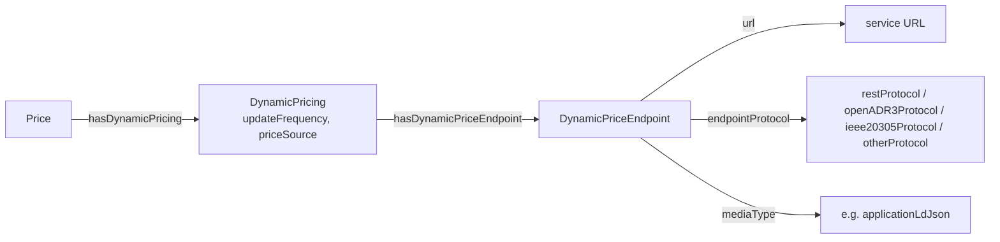

# SPEC-URPX-ONT-043 — Dynamic price discovery and output-based conformance

| Field | Value |
|-------|-------|
| **Status** | Proposed — open for working group review |
| **Author** | Flux Tailor |
| **Assignee** | Unassigned — open for any working-group member |
| **Delivered against** | URPX v0.3.0 candidate, branch `v0.3.0-wg-review`, commit `3d474cbd` |
| **Target release** | v0.5.0 (fully additive; no change required to the v0.3.0 candidate before its tag) |
| **Targets** | `ontology/urpx-ontology.ttl`, `shacl/urpx-shacl.ttl`, `test-cases/`, documentation pages |
| **Implementation task** | [backlog.task.urpx.ont.2026-07-19.dynamic-price-discovery-and-conformance-implementation.md](../tasks/backlog.task.urpx.ont.2026-07-19.dynamic-price-discovery-and-conformance-implementation.md) |
| **Samples** | [dev-docs/samples/comed-rrtp-hdp/](../samples/comed-rrtp-hdp/) (endpoint + conformance vector) · [dev-docs/samples/pge-b6-pdp-event/](../samples/pge-b6-pdp-event/) (event-day vector) |
| **Depends on** | SPEC-URPX-ONT-041 (expressions being verified), SPEC-URPX-ONT-042 (series carrying vector inputs/outputs) |

## 1. Problem

Two gaps remain after the calculation semantics (041) and the payload (042) land:

1. **Discovery.** A consumer holding a rate plan with dynamic components has no machine-readable way to learn *where* the live values are served and *in what shape*. Today this is prose inside descriptions and ad-hoc source-reference URLs.
2. **Verification.** Conformance for dynamic components must be asserted through expected outputs for test cases — never through "ships an expression tree". The test-case catalog has no expected-output vectors for dynamic components, so two implementations cannot yet prove they compute the same prices from the same recipe.

## 2. Design

### 2.1 Discovery: `DynamicPriceEndpoint` (descriptive only)

A small descriptive class attached to `DynamicPricing`. URPX says where the values are served, over which protocol family, and in what payload shape; everything operational (service levels, authentication schemes, quotas) stays with the publisher.



Update cadence is *not* repeated on the endpoint: the owning `DynamicPricing` already carries `updateFrequency`.

### 2.2 Verification: expected-output conformance vectors

A conformance vector is pure URPX data — no new vocabulary:

- **Given:** the plan's recipe (its `PriceUpdateRule` with a value expression, SPEC-URPX-ONT-041) and its driver values (a `marketPriceFeed` `PriceTimeSeries` of, for example, wholesale prices for one day).
- **Expected:** the resolved retail values (a `highlyDynamicPrices` `PriceTimeSeries` for the same window).
- **Pass:** an implementation that evaluates the recipe against the drivers produces values decimal-equal to the expected series (after applying any `roundOperator` the expression states).

Because inputs and expected outputs are themselves price time series, the vector format needs no invention, validates under the same shapes, and exercises the vocabulary it tests. Vectors join the test-case catalog with a `test_case_id` like any fixture set.

Two initial vectors accompany this spec as samples (promoted to `test-cases/` on adoption):

| Vector | Recipe exercised | Driver series | Expected series |
|---|---|---|---|
| Wholesale pass-through day | `add` (wholesale price + fixed adder) | one day of hourly wholesale prices | one day of hourly retail supply prices |
| Event-day conditional | `ConditionalValueNode` (event adder over TOU base) | event flag + base values | event-day prices with the adder applied during event hours |

## 3. Proposed edits

### E-01 — New class `urpx:DynamicPriceEndpoint` + attachment

- [ ] Applied to candidate TTL
- [ ] Shape added

**Before:** (class does not exist)

**After:**

```turtle
urpx:DynamicPriceEndpoint a owl:Class ;
    rdfs:label "Dynamic Price Endpoint"@en ;
    rdfs:comment "Descriptive metadata for a service endpoint where live values of a dynamic price are published"@en ;
    skos:note "Says where and in what shape live price values are served: service URL, protocol family, payload media type, and whether authentication is required. Descriptive only: service levels, authentication schemes, and availability are publisher concerns outside URPX. The update cadence is carried by the owning DynamicPricing's updateFrequency." .

urpx:hasDynamicPriceEndpoint a owl:ObjectProperty ;
    rdfs:label "Has Dynamic Price Endpoint"@en ;
    rdfs:comment "Links a dynamic pricing configuration to the endpoints where its live values are served"@en ;
    rdfs:domain urpx:DynamicPricing ;
    rdfs:range urpx:DynamicPriceEndpoint .

urpx:requiresAuthentication a owl:DatatypeProperty ;
    rdfs:label "Requires Authentication"@en ;
    rdfs:comment "Whether reading the endpoint requires authentication"@en ;
    rdfs:domain urpx:DynamicPriceEndpoint ;
    rdfs:range xsd:boolean ;
    skos:note "Descriptive flag only; the authentication scheme is a publisher concern." .
```

**SHACL:** new shape plus one insert:

```turtle
urpx-shacl:DynamicPriceEndpointShape
    a sh:NodeShape ;
    rdfs:label "DynamicPriceEndpoint Shape"@en ;
    sh:targetClass urpx:DynamicPriceEndpoint ;
    sh:closed true ;
    sh:ignoredProperties ( rdf:type urpx:hasTemporalScope ) ;
    sh:property [ sh:path urpx:name ; sh:datatype xsd:string ; sh:minCount 0 ; sh:maxCount 1 ; ] ;
    sh:property [ sh:path urpx:description ; sh:datatype xsd:string ; sh:minCount 0 ; sh:maxCount 1 ; ] ;
    sh:property [ sh:path urpx:url ; sh:datatype xsd:anyURI ; sh:minCount 1 ; sh:maxCount 1 ; ] ;
    sh:property [ sh:path urpx:endpointProtocol ; sh:node urpx-shacl:EndpointProtocolValueShape ; sh:minCount 0 ; sh:maxCount 1 ; ] ;
    sh:property [ sh:path urpx:mediaType ; sh:node urpx-shacl:MediaTypeValueShape ; sh:minCount 0 ; sh:maxCount 1 ; ] ;
    sh:property [ sh:path urpx:requiresAuthentication ; sh:datatype xsd:boolean ; sh:minCount 0 ; sh:maxCount 1 ; ] .
```

Add to `urpx-shacl:DynamicPricingShape`:

```turtle
    sh:property [
        sh:path urpx:hasDynamicPriceEndpoint ;
        sh:class urpx:DynamicPriceEndpoint ;
        sh:minCount 0 ;
    ] ;
```

### E-02 — New enumeration `urpx:EndpointProtocolValue`

- [ ] Applied to candidate TTL
- [ ] Shape added

**Before:** (enumeration does not exist)

**After:**

```turtle
urpx:EndpointProtocolValue a owl:Class ;
    rdfs:label "Endpoint Protocol Value"@en ;
    rdfs:comment "Protocol family enumeration for dynamic price endpoints" ;
    owl:equivalentClass [ owl:oneOf ( urpx:restProtocol urpx:openADR3Protocol urpx:ieee20305Protocol urpx:otherProtocol ) ] ;
    skos:note "Coarse protocol hint for consumers selecting a client; not a full protocol binding." .

urpx:restProtocol rdf:type urpx:EndpointProtocolValue ;
    rdfs:label "REST Protocol"@en ;
    skos:definition "Plain HTTP/REST endpoint"@en ;
    skos:prefLabel "REST"@en .

urpx:openADR3Protocol rdf:type urpx:EndpointProtocolValue ;
    rdfs:label "OpenADR 3 Protocol"@en ;
    skos:definition "OpenADR 3.x program interface"@en ;
    skos:prefLabel "OpenADR 3"@en .

urpx:ieee20305Protocol rdf:type urpx:EndpointProtocolValue ;
    rdfs:label "IEEE 2030.5 Protocol"@en ;
    skos:definition "IEEE 2030.5 (Smart Energy Profile) interface"@en ;
    skos:prefLabel "IEEE 2030.5"@en .

urpx:otherProtocol rdf:type urpx:EndpointProtocolValue ;
    rdfs:label "Other Protocol"@en ;
    skos:definition "A protocol family not otherwise enumerated; describe in the endpoint description"@en ;
    skos:prefLabel "Other"@en .

urpx:endpointProtocol a owl:ObjectProperty ;
    rdfs:label "Endpoint Protocol"@en ;
    rdfs:comment "Protocol family of a dynamic price endpoint"@en ;
    rdfs:domain urpx:DynamicPriceEndpoint ;
    rdfs:range urpx:EndpointProtocolValue .
```

**SHACL:** new value shape:

```turtle
urpx-shacl:EndpointProtocolValueShape
    a sh:NodeShape ;
    rdfs:label "EndpointProtocolValue Shape"@en ;
    sh:targetClass urpx:EndpointProtocolValue ;
    sh:nodeKind sh:IRI ;
    sh:in ( urpx:restProtocol urpx:openADR3Protocol urpx:ieee20305Protocol urpx:otherProtocol ) .
```

### E-03 — Reuse widenings: `urpx:url` and `urpx:mediaType`; one media-type member

- [ ] Applied to candidate TTL

1. **`urpx:url`** — domain union gains `urpx:DynamicPriceEndpoint`:

   **Before:** `owl:unionOf ( urpx:SourcePublication urpx:URPXPackage urpx:RatePlan urpx:RatePlanVersion urpx:RatePlanModifier urpx:RatePlanModifierVersion urpx:DataSourceReference urpx:ProgramEnrollment urpx:RateCase )` **After:** append `urpx:DynamicPriceEndpoint` to the union.

2. **`urpx:mediaType`** — **Before:** `rdfs:domain urpx:DataSourceReference ;` **After:**

   ```turtle
   rdfs:domain [ a owl:Class ;
           owl:unionOf ( urpx:DataSourceReference urpx:DynamicPriceEndpoint ) ] ;
   ```

3. **`urpx:MediaTypeValue`** gains one member so a JSON-LD payload (the URPX `PriceTimeSeries` shape) is declarable:

   **Before (`owl:oneOf`):** `( urpx:applicationJson urpx:applicationPdf urpx:applicationVndMsExcel urpx:applicationVndOasisOpendocumentSpreadsheet urpx:applicationVndOasisOpendocumentText urpx:applicationVndOpenxmlformatsOfficedocumentSpreadsheetmlSheet urpx:imageGif urpx:imageJpeg urpx:imagePng urpx:textCsv urpx:textHtml urpx:textPlain urpx:textRtf urpx:textXml )`

   **After:** insert `urpx:applicationLdJson` (alphabetically after `urpx:applicationJson`), plus the individual and the matching `sh:in` update in the media-type value shape:

   ```turtle
   urpx:applicationLdJson rdf:type urpx:MediaTypeValue ;
       rdfs:label "application/ld+json"@en ;
       skos:definition "JSON-LD media type"@en ;
       skos:prefLabel "JSON-LD"@en .
   ```

### E-04 — Conformance vectors join the test-case catalog

- [ ] Vector fixture sets prepared
- [ ] Catalog rows added

No vocabulary. On adoption, the two vector sample sets move from `dev-docs/samples/` into `test-cases/` as fixture folders (existing folder conventions: `data/*.jsonld` + `assets/` + index row), with catalog notes naming what each vector proves. The pass criterion — computed values decimal-equal to the expected series — is recorded in each vector's README and in the quality-assurance documentation page.

## 4. Worked example

```turtle
ex:dp-hourly-supply a urpx:DynamicPricing ;
    urpx:dynamicPricingType urpx:realTimePricing ;
    urpx:priceSource urpx:wholesaleMarketSource ;
    urpx:updateFrequency urpx:hourlyUpdates ;
    urpx:hasDynamicPriceEndpoint [
        a urpx:DynamicPriceEndpoint ;
        urpx:name "Hourly price feed" ;
        urpx:url "https://example.com/api/prices/hourly"^^xsd:anyURI ;
        urpx:endpointProtocol urpx:restProtocol ;
        urpx:mediaType urpx:applicationLdJson ;
        urpx:requiresAuthentication false ;
    ] .
```

## 5. Proposed design-decision log entries

To be numbered in the canonical design-decision log at ratification, not before:

1. **Endpoint discovery is descriptive metadata in an optional profile**; serving infrastructure stays out of scope.
2. **Conformance for dynamic components is output-based**: expected-output vectors expressed as price time series, never structural inspection of expression trees.

## 6. Acceptance criteria

1. Both `.ttl` files parse; existing test cases validate with zero new violations.
2. The endpoint block in the ComEd sample validates; an endpoint without `url` fails validation.
3. Both conformance vectors validate as series pairs, and an independent hand evaluation of the recipe against the driver series reproduces the expected values exactly.

## 7. Open questions

1. **Protocol enumeration scope.** Are four families (REST, OpenADR 3, IEEE 2030.5, other) the right starting set, or should the enumeration stay out of vocabulary entirely (free-text hint) until adopters demand comparability?
2. **Vector tolerance.** Decimal equality after expression-stated rounding is the proposed pass criterion. Is an explicit tolerance ever acceptable (for example for implementations computing in binary floating point), or is exact decimal arithmetic a conformance requirement?
3. **Driver binding.** A vector's driver series feeds a specific `MetricInput` referenced by the recipe's value expression, but that binding is currently declared in the vector's README, not in vocabulary (the driver series references the externally-minted price definition, while the expression references the metric input). Should a property linking a `MetricInput` to the series that supplies its values be added, or is per-vector declaration sufficient?
4. **Non-price drivers.** Event-triggered rates are driven by event signals, not prices; a boolean event stream does not belong in a `PriceTimeSeries`. The working position is that event signaling stays with the demand-response protocols (OpenADR) and URPX carries only the resulting prices — confirm or revisit.
