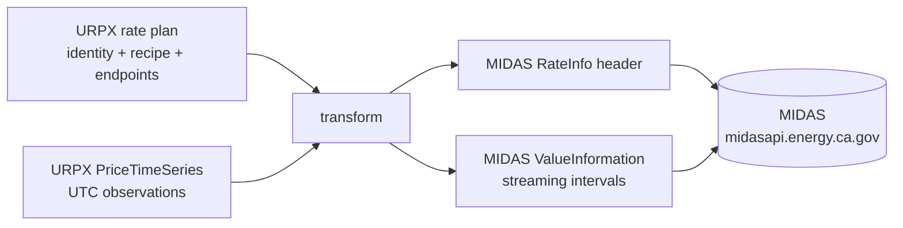

# SPEC-URPX-ONT-044 — URPX to MIDAS transform

| Field | Value |
|-------|-------|
| **Status** | Proposed — open for working group review |
| **Delivered against** | URPX v0.3.0 candidate, branch `v0.3.0-wg-review`, commit `3d474cbd`; MIDAS v2.0 (June 2026), `https://github.com/california-energy-commission/MIDAS` |
| **Target release** | v0.4.0 documentation/tooling; **no ontology or SHACL changes** |
| **Targets** | documentation pages (interoperability), `scripts/` (reference transform, follow-up) |
| **Implementation task** | [backlog.task.urpx.ont.2026-07-19.urpx-to-midas-transform.md](../tasks/backlog.task.urpx.ont.2026-07-19.urpx-to-midas-transform.md) |
| **Samples** | [dev-docs/samples/midas-transform/](../samples/midas-transform/) |
| **Depends on** | SPEC-URPX-ONT-041 (recipes), SPEC-URPX-ONT-042 (series), SPEC-URPX-ONT-043 (endpoints) |

## 1. Purpose

MIDAS — the California Energy Commission's Market Informed Demand Automation Server — is the operating machine-to-machine channel for time-varying electricity rates in California: under the CEC's Load Management Standards, the largest utilities and CCAs must keep it populated with all time-varying rate values, and since 2024 every customer bill carries a Rate Identification Number (RIN) pointing into it. MIDAS serves each rate as a streaming series of UTC intervals — exactly what URPX calls the extrapolated form of a highly dynamic price.

URPX already anchors to MIDAS on the identity side: a `RatePlanIdentifier` with scheme `urpx:ca-midas-rin` carries the RIN. This spec completes the bridge on the values side: a normative mapping from URPX rate plans and price time series to the MIDAS v2.0 upload schema, so that a rate plan maintained in URPX can populate MIDAS mechanically. The transform direction URPX → MIDAS comes first; it lets URPX act as the richer authoring and interchange layer while MIDAS remains the serving channel.

## 2. Header mapping (URPX → MIDAS RateInfo)

| MIDAS field | URPX source | Notes |
|---|---|---|
| `RateID` (RIN) | `RatePlanIdentifier` with `urpx:scheme urpx:ca-midas-rin`, `skos:notation` | Already the standard URPX carriage of the RIN. Format `CCSS-DDEE-RRRR-LLLL…`. |
| `RateName` | `RatePlan` `urpx:name` | Must stay consistent with the CEC Interval Meter Database naming (CCR Title 20 § 1344). |
| `RateType` | derived; see §3 | Ten-code enumeration. |
| `Sector` | derived from `EligibilityRule` customer-class conditions | `Res`, `Com`, `Ind`, `Agr`, `All`, EV variants; default `All` when underdetermined (open question 2). |
| `RatePlan_Url` | `RatePlan` `urpx:url` | Tariff document link. |
| `API_Url` | `DynamicPriceEndpoint` `urpx:url` (SPEC-URPX-ONT-043) | The publisher's own live endpoint, when one exists. |
| `AltRateName1/2` | additional plan identifiers (`utility-tariff-code` notation) | Optional. |
| `SignupCloseDate` | — | No URPX equivalent today; emit null (open question 3). |
| `EndUse` | — | Emit null unless the plan is scoped to an end use by eligibility (EV, battery, solar). |

## 3. RateType derivation

MIDAS types a rate with one code; URPX states structure. The derivation:

| URPX structure | MIDAS `RateType` |
|---|---|
| `TOUSchedule` present, no `DynamicPricing` | `TOU` |
| `dynamicPricingType urpx:realTimePricing` | `RTP` |
| `dynamicPricingType urpx:criticalPeakPricing` | `CPP` |
| `dynamicPricingType urpx:timeVaryingPricing` (no event machinery) | `TOU` |
| a time-differentiated `CalculationMethod` (hourly or interval-differentiated values) with no `TOUSchedule` and no `DynamicPricing` | `TOU` (time-differentiated, no event or real-time machinery) |
| any of the above **plus** a demand-charge price definition | demand variant: `T-D` / `R-D` / `C-D` |
| `dynamicPricingType urpx:eventDrivenPricing` or `demandResponsePricing` | no clean single code — transform requires an explicit per-plan override (`VPP` and `DSR` exist in MIDAS but do not correspond one-to-one to URPX enumeration members) |

The transform must fail loudly, not guess, when the derivation is ambiguous.

**Mapping a `RatePlanModifier` component.** A modifier that publishes its own value stream (an export compensation component, for example) is not a full rate plan. When the transform source is a modifier component rather than a `RatePlan`, the `RateName`/`RateType`/`Sector` describe that component stream, and `Sector` is taken from the modifier's stated applicability (for example, a residential-only Net Billing Tariff maps to `Res`) rather than from a full plan's eligibility rule. Where the applicability is not machine-modeled, this is a documented simplification for the worked example, not a general derivation.

## 4. Values mapping (URPX `PriceObservation` → MIDAS `ValueData`)

One MIDAS `ValueData` entry per observation, nine fields:

| MIDAS field | URPX source | Notes |
|---|---|---|
| `DateStart` / `TimeStart` | `intervalStart` | Both sides are UTC; split into date and time parts. |
| `DateEnd` / `TimeEnd` | `intervalEnd`, or `intervalStart` + resolution | MIDAS uses an inclusive end (`…:59:59`); subtract one second from the exclusive URPX end. |
| `Value` | `unitPrice` | Decimal. **Sign rule:** URPX carries credits as negative unit prices; MIDAS export prices are positive values meaning payment to the customer. For `export $/kWh` streams the transform negates the URPX value; all other units pass through unchanged. |
| `Unit` | from the referenced `PriceDefinition` | `chargeType urpx:exportCredit` → `export $/kWh`; demand charges → `$/kW`; reactive → `$/kvarh`; energy default → `$/kWh`. One URPX series maps to one MIDAS unit stream; parallel URPX series for the same RIN become MIDAS's parallel per-unit entries. |
| `ValueName` | series `name`, refined by `touPeriodNumber` → TOU period label when present | ≤ 50 characters. |
| `DayStart` / `DayEnd` | derived: local day-of-week of the interval under the plan's `timezoneIdentifier`; holidays (day type 8) from the plan's location data set | MIDAS day types 1–7 = Monday–Sunday, 8 = holiday. |

**Constraints the transform enforces (from the MIDAS upload rules):**

1. Series `intervalType` must be `fiveMinuteInterval`, `fifteenMinuteInterval`, or `hourlyInterval` — MIDAS accepts exactly these three; the interval is locked to a RIN at first upload and cannot change.
2. All unit streams in one upload share the same interval and the same count of entries; the transform zero-fills declared gaps and reports them (MIDAS emits `MISSING_INTERVAL` / `DATA_GAP` warnings).
3. Streams must be gap-free over the window (streaming format: one entry per interval even when the value repeats). Days with daylight-saving transitions carry 23 or 25 hourly intervals; the local day-type derivation must use the plan's timezone, while all wire times stay UTC.
4. `priceCurrency`, when stated, must be `USD` — MIDAS has no currency abstraction (it is embedded in the unit codes). Any other currency is a hard transform error.

## 5. Information-loss and lifecycle analysis

The transform is deliberately lossy in documented ways; URPX remains the richer record.

| URPX concept | MIDAS fate |
|---|---|
| `priceStatus` (projected / provisional / final) | Dropped: MIDAS has no per-value status. Projected and settled values upload alike; MIDAS serves one blended stream. |
| `supersedes` chain between series | Collapses to MIDAS replace-on-upload: each new upload replaces a RIN's value table (prior values move to MIDAS history). One URPX superseding series = one upload. |
| Value expressions, coverage claims, provenance | Not representable; remain URPX-side. |
| Structured eligibility and applicability | Collapse to `Sector` + prose. |

Nothing in MIDAS is unrepresentable in URPX, so a future reverse transform (MIDAS → URPX series) is straightforward; it is out of scope here.

## 6. Deliverables

1. **This mapping** (normative once adopted), summarized on the interoperability documentation page.
2. **A reference transform** (companion task): reads a URPX package plus its price time series, emits a MIDAS v2.0 upload payload (JSON, per the published upload schema), validates the constraints in §4, and reports the §5 losses. Known schema quirks to honor: the upload examples key the RIN as `"RIN"` while the XSD and responses use `RateID`; the data dictionary marks `Value`/`Unit` optional but the XSD requires them — the transform treats all nine value fields as required.
3. **A worked example**: the PG&E Net Billing Tariff hourly export compensation series transformed to a MIDAS upload payload — [dev-docs/samples/midas-transform/](../samples/midas-transform/). The export case is the better demonstration because it exercises the credit sign flip (§4) and the modifier-component header mapping (§3).

## 7. Proposed design-decision log entry

To be numbered at ratification: **URPX-to-MIDAS field mapping adopted as the normative bridge to California's rate server; transform fails loudly on ambiguous rate typing; documented one-way information loss accepted (status, lifecycle, provenance stay URPX-side).**

## 8. Acceptance criteria

1. The worked example payload validates against the published MIDAS upload schema and passes its documented validation rules (no `UNEQUAL_INTERVAL`, `INTERVAL_MISMATCH`, or `INVALID_RIN` errors).
2. Every mapping row in §2 and §4 is exercised by the worked example or explicitly marked not-exercised in the sample README.
3. A URPX series violating a §4 constraint (wrong resolution, non-USD currency, gap) makes the reference transform fail with a named error.

## 9. Open questions

1. **RateType overrides.** Should the per-plan override for ambiguous typing (§3) be an input to the transform only, or is a small URPX annotation slot (an identifier-scheme-style declared MIDAS rate type) worth standardizing?
2. **Sector derivation.** Deriving MIDAS `Sector` from eligibility conditions is heuristic. Accept `All` as the safe default, or require an explicit sector input per transform run?
3. **Signup close date.** MIDAS carries `SignupCloseDate` (last date a customer may opt in). URPX has no enrollment-window property. Worth a small vocabulary addition later, or leave null?
