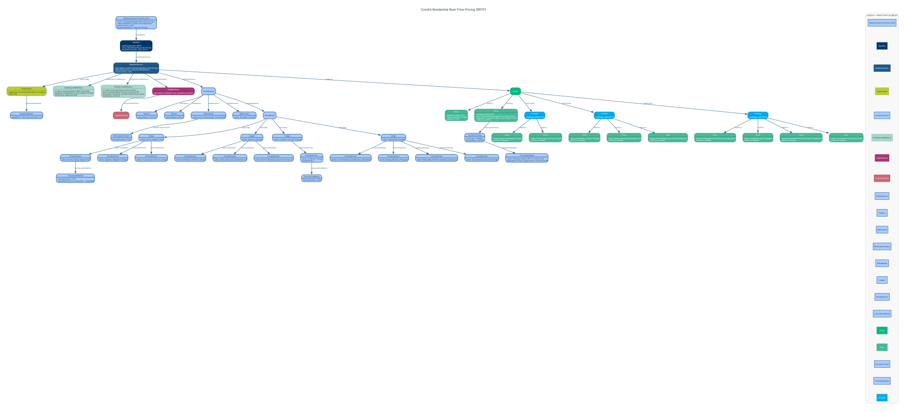

<!-- SPDX-FileCopyrightText: Flux Tailor LLC -->
<!-- SPDX-License-Identifier: Apache-2.0 -->
<!-- SPDX-Transition-License-After-Draft: W3C-20231102 -->
<!-- AUTO-GENERATED by urpx-website-dev/scripts/codegen/generate-example-graphviz.py — DO NOT HAND-EDIT -->
---
title: "Residential Real-Time Pricing (RRTP)"
utility: "Commonwealth Edison Company"
slug: "comed-rrtp"
---

# Residential Real-Time Pricing (RRTP)

**Utility:** Commonwealth Edison Company

ComEd's Residential Real-Time Pricing program where hourly supply prices are based on PJM day-ahead LMP plus a retail adder. Demonstrates DynamicPricing with realTimePricing type, PriceUpdateRule for wholesale market integration, seasonal structure, and a full billing model with supply, delivery, service, and adjustment ledgers.



## JSON-LD source

```json
{
  "@context": {
    "urpx": "https://schema.urpx.org/",
    "schema": "http://schema.org/",
    "xsd": "http://www.w3.org/2001/XMLSchema#",
    "org": "https://example.com/organizations/",
    "comed": "https://example.com/comed/",
    "urpx:unitPrice": { "@type": "xsd:decimal" },
    "urpx:effectiveDate": { "@type": "xsd:date" },
    "urpx:effectiveDateTime": { "@type": "xsd:dateTime" },
    "urpx:baseQuantity": { "@type": "xsd:decimal" },
    "urpx:startTime": { "@type": "xsd:time" },
    "urpx:endTime": { "@type": "xsd:time" },
    "urpx:initialEffectiveDate": { "@type": "xsd:date" },
    "urpx:startDate": { "@type": "xsd:date" },
    "urpx:url": { "@type": "xsd:anyURI" },
    "urpx:month": { "@type": "xsd:gMonth" },
    "urpx:intervalDuration": { "@type": "xsd:duration" },
    "urpx:touTierNumber": { "@type": "xsd:integer" },
    "urpx:touPeriodNumber": { "@type": "xsd:integer" },
    "urpx:priceCeiling": { "@type": "xsd:decimal" },
    "urpx:priceFloor": { "@type": "xsd:decimal" }
  },
  "@type": "urpx:HighlyDynamicPricesDocument",
  "@id": "comed:hdp-rrtp-001",
  "urpx:name": "ComEd Residential Real-Time Pricing (RRTP)",
  "urpx:effectiveDateTime": "2026-01-01T00:00:00",
  "urpx:priceCurrency": "USD",
  "urpx:timezoneIdentifier": "America/Chicago",
  "urpx:hasRatePlan": {
    "@type": "urpx:RatePlan",
    "@id": "comed:rrtp",
    "urpx:ratePlanIdentifier": "RRTP",
    "urpx:name": "Residential Real-Time Pricing",
    "urpx:initialEffectiveDate": "2007-01-01",
    "urpx:hasRatePlanVersion": {
      "@type": "urpx:RatePlanVersion",
      "@id": "comed:rrtp-2026-01-01",
      "urpx:publishedBy": {
        "@type": "urpx:Organization",
        "@id": "org:utility-comed",
        "urpx:legalName": "Commonwealth Edison Company",
        "urpx:eiaId": "4110",
        "urpx:organizationType": { "@id": "urpx:utilityOrganization" },
        "urpx:participatesInMarket": {
          "@type": "urpx:SystemOperator",
          "@id": "org:iso-pjm",
          "urpx:legalName": "PJM Interconnection LLC",
          "urpx:organizationType": { "@id": "urpx:isoOrganization" }
        }
      },
      "urpx:description": "ComEd's Residential Real-Time Pricing program allows residential customers to pay hourly electricity supply prices based on the PJM day-ahead wholesale market Locational Marginal Price (LMP) for the ComEd zone, plus a retail adder. Delivery charges remain fixed per the standard delivery tariff. Participants receive day-ahead hourly price signals to enable load shifting.",
      "urpx:effectiveDateTime": "2026-01-01T00:00:00",
      "urpx:changeReason": { "@id": "urpx:rateCase" },
      "urpx:priceCurrency": "USD",
      "urpx:commodity": { "@id": "urpx:electricity" },
      "urpx:serviceRole": { "@id": "urpx:bundledServiceRole" },
      "urpx:hasDataSourceReference": [
        {
          "@type": "urpx:DataSourceReference",
          "urpx:url": "file://./assets/ComEd_RRTP_Tariff_2026-01-01.pdf",
          "urpx:fileName": "ComEd_RRTP_Tariff_2026-01-01.pdf",
          "urpx:mediaType": "application/pdf"
        },
        {
          "@type": "urpx:DataSourceReference",
          "@id": "comed:dsr-live-prices",
          "urpx:url": "https://hourlypricing.comed.com/live-prices/",
          "urpx:name": "ComEd Hourly Pricing Live Prices API",
          "urpx:description": "Real-time and day-ahead hourly pricing data feed for ComEd RRTP program. Provides current and next-day hourly prices based on PJM wholesale market LMP.",
          "urpx:mediaType": "text/html"
        }
      ],
      "urpx:hasEligibilityRule": [
        {
          "@type": "urpx:EligibilityRule",
          "@id": "comed:er-rrtp-residential",
          "urpx:hasCustomerProfile": {
            "@id": "comed:cp-residential",
            "@type": "urpx:CustomerProfile",
            "urpx:hasCustomerKind": { "@id": "urpx:residentialKind" }
          },
          "urpx:description": "Available to all residential customers in ComEd's service territory with an interval meter (smart meter). Customer must enroll through an approved retail electricity supplier or through ComEd's hourly pricing program."
        }
      ],
      "urpx:hasPlanElements": {
        "@type": "urpx:PlanElements",
        "urpx:hasSeasons": [
          {
            "@type": "urpx:Season",
            "@id": "comed:season-summer",
            "urpx:seasonName": "Summer",
            "urpx:month": [
              "--06",
              "--07",
              "--08",
              "--09"
            ]
          },
          {
            "@type": "urpx:Season",
            "@id": "comed:season-winter",
            "urpx:seasonName": "Winter",
            "urpx:month": [
              "--10",
              "--11",
              "--12",
              "--01",
              "--02",
              "--03",
              "--04",
              "--05"
            ]
          }
        ],
        "urpx:hasMetricInput": [
          {
            "@type": "urpx:MetricInput",
            "@id": "comed:mi-energy",
            "urpx:name": "Hourly kWh Energy Consumption",
            "urpx:metricInputType": { "@id": "urpx:measuredMetricInput" },
            "urpx:hasMetricSpecification": {
              "@type": "urpx:MetricSpecification",
              "@id": "comed:ms-energy",
              "urpx:measurementKind": { "@id": "urpx:energy" },
              "urpx:unitOfMeasure": { "@id": "urpx:kWh" },
              "urpx:flowDirection": { "@id": "urpx:forward" },
              "urpx:intervalDuration": "PT1H"
            }
          },
          {
            "@type": "urpx:MetricInput",
            "@id": "comed:mi-meter-count",
            "urpx:name": "Per Meter Charges",
            "urpx:metricInputType": { "@id": "urpx:profileMetricInput" },
            "urpx:profileMetricProperty": { "@id": "urpx:numberOfMeters" }
          }
        ],
        "urpx:hasBillingModel": {
          "@type": "urpx:BillingModel",
          "urpx:hasLedger": [
            {
              "@type": "urpx:Ledger",
              "@id": "comed:ledger-supply",
              "urpx:name": "Hourly Supply Prices",
              "urpx:ledgerType": { "@id": "urpx:supplyLedger" },
              "urpx:referencesMetricInput": { "@id": "comed:mi-energy" },
              "urpx:hasPriceDefinition": [
                {
                  "@type": "urpx:PriceDefinition",
                  "@id": "comed:pd-hourly-energy-supply",
                  "urpx:name": "Hourly Energy Supply Price",
                  "urpx:chargeType": { "@id": "urpx:usageCharge" },
                  "urpx:chargeCategory": { "@id": "urpx:auxiliaryCharge" },
                  "urpx:billPortion": { "@id": "urpx:supplyPortion" },
                  "urpx:hasCalculationMethod": {
                    "@type": "urpx:CalculationMethod",
                    "urpx:intervalDuration": "PT1H",
                    "urpx:calculationFormula": "hourlyLMP + retailAdder"
                  }
                },
                {
                  "@type": "urpx:PriceDefinition",
                  "@id": "comed:pd-capacity-obligation",
                  "urpx:name": "Capacity Obligation Charge",
                  "urpx:chargeType": { "@id": "urpx:usageCharge" },
                  "urpx:chargeCategory": { "@id": "urpx:auxiliaryCharge" },
                  "urpx:billPortion": { "@id": "urpx:supplyPortion" }
                },
                {
                  "@type": "urpx:PriceDefinition",
                  "@id": "comed:pd-transmission-services",
                  "urpx:name": "Transmission Services Charge",
                  "urpx:chargeType": { "@id": "urpx:transmission" },
                  "urpx:chargeCategory": { "@id": "urpx:adjustment" },
                  "urpx:billPortion": { "@id": "urpx:supplyPortion" }
                }
              ]
            },
            {
              "@type": "urpx:Ledger",
              "@id": "comed:ledger-delivery",
              "urpx:name": "Delivery Charges",
              "urpx:ledgerType": { "@id": "urpx:deliveryLedger" },
              "urpx:referencesMetricInput": { "@id": "comed:mi-energy" },
              "urpx:hasPriceDefinition": [
                {
                  "@type": "urpx:PriceDefinition",
                  "@id": "comed:pd-distribution-facilities",
                  "urpx:name": "Distribution Facilities Charge",
                  "urpx:chargeType": { "@id": "urpx:usageCharge" },
                  "urpx:chargeCategory": { "@id": "urpx:infrastructure" },
                  "urpx:billPortion": { "@id": "urpx:deliveryPortion" }
                },
                {
                  "@type": "urpx:PriceDefinition",
                  "@id": "comed:pd-il-electricity-distribution-tax",
                  "urpx:name": "Illinois Electricity Distribution Tax",
                  "urpx:chargeType": { "@id": "urpx:taxCharge" },
                  "urpx:chargeCategory": { "@id": "urpx:taxes" },
                  "urpx:billPortion": { "@id": "urpx:deliveryPortion" }
                },
                {
                  "@type": "urpx:PriceDefinition",
                  "@id": "comed:pd-storm-hardening",
                  "urpx:name": "Storm Hardening and Infrastructure Investment",
                  "urpx:chargeType": { "@id": "urpx:reliabilityCharge" },
                  "urpx:chargeCategory": { "@id": "urpx:infrastructure" },
                  "urpx:billPortion": { "@id": "urpx:deliveryPortion" }
                }
              ]
            },
            {
              "@type": "urpx:Ledger",
              "@id": "comed:ledger-service",
              "urpx:name": "Customer Service Charges",
              "urpx:ledgerType": { "@id": "urpx:bundledLedger" },
              "urpx:referencesMetricInput": { "@id": "comed:mi-meter-count" },
              "urpx:hasPriceDefinition": {
                "@type": "urpx:PriceDefinition",
                "@id": "comed:pd-customer-charge",
                "urpx:name": "Customer Charge",
                "urpx:chargeType": { "@id": "urpx:minimumBill" },
                "urpx:chargeCategory": { "@id": "urpx:serviceCharge" },
                "urpx:billPortion": { "@id": "urpx:bundledPortion" },
                "urpx:baseQuantity": "1",
                "urpx:hasCalculationMethod": {
                  "@type": "urpx:CalculationMethod",
                  "urpx:intervalDuration": "P1M"
                }
              }
            },
            {
              "@type": "urpx:Ledger",
              "@id": "comed:ledger-adjustments",
              "urpx:name": "Adjustment Charges",
              "urpx:ledgerType": { "@id": "urpx:bundledLedger" },
              "urpx:referencesMetricInput": { "@id": "comed:mi-energy" },
              "urpx:hasPriceDefinition": [
                {
                  "@type": "urpx:PriceDefinition",
                  "@id": "comed:pd-environmental-cost-recovery",
                  "urpx:name": "Environmental Cost Recovery Adjustment",
                  "urpx:chargeType": { "@id": "urpx:environmentalFunding" },
                  "urpx:chargeCategory": { "@id": "urpx:environmental" },
                  "urpx:billPortion": { "@id": "urpx:bundledPortion" }
                },
                {
                  "@type": "urpx:PriceDefinition",
                  "@id": "comed:pd-energy-efficiency",
                  "urpx:name": "Energy Efficiency Programs",
                  "urpx:chargeType": { "@id": "urpx:publicBenefits" },
                  "urpx:chargeCategory": { "@id": "urpx:regulatory" },
                  "urpx:billPortion": { "@id": "urpx:bundledPortion" }
                },
                {
                  "@type": "urpx:PriceDefinition",
                  "@id": "comed:pd-renewable-portfolio-standard",
                  "urpx:name": "Renewable Portfolio Standard Compliance",
                  "urpx:chargeType": { "@id": "urpx:environmentalFunding" },
                  "urpx:chargeCategory": { "@id": "urpx:environmental" },
                  "urpx:billPortion": { "@id": "urpx:bundledPortion" }
                },
                {
                  "@type": "urpx:PriceDefinition",
                  "@id": "comed:pd-zero-emission-credit",
                  "urpx:name": "Zero Emission Standard Charge",
                  "urpx:chargeType": { "@id": "urpx:environmentalFunding" },
                  "urpx:chargeCategory": { "@id": "urpx:environmental" },
                  "urpx:billPortion": { "@id": "urpx:bundledPortion" }
                }
              ]
            }
          ]
        }
      },
      "urpx:hasPrices": {
        "@type": "urpx:Prices",
        "urpx:hasPrice": [
          {
            "@type": "urpx:Price",
            "@id": "comed:price-customer-charge-v2026-01-01",
            "urpx:referencesPriceDefinition": { "@id": "comed:pd-customer-charge" },
            "urpx:startDate": "2026-01-01",
            "urpx:name": "Customer Charge",
            "urpx:unitPrice": "12.34"
          },
          {
            "@type": "urpx:Price",
            "@id": "comed:price-hourly-energy-supply-v2026-01-01",
            "urpx:referencesPriceDefinition": { "@id": "comed:pd-hourly-energy-supply" },
            "urpx:startDate": "2026-01-01",
            "urpx:name": "Hourly Energy Supply Price (Day-Ahead LMP + Retail Adder)",
            "urpx:description": "This price varies hourly based on the PJM day-ahead wholesale Locational Marginal Price for the ComEd zone, plus a fixed retail adder. The unitPrice shown is the retail adder component; the hourly LMP component is externally sourced.",
            "urpx:unitPrice": "0.00735",
            "urpx:hasDynamicPricing": {
              "@type": "urpx:DynamicPricing",
              "@id": "comed:dp-hourly-lmp",
              "urpx:dynamicPricingType": { "@id": "urpx:realTimePricing" },
              "urpx:priceSource": { "@id": "urpx:wholesaleMarketSource" },
              "urpx:updateFrequency": { "@id": "urpx:hourlyUpdates" },
              "urpx:priceFloor": "0.00000",
              "urpx:priceCeiling": "2.00000",
              "urpx:hasPriceUpdateRule": {
                "@type": "urpx:PriceUpdateRule",
                "@id": "comed:pur-day-ahead-lmp",
                "urpx:name": "PJM Day-Ahead LMP for ComEd Zone",
                "urpx:description": "Hourly supply price is set to the PJM day-ahead Locational Marginal Price (LMP) for the ComEd pricing zone, published by PJM by 16:00 EST for the following operating day. Each hour has a distinct price. Total supply cost = sum of (hourly LMP + retail adder) * hourly kWh consumption. Live prices available at https://hourlypricing.comed.com/live-prices/"
              }
            }
          }
        ],
        "urpx:hasPriceSet": [
          {
            "@type": "urpx:PriceSet",
            "@id": "comed:ps-supply-adders",
            "urpx:startDate": "2026-01-01",
            "urpx:hasPrice": [
              {
                "@type": "urpx:Price",
                "@id": "comed:price-capacity-obligation-v2026-01-01",
                "urpx:referencesPriceDefinition": { "@id": "comed:pd-capacity-obligation" },
                "urpx:name": "Capacity Obligation Charge",
                "urpx:unitPrice": "0.02418"
              },
              {
                "@type": "urpx:Price",
                "@id": "comed:price-transmission-services-v2026-01-01",
                "urpx:referencesPriceDefinition": { "@id": "comed:pd-transmission-services" },
                "urpx:name": "Transmission Services Charge",
                "urpx:unitPrice": "0.01892"
              }
            ]
          },
          {
            "@type": "urpx:PriceSet",
            "@id": "comed:ps-delivery-charges",
            "urpx:startDate": "2026-01-01",
            "urpx:hasPrice": [
              {
                "@type": "urpx:Price",
                "@id": "comed:price-distribution-facilities-v2026-01-01",
                "urpx:referencesPriceDefinition": { "@id": "comed:pd-distribution-facilities" },
                "urpx:name": "Distribution Facilities Charge",
                "urpx:unitPrice": "0.03124"
              },
              {
                "@type": "urpx:Price",
                "@id": "comed:price-il-electricity-distribution-tax-v2026-01-01",
                "urpx:referencesPriceDefinition": { "@id": "comed:pd-il-electricity-distribution-tax" },
                "urpx:name": "Illinois Electricity Distribution Tax",
                "urpx:unitPrice": "0.00113"
              },
              {
                "@type": "urpx:Price",
                "@id": "comed:price-storm-hardening-v2026-01-01",
                "urpx:referencesPriceDefinition": { "@id": "comed:pd-storm-hardening" },
                "urpx:name": "Storm Hardening and Infrastructure Investment",
                "urpx:unitPrice": "0.00486"
              }
            ]
          },
          {
            "@type": "urpx:PriceSet",
            "@id": "comed:ps-adjustments",
            "urpx:startDate": "2026-01-01",
            "urpx:hasPrice": [
              {
                "@type": "urpx:Price",
                "@id": "comed:price-environmental-cost-recovery-v2026-01-01",
                "urpx:referencesPriceDefinition": { "@id": "comed:pd-environmental-cost-recovery" },
                "urpx:name": "Environmental Cost Recovery Adjustment",
                "urpx:unitPrice": "0.00198"
              },
              {
                "@type": "urpx:Price",
                "@id": "comed:price-energy-efficiency-v2026-01-01",
                "urpx:referencesPriceDefinition": { "@id": "comed:pd-energy-efficiency" },
                "urpx:name": "Energy Efficiency Programs",
                "urpx:unitPrice": "0.00241"
              },
              {
                "@type": "urpx:Price",
                "@id": "comed:price-renewable-portfolio-standard-v2026-01-01",
                "urpx:referencesPriceDefinition": { "@id": "comed:pd-renewable-portfolio-standard" },
                "urpx:name": "Renewable Portfolio Standard Compliance",
                "urpx:unitPrice": "0.00312"
              },
              {
                "@type": "urpx:Price",
                "@id": "comed:price-zero-emission-credit-v2026-01-01",
                "urpx:referencesPriceDefinition": { "@id": "comed:pd-zero-emission-credit" },
                "urpx:name": "Zero Emission Standard Charge",
                "urpx:unitPrice": "0.00178"
              }
            ]
          }
        ]
      }
    }
  }
}
```

