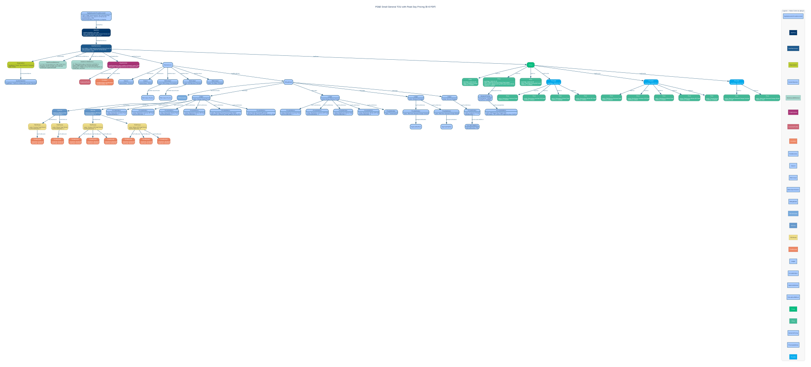

<!-- SPDX-FileCopyrightText: Flux Tailor LLC -->
<!-- SPDX-License-Identifier: Apache-2.0 -->
<!-- SPDX-Transition-License-After-Draft: W3C-20231102 -->
<!-- AUTO-GENERATED by urpx-website-dev/scripts/codegen/generate-example-graphviz.py — DO NOT HAND-EDIT -->
---
title: "Small General TOU with Peak Day Pricing (B-6 PDP)"
utility: "Pacific Gas & Electric Company"
slug: "pge-b6-pdp"
---

# Small General TOU with Peak Day Pricing (B-6 PDP)

**Utility:** Pacific Gas & Electric Company

PG&E's small general service time-of-use rate with a Peak Day Pricing overlay. On PDP event days (up to 15 per year), peak period prices (14:00–18:00) are replaced with a critical peak adder. Demonstrates DynamicPricing with criticalPeakPricing type, TOUSchedule with peak/off-peak tiers, demand charges, and event-triggered PriceUpdateRule driven by CAISO grid conditions.



## JSON-LD source

```json
{
  "@context": {
    "urpx": "https://schema.urpx.org/",
    "schema": "http://schema.org/",
    "xsd": "http://www.w3.org/2001/XMLSchema#",
    "org": "https://example.com/organizations/",
    "pge": "https://example.com/pge/",
    "urpx:unitPrice": { "@type": "xsd:decimal" },
    "urpx:effectiveDate": { "@type": "xsd:date" },
    "urpx:effectiveDateTime": { "@type": "xsd:dateTime" },
    "urpx:baseQuantity": { "@type": "xsd:decimal" },
    "urpx:startTime": { "@type": "xsd:time" },
    "urpx:endTime": { "@type": "xsd:time" },
    "urpx:initialEffectiveDate": { "@type": "xsd:date" },
    "urpx:startDate": { "@type": "xsd:date" },
    "urpx:url": { "@type": "xsd:anyURI" },
    "urpx:month": { "@type": "xsd:gMonth" },
    "urpx:intervalDuration": { "@type": "xsd:duration" },
    "urpx:touTierNumber": { "@type": "xsd:integer" },
    "urpx:touPeriodNumber": { "@type": "xsd:integer" },
    "urpx:priceCeiling": { "@type": "xsd:decimal" },
    "urpx:priceFloor": { "@type": "xsd:decimal" }
  },
  "@type": "urpx:HighlyDynamicPricesDocument",
  "@id": "pge:hdp-b6-cpp-001",
  "urpx:name": "PG&E Small General TOU with Peak Day Pricing (B-6 PDP)",
  "urpx:effectiveDateTime": "2026-01-01T00:00:00",
  "urpx:priceCurrency": "USD",
  "urpx:timezoneIdentifier": "America/Los_Angeles",
  "urpx:hasRatePlan": {
    "@type": "urpx:RatePlan",
    "@id": "pge:b6-pdp",
    "urpx:ratePlanIdentifier": "B-6-PDP",
    "urpx:name": "Small General Time-of-Use Service with Peak Day Pricing",
    "urpx:initialEffectiveDate": "2021-03-01",
    "urpx:hasRatePlanVersion": {
      "@type": "urpx:RatePlanVersion",
      "@id": "pge:b6-pdp-2026-01-01",
      "urpx:publishedBy": {
        "@type": "urpx:Organization",
        "@id": "org:utility-pge",
        "urpx:legalName": "Pacific Gas & Electric Company",
        "urpx:eiaId": "14328",
        "urpx:organizationType": { "@id": "urpx:utilityOrganization" },
        "urpx:participatesInMarket": {
          "@type": "urpx:SystemOperator",
          "@id": "org:iso-caiso",
          "urpx:legalName": "California Independent System Operator",
          "urpx:organizationType": { "@id": "urpx:isoOrganization" }
        }
      },
      "urpx:description": "Small general service time-of-use rate with a Peak Day Pricing (PDP) overlay. On PDP event days (up to 15 per year, called day-ahead), prices during the peak period (14:00-18:00) are replaced with a significantly higher critical peak price. Non-event hours retain standard TOU pricing. PDP events are triggered by extreme heat forecasts or grid stress conditions via CAISO.",
      "urpx:effectiveDateTime": "2026-01-01T00:00:00",
      "urpx:changeReason": { "@id": "urpx:rateCase" },
      "urpx:priceCurrency": "USD",
      "urpx:commodity": { "@id": "urpx:electricity" },
      "urpx:serviceRole": { "@id": "urpx:bundledServiceRole" },
      "urpx:hasDataSourceReference": [
        {
          "@type": "urpx:DataSourceReference",
          "urpx:url": "file://./assets/PGE_B-6_PDP_2026-01-01.pdf",
          "urpx:fileName": "ELEC_SCHEDS_B-6-PDP.pdf",
          "urpx:mediaType": "application/pdf"
        },
        {
          "@type": "urpx:DataSourceReference",
          "@id": "pge:dsr-hourly-flex-pricing",
          "urpx:url": "https://www.pge.com/en/account/rate-plans/hourly-flex-pricing.html",
          "urpx:name": "PG&E Hourly Flex Pricing Information",
          "urpx:description": "PG&E's hourly flex pricing program page with dynamic pricing details, event day notifications, and rate plan information for Peak Day Pricing participants.",
          "urpx:mediaType": "text/html"
        }
      ],
      "urpx:hasEligibilityRule": [
        {
          "@type": "urpx:EligibilityRule",
          "@id": "pge:er-b6-pdp-commercial",
          "urpx:hasCustomerProfile": {
            "@id": "pge:cp-small-commercial",
            "@type": "urpx:CustomerProfile",
            "urpx:hasCustomerKind": { "@id": "urpx:commercialKind" }
          },
          "urpx:logicExpression": "pge:condition-demand-under-75kw",
          "urpx:hasCondition": [
            {
              "@id": "pge:condition-demand-under-75kw",
              "@type": "urpx:Condition",
              "urpx:conditionType": "maxDemand",
              "urpx:operator": { "@id": "urpx:lessThanOrEqualsOperator" },
              "urpx:conditionValue": "75"
            }
          ],
          "urpx:description": "Small general service customers with maximum demand of 75 kW or less. Must have interval metering for PDP participation."
        }
      ],
      "urpx:hasPlanElements": {
        "@type": "urpx:PlanElements",
        "urpx:hasSeasons": [
          {
            "@type": "urpx:Season",
            "@id": "pge:season-summer",
            "urpx:seasonName": "Summer",
            "urpx:month": [
              "--06",
              "--07",
              "--08",
              "--09"
            ]
          },
          {
            "@type": "urpx:Season",
            "@id": "pge:season-winter",
            "urpx:seasonName": "Winter",
            "urpx:month": [
              "--10",
              "--11",
              "--12",
              "--01",
              "--02",
              "--03",
              "--04",
              "--05"
            ]
          }
        ],
        "urpx:hasMetricInput": [
          {
            "@type": "urpx:MetricInput",
            "@id": "pge:mi-energy-b6",
            "urpx:name": "kWh Energy Consumption",
            "urpx:metricInputType": { "@id": "urpx:measuredMetricInput" },
            "urpx:hasMetricSpecification": {
              "@type": "urpx:MetricSpecification",
              "@id": "pge:ms-energy-b6",
              "urpx:measurementKind": { "@id": "urpx:energy" },
              "urpx:unitOfMeasure": { "@id": "urpx:kWh" },
              "urpx:flowDirection": { "@id": "urpx:forward" }
            }
          },
          {
            "@type": "urpx:MetricInput",
            "@id": "pge:mi-demand-b6",
            "urpx:name": "kW Maximum Demand",
            "urpx:metricInputType": { "@id": "urpx:measuredMetricInput" },
            "urpx:hasMetricSpecification": {
              "@type": "urpx:MetricSpecification",
              "@id": "pge:ms-demand-b6",
              "urpx:measurementKind": { "@id": "urpx:demand" },
              "urpx:unitOfMeasure": { "@id": "urpx:kW" },
              "urpx:flowDirection": { "@id": "urpx:forward" }
            }
          },
          {
            "@type": "urpx:MetricInput",
            "@id": "pge:mi-meter-count-b6",
            "urpx:name": "Per Meter Charges",
            "urpx:metricInputType": { "@id": "urpx:profileMetricInput" },
            "urpx:profileMetricProperty": { "@id": "urpx:numberOfMeters" }
          }
        ],
        "urpx:hasBillingModel": {
          "@type": "urpx:BillingModel",
          "urpx:hasTOUSchedule": {
            "@type": "urpx:TOUSchedule",
            "@id": "pge:tou-b6-pdp",
            "urpx:referencesMetricInput": { "@id": "pge:mi-energy-b6" },
            "urpx:hasTOUTier": [
              {
                "@type": "urpx:TOUTier",
                "@id": "pge:tou-tier-b6-peak",
                "urpx:tierSourceName": "Peak",
                "urpx:touTierStandardName": { "@id": "urpx:peakTier" },
                "urpx:touTierNumber": 1,
                "urpx:hasTOUPeriod": [
                  {
                    "@type": "urpx:TOUPeriod",
                    "@id": "pge:tou-period-b6-summer-peak",
                    "urpx:name": "Summer Peak Period",
                    "urpx:touPeriodNumber": 1,
                    "urpx:hasTimeBracket": [
                      {
                        "@type": "urpx:TimeBracket",
                        "@id": "pge:tb-b6-summer-peak",
                        "urpx:startTime": "12:00:00",
                        "urpx:endTime": "18:00:00",
                        "urpx:appliesInSeason": { "@id": "pge:season-summer" },
                        "urpx:dayType": { "@id": "urpx:weekdays" }
                      }
                    ]
                  },
                  {
                    "@type": "urpx:TOUPeriod",
                    "@id": "pge:tou-period-b6-winter-peak",
                    "urpx:name": "Winter Peak Period",
                    "urpx:touPeriodNumber": 2,
                    "urpx:hasTimeBracket": [
                      {
                        "@type": "urpx:TimeBracket",
                        "@id": "pge:tb-b6-winter-peak",
                        "urpx:startTime": "16:00:00",
                        "urpx:endTime": "21:00:00",
                        "urpx:appliesInSeason": { "@id": "pge:season-winter" },
                        "urpx:dayType": { "@id": "urpx:weekdays" }
                      }
                    ]
                  }
                ]
              },
              {
                "@type": "urpx:TOUTier",
                "@id": "pge:tou-tier-b6-off-peak",
                "urpx:tierSourceName": "Off-Peak",
                "urpx:touTierStandardName": { "@id": "urpx:offPeakTier" },
                "urpx:touTierNumber": 2,
                "urpx:hasTOUPeriod": [
                  {
                    "@type": "urpx:TOUPeriod",
                    "@id": "pge:tou-period-b6-summer-off-peak",
                    "urpx:name": "Summer Off-Peak Period",
                    "urpx:touPeriodNumber": 3,
                    "urpx:hasTimeBracket": [
                      {
                        "@type": "urpx:TimeBracket",
                        "@id": "pge:tb-b6-summer-off-peak-1",
                        "urpx:startTime": "00:00:00",
                        "urpx:endTime": "12:00:00",
                        "urpx:appliesInSeason": { "@id": "pge:season-summer" },
                        "urpx:dayType": { "@id": "urpx:allDays" }
                      },
                      {
                        "@type": "urpx:TimeBracket",
                        "@id": "pge:tb-b6-summer-off-peak-2",
                        "urpx:startTime": "18:00:00",
                        "urpx:endTime": "00:00:00",
                        "urpx:appliesInSeason": { "@id": "pge:season-summer" },
                        "urpx:dayType": { "@id": "urpx:weekdays" }
                      },
                      {
                        "@type": "urpx:TimeBracket",
                        "@id": "pge:tb-b6-summer-off-peak-weekend",
                        "urpx:startTime": "00:00:00",
                        "urpx:endTime": "00:00:00",
                        "urpx:appliesInSeason": { "@id": "pge:season-summer" },
                        "urpx:dayType": { "@id": "urpx:weekendsAndHolidays" }
                      }
                    ]
                  },
                  {
                    "@type": "urpx:TOUPeriod",
                    "@id": "pge:tou-period-b6-winter-off-peak",
                    "urpx:name": "Winter Off-Peak Period",
                    "urpx:touPeriodNumber": 4,
                    "urpx:hasTimeBracket": [
                      {
                        "@type": "urpx:TimeBracket",
                        "@id": "pge:tb-b6-winter-off-peak-1",
                        "urpx:startTime": "00:00:00",
                        "urpx:endTime": "16:00:00",
                        "urpx:appliesInSeason": { "@id": "pge:season-winter" },
                        "urpx:dayType": { "@id": "urpx:allDays" }
                      },
                      {
                        "@type": "urpx:TimeBracket",
                        "@id": "pge:tb-b6-winter-off-peak-2",
                        "urpx:startTime": "21:00:00",
                        "urpx:endTime": "00:00:00",
                        "urpx:appliesInSeason": { "@id": "pge:season-winter" },
                        "urpx:dayType": { "@id": "urpx:weekdays" }
                      },
                      {
                        "@type": "urpx:TimeBracket",
                        "@id": "pge:tb-b6-winter-off-peak-weekend",
                        "urpx:startTime": "00:00:00",
                        "urpx:endTime": "00:00:00",
                        "urpx:appliesInSeason": { "@id": "pge:season-winter" },
                        "urpx:dayType": { "@id": "urpx:weekendsAndHolidays" }
                      }
                    ]
                  }
                ]
              }
            ]
          },
          "urpx:hasLedger": [
            {
              "@type": "urpx:Ledger",
              "@id": "pge:ledger-b6-supply",
              "urpx:name": "Energy Supply Prices",
              "urpx:ledgerType": { "@id": "urpx:supplyLedger" },
              "urpx:referencesMetricInput": { "@id": "pge:mi-energy-b6" },
              "urpx:hasPriceDefinition": [
                {
                  "@type": "urpx:PriceDefinition",
                  "@id": "pge:pd-b6-gen-summer-peak",
                  "urpx:name": "Generation Summer Peak",
                  "urpx:chargeType": { "@id": "urpx:usageCharge" },
                  "urpx:chargeCategory": { "@id": "urpx:auxiliaryCharge" },
                  "urpx:billPortion": { "@id": "urpx:supplyPortion" },
                  "urpx:touPeriodNumber": 1
                },
                {
                  "@type": "urpx:PriceDefinition",
                  "@id": "pge:pd-b6-gen-summer-off-peak",
                  "urpx:name": "Generation Summer Off-Peak",
                  "urpx:chargeType": { "@id": "urpx:usageCharge" },
                  "urpx:chargeCategory": { "@id": "urpx:auxiliaryCharge" },
                  "urpx:billPortion": { "@id": "urpx:supplyPortion" },
                  "urpx:touPeriodNumber": 3
                },
                {
                  "@type": "urpx:PriceDefinition",
                  "@id": "pge:pd-b6-gen-winter-peak",
                  "urpx:name": "Generation Winter Peak",
                  "urpx:chargeType": { "@id": "urpx:usageCharge" },
                  "urpx:chargeCategory": { "@id": "urpx:auxiliaryCharge" },
                  "urpx:billPortion": { "@id": "urpx:supplyPortion" },
                  "urpx:touPeriodNumber": 2
                },
                {
                  "@type": "urpx:PriceDefinition",
                  "@id": "pge:pd-b6-gen-winter-off-peak",
                  "urpx:name": "Generation Winter Off-Peak",
                  "urpx:chargeType": { "@id": "urpx:usageCharge" },
                  "urpx:chargeCategory": { "@id": "urpx:auxiliaryCharge" },
                  "urpx:billPortion": { "@id": "urpx:supplyPortion" },
                  "urpx:touPeriodNumber": 4
                },
                {
                  "@type": "urpx:PriceDefinition",
                  "@id": "pge:pd-b6-pdp-critical-peak",
                  "urpx:name": "Peak Day Pricing Critical Peak Adder",
                  "urpx:chargeType": { "@id": "urpx:usageCharge" },
                  "urpx:chargeCategory": { "@id": "urpx:auxiliaryCharge" },
                  "urpx:billPortion": { "@id": "urpx:supplyPortion" },
                  "urpx:description": "Additional charge applied during PDP event hours (14:00-18:00) on designated Peak Day Pricing event days. This adder is on top of the standard peak TOU price."
                },
                {
                  "@type": "urpx:PriceDefinition",
                  "@id": "pge:pd-b6-pdp-credit",
                  "urpx:name": "Peak Day Pricing Bill Credit",
                  "urpx:chargeType": { "@id": "urpx:creditEnergy" },
                  "urpx:chargeCategory": { "@id": "urpx:adjustment" },
                  "urpx:billPortion": { "@id": "urpx:supplyPortion" },
                  "urpx:description": "Monthly bill credit applied to offset the risk of PDP events. Reduces the standard peak rate to provide a net discount on non-event days."
                }
              ]
            },
            {
              "@type": "urpx:Ledger",
              "@id": "pge:ledger-b6-delivery",
              "urpx:name": "Energy Delivery Prices",
              "urpx:ledgerType": { "@id": "urpx:deliveryLedger" },
              "urpx:referencesMetricInput": { "@id": "pge:mi-energy-b6" },
              "urpx:hasPriceDefinition": [
                {
                  "@type": "urpx:PriceDefinition",
                  "@id": "pge:pd-b6-dist-summer-peak",
                  "urpx:name": "Distribution Summer Peak",
                  "urpx:chargeType": { "@id": "urpx:usageCharge" },
                  "urpx:chargeCategory": { "@id": "urpx:infrastructure" },
                  "urpx:billPortion": { "@id": "urpx:deliveryPortion" },
                  "urpx:touPeriodNumber": 1
                },
                {
                  "@type": "urpx:PriceDefinition",
                  "@id": "pge:pd-b6-dist-summer-off-peak",
                  "urpx:name": "Distribution Summer Off-Peak",
                  "urpx:chargeType": { "@id": "urpx:usageCharge" },
                  "urpx:chargeCategory": { "@id": "urpx:infrastructure" },
                  "urpx:billPortion": { "@id": "urpx:deliveryPortion" },
                  "urpx:touPeriodNumber": 3
                },
                {
                  "@type": "urpx:PriceDefinition",
                  "@id": "pge:pd-b6-dist-winter-peak",
                  "urpx:name": "Distribution Winter Peak",
                  "urpx:chargeType": { "@id": "urpx:usageCharge" },
                  "urpx:chargeCategory": { "@id": "urpx:infrastructure" },
                  "urpx:billPortion": { "@id": "urpx:deliveryPortion" },
                  "urpx:touPeriodNumber": 2
                },
                {
                  "@type": "urpx:PriceDefinition",
                  "@id": "pge:pd-b6-dist-winter-off-peak",
                  "urpx:name": "Distribution Winter Off-Peak",
                  "urpx:chargeType": { "@id": "urpx:usageCharge" },
                  "urpx:chargeCategory": { "@id": "urpx:infrastructure" },
                  "urpx:billPortion": { "@id": "urpx:deliveryPortion" },
                  "urpx:touPeriodNumber": 4
                },
                {
                  "@type": "urpx:PriceDefinition",
                  "@id": "pge:pd-b6-transmission",
                  "urpx:name": "Transmission",
                  "urpx:chargeType": { "@id": "urpx:transmission" },
                  "urpx:chargeCategory": { "@id": "urpx:adjustment" },
                  "urpx:billPortion": { "@id": "urpx:deliveryPortion" }
                }
              ]
            },
            {
              "@type": "urpx:Ledger",
              "@id": "pge:ledger-b6-demand",
              "urpx:name": "Demand Charges",
              "urpx:ledgerType": { "@id": "urpx:deliveryLedger" },
              "urpx:referencesMetricInput": { "@id": "pge:mi-demand-b6" },
              "urpx:hasPriceDefinition": [
                {
                  "@type": "urpx:PriceDefinition",
                  "@id": "pge:pd-b6-demand-summer",
                  "urpx:name": "Maximum Demand Charge Summer",
                  "urpx:chargeType": { "@id": "urpx:demandDirect" },
                  "urpx:chargeCategory": { "@id": "urpx:infrastructure" },
                  "urpx:billPortion": { "@id": "urpx:deliveryPortion" },
                  "urpx:hasApplicabilityRule": {
                    "@type": "urpx:ApplicabilityRule",
                    "urpx:appliesInSeason": { "@id": "pge:season-summer" }
                  }
                },
                {
                  "@type": "urpx:PriceDefinition",
                  "@id": "pge:pd-b6-demand-winter",
                  "urpx:name": "Maximum Demand Charge Winter",
                  "urpx:chargeType": { "@id": "urpx:demandDirect" },
                  "urpx:chargeCategory": { "@id": "urpx:infrastructure" },
                  "urpx:billPortion": { "@id": "urpx:deliveryPortion" },
                  "urpx:hasApplicabilityRule": {
                    "@type": "urpx:ApplicabilityRule",
                    "urpx:appliesInSeason": { "@id": "pge:season-winter" }
                  }
                }
              ]
            },
            {
              "@type": "urpx:Ledger",
              "@id": "pge:ledger-b6-service",
              "urpx:name": "Service Charges",
              "urpx:ledgerType": { "@id": "urpx:bundledLedger" },
              "urpx:referencesMetricInput": { "@id": "pge:mi-meter-count-b6" },
              "urpx:hasPriceDefinition": {
                "@type": "urpx:PriceDefinition",
                "@id": "pge:pd-b6-customer-charge",
                "urpx:name": "Customer Charge",
                "urpx:chargeType": { "@id": "urpx:minimumBill" },
                "urpx:chargeCategory": { "@id": "urpx:serviceCharge" },
                "urpx:billPortion": { "@id": "urpx:bundledPortion" },
                "urpx:baseQuantity": "1",
                "urpx:hasCalculationMethod": {
                  "@type": "urpx:CalculationMethod",
                  "urpx:intervalDuration": "P1D"
                }
              }
            }
          ]
        }
      },
      "urpx:hasPrices": {
        "@type": "urpx:Prices",
        "urpx:hasPrice": [
          {
            "@type": "urpx:Price",
            "@id": "pge:price-b6-customer-charge-v2026-01-01",
            "urpx:referencesPriceDefinition": { "@id": "pge:pd-b6-customer-charge" },
            "urpx:startDate": "2026-01-01",
            "urpx:name": "Customer Charge",
            "urpx:unitPrice": "0.49281"
          },
          {
            "@type": "urpx:Price",
            "@id": "pge:price-b6-pdp-critical-peak-v2026-01-01",
            "urpx:referencesPriceDefinition": { "@id": "pge:pd-b6-pdp-critical-peak" },
            "urpx:startDate": "2026-01-01",
            "urpx:name": "Peak Day Pricing Critical Peak Adder",
            "urpx:description": "Applied during PDP event hours (14:00-18:00) on up to 15 event days per year. Events are called by 14:00 the day before based on CAISO grid conditions and extreme heat forecasts.",
            "urpx:unitPrice": "1.20000",
            "urpx:hasDynamicPricing": {
              "@type": "urpx:DynamicPricing",
              "@id": "pge:dp-pdp-event",
              "urpx:dynamicPricingType": { "@id": "urpx:criticalPeakPricing" },
              "urpx:priceSource": { "@id": "urpx:wholesaleMarketSource" },
              "urpx:updateFrequency": { "@id": "urpx:eventTriggeredUpdates" },
              "urpx:priceCeiling": "1.50000",
              "urpx:priceFloor": "0.60000",
              "urpx:hasPriceUpdateRule": {
                "@type": "urpx:PriceUpdateRule",
                "@id": "pge:pur-pdp-event-trigger",
                "urpx:name": "PDP Event Day Trigger Rule",
                "urpx:description": "PDP events are triggered when CAISO forecasts extreme grid stress, typically driven by heat waves or supply shortfalls. Events are called by 14:00 the day before and apply from 14:00-18:00 on the event day. Maximum 15 events per year (May-October). The critical peak adder replaces the standard peak price during event hours. Program details at https://www.pge.com/en/account/rate-plans/hourly-flex-pricing.html"
              }
            }
          },
          {
            "@type": "urpx:Price",
            "@id": "pge:price-b6-pdp-credit-v2026-01-01",
            "urpx:referencesPriceDefinition": { "@id": "pge:pd-b6-pdp-credit" },
            "urpx:startDate": "2026-01-01",
            "urpx:name": "Peak Day Pricing Bill Credit",
            "urpx:unitPrice": "-0.05830"
          }
        ],
        "urpx:hasPriceSet": [
          {
            "@type": "urpx:PriceSet",
            "@id": "pge:ps-b6-generation",
            "urpx:startDate": "2026-01-01",
            "urpx:hasPrice": [
              {
                "@type": "urpx:Price",
                "@id": "pge:price-b6-gen-summer-peak-v2026-01-01",
                "urpx:referencesPriceDefinition": { "@id": "pge:pd-b6-gen-summer-peak" },
                "urpx:name": "Generation Summer Peak",
                "urpx:unitPrice": "0.18741"
              },
              {
                "@type": "urpx:Price",
                "@id": "pge:price-b6-gen-summer-off-peak-v2026-01-01",
                "urpx:referencesPriceDefinition": { "@id": "pge:pd-b6-gen-summer-off-peak" },
                "urpx:name": "Generation Summer Off-Peak",
                "urpx:unitPrice": "0.10223"
              },
              {
                "@type": "urpx:Price",
                "@id": "pge:price-b6-gen-winter-peak-v2026-01-01",
                "urpx:referencesPriceDefinition": { "@id": "pge:pd-b6-gen-winter-peak" },
                "urpx:name": "Generation Winter Peak",
                "urpx:unitPrice": "0.09438"
              },
              {
                "@type": "urpx:Price",
                "@id": "pge:price-b6-gen-winter-off-peak-v2026-01-01",
                "urpx:referencesPriceDefinition": { "@id": "pge:pd-b6-gen-winter-off-peak" },
                "urpx:name": "Generation Winter Off-Peak",
                "urpx:unitPrice": "0.07612"
              }
            ]
          },
          {
            "@type": "urpx:PriceSet",
            "@id": "pge:ps-b6-distribution",
            "urpx:startDate": "2026-01-01",
            "urpx:hasPrice": [
              {
                "@type": "urpx:Price",
                "@id": "pge:price-b6-dist-summer-peak-v2026-01-01",
                "urpx:referencesPriceDefinition": { "@id": "pge:pd-b6-dist-summer-peak" },
                "urpx:name": "Distribution Summer Peak",
                "urpx:unitPrice": "0.15234"
              },
              {
                "@type": "urpx:Price",
                "@id": "pge:price-b6-dist-summer-off-peak-v2026-01-01",
                "urpx:referencesPriceDefinition": { "@id": "pge:pd-b6-dist-summer-off-peak" },
                "urpx:name": "Distribution Summer Off-Peak",
                "urpx:unitPrice": "0.11547"
              },
              {
                "@type": "urpx:Price",
                "@id": "pge:price-b6-dist-winter-peak-v2026-01-01",
                "urpx:referencesPriceDefinition": { "@id": "pge:pd-b6-dist-winter-peak" },
                "urpx:name": "Distribution Winter Peak",
                "urpx:unitPrice": "0.12018"
              },
              {
                "@type": "urpx:Price",
                "@id": "pge:price-b6-dist-winter-off-peak-v2026-01-01",
                "urpx:referencesPriceDefinition": { "@id": "pge:pd-b6-dist-winter-off-peak" },
                "urpx:name": "Distribution Winter Off-Peak",
                "urpx:unitPrice": "0.11693"
              },
              {
                "@type": "urpx:Price",
                "@id": "pge:price-b6-transmission-v2026-01-01",
                "urpx:referencesPriceDefinition": { "@id": "pge:pd-b6-transmission" },
                "urpx:name": "Transmission",
                "urpx:unitPrice": "0.04638"
              }
            ]
          },
          {
            "@type": "urpx:PriceSet",
            "@id": "pge:ps-b6-demand",
            "urpx:startDate": "2026-01-01",
            "urpx:hasPrice": [
              {
                "@type": "urpx:Price",
                "@id": "pge:price-b6-demand-summer-v2026-01-01",
                "urpx:referencesPriceDefinition": { "@id": "pge:pd-b6-demand-summer" },
                "urpx:name": "Maximum Demand Charge Summer",
                "urpx:unitPrice": "8.35"
              },
              {
                "@type": "urpx:Price",
                "@id": "pge:price-b6-demand-winter-v2026-01-01",
                "urpx:referencesPriceDefinition": { "@id": "pge:pd-b6-demand-winter" },
                "urpx:name": "Maximum Demand Charge Winter",
                "urpx:unitPrice": "6.42"
              }
            ]
          }
        ]
      }
    }
  }
}
```

