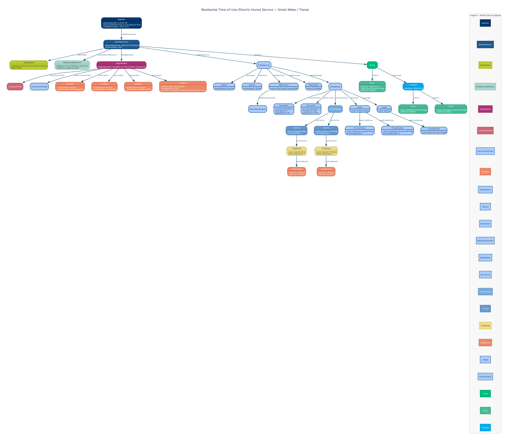

<!-- SPDX-FileCopyrightText: Flux Tailor LLC -->
<!-- SPDX-License-Identifier: Apache-2.0 -->
<!-- SPDX-Transition-License-After-Draft: W3C-20231102 -->
<!-- AUTO-GENERATED by urpx-website-dev/scripts/codegen/generate-example-graphviz.py — DO NOT HAND-EDIT -->
---
title: "Residential Time-of-Use (Electric Home) Service — Smart Meter / Tiered"
utility: "Pacific Gas & Electric Company"
slug: "pge-e-elec-sp"
---

# Residential Time-of-Use (Electric Home) Service — Smart Meter / Tiered

**Utility:** Pacific Gas & Electric Company

Variant of E-ELEC requiring an AMI smart meter at the service point, with a 2,000 kWh monthly consumption eligibility limit and two service tiers (Baseline 0–500 kWh, Over-Baseline 500–2,000 kWh). Demonstrates ServicePointProfile, consumption-based eligibility Conditions, and ServiceTier structures.



## JSON-LD source

```json
{
  "@context": {
    "urpx": "https://schema.urpx.org/",
    "schema": "http://schema.org/",
    "xsd": "http://www.w3.org/2001/XMLSchema#",
    "org": "https://example.com/organizations/",
    "pge": "https://example.com/pge/",
    "urpx:unitPrice":         { "@type": "xsd:decimal" },
    "urpx:effectiveDateTime": { "@type": "xsd:dateTime" },
    "urpx:initialEffectiveDate": { "@type": "xsd:date" },
    "urpx:startDate":         { "@type": "xsd:date" },
    "urpx:startTime":         { "@type": "xsd:time" },
    "urpx:endTime":           { "@type": "xsd:time" },
    "urpx:month":             { "@type": "xsd:gMonth" },
    "urpx:touTierNumber":     { "@type": "xsd:integer" },
    "urpx:touPeriodNumber":   { "@type": "xsd:integer" },
    "urpx:intervalDuration":  { "@type": "xsd:duration" },
    "urpx:url":               { "@type": "xsd:anyURI" },
    "urpx:baseQuantity":      { "@type": "xsd:decimal" },
    "urpx:lowerBound":        { "@type": "xsd:decimal" },
    "urpx:upperBound":        { "@type": "xsd:decimal" },
    "urpx:serviceTierNumber": { "@type": "xsd:integer" },
    "urpx:averageMonthlyUsage": { "@type": "xsd:decimal" }
  },
  "@type": "urpx:RatePlan",
  "@id": "pge:e-elec-sp",
  "urpx:ratePlanIdentifier": "E-ELEC-SP",
  "urpx:name": "Residential Time-of-Use (Electric Home) Service — Smart Meter / Tiered",
  "urpx:initialEffectiveDate": "2022-12-01",
  "urpx:hasRatePlanVersion": {
    "@type": "urpx:RatePlanVersion",
    "@id": "pge:e-elec-sp-2026-01-01",
    "urpx:effectiveDateTime": "2026-01-01T00:00:00",
    "urpx:priceCurrency": "USD",
    "urpx:commodity": { "@id": "urpx:electricity" },
    "urpx:serviceRole": { "@id": "urpx:bundledServiceRole" },
    "urpx:changeReason": { "@id": "urpx:rateCase" },
    "urpx:publishedBy": {
      "@type": "urpx:Organization",
      "@id": "org:utility-pge",
      "urpx:legalName": "Pacific Gas & Electric Company",
      "urpx:eiaId": "14328",
      "urpx:organizationType": { "@id": "urpx:utilityOrganization" }
    },
    "urpx:hasDataSourceReference": {
      "@type": "urpx:DataSourceReference",
      "urpx:fileName": "ELEC_SCHEDS_E-ELEC.pdf",
      "urpx:mediaType": "application/pdf"
    },
    "urpx:hasEligibilityRule": {
      "@type": "urpx:EligibilityRule",
      "@id": "pge:er-residential-service-sp",
      "urpx:logicExpression": "(condition-EV OR condition-storage OR condition-heatpump) AND condition-consumption-limit",
      "urpx:hasCustomerProfile": {
        "@type": "urpx:CustomerProfile",
        "@id": "pge:cp-residential-sp",
        "urpx:hasCustomerKind": { "@id": "urpx:residentialKind" }
      },
      "urpx:hasServicePointProfile": {
        "@type": "urpx:ServicePointProfile",
        "@id": "pge:spp-smart-meter",
        "urpx:hasMeteringConfiguration": { "@id": "urpx:amiConfiguration" }
      },
      "urpx:hasCondition": [
        {
          "@type": "urpx:Condition",
          "@id": "pge:condition-EV",
          "urpx:conditionType": "derType",
          "urpx:operator": { "@id": "urpx:equalsOperator" },
          "urpx:conditionValue": "evChargingDER"
        },
        {
          "@type": "urpx:Condition",
          "@id": "pge:condition-storage",
          "urpx:conditionType": "derType",
          "urpx:operator": { "@id": "urpx:equalsOperator" },
          "urpx:conditionValue": "storageDER"
        },
        {
          "@type": "urpx:Condition",
          "@id": "pge:condition-heatpump",
          "urpx:conditionType": "derType",
          "urpx:operator": { "@id": "urpx:equalsOperator" },
          "urpx:conditionValue": "heatPumpDER"
        },
        {
          "@type": "urpx:Condition",
          "@id": "pge:condition-consumption-limit",
          "urpx:conditionType": "consumption",
          "urpx:operator": { "@id": "urpx:lessThanOrEqualOperator" },
          "urpx:conditionValue": "2000",
          "urpx:description": "Average monthly kWh consumption must not exceed 2,000 kWh",
          "urpx:unitOfMeasure": { "@id": "urpx:kWh" }
        }
      ]
    },
    "urpx:hasPlanElements": {
      "@type": "urpx:PlanElements",
      "urpx:hasSeasons": [
        {
          "@type": "urpx:Season",
          "@id": "pge:season-summer",
          "urpx:seasonName": "Summer",
          "urpx:month": ["--06","--07","--08","--09"]
        },
        {
          "@type": "urpx:Season",
          "@id": "pge:season-winter",
          "urpx:seasonName": "Winter",
          "urpx:month": ["--10","--11","--12","--01","--02","--03","--04","--05"]
        }
      ],
      "urpx:hasMetricInput": [
        {
          "@type": "urpx:MetricInput",
          "@id": "pge:mi-energy",
          "urpx:name": "kWh Energy Consumption",
          "urpx:metricInputType": { "@id": "urpx:measuredMetricInput" },
          "urpx:hasMetricSpecification": {
            "@type": "urpx:MetricSpecification",
            "@id": "pge:ms-energy",
            "urpx:measurementKind": { "@id": "urpx:energy" },
            "urpx:unitOfMeasure": { "@id": "urpx:kWh" },
            "urpx:flowDirection": { "@id": "urpx:forward" }
          }
        },
        {
          "@type": "urpx:MetricInput",
          "@id": "pge:mi-meter-count",
          "urpx:name": "Per Meter",
          "urpx:metricInputType": { "@id": "urpx:profileMetricInput" },
          "urpx:profileMetricProperty": { "@id": "urpx:numberOfMeters" }
        }
      ],
      "urpx:hasBillingModel": {
        "@type": "urpx:BillingModel",
        "urpx:hasServiceTier": [
          {
            "@type": "urpx:ServiceTier",
            "@id": "pge:st-baseline",
            "urpx:serviceTierNumber": 1,
            "urpx:lowerBound": "0",
            "urpx:lowerBoundOperator": { "@id": "urpx:greaterThanOrEqualOperator" },
            "urpx:upperBound": "500",
            "urpx:upperBoundOperator": { "@id": "urpx:lessThanOrEqualOperator" },
            "urpx:referencesMetricInput": { "@id": "pge:mi-energy" }
          },
          {
            "@type": "urpx:ServiceTier",
            "@id": "pge:st-over-baseline",
            "urpx:serviceTierNumber": 2,
            "urpx:lowerBound": "500",
            "urpx:lowerBoundOperator": { "@id": "urpx:greaterThanOperator" },
            "urpx:upperBound": "2000",
            "urpx:upperBoundOperator": { "@id": "urpx:lessThanOrEqualOperator" },
            "urpx:referencesMetricInput": { "@id": "pge:mi-energy" }
          }
        ],
        "urpx:hasTOUSchedule": {
          "@type": "urpx:TOUSchedule",
          "@id": "pge:tou-e-elec-sp",
          "urpx:referencesMetricInput": { "@id": "pge:mi-energy" },
          "urpx:hasTOUTier": [
            {
              "@type": "urpx:TOUTier",
              "@id": "pge:tou-tier-peak",
              "urpx:tierSourceName": "Peak",
              "urpx:touTierStandardName": { "@id": "urpx:peakTier" },
              "urpx:touTierNumber": 1,
              "urpx:hasTOUPeriod": {
                "@type": "urpx:TOUPeriod",
                "@id": "pge:tou-period-summer-peak",
                "urpx:name": "Summer Peak",
                "urpx:touPeriodNumber": 1,
                "urpx:hasTimeBracket": {
                  "@type": "urpx:TimeBracket",
                  "@id": "pge:tb-summer-peak",
                  "urpx:startTime": "16:00:00",
                  "urpx:endTime": "21:00:00",
                  "urpx:appliesInSeason": { "@id": "pge:season-summer" },
                  "urpx:dayType": { "@id": "urpx:allDays" }
                }
              }
            },
            {
              "@type": "urpx:TOUTier",
              "@id": "pge:tou-tier-off-peak",
              "urpx:tierSourceName": "Off-Peak",
              "urpx:touTierStandardName": { "@id": "urpx:offPeakTier" },
              "urpx:touTierNumber": 3,
              "urpx:hasTOUPeriod": {
                "@type": "urpx:TOUPeriod",
                "@id": "pge:tou-period-summer-off-peak",
                "urpx:name": "Summer Off-Peak",
                "urpx:touPeriodNumber": 5,
                "urpx:hasTimeBracket": {
                  "@type": "urpx:TimeBracket",
                  "@id": "pge:tb-summer-off-peak",
                  "urpx:startTime": "00:00:00",
                  "urpx:endTime": "15:00:00",
                  "urpx:appliesInSeason": { "@id": "pge:season-summer" },
                  "urpx:dayType": { "@id": "urpx:allDays" }
                }
              }
            }
          ]
        },
        "urpx:hasLedger": [
          {
            "@type": "urpx:Ledger",
            "@id": "pge:ledger-energy-supply",
            "urpx:name": "Energy Supply",
            "urpx:ledgerType": { "@id": "urpx:supplyLedger" },
            "urpx:referencesMetricInput": { "@id": "pge:mi-energy" },
            "urpx:hasPriceDefinition": [
              {
                "@type": "urpx:PriceDefinition",
                "@id": "pge:pd-gen-summer-peak",
                "urpx:name": "Generation Summer Peak",
                "urpx:chargeType": { "@id": "urpx:usageCharge" },
                "urpx:billPortion": { "@id": "urpx:supplyPortion" },
                "urpx:touPeriodNumber": 1
              },
              {
                "@type": "urpx:PriceDefinition",
                "@id": "pge:pd-gen-summer-off-peak",
                "urpx:name": "Generation Summer Off-Peak",
                "urpx:chargeType": { "@id": "urpx:usageCharge" },
                "urpx:billPortion": { "@id": "urpx:supplyPortion" },
                "urpx:touPeriodNumber": 5
              }
            ]
          },
          {
            "@type": "urpx:Ledger",
            "@id": "pge:ledger-service",
            "urpx:name": "Service",
            "urpx:ledgerType": { "@id": "urpx:bundledLedger" },
            "urpx:referencesMetricInput": { "@id": "pge:mi-meter-count" },
            "urpx:hasPriceDefinition": {
              "@type": "urpx:PriceDefinition",
              "@id": "pge:pd-base-charge",
              "urpx:name": "Base Services Charge",
              "urpx:chargeType": { "@id": "urpx:minimumBill" },
              "urpx:billPortion": { "@id": "urpx:bundledPortion" }
            }
          }
        ]
      }
    },
    "urpx:hasPrices": {
      "@type": "urpx:Prices",
      "urpx:hasPrice": {
        "@type": "urpx:Price",
        "@id": "pge:price-base-charge",
        "urpx:referencesPriceDefinition": { "@id": "pge:pd-base-charge" },
        "urpx:startDate": "2026-01-01",
        "urpx:name": "Base Services Charge",
        "urpx:unitPrice": "0.49281"
      },
      "urpx:hasPriceSet": {
        "@type": "urpx:PriceSet",
        "@id": "pge:ps-generation-charges",
        "urpx:startDate": "2026-01-01",
        "urpx:hasPrice": [
          {
            "@type": "urpx:Price",
            "@id": "pge:price-gen-summer-peak",
            "urpx:referencesPriceDefinition": { "@id": "pge:pd-gen-summer-peak" },
            "urpx:name": "Generation Summer Peak",
            "urpx:unitPrice": "0.26299"
          },
          {
            "@type": "urpx:Price",
            "@id": "pge:price-gen-summer-off-peak",
            "urpx:referencesPriceDefinition": { "@id": "pge:pd-gen-summer-off-peak" },
            "urpx:name": "Generation Summer Off-Peak",
            "urpx:unitPrice": "0.11878"
          }
        ]
      }
    }
  }
}
```

