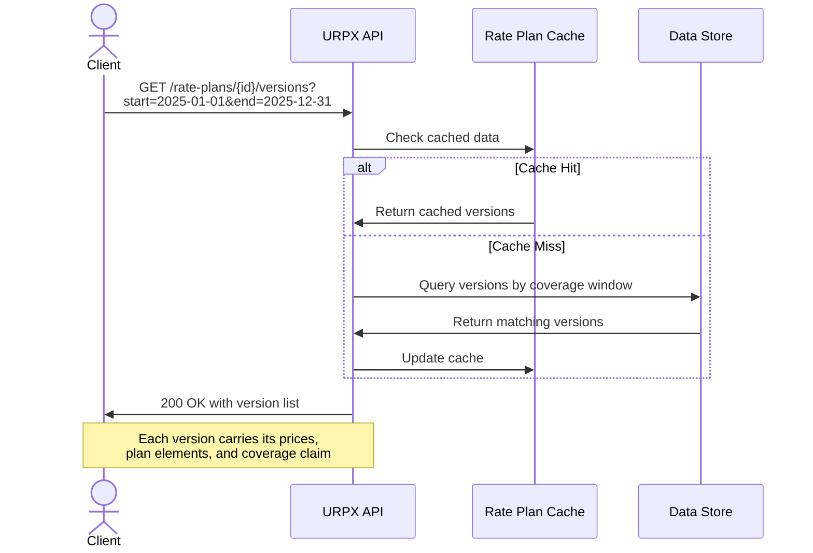
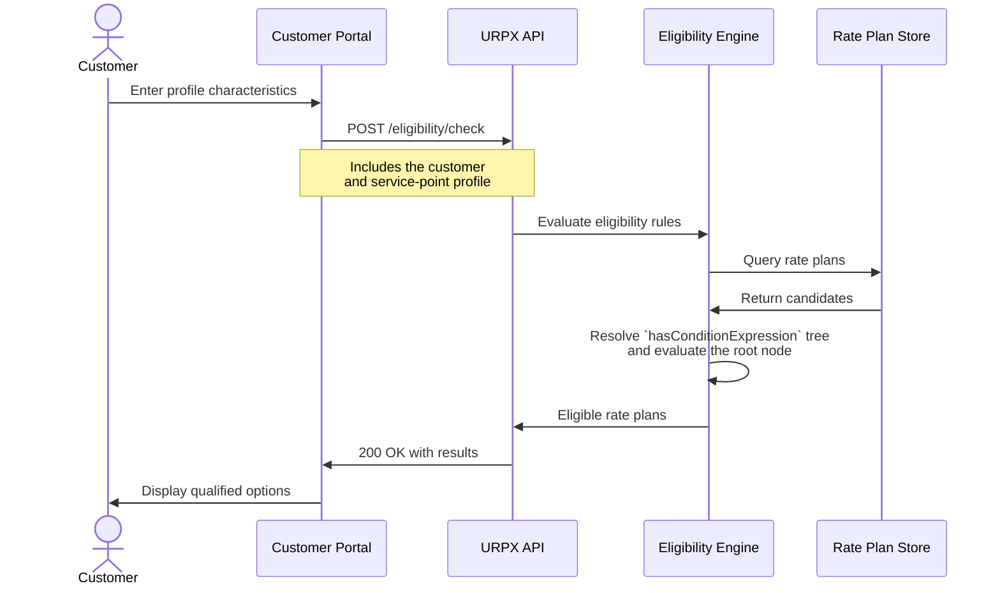

<!-- SPDX-FileCopyrightText: The URPX Authors -->
<!-- SPDX-License-Identifier: W3C-20150513 -->

---
site_category: technical-reference
site_id: api-spec
site_title: "API Specification"
site_label: "API Spec"
site_position: 3
---

# URPX API Specification

**Version:** 0.5.1 (Working Group Draft)
**Status:** Non-normative sketch, illustrative only. Aligned to URPX v0.5.1; the normative access API is in development for a later release.
**Last Updated:** 2026-10-05

[← Back to Index](/docs/getting-started/overview) | [Overview](urpx-overview.md) | [URPX Interoperability & Standards Integration](urpx-interoperability.md)

---

## Status Notice

This page is an **illustrative sketch**, not a normative interface. The sequence diagrams and API-call drafts below show the *shape* of how applications will read published rate plan data; they are for illustration and are **not final**. Endpoint paths, parameters, and response formats will be settled in the normative access-API specification, which is being developed for a later release.

**Scope**: URPX APIs are for **consuming** published rate plan data: discovery, version retrieval, and eligibility checks. Rate plan submission workflows are outside the standard's scope. Published URPX data may, however, expose regulatory traceability metadata such as linked `RateCase` resources, filing references, and approval dates.

---

## Table of Contents

1. [Access model](#access-model)
2. [Use cases](#use-cases)
3. [Query example (SPARQL)](#query-example-sparql)
4. [Roadmap](#roadmap)

---

## Access model

URPX standardizes one thing on the wire: the **JSON-LD representation** of a rate plan, governed by the published context and the SHACL shapes. Every access method returns or queries that same representation. Developers work with familiar JSON, and semantic interoperability comes from the JSON-LD context.

Access to published data is offered as **profiles** over that representation, rather than a single fixed interface:

- **Graph query (SPARQL)**: the native query profile for the RDF graph. A worked example is shown below.
- **A query API and a REST/JSON profile**: a documented request/response access layer over the same JSON-LD representation. These are being designed for a later release; the REST profile in particular will be shaped by broader input from data consumers once the standard is public.

No single protocol is "the API." Because the representation is the stable thing, a new property added to the model flows through to consumers without breaking the access layer.

---

## Use Cases

The following use cases illustrate the read patterns the access API will support. The diagrams and call drafts are illustrative and not final.

### Use Case 1: Rate Plan Discovery

**Actor**: Application Developer

**Goal**: Find the rate plans available in a service territory

**Scenario**:
```
GIVEN a service territory
WHEN I query the available rate plans
THEN I receive a list of rate plans with basic information
AND I can narrow the list by customer and service characteristics
```

Discovery by territory or customer characteristics is resolved by the access layer: a rate plan's identity carries no territory or customer field directly; those attach to service-point and customer profiles and are evaluated by the plan's eligibility rules. The access layer offers them as filters over that logic.

**Illustrative call draft**:
```http
GET /api/v1/rate-plans?territory=nyiso-zone-j&customerKind=residentialKind
```

---

### Use Case 2: Rate Plan Version Retrieval

**Actor**: Billing System

**Goal**: Get the rate plan versions effective within a date range, with their resolved pricing

**Scenario**:
```
GIVEN a rate plan unique identifier and a date range
WHEN I request the version data
THEN I receive the versions whose coverage falls within that period
AND each version carries its resolved price structure
```

**Sequence Diagram**:


**Illustrative call draft**:
```http
GET /api/v1/rate-plans/{ratePlanId}/versions?startDate=2025-01-01&endDate=2025-12-31
```

---

### Use Case 3: Customer Eligibility Check

**Actor**: Customer Portal

**Goal**: Find which rate plans a customer with a given profile qualifies for

**Scenario**:
```
GIVEN a customer and service-point profile
WHEN I check eligibility against the available rate plans
THEN I receive the qualifying rate plans
AND each names the criteria that matched
```

**Sequence Diagram**:


**Illustrative call draft**:
```http
POST /api/v1/eligibility/check
```
with the customer and service-point profile in the request body.

**Implementation Note:** Eligibility evaluation in URPX is based on structured `ConditionExpression` trees. API responses should surface matched rule names or stable identifiers rather than serialized internal expression graphs unless explicitly requested.

---

## Read operations (illustrative calls)

Read access follows ordinary resource patterns over the JSON-LD representation. These call drafts are illustrative and not final.

```http
GET /api/v1/rate-plans/RES-TOU-001
Accept: application/ld+json
```

```http
GET /api/v1/rate-plans/RES-TOU-001/versions/current
Accept: application/ld+json
```

---

## Query example (SPARQL)

SPARQL is the native query profile for the URPX graph. The example below orders a rate plan's versions by the start of their coverage window and takes the most recent.

A rate plan version is a derived snapshot with no authored effective date, so recency is read from the start of the version's coverage window (its temporal scope). The version links back to its rate plan through `forRatePlan`; there is no navigation property in the other direction. This query reads the coverage-kind temporal scope on the version's coverage claim, with a start date. That is a modelling convention for published snapshots, not a field the v0.5.1 shapes require.

```sparql
PREFIX urpx: <https://urpx.org/ns/ontology/>

SELECT ?version ?coverageStart
WHERE {
  ?plan  a urpx:RatePlan ;
         urpx:ratePlanUniqueIdentifier "CPL-RES-TOU-1" .

  ?version a urpx:RatePlanVersion ;
           urpx:forRatePlan ?plan ;
           urpx:hasCoverageClaim/urpx:hasTemporalScope ?scope .

  ?scope urpx:scopeKind urpx:coverage ;
         urpx:startDate  ?coverageStart .
}
ORDER BY DESC(?coverageStart)
LIMIT 1
```

**Expected output.** The query returns the latest version's identifier and its coverage start date. Retrieving that version returns its full JSON-LD representation. The worked example below shows a resolved `RatePlanVersion` in its entirety: the parent rate plan identity, the version metadata, the complete `hasPlanElements` (seasons, metric inputs, ledgers, the time-of-use schedule, and price definitions), and the complete `hasPrices` (dated price sets). It is a fictional utility (Cascade Power and Light) and is illustrative, pending a SHACL validation pass before publication.

Three things this example is built to show:

- **One resolved version spanning several pricing inputs.** The snapshot consolidates three distinct pricing models, each authored in its own publication: delivery pricing and rate plan structure from the 2026 rate-case tariff book, seasonal generation energy from an advice-letter supplement, and market supply energy from a monthly price feed. The version lists its contributing models through `consolidatedFrom`, and the tie of each price to its source is provenance: every price set and price carries a `hasDataSourceReference` back to the `SourcePublication` it was read from, and the authoring models are made explicit alongside as a `ModelCollection` of `PricingModel` nodes.
- **Prices change over time, at two cadences.** The seasonal generation prices apply by season (summer and winter price sets, selected by `appliesInSeason`, each with its own validity window), while the market supply prices refresh monthly on 2026-07-01 and 2026-08-01. Season here is applicability, expressed through `appliesInSeason` on the plan-element definitions, not a validity window; the definitions themselves are stable structure. A validity window on a plan-element definition is reserved for when the structure itself is authored to change, which is not what a season boundary is.
- **Dated blocks with their own reason.** Each market-supply block is a `Price` valid for a non-overlapping window, and each carries its own `SourcePublication` stating why it changed (a scheduled reconciliation, then a summer fuel-cost adjustment). Note a modelling reality: a reason code (`changeReason`) is a property of the whole `RatePlanVersion`, not of a block inside it, so per-block reasons are expressed through each block's source publication. To model three genuinely reason-tagged changes as first-class, the model-faithful form is three effective-dated `RatePlanVersion` records on the same rate plan.

```json
{
  "@context": [
    "https://urpx.org/ns/context/releases/v0.5.1/jsonld/urpx-context.jsonld",
    {
      "cpl": "https://example.org/urpx/fixtures/cpl/",
      "org": "https://example.org/urpx/fixtures/org/",
      "xsd": "http://www.w3.org/2001/XMLSchema#",
      "urpx:effectiveDate": { "@type": "xsd:date" },
      "urpx:expirationDate": { "@type": "xsd:date" },
      "urpx:initialEffectiveDate": { "@type": "xsd:date" },
      "urpx:startDate": { "@type": "xsd:date" },
      "urpx:endDate": { "@type": "xsd:date" },
      "urpx:dateRetrieved": { "@type": "xsd:date" },
      "urpx:amount": { "@type": "xsd:decimal" },
      "urpx:unitPrice": { "@type": "xsd:decimal" },
      "urpx:baseQuantity": { "@type": "xsd:decimal" },
      "urpx:startTime": { "@type": "xsd:time" },
      "urpx:endTime": { "@type": "xsd:time" },
      "urpx:month": { "@type": "xsd:gMonth" },
      "urpx:intervalDuration": { "@type": "xsd:duration" },
      "urpx:accessURL": { "@type": "xsd:anyURI" }
    }
  ],
  "@graph": [
    {
      "@id": "cpl:res-tou-1-v20260601",
      "@type": "urpx:RatePlanVersion",
      "urpx:name": "Residential TOU-1: resolved snapshot, rate year effective 2026-06-01",
      "urpx:description": "Fully resolved, self-contained snapshot for Cascade Power and Light Residential Time-of-Use Schedule TOU-1. It consolidates three pricing inputs, each authored as its own PricingModel: delivery pricing and rate plan structure from the 2026 rate-case tariff book, seasonal time-of-use generation energy from a generation advice-letter supplement, and market supply energy from a monthly market price feed. Every price carries its own valid dates and source citation, so the snapshot is readable without the source pricing models.",
      "urpx:version": "2026-06-01",
      "urpx:effectiveDate": "2026-06-01",
      "urpx:expirationDate": "2027-06-01",
      "urpx:changeReason": { "@id": "urpx:rateCase" },
      "urpx:priceCurrency": "USD",
      "urpx:commodity": { "@id": "urpx:electricity" },
      "urpx:serviceRole": { "@id": "urpx:bundledServiceRole" },
      "urpx:customerChoice": { "@id": "urpx:voluntaryChoice" },
      "urpx:isDefault": false,
      "urpx:timezoneIdentifier": "America/Los_Angeles",
      "urpx:selfContained": true,
      "urpx:consolidatedFrom": [
        { "@id": "cpl:pm-delivery-structure" },
        { "@id": "cpl:pm-generation-seasonal" },
        { "@id": "cpl:pm-market-supply" }
      ],
      "urpx:offeredBy": {
        "@id": "org:cascade-pl",
        "@type": "urpx:UtilityOperator",
        "urpx:legalName": "Cascade Power and Light Company",
        "urpx:organizationType": { "@id": "urpx:utilityOrganization" }
      },
      "urpx:forRatePlan": {
        "@id": "cpl:res-tou-1",
        "@type": "urpx:RatePlan",
        "urpx:name": "Residential Time-of-Use Service, Schedule TOU-1 (Peak 5 to 9 p.m.)",
        "urpx:description": "Cascade Power and Light residential time-of-use rate plan: stable identity record. No pricing content; priced content lives in its dated RatePlanVersions.",
        "urpx:ratePlanUniqueIdentifier": "CPL-RES-TOU-1",
        "urpx:initialEffectiveDate": "2019-06-01",
        "urpx:priceCurrency": "USD",
        "urpx:timezoneIdentifier": "America/Los_Angeles",
        "urpx:commodity": { "@id": "urpx:electricity" },
        "urpx:serviceRole": { "@id": "urpx:bundledServiceRole" },
        "urpx:offeredBy": { "@id": "org:cascade-pl" },
        "urpx:hasServiceClass": {
          "@id": "cpl:sc-residential",
          "@type": "urpx:ServiceClass",
          "urpx:serviceClassName": "Residential Service",
          "urpx:serviceClassRaw": "RES"
        }
      },
      "urpx:hasDataSourceReference": {
        "@id": "cpl:sr-tariffbook-2026",
        "@type": "urpx:DataSourceReference",
        "urpx:name": "Cascade P&L 2026 Rate Case: Schedule TOU-1 tariff sheets",
        "urpx:sourcePublication": { "@id": "cpl:sp-tariffbook-2026" },
        "urpx:fileName": "cpl_tou1_2026-06-01.pdf",
        "urpx:mediaType": { "@id": "urpx:applicationPdf" },
        "urpx:effectiveDate": "2026-06-01"
      },
      "urpx:hasCoverageClaim": {
        "@id": "cpl:cc-res-tou-1-v20260601",
        "@type": "urpx:CoverageClaim",
        "urpx:completenessResult": { "@id": "urpx:complete" },
        "urpx:confidence": { "@id": "urpx:estimated" },
        "urpx:selfContained": true,
        "urpx:hasTemporalScope": {
          "@id": "cpl:ts-coverage-v20260601",
          "@type": "urpx:TemporalScope",
          "urpx:scopeKind": { "@id": "urpx:coverage" },
          "urpx:startDate": "2026-06-01",
          "urpx:endDate": "2027-06-01"
        }
      },
      "urpx:hasPlanElements": {
        "@id": "cpl:pe-res-tou-1-v20260601",
        "@type": "urpx:PlanElements",
        "urpx:hasSeasons": [
          {
            "@id": "cpl:season-summer",
            "@type": "urpx:Season",
            "urpx:seasonName": "Summer",
            "urpx:month": ["--06", "--07", "--08", "--09"]
          },
          {
            "@id": "cpl:season-winter",
            "@type": "urpx:Season",
            "urpx:seasonName": "Winter",
            "urpx:month": ["--10", "--11", "--12", "--01", "--02", "--03", "--04", "--05"]
          }
        ],
        "urpx:hasMetricInput": [
          {
            "@id": "cpl:mi-energy-kwh",
            "@type": "urpx:MetricInput",
            "urpx:name": "Electricity consumption (kWh)",
            "urpx:metricInputType": { "@id": "urpx:measuredMetricInput" },
            "urpx:hasMetricSpecification": {
              "@id": "cpl:ms-energy-kwh",
              "@type": "urpx:MetricSpecification",
              "urpx:measurementKind": { "@id": "urpx:energy" },
              "urpx:unitOfMeasure": { "@id": "urpx:kWh" },
              "urpx:flowDirection": { "@id": "urpx:forward" },
              "urpx:commodity": { "@id": "urpx:electricity" }
            }
          },
          {
            "@id": "cpl:mi-meter-count",
            "@type": "urpx:MetricInput",
            "urpx:name": "Per-meter charges",
            "urpx:metricInputType": { "@id": "urpx:profileMetricInput" },
            "urpx:profileMetricProperty": { "@id": "urpx:meterCount" }
          }
        ],
        "urpx:hasBillingModel": {
          "@id": "cpl:bm-res-tou-1-v20260601",
          "@type": "urpx:BillingModel",
          "urpx:hasLedger": [
            {
              "@id": "cpl:ledger-supply",
              "@type": "urpx:Ledger",
              "urpx:name": "Supply",
              "urpx:ledgerType": { "@id": "urpx:supplyLedger" },
              "urpx:referencesMetricInput": { "@id": "cpl:mi-energy-kwh" }
            },
            {
              "@id": "cpl:ledger-delivery",
              "@type": "urpx:Ledger",
              "urpx:name": "Delivery",
              "urpx:ledgerType": { "@id": "urpx:deliveryLedger" },
              "urpx:referencesMetricInput": { "@id": "cpl:mi-energy-kwh" }
            }
          ],
          "urpx:hasTOUSchedule": {
            "@id": "cpl:tou-res-tou-1",
            "@type": "urpx:TOUSchedule",
            "urpx:referencesMetricInput": { "@id": "cpl:mi-energy-kwh" },
            "urpx:hasTOUTier": [
              {
                "@id": "cpl:tou-tier-peak",
                "@type": "urpx:TOUTier",
                "urpx:tierSourceName": "Peak",
                "urpx:touTierStandardName": { "@id": "urpx:peakTier" },
                "urpx:touTierNumber": 1,
                "urpx:hasTOUPeriod": [
                  {
                    "@id": "cpl:tou-period-summer-peak",
                    "@type": "urpx:TOUPeriod",
                    "urpx:name": "Summer Peak",
                    "urpx:touPeriodNumber": 1,
                    "urpx:hasTimeBracket": [
                      {
                        "@id": "cpl:tb-summer-peak",
                        "@type": "urpx:TimeBracket",
                        "urpx:startTime": "17:00:00",
                        "urpx:endTime": "21:00:00",
                        "urpx:appliesInSeason": { "@id": "cpl:season-summer" },
                        "urpx:dayType": { "@id": "urpx:allDays" }
                      }
                    ]
                  },
                  {
                    "@id": "cpl:tou-period-winter-peak",
                    "@type": "urpx:TOUPeriod",
                    "urpx:name": "Winter Peak",
                    "urpx:touPeriodNumber": 2,
                    "urpx:hasTimeBracket": [
                      {
                        "@id": "cpl:tb-winter-peak",
                        "@type": "urpx:TimeBracket",
                        "urpx:startTime": "17:00:00",
                        "urpx:endTime": "21:00:00",
                        "urpx:appliesInSeason": { "@id": "cpl:season-winter" },
                        "urpx:dayType": { "@id": "urpx:allDays" }
                      }
                    ]
                  }
                ]
              },
              {
                "@id": "cpl:tou-tier-off-peak",
                "@type": "urpx:TOUTier",
                "urpx:tierSourceName": "Off-Peak",
                "urpx:touTierStandardName": { "@id": "urpx:offPeakTier" },
                "urpx:touTierNumber": 2,
                "urpx:hasTOUPeriod": [
                  {
                    "@id": "cpl:tou-period-summer-off-peak",
                    "@type": "urpx:TOUPeriod",
                    "urpx:name": "Summer Off-Peak",
                    "urpx:touPeriodNumber": 3,
                    "urpx:hasTimeBracket": [
                      {
                        "@id": "cpl:tb-summer-off-peak-am",
                        "@type": "urpx:TimeBracket",
                        "urpx:startTime": "00:00:00",
                        "urpx:endTime": "17:00:00",
                        "urpx:appliesInSeason": { "@id": "cpl:season-summer" },
                        "urpx:dayType": { "@id": "urpx:allDays" }
                      },
                      {
                        "@id": "cpl:tb-summer-off-peak-pm",
                        "@type": "urpx:TimeBracket",
                        "urpx:startTime": "21:00:00",
                        "urpx:endTime": "23:59:59",
                        "urpx:appliesInSeason": { "@id": "cpl:season-summer" },
                        "urpx:dayType": { "@id": "urpx:allDays" }
                      }
                    ]
                  },
                  {
                    "@id": "cpl:tou-period-winter-off-peak",
                    "@type": "urpx:TOUPeriod",
                    "urpx:name": "Winter Off-Peak",
                    "urpx:touPeriodNumber": 4,
                    "urpx:hasTimeBracket": [
                      {
                        "@id": "cpl:tb-winter-off-peak-am",
                        "@type": "urpx:TimeBracket",
                        "urpx:startTime": "00:00:00",
                        "urpx:endTime": "17:00:00",
                        "urpx:appliesInSeason": { "@id": "cpl:season-winter" },
                        "urpx:dayType": { "@id": "urpx:allDays" }
                      },
                      {
                        "@id": "cpl:tb-winter-off-peak-pm",
                        "@type": "urpx:TimeBracket",
                        "urpx:startTime": "21:00:00",
                        "urpx:endTime": "23:59:59",
                        "urpx:appliesInSeason": { "@id": "cpl:season-winter" },
                        "urpx:dayType": { "@id": "urpx:allDays" }
                      }
                    ]
                  }
                ]
              }
            ]
          },
          "urpx:hasPriceDefinition": [
            {
              "@id": "cpl:pd-customer-charge",
              "@type": "urpx:PriceDefinition",
              "urpx:name": "Customer Charge",
              "urpx:chargeType": { "@id": "urpx:customerCharge" },
              "urpx:billPortion": { "@id": "urpx:deliveryPortion" },
              "urpx:priceCurrency": "USD",
              "urpx:baseQuantity": "1",
              "urpx:referencesLedger": { "@id": "cpl:ledger-delivery" }
            },
            {
              "@id": "cpl:pd-gen-summer-peak",
              "@type": "urpx:PriceDefinition",
              "urpx:name": "Generation Energy: Summer Peak",
              "urpx:chargeType": { "@id": "urpx:usageCharge" },
              "urpx:billPortion": { "@id": "urpx:supplyPortion" },
              "urpx:touPeriodNumber": 1,
              "urpx:appliesInSeason": { "@id": "cpl:season-summer" },
              "urpx:referencesLedger": { "@id": "cpl:ledger-supply" },
              "urpx:referencesMetricInput": { "@id": "cpl:mi-energy-kwh" }
            },
            {
              "@id": "cpl:pd-gen-winter-peak",
              "@type": "urpx:PriceDefinition",
              "urpx:name": "Generation Energy: Winter Peak",
              "urpx:chargeType": { "@id": "urpx:usageCharge" },
              "urpx:billPortion": { "@id": "urpx:supplyPortion" },
              "urpx:touPeriodNumber": 2,
              "urpx:appliesInSeason": { "@id": "cpl:season-winter" },
              "urpx:referencesLedger": { "@id": "cpl:ledger-supply" },
              "urpx:referencesMetricInput": { "@id": "cpl:mi-energy-kwh" }
            },
            {
              "@id": "cpl:pd-supply-energy",
              "@type": "urpx:PriceDefinition",
              "urpx:name": "Market Supply Energy: All Hours",
              "urpx:chargeType": { "@id": "urpx:usageCharge" },
              "urpx:billPortion": { "@id": "urpx:supplyPortion" },
              "urpx:referencesLedger": { "@id": "cpl:ledger-supply" },
              "urpx:referencesMetricInput": { "@id": "cpl:mi-energy-kwh" }
            }
          ]
        }
      },
      "urpx:hasPrices": {
        "@id": "cpl:prices-res-tou-1-v20260601",
        "@type": "urpx:Prices",
        "urpx:hasPriceSet": [
          {
            "@id": "cpl:ps-customer-charge",
            "@type": "urpx:PriceSet",
            "urpx:name": "Customer Charge",
            "urpx:priceCurrency": "USD",
            "urpx:billPortion": { "@id": "urpx:deliveryPortion" },
            "urpx:referencesPriceDefinition": { "@id": "cpl:pd-customer-charge" },
            "urpx:hasDataSourceReference": { "@id": "cpl:sr-tariffbook-2026" },
            "urpx:hasPrice": {
              "@id": "cpl:p-customer-charge",
              "@type": "urpx:Price",
              "urpx:amount": "0.42740",
              "urpx:startDate": "2026-06-01",
              "urpx:endDate": "2027-06-01"
            }
          },
          {
            "@id": "cpl:ps-generation-summer",
            "@type": "urpx:PriceSet",
            "urpx:name": "Generation Energy: Summer (TOU)",
            "urpx:priceCurrency": "USD",
            "urpx:billPortion": { "@id": "urpx:supplyPortion" },
            "urpx:appliesInSeason": { "@id": "cpl:season-summer" },
            "urpx:startDate": "2026-06-01",
            "urpx:endDate": "2026-10-01",
            "urpx:hasDataSourceReference": { "@id": "cpl:sr-al-gen-2026" },
            "urpx:hasPrice": [
              {
                "@id": "cpl:p-gen-summer-peak",
                "@type": "urpx:Price",
                "urpx:name": "Generation Summer Peak",
                "urpx:referencesPriceDefinition": { "@id": "cpl:pd-gen-summer-peak" },
                "urpx:touPeriodNumber": 1,
                "urpx:unitPrice": "0.28410"
              }
            ]
          },
          {
            "@id": "cpl:ps-generation-winter",
            "@type": "urpx:PriceSet",
            "urpx:name": "Generation Energy: Winter (TOU)",
            "urpx:priceCurrency": "USD",
            "urpx:billPortion": { "@id": "urpx:supplyPortion" },
            "urpx:appliesInSeason": { "@id": "cpl:season-winter" },
            "urpx:startDate": "2026-10-01",
            "urpx:hasDataSourceReference": { "@id": "cpl:sr-al-gen-2026" },
            "urpx:hasPrice": [
              {
                "@id": "cpl:p-gen-winter-peak",
                "@type": "urpx:Price",
                "urpx:name": "Generation Winter Peak",
                "urpx:referencesPriceDefinition": { "@id": "cpl:pd-gen-winter-peak" },
                "urpx:touPeriodNumber": 2,
                "urpx:unitPrice": "0.19880"
              }
            ]
          },
          {
            "@id": "cpl:ps-supply-energy",
            "@type": "urpx:PriceSet",
            "urpx:name": "Market Supply Energy: monthly reconciled",
            "urpx:priceCurrency": "USD",
            "urpx:billPortion": { "@id": "urpx:supplyPortion" },
            "urpx:referencesPriceDefinition": { "@id": "cpl:pd-supply-energy" },
            "urpx:hasMetricSpecification": { "@id": "cpl:ms-energy-kwh" },
            "urpx:hasPrice": [
              {
                "@id": "cpl:p-supply-202606",
                "@type": "urpx:Price",
                "urpx:unitPrice": "0.06840",
                "urpx:startDate": "2026-06-01",
                "urpx:endDate": "2026-07-01",
                "urpx:hasDataSourceReference": {
                  "@id": "cpl:sr-market-202606",
                  "@type": "urpx:DataSourceReference",
                  "urpx:name": "Cascade P&L Market Supply Notice: June 2026 cycle",
                  "urpx:sourcePublication": {
                    "@id": "cpl:sp-market-202606",
                    "@type": "urpx:SourcePublication",
                    "urpx:name": "Cascade P&L Market Supply Rate: June 2026 (scheduled monthly reconciliation)",
                    "urpx:publicationType": { "@id": "urpx:marketPriceFeed" },
                    "urpx:issuingAuthority": "Cascade Power and Light Company",
                    "urpx:effectiveDate": "2026-06-01"
                  },
                  "urpx:accessURL": "https://www.example-cpl.com/rates/market-supply",
                  "urpx:dateRetrieved": "2026-05-20"
                }
              },
              {
                "@id": "cpl:p-supply-202607",
                "@type": "urpx:Price",
                "urpx:unitPrice": "0.07520",
                "urpx:startDate": "2026-07-01",
                "urpx:endDate": "2026-08-01",
                "urpx:hasDataSourceReference": {
                  "@id": "cpl:sr-market-202607",
                  "@type": "urpx:DataSourceReference",
                  "urpx:name": "Cascade P&L Market Supply Notice: July 2026 cycle",
                  "urpx:sourcePublication": {
                    "@id": "cpl:sp-market-202607",
                    "@type": "urpx:SourcePublication",
                    "urpx:name": "Cascade P&L Market Supply Rate: July 2026 (summer fuel-cost adjustment)",
                    "urpx:publicationType": { "@id": "urpx:marketPriceFeed" },
                    "urpx:issuingAuthority": "Cascade Power and Light Company",
                    "urpx:effectiveDate": "2026-07-01"
                  },
                  "urpx:accessURL": "https://www.example-cpl.com/rates/market-supply",
                  "urpx:dateRetrieved": "2026-06-19"
                }
              },
              {
                "@id": "cpl:p-supply-202608",
                "@type": "urpx:Price",
                "urpx:unitPrice": "0.07185",
                "urpx:startDate": "2026-08-01",
                "urpx:hasDataSourceReference": {
                  "@id": "cpl:sr-market-202608",
                  "@type": "urpx:DataSourceReference",
                  "urpx:name": "Cascade P&L Market Supply Notice: August 2026 cycle",
                  "urpx:sourcePublication": {
                    "@id": "cpl:sp-market-202608",
                    "@type": "urpx:SourcePublication",
                    "urpx:name": "Cascade P&L Market Supply Rate: August 2026 (summer fuel-cost adjustment)",
                    "urpx:publicationType": { "@id": "urpx:marketPriceFeed" },
                    "urpx:issuingAuthority": "Cascade Power and Light Company",
                    "urpx:effectiveDate": "2026-08-01"
                  },
                  "urpx:accessURL": "https://www.example-cpl.com/rates/market-supply",
                  "urpx:dateRetrieved": "2026-07-21"
                }
              }
            ]
          }
        ]
      }
    },

    {
      "@id": "cpl:sp-tariffbook-2026",
      "@type": "urpx:SourcePublication",
      "urpx:name": "Cascade P&L 2026 General Rate Case: Electric Tariff Book",
      "urpx:publicationType": { "@id": "urpx:tariffBook" },
      "urpx:issuingAuthority": "State Public Utilities Commission",
      "urpx:effectiveDate": "2026-06-01"
    },
    {
      "@id": "cpl:sp-al-gen-2026",
      "@type": "urpx:SourcePublication",
      "urpx:name": "Cascade P&L Advice Letter 512-E: Seasonal Generation Energy Rates",
      "urpx:publicationType": { "@id": "urpx:tariffSupplement" },
      "urpx:issuingAuthority": "State Public Utilities Commission",
      "urpx:effectiveDate": "2026-06-01"
    },
    {
      "@id": "cpl:sr-al-gen-2026",
      "@type": "urpx:DataSourceReference",
      "urpx:name": "Advice Letter 512-E: generation energy schedule",
      "urpx:sourcePublication": { "@id": "cpl:sp-al-gen-2026" },
      "urpx:fileName": "cpl_al_512e_gen_2026.pdf",
      "urpx:mediaType": { "@id": "urpx:applicationPdf" },
      "urpx:effectiveDate": "2026-06-01"
    },
    {
      "@id": "cpl:mc-res-tou-1",
      "@type": "urpx:ModelCollection",
      "urpx:name": "Contributing pricing models: Residential TOU-1, rate year 2026-06-01",
      "urpx:collectsPricingModel": [
        { "@id": "cpl:pm-delivery-structure" },
        { "@id": "cpl:pm-generation-seasonal" },
        { "@id": "cpl:pm-market-supply" }
      ]
    },
    {
      "@id": "cpl:pm-delivery-structure",
      "@type": "urpx:PricingModel",
      "urpx:confidence": { "@id": "urpx:verified" },
      "urpx:referencesRatePlan": { "@id": "cpl:res-tou-1" },
      "urpx:documentedBy": { "@id": "cpl:sr-tariffbook-2026" },
      "urpx:effectiveDate": "2026-06-01",
      "urpx:expirationDate": "2027-06-01"
    },
    {
      "@id": "cpl:pm-generation-seasonal",
      "@type": "urpx:PricingModel",
      "urpx:confidence": { "@id": "urpx:verified" },
      "urpx:referencesRatePlan": { "@id": "cpl:res-tou-1" },
      "urpx:documentedBy": { "@id": "cpl:sr-al-gen-2026" },
      "urpx:effectiveDate": "2026-06-01"
    },
    {
      "@id": "cpl:pm-market-supply",
      "@type": "urpx:PricingModel",
      "urpx:confidence": { "@id": "urpx:estimated" },
      "urpx:referencesRatePlan": { "@id": "cpl:res-tou-1" },
      "urpx:documentedBy": { "@id": "cpl:sr-market-202608" },
      "urpx:effectiveDate": "2026-06-01"
    }
  ]
}
```

*The public query endpoint is part of the access API in development; the query itself uses the published ontology namespace shown in the `PREFIX` line.*

---

## Roadmap

The URPX v0.5.1 model (the ontology, the SHACL shapes, and the JSON-LD representation) is the foundation the access API is built on. The access API itself develops in a later release:

- **Query API**: a documented request/response query interface over the JSON-LD representation, taking the graph-query profile shown above as its starting point.
- **REST / JSON profile**: a resource-oriented access layer, shaped by broader input from data consumers once the standard is public.
- **Reference material**: worked request/response examples, validated against the shipped shapes, added once the interface is settled so that nothing on this page can drift from the model.

Input on scope and priorities is welcome through the working group. Visit [urpx-org on GitHub](https://github.com/urpx-org) for working group information.

---

## Additional Resources

- [URPX Interoperability & Standards Integration](urpx-interoperability.md) - LF Energy standards alignment
- [Tutorial](urpx-tutorial.md) - Rate plan data creation guide

---

*The normative access API is under development and is not part of this release. For the latest state, see the [URPX GitHub repository](https://github.com/urpx-org/urpx).*

[← Back to Index](/docs/getting-started/overview)
