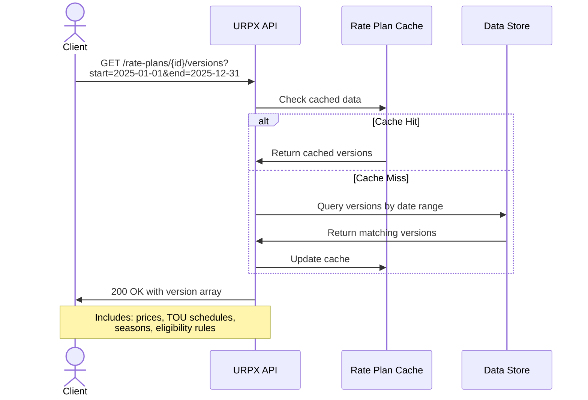
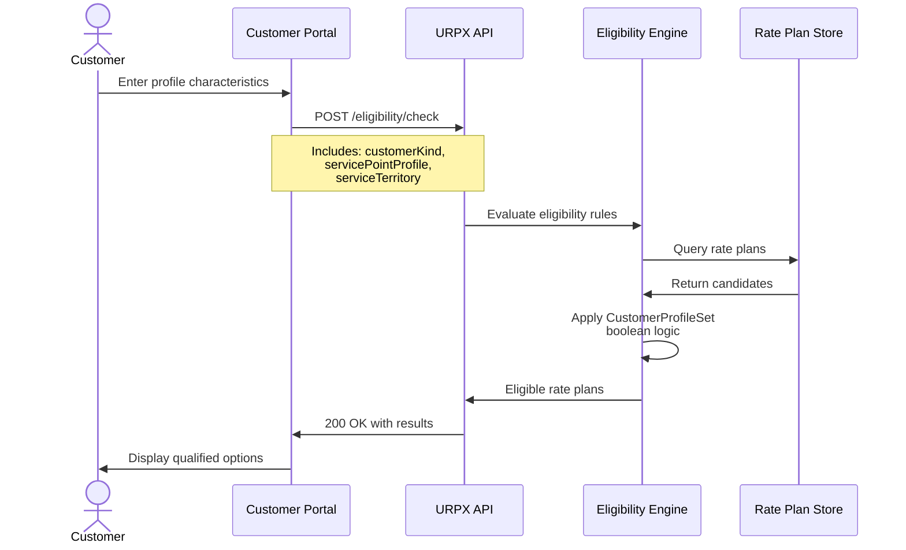

# URPX API Specification

**Version:** 0.1.1 (Draft)  
**Status:** Requirements Phase  
**Last Updated:** 2025-11-23

[← Back to Index](../index.md) | [Overview](urpx-overview.md) | [URPX Interoperability & Standards Integration](urpx-interoperability.md)

---

## Status Notice

The URPX API specification is currently in requirements gathering phase. A working group lead for API design will be identified to develop comprehensive REST and GraphQL specifications for consuming published rate plan data.

This document provides initial pre-draft requirements, use cases, and example API patterns to guide development.

**Scope Note**: URPX APIs focus on consuming published rate plan data. Rate plan submission and regulatory approval tracking are outside the standard's scope.

---

## Table of Contents

1. [Requirements Overview](#requirements-overview)
2. [Use Cases](#use-cases)
3. [Example API Calls](#example-api-calls)
4. [Sequence Diagrams](#sequence-diagrams)
5. [Next Steps](#next-steps)

---

## Requirements Overview

### API Design Principles

**Standards-Based**
- RESTful design following OpenAPI 3.1.0
- GraphQL support for flexible querying
- JSON-LD responses for semantic interoperability
- SPARQL endpoint for advanced queries

**Security**
- OAuth 2.0 for authenticated access
- API keys for public data
- Rate limiting per consumer
- No PII in responses

**Performance**
- Pagination for large result sets
- Caching for public tariff data
- Efficient SPARQL query patterns
- Response time targets (< 500ms)

---

## Use Cases

### Use Case 1: Rate Plan Discovery

**Actor**: Application Developer

**Goal**: Find all rate plans available in a service territory

**Scenario**:
```
GIVEN a service territory identifier
WHEN I query available rate plans
THEN I receive list of rate plans with basic information
AND I can filter by customer type and service role
```

**API Pattern**:
```http
GET /api/v1/rate-plans?territory=nyiso-zone-j&customerKind=residentialKind
```

---

### Use Case 2: Rate Plan Version Retrieval

**Actor**: Billing System

**Goal**: Get all rate plan version data for a rate plan within a date range

**Scenario**:
```
GIVEN a rate plan identifier and date range
WHEN I request version data
THEN I receive all versions effective within that period
AND each version includes complete price structure
AND temporal coverage is validated (no gaps)
```

**Sequence Diagram**:


**API Pattern**:
```http
GET /api/v1/rate-plans/{ratePlanId}/versions?startDate=2025-01-01&endDate=2025-12-31
```

**Response Example**:
```json
{
  "data": [
    {
      "id": "ex:version-2025-summer",
      "type": "RatePlanVersion",
      "version": "1.0",
      "effectiveDateTime": "2025-06-01T00:00:00-04:00",
      "expirationDateTime": "2025-09-30T23:59:59-04:00",
      "changeReason": "seasonalChange",
      "hasPrices": {
              "hasPriceSet": [
                {
                  "name": "Summer Prices",
                  "hasPrice": [...]
          }
        ]
      }
    }
  ],
  "meta": {
    "totalVersions": 2,
    "dateRangeRequested": {
      "start": "2025-01-01",
      "end": "2025-12-31"
    }
  }
}
```

---

### Use Case 3: Customer Eligibility Check

**Actor**: Customer Portal

**Goal**: Determine rate plan eligibility for customer with specific profile characteristics

**Scenario**:
```
GIVEN customer profile inputs (service point + customer characteristics)
WHEN I check eligibility against available rate plans
THEN I receive list of qualifying rate plans
AND each includes matched eligibility criteria
```

**Sequence Diagram**:


**API Pattern**:
```http
POST /api/v1/eligibility/check
Content-Type: application/json

{
  "CustomerProfile": {
    "hasCustomerKind": "residentialKind",
    "hasCustomerSubKind": "residentialStandard"
  },
  "ServicePointProfile": {
    "endUse": "residentialService",
    "voltageLevel": "secondaryVoltage",
    "hasMeteringConfiguration": "ami"
    "geographicZone": "urbanZone"
  }
}
```

**Response Example**:
```json
{
  "data": {
    "eligibleRatePlans": [
      {
        "ratePlanIdentifier": "RES-TOU-001",
        "name": "Residential Time-of-Use Rate Plan",
        "serviceRole": "bundledServiceRole",
        "matchedCriteria": [
          "customerKind",
          "serviceTerritory",
          "voltageLevel"
        ]
      }
    ],
    "ineligibleRatePlans": [
      {
        "ratePlanIdentifier": "COMM-DEMAND-001",
        "reason": "Requires commercialKind customer classification"
      }
    ]
  }
}
```

---

## Write Operations

### Create New Rate Plan

**Request**:
```http
POST /api/v1/rate-plans
Content-Type: application/ld+json
Authorization: Bearer {token}

{
  "@context": "https://schema.urpx.org/context.jsonld",
  "@type": "RatePlan",
  "ratePlanIdentifier": "NEW-RES-PLAN-001",
  "name": "New Residential Rate Plan",
  "serviceRole": {"@id": "urpx:bundledServiceRole"},
  "initialEffectiveDate": "2025-01-01"
}
```

**Response**:
```http
HTTP/1.1 201 Created
Location: /api/v1/rate-plans/NEW-RES-PLAN-001

{
  "@context": "https://schema.urpx.org/context.jsonld",
  "@id": "ex:rateplan-new-001",
  "@type": "RatePlan",
  "ratePlanIdentifier": "NEW-RES-PLAN-001",
  "name": "New Residential Rate Plan",
  "serviceRole": {"@id": "urpx:bundledServiceRole"},
  "initialEffectiveDate": "2025-01-01"
}
```

---

### Add New Version to Existing Rate Plan

**Request**:
```http
POST /api/v1/rate-plans/{ratePlanId}/versions
Content-Type: application/ld+json
Authorization: Bearer {token}

{
  "@context": "https://schema.urpx.org/context.jsonld",
  "@type": "RatePlanVersion",
  "version": "2.0",
  "effectiveDateTime": "2025-07-01T00:00:00-04:00",
  "changeReason": {"@id": "urpx:rateCase"},
  "publishedBy": {"@id": "ex:utility-example"},
  "hasPrices": {
        "@type": "Prices",
        "hasPriceSet": [...]
  }
}
```

**Response**:
```http
HTTP/1.1 201 Created
Location: /api/v1/rate-plans/RES-TOU-001/versions/2.0

{
  "@id": "ex:version-2025-v2",
  "@type": "RatePlanVersion",
  "version": "2.0",
  "effectiveDateTime": "2025-07-01T00:00:00-04:00",
  "changeReason": {"@id": "urpx:rateCase"}
}
```

---

## Read Operations

### Get Rate Plan Basic Information

```http
GET /api/v1/rate-plans/RES-TOU-001
Accept: application/ld+json
```

**Response**:
```json
{
  "@context": "https://schema.urpx.org/context.jsonld",
  "@id": "ex:rateplan-res-tou-001",
  "@type": "RatePlan",
  "ratePlanIdentifier": "RES-TOU-001",
  "name": "Residential Time-of-Use Rate Plan",
  "serviceRole": {"@id": "urpx:bundledServiceRole"},
  "initialEffectiveDate": "2025-01-01"
}
```

---

### Get Current Effective Version

```http
GET /api/v1/rate-plans/RES-TOU-001/versions/current
Accept: application/ld+json
```

**Response**:
```json
{
  "@context": "https://schema.urpx.org/context.jsonld",
  "@id": "ex:version-current",
  "@type": "RatePlanVersion",
  "version": "1.0",
  "effectiveDateTime": "2025-06-01T00:00:00-04:00",
  "hasPrices": {
      "@type": "Prices",
      "hasPriceSet": [...]
  },
  "hasPlanElements": {
    "@type": "PlanElements",
    "hasSeasons": [...],
    "hasMetricInput": [...]
  }
}
```

---

## SPARQL Endpoint

### Public SPARQL Queries

**Endpoint**: `https://sparql.urpx.org/query`

**Example: Find All Peak Period Charges**

```sparql
PREFIX urpx: <https://schema.urpx.org/>

SELECT ?price ?name ?unitPrice ?periodName
WHERE {
  ?ratePlan urpx:ratePlanIdentifier "RES-TOU-001" ;
           urpx:hasRatePlanVersion ?version .
  
  ?version urpx:hasPrices/urpx:hasPriceSet/urpx:hasPrice ?price .
  
  ?price urpx:name ?name ;
         urpx:unitPrice ?unitPrice ;
         urpx:touPeriodNumber ?periodNum .
  
  ?version urpx:hasPlanElements/urpx:hasMetricInput/urpx:hasTOUSchedule/
           urpx:hasTOUTier/urpx:hasTOUPeriod ?period .
  
  ?period urpx:touPeriodNumber ?periodNum ;
         urpx:periodName ?periodName .
  
  FILTER(CONTAINS(?periodName, "Peak"))
}
```

---

## Next Steps

### API Development Roadmap

**Phase 1: Requirements Gathering (Current)**
- Define core use cases
- Establish API patterns
- Document query requirements
- Create initial examples

**Phase 2: Specification Development**
- OpenAPI 3.1 complete specification
- GraphQL schema definition
- SPARQL query templates
- Authentication framework

**Phase 3: Reference Implementation**
- API server implementation
- SDK development (Python, JavaScript)
- Integration testing
- Performance benchmarking

**Phase 4: Community Adoption**
- Production deployment
- Documentation completion
- Developer outreach
- Feedback integration

### Working Group

**Seeking**: API Working Group Lead

**Responsibilities**:
- Define comprehensive API specification aligned with v0.1.1 ontology
- Coordinate with semantic web and integration teams
- Develop reference implementation
- Lead community adoption

**Contact**: Visit [urpx-org on GitHub](https://github.com/urpx-org) for working group information

---

## Additional Resources

- [Standards Integration](urpx-standards-integration.md) - LF Energy standards alignment
- [Tutorial](urpx-tutorial.md) - Rate plan data creation guide
- [Examples](urpx-examples.md) - Real-world implementations

---

*API specification under development for URPX v0.1.1. For latest updates, visit the [URPX GitHub repository](https://github.com/urpx-org/urpx).*

[← Back to Index](../index.md)
