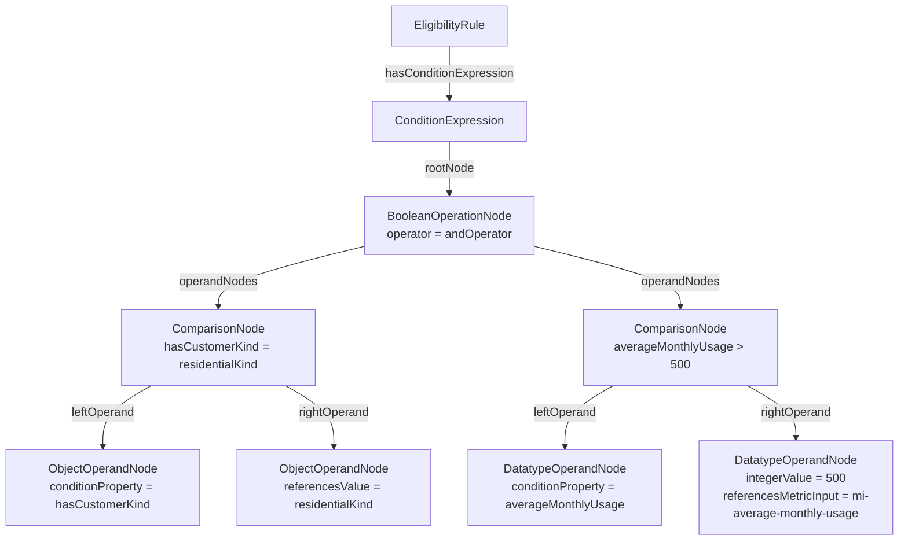

# URPX Condition Model

**Version:** 0.2.0  
**Last Updated:** 2026-04-28  
**Status:** Adopted for URPX 0.2.0  
**Scope:** Structured condition-expression modeling in eligibility, applicability, and related contexts  
**Ontology Source:** [`urpx-ontology.ttl`](../../ontology/urpx-ontology.ttl)  
**SHACL Source:** [`urpx-shacl.ttl`](../../shacl/urpx-shacl.ttl)

---

## Introduction

This document defines the structured condition-expression model used in URPX.

The model is designed to express rule logic in a way that is:

- machine-readable,
- straightforward to validate with SHACL,
- understandable to human authors and reviewers, and
- flexible enough to support both direct property comparisons and nested derived expressions.

URPX uses the same condition-expression architecture for:

- `urpx:EligibilityRule`, which must carry one structured condition expression and determines qualification for a rate or modifier,
- `urpx:ApplicabilityRule`, which determines when a price, price set, or price definition applies,
- `urpx:ApplicabilityGroup`, where it may be used for additional structured applicability logic, and
- `urpx:ProfileAlternative`, which carries exactly one structured condition expression that defines the alternative.

## Design Goals

- Keep atomic predicates separate from boolean composition.
- Make the rule-level entry point explicit.
- Support direct comparisons, nested arithmetic, and derived expressions.
- Support object-valued, datatype-valued, and fallback custom operands.
- Use datatype-specific literal value properties instead of a generic mixed-type literal slot.
- Allow optional human-readable expression text without making that text authoritative for execution.

## Table of Contents

- [Core Modeling Pattern](#core-modeling-pattern)
- [Class Reference](#class-reference)
- [Property Reference](#property-reference)
- [Supported Literal Value Properties](#supported-literal-value-properties)
- [Operator Sets](#operator-sets)
- [Validation Summary](#validation-summary)
- [JSON-LD Context Pattern](#json-ld-context-pattern)
- [JSON-LD Example Use Cases](#json-ld-example-use-cases)

---

## Core Modeling Pattern

URPX condition modeling separates five concerns:

1. **Rule attachment**  
   `EligibilityRule` and `ProfileAlternative` must each attach exactly one structured condition expression through `urpx:hasConditionExpression`. `ApplicabilityRule` and `ApplicabilityGroup` may attach at most one.

2. **Rule-level wrapper**  
   `ConditionExpression` is the rule-level wrapper. It points to exactly one `urpx:rootNode`.

3. **Atomic predicates**  
   `ComparisonNode` expresses one independently evaluable predicate with `urpx:operator`, `urpx:leftOperand`, and `urpx:rightOperand`.

4. **Boolean composition**  
   `BooleanOperationNode` combines comparison nodes and nested boolean-operation nodes using `urpx:operandNodes`.

5. **Operand typing**  
   Operand nodes distinguish object-valued references, datatype-valued literals, and custom fallback cases.

### Rule-Level Structure

The rule-level entry point is always `urpx:hasConditionExpression`.

In the current model, this entry point is available on `EligibilityRule`, `ApplicabilityRule`, `ApplicabilityGroup`, and `ProfileAlternative`.

`ConditionExpression` is not itself a boolean operator node. It provides a stable wrapper with exactly one `urpx:rootNode`. The root may be:

- a `urpx:ComparisonNode` for the single-condition case, or
- a `urpx:BooleanOperationNode` for grouped boolean logic.

This means a single-condition rule does not need a unary boolean wrapper. The wrapper points directly to the comparison node.

### Atomic Predicate Structure

`ComparisonNode` represents exactly one predicate. It uses:

- `urpx:operator`
- `urpx:leftOperand`
- `urpx:rightOperand`

Each side may be:

- an operand node, or
- an `urpx:OperationNode` for nested arithmetic or derived expressions.

### Boolean Composition

`BooleanOperationNode` is used only for boolean structure. It:

- uses `urpx:operator`,
- uses `urpx:operandNodes`,
- accepts only boolean operators, and
- does not use `urpx:leftOperand` or `urpx:rightOperand`.

### Operand Node Families

URPX uses three operand-node families:

- `urpx:ObjectOperandNode`
- `urpx:DatatypeOperandNode`
- `urpx:CustomOperandNode`

These make the role of each operand explicit without relying on a generic terminal-node abstraction.

### Datatype Handling

Datatype intent is carried by the value property used and, where relevant, by the range of the referenced ontology property.

URPX does not require a separate datatype enumeration on operand nodes. Instead, literal-bearing operand nodes use one of the datatype-specific value properties such as:

- `urpx:booleanValue`
- `urpx:dateValue`
- `urpx:dateTimeValue`
- `urpx:decimalValue`
- `urpx:durationValue`
- `urpx:gMonthValue`
- `urpx:integerValue`
- `urpx:stringValue`
- `urpx:timeValue`

### Metric Input References on Operand Nodes

`urpx:referencesMetricInput` is used in three distinct ways:

- On `ObjectOperandNode`, it can serve as the direct object-valued operand form.
- On `DatatypeOperandNode`, it may optionally appear on a literal-bearing operand node.
- On `CustomOperandNode`, it may optionally appear on a literal-bearing operand node.

For datatype and custom operand nodes, `referencesMetricInput` is used only when the node also carries exactly one datatype-specific literal value property. It is not used on the property-reference branch of `DatatypeOperandNode`, and it is not used on the `customConditionProperty` branch of `CustomOperandNode`.

### Human-Readable Expression Text

`urpx:logicExpression` may be attached to:

- `urpx:ComparisonNode`
- `urpx:BooleanOperationNode`

This property is optional. It can help with debugging, review, or UI display, but the structured node graph remains the authoritative representation for execution and validation.

### Human-Readable Metadata

`ComparisonNode` may include:

- `urpx:name`
- `urpx:description`

These are optional and non-semantic. They are intended for human readability, audit, and display.

---

## Class Reference

### Rule-Level Classes

#### `urpx:EligibilityRule`

**Description:** Conditions determining customer and service point qualification.

**Condition Model Role:** An eligibility rule uses `urpx:hasConditionExpression` for structured qualification logic. `urpx:hasCustomerProfile` and `urpx:hasServicePointProfile` are not part of `EligibilityRule`.

**Relevant Properties:**

| Property | Cardinality | Range | Description |
|----------|-------------|-------|-------------|
| `urpx:hasConditionExpression` | `1..1` | `urpx:ConditionExpression` | Attaches the structured condition expression used for rule evaluation |

#### `urpx:ApplicabilityRule`

**Description:** Conditions that determine when a price, price set, or price definition applies.

**Condition Model Role:** An applicability rule uses the same condition-expression architecture as an eligibility rule.

**Relevant Properties:**

| Property | Cardinality | Range | Description |
|----------|-------------|-------|-------------|
| `urpx:hasConditionExpression` | `0..1` | `urpx:ConditionExpression` | Attaches the structured condition expression used for rule evaluation |

#### `urpx:ApplicabilityGroup`

**Description:** Geographic and service class applicability rules for statement prices.

**Condition Model Role:** An applicability group may optionally use `urpx:hasConditionExpression` when its built-in applicability fields need supplemental structured condition logic.

**Relevant Properties:**

| Property | Cardinality | Range | Description |
|----------|-------------|-------|-------------|
| `urpx:hasConditionExpression` | `0..1` | `urpx:ConditionExpression` | Attaches optional structured condition logic to the applicability group |

#### `urpx:ProfileAlternative`

**Description:** Specific combination of dimension values representing one alternative choice.

**Condition Model Role:** A profile alternative uses `urpx:hasConditionExpression` as its defining structured condition expression.

**Relevant Properties:**

| Property | Cardinality | Range | Description |
|----------|-------------|-------|-------------|
| `urpx:hasConditionExpression` | `1..1` | `urpx:ConditionExpression` | Attaches the defining structured condition expression for the profile alternative |

### Expression Classes

#### `urpx:ConditionExpression`

**Description:** Rule-level wrapper for a structured condition expression.

**Semantic Context:** `ConditionExpression` is the entry point for rule logic. It is not itself a boolean operator node.

**Key Properties:**

| Property | Cardinality | Range | Description |
|----------|-------------|-------|-------------|
| `urpx:rootNode` | `1..1` | `urpx:ComparisonNode` or `urpx:BooleanOperationNode` | The single root of the condition-expression tree |

#### `urpx:ConditionNode`

**Description:** Abstract superclass for nodes that may appear in a condition-expression tree.

**Semantic Context:** `ConditionNode` is a structural superclass. The concrete node types are `ComparisonNode` and `BooleanOperationNode`.

#### `urpx:ComparisonNode`

**Description:** Atomic comparison predicate in a condition expression.

**Semantic Context:** `ComparisonNode` represents one independently evaluable predicate.

**Key Properties:**

| Property | Cardinality | Range | Description |
|----------|-------------|-------|-------------|
| `urpx:operator` | `1..1` | operator IRI | Comparison or ordered-expression operator |
| `urpx:leftOperand` | `1..1` | operand node or `urpx:OperationNode` | Left side of the comparison |
| `urpx:rightOperand` | `1..1` | operand node or `urpx:OperationNode` | Right side of the comparison |
| `urpx:logicExpression` | `0..1` | `xsd:string` | Optional human-readable expression text |
| `urpx:name` | `0..1` | `xsd:string` | Optional human-readable label |
| `urpx:description` | `0..1` | `xsd:string` | Optional explanatory text |

#### `urpx:BooleanOperationNode`

**Description:** Boolean combinator node in a condition-expression tree.

**Semantic Context:** `BooleanOperationNode` is used for `AND`, `OR`, and `NOT` composition only.

**Key Properties:**

| Property | Cardinality | Range | Description |
|----------|-------------|-------|-------------|
| `urpx:operator` | `1..1` | boolean operator IRI | Boolean operator for the current node |
| `urpx:operandNodes` | `1..n` | `urpx:ComparisonNode` or `urpx:BooleanOperationNode` | Child condition nodes |
| `urpx:logicExpression` | `0..1` | `xsd:string` | Optional human-readable expression text |

#### `urpx:OperationNode`

**Description:** Nested expression node for arithmetic or other ordered subexpressions.

**Semantic Context:** `OperationNode` is used inside `ComparisonNode` when an operand must itself be computed or transformed before comparison.

**Key Properties:**

| Property | Cardinality | Range | Description |
|----------|-------------|-------|-------------|
| `urpx:operator` | `1..1` | operator IRI | Arithmetic or ordered-expression operator |
| `urpx:leftOperand` | `1..1` | operand node or `urpx:OperationNode` | Left subexpression operand |
| `urpx:rightOperand` | `1..1` | operand node or `urpx:OperationNode` | Right subexpression operand |

### Operand Node Classes

#### `urpx:ObjectOperandNode`

**Description:** Operand node for object-valued properties, enumeration values, and metric-input references.

**Semantic Context:** `ObjectOperandNode` is used for object-valued property comparisons and for direct references to metric inputs inside structured expressions.

**Key Properties:**

| Property | Cardinality | Range | Description |
|----------|-------------|-------|-------------|
| `urpx:conditionProperty` | choice form | `rdf:Property` | Object-valued URPX property being evaluated |
| `urpx:referencesValue` | choice form | IRI | Enumeration or other referenced object value |
| `urpx:referencesMetricInput` | choice form | `urpx:MetricInput` | Metric input used directly as an operand |

**Usage Note:** SHACL constrains each `ObjectOperandNode` to exactly one of these three forms.

#### `urpx:DatatypeOperandNode`

**Description:** Operand node for datatype-valued properties and datatype literal values.

**Semantic Context:** `DatatypeOperandNode` has two structural forms:

- a property-reference form using `urpx:conditionProperty`, or
- a literal form using exactly one datatype-specific value property.

In the literal form, `urpx:referencesMetricInput` may also be present when the literal threshold or literal comparison value needs explicit metric-input context.

**Key Properties:**

| Property | Cardinality | Range | Description |
|----------|-------------|-------|-------------|
| `urpx:conditionProperty` | property form | `rdf:Property` | Datatype-valued URPX property being evaluated |
| one datatype-specific value property | literal form | matching `xsd` datatype | Literal comparison value |
| `urpx:referencesMetricInput` | literal form only, optional | `urpx:MetricInput` | Metric input context for a literal-bearing operand node |

**Usage Note:** SHACL constrains each `DatatypeOperandNode` to exactly one structural branch. The property-reference branch does not allow `referencesMetricInput`. Literal branches may optionally include one `referencesMetricInput`.

#### `urpx:CustomOperandNode`

**Description:** Fallback operand node for concepts not yet captured by a URPX-native property.

**Semantic Context:** `CustomOperandNode` has two structural forms:

- a custom-property form using `urpx:customConditionProperty`, or
- a literal form using exactly one datatype-specific value property.

In the literal form, `urpx:referencesMetricInput` may also be present when the literal threshold or literal comparison value needs explicit metric-input context.

**Key Properties:**

| Property | Cardinality | Range | Description |
|----------|-------------|-------|-------------|
| `urpx:customConditionProperty` | custom-property form | `xsd:string` | Human-readable identifier for a custom concept |
| one datatype-specific value property | literal form | matching `xsd` datatype | Literal comparison value |
| `urpx:referencesMetricInput` | literal form only, optional | `urpx:MetricInput` | Metric input context for a literal-bearing operand node |

**Usage Note:** SHACL constrains each `CustomOperandNode` to exactly one structural branch. The `customConditionProperty` branch does not allow `referencesMetricInput`. Literal branches may optionally include one `referencesMetricInput`.

---

## Property Reference

### Rule Attachment Properties

| Property | Domain | Range / Type | Usage |
|----------|--------|--------------|-------|
| `urpx:hasConditionExpression` | `urpx:EligibilityRule`, `urpx:ApplicabilityRule`, `urpx:ApplicabilityGroup`, `urpx:ProfileAlternative` | `urpx:ConditionExpression` | Attaches the structured condition expression used by the owning node |
| `urpx:rootNode` | `urpx:ConditionExpression` | `urpx:ComparisonNode` or `urpx:BooleanOperationNode` | Points to the single root of the expression tree |

### Boolean Structure Properties

| Property | Domain | Range / Type | Usage |
|----------|--------|--------------|-------|
| `urpx:operandNodes` | `urpx:BooleanOperationNode` | `urpx:ComparisonNode` or `urpx:BooleanOperationNode` | Child nodes used for boolean composition |
| `urpx:operator` | comparison, boolean-operation, and operation nodes | operator IRI | Shared operator property; allowed subsets depend on node type |
| `urpx:logicExpression` | `urpx:ComparisonNode`, `urpx:BooleanOperationNode` | `xsd:string` | Optional human-readable expression text |

### Ordered Expression Properties

| Property | Domain | Range / Type | Usage |
|----------|--------|--------------|-------|
| `urpx:leftOperand` | `urpx:ComparisonNode`, `urpx:OperationNode` | operand node or `urpx:OperationNode` | Left side of a comparison or nested expression |
| `urpx:rightOperand` | `urpx:ComparisonNode`, `urpx:OperationNode` | operand node or `urpx:OperationNode` | Right side of a comparison or nested expression |

### Operand Properties

| Property | Domain | Range / Type | Usage |
|----------|--------|--------------|-------|
| `urpx:conditionProperty` | `urpx:DatatypeOperandNode`, `urpx:ObjectOperandNode` | `rdf:Property` | URPX-native property being evaluated |
| `urpx:customConditionProperty` | `urpx:CustomOperandNode` | `xsd:string` | Fallback identifier when no suitable URPX-native property exists |
| `urpx:referencesValue` | `urpx:ObjectOperandNode` | IRI | Object or enumeration value used in a comparison |
| `urpx:referencesMetricInput` | operand-node forms where allowed | `urpx:MetricInput` | Metric input reference used directly as an operand or as context for a literal-bearing operand |

### Metadata Properties

| Property | Domain | Range / Type | Usage |
|----------|--------|--------------|-------|
| `urpx:name` | `urpx:ComparisonNode` and broader URPX classes | `xsd:string` | Optional human-readable label |
| `urpx:description` | `urpx:ComparisonNode` and broader URPX classes | `xsd:string` | Optional explanatory text |

### Datatype-Specific Value Properties

| Property | Value Type | Usage |
|----------|------------|-------|
| `urpx:booleanValue` | `xsd:boolean` | Boolean literal value |
| `urpx:dateValue` | `xsd:date` | Calendar date literal value |
| `urpx:dateTimeValue` | `xsd:dateTime` | Date-time literal value |
| `urpx:decimalValue` | `xsd:decimal` | Decimal literal value |
| `urpx:durationValue` | `xsd:duration` | ISO 8601 duration literal value |
| `urpx:gMonthValue` | `xsd:gMonth` | Month-of-year literal value |
| `urpx:integerValue` | `xsd:integer` | Integer literal value |
| `urpx:stringValue` | `xsd:string` | String literal value |
| `urpx:timeValue` | `xsd:time` | Time-of-day literal value |

---

## Supported Literal Value Properties

URPX condition expressions use datatype-specific literal value properties rather than a generic mixed-type literal slot.

Datatype is conveyed by the value property itself. For example:

- `urpx:integerValue` carries an integer literal,
- `urpx:decimalValue` carries a decimal literal,
- `urpx:dateValue` carries a calendar date literal.

This approach keeps authoring and validation straightforward:

- authors use the value property that matches the intended datatype,
- SHACL constrains operand nodes to exactly one literal-value branch, and
- no separate datatype enumeration is required on the operand node.

---

## Operator Sets

### Boolean Operators

`BooleanOperationNode` uses boolean operators only:

- `urpx:andOperator`
- `urpx:orOperator`
- `urpx:notOperator`

### Comparison and Ordered Expression Operators

`ComparisonNode` and `OperationNode` use the broader operator set. Common operators include:

| Category | Operators |
|----------|-----------|
| Comparison | `urpx:equalsOperator`, `urpx:notEqualsOperator`, `urpx:greaterThanOperator`, `urpx:greaterThanOrEqualOperator`, `urpx:lessThanOperator`, `urpx:lessThanOrEqualOperator` |
| Arithmetic | `urpx:addOperator`, `urpx:subtractOperator`, `urpx:multiplyOperator`, `urpx:divideOperator` |

Boolean composition should be modeled with `BooleanOperationNode`, not with arithmetic or ordered-expression nodes.

---

## Validation Summary

URPX SHACL defines the condition model as a set of closed node shapes. In practice, that means each major node accepts only the properties appropriate to its role.

### Core Expression Shapes

- `EligibilityRule` must carry exactly one `urpx:hasConditionExpression`.
- `EligibilityRule` does not use `urpx:hasCustomerProfile` or `urpx:hasServicePointProfile`.
- `ApplicabilityRule` and `ApplicabilityGroup` may each carry at most one `urpx:hasConditionExpression`.
- `ProfileAlternative` must carry exactly one `urpx:hasConditionExpression`.
- `ConditionExpression` requires exactly one `urpx:rootNode`.
- `ComparisonNode` requires exactly one `urpx:operator`, exactly one `urpx:leftOperand`, and exactly one `urpx:rightOperand`.
- `BooleanOperationNode` requires exactly one boolean `urpx:operator`.
- `BooleanOperationNode` uses `urpx:operandNodes` rather than `urpx:leftOperand` and `urpx:rightOperand`.
- `BooleanOperationNode` uses operator-specific cardinality:
  - `urpx:andOperator` requires two or more operands,
  - `urpx:orOperator` requires two or more operands,
  - `urpx:notOperator` requires exactly one operand.
- `OperationNode` requires exactly one `urpx:operator`, exactly one `urpx:leftOperand`, and exactly one `urpx:rightOperand`.

### Operand Node Shapes

- `ObjectOperandNode` must use exactly one of:
  - `urpx:conditionProperty`
  - `urpx:referencesValue`
  - `urpx:referencesMetricInput`
- `DatatypeOperandNode` must use exactly one structural branch:
  - property-reference branch: `urpx:conditionProperty`
  - literal branch: exactly one datatype-specific value property, with optional `urpx:referencesMetricInput`
- `CustomOperandNode` must use exactly one structural branch:
  - custom-property branch: `urpx:customConditionProperty`
  - literal branch: exactly one datatype-specific value property, with optional `urpx:referencesMetricInput`

### Practical Modeling Notes

- Use `ObjectOperandNode` when the comparison is naturally object-valued or enumeration-valued.
- Use `DatatypeOperandNode` when the comparison centers on datatype-valued properties and literal thresholds.
- Use `CustomOperandNode` only when no suitable URPX-native property exists.
- Use `logicExpression` as supplemental human-readable text only.

---

## JSON-LD Context Pattern

Datatype-specific value properties allow compact JSON-LD authoring by declaring datatype coercion once in the document context.

### Example Context

```json
{
  "@context": {
    "urpx": "https://schema.urpx.org/",
    "xsd": "http://www.w3.org/2001/XMLSchema#",
    "urpx:booleanValue": { "@id": "urpx:booleanValue", "@type": "xsd:boolean" },
    "urpx:dateValue": { "@id": "urpx:dateValue", "@type": "xsd:date" },
    "urpx:dateTimeValue": { "@id": "urpx:dateTimeValue", "@type": "xsd:dateTime" },
    "urpx:decimalValue": { "@id": "urpx:decimalValue", "@type": "xsd:decimal" },
    "urpx:durationValue": { "@id": "urpx:durationValue", "@type": "xsd:duration" },
    "urpx:gMonthValue": { "@id": "urpx:gMonthValue", "@type": "xsd:gMonth" },
    "urpx:integerValue": { "@id": "urpx:integerValue", "@type": "xsd:integer" },
    "urpx:stringValue": { "@id": "urpx:stringValue", "@type": "xsd:string" },
    "urpx:timeValue": { "@id": "urpx:timeValue", "@type": "xsd:time" }
  }
}
```

### Note on Decimals

If exact decimal fidelity matters in a specific toolchain, implementations should verify that the JSON-LD processor preserves `xsd:decimal` coercion as intended for `urpx:decimalValue` values written as JSON numbers.

---

## JSON-LD Example Use Cases

### Single Atomic Condition

```json
{
  "@type": "urpx:ConditionExpression",
  "urpx:rootNode": {
    "@id": "urpx:condition-customer-kind"
  }
}
```

```json
{
  "@id": "urpx:condition-customer-kind",
  "@type": "urpx:ComparisonNode",
  "urpx:logicExpression": "hasCustomerKind = residentialKind",
  "urpx:operator": { "@id": "urpx:equalsOperator" },
  "urpx:leftOperand": {
    "@type": "urpx:ObjectOperandNode",
    "urpx:conditionProperty": { "@id": "urpx:hasCustomerKind" }
  },
  "urpx:rightOperand": {
    "@type": "urpx:ObjectOperandNode",
    "urpx:referencesValue": { "@id": "urpx:residentialKind" }
  }
}
```

### Two Conditions Combined With AND

```json
{
  "@id": "urpx:eligibility-expression-1",
  "@type": "urpx:ConditionExpression",
  "urpx:rootNode": {
    "@type": "urpx:BooleanOperationNode",
    "urpx:logicExpression": "customer kind is residential AND usage exceeds threshold",
    "urpx:operator": { "@id": "urpx:andOperator" },
    "urpx:operandNodes": [
      { "@id": "urpx:condition-customer-kind" },
      { "@id": "urpx:condition-usage-threshold" }
    ]
  }
}
```

### Integer Threshold

```json
{
  "@id": "urpx:condition-usage-threshold",
  "@type": "urpx:ComparisonNode",
  "urpx:operator": { "@id": "urpx:greaterThanOperator" },
  "urpx:leftOperand": {
    "@type": "urpx:DatatypeOperandNode",
    "urpx:conditionProperty": { "@id": "urpx:averageMonthlyUsage" }
  },
  "urpx:rightOperand": {
    "@type": "urpx:DatatypeOperandNode",
    "urpx:integerValue": 500,
    "urpx:referencesMetricInput": { "@id": "urpx:mi-average-monthly-usage" }
  }
}
```

### Derived Decimal Comparison With OperationNode

```json
{
  "@id": "urpx:condition-load-factor",
  "@type": "urpx:ComparisonNode",
  "urpx:operator": { "@id": "urpx:greaterThanOperator" },
  "urpx:leftOperand": {
    "@type": "urpx:OperationNode",
    "urpx:operator": { "@id": "urpx:divideOperator" },
    "urpx:leftOperand": {
      "@type": "urpx:ObjectOperandNode",
      "urpx:referencesMetricInput": { "@id": "urpx:mi-energy" }
    },
    "urpx:rightOperand": {
      "@type": "urpx:ObjectOperandNode",
      "urpx:referencesMetricInput": { "@id": "urpx:mi-demand" }
    }
  },
  "urpx:rightOperand": {
    "@type": "urpx:DatatypeOperandNode",
    "urpx:decimalValue": 0.4
  }
}
```

### Custom Fallback Comparison

```json
{
  "@id": "urpx:condition-legacy-segment",
  "@type": "urpx:ComparisonNode",
  "urpx:operator": { "@id": "urpx:equalsOperator" },
  "urpx:leftOperand": {
    "@type": "urpx:CustomOperandNode",
    "urpx:customConditionProperty": "Customer Segment Code From Legacy System"
  },
  "urpx:rightOperand": {
    "@type": "urpx:CustomOperandNode",
    "urpx:stringValue": "SEG-A"
  }
}
```

### Unary NOT

```json
{
  "@type": "urpx:ConditionExpression",
  "urpx:rootNode": {
    "@type": "urpx:BooleanOperationNode",
    "urpx:operator": { "@id": "urpx:notOperator" },
    "urpx:operandNodes": [
      { "@id": "urpx:condition-is-cca-customer" }
    ]
  }
}
```

```json
{
  "@id": "urpx:condition-is-cca-customer",
  "@type": "urpx:ComparisonNode",
  "urpx:operator": { "@id": "urpx:equalsOperator" },
  "urpx:leftOperand": {
    "@type": "urpx:DatatypeOperandNode",
    "urpx:conditionProperty": { "@id": "urpx:isCCACustomer" }
  },
  "urpx:rightOperand": {
    "@type": "urpx:DatatypeOperandNode",
    "urpx:booleanValue": true
  }
}
```

### Rule Attachment Example

```json
{
  "@id": "urpx:eligibility-rule-1",
  "@type": "urpx:EligibilityRule",
  "urpx:hasConditionExpression": {
    "@type": "urpx:ConditionExpression",
    "urpx:rootNode": {
      "@type": "urpx:BooleanOperationNode",
      "urpx:operator": { "@id": "urpx:andOperator" },
      "urpx:operandNodes": [
        { "@id": "urpx:condition-customer-kind" },
        { "@id": "urpx:condition-usage-threshold" }
      ]
    }
  }
}
```

### Full End-to-End ConditionExpression Graph

The examples above show individual parts of the model. The following
JSON-LD example shows one complete `ConditionExpression` graph in a
single document, including the owning `EligibilityRule`, the
`ConditionExpression`, the boolean root node, and the comparison nodes
embedded directly in `urpx:operandNodes`.

The same graph pattern can also be attached to `ApplicabilityRule`,
`ApplicabilityGroup`, or `ProfileAlternative`.

### Expanded ConditionExpression Tree

The following Mermaid diagram shows the same full structure at a glance
before the complete JSON-LD serialization.



```json
{
  "@context": {
    "urpx": "https://schema.urpx.org/",
    "xsd": "http://www.w3.org/2001/XMLSchema#",
    "urpx:booleanValue": { "@id": "urpx:booleanValue", "@type": "xsd:boolean" },
    "urpx:dateValue": { "@id": "urpx:dateValue", "@type": "xsd:date" },
    "urpx:dateTimeValue": { "@id": "urpx:dateTimeValue", "@type": "xsd:dateTime" },
    "urpx:decimalValue": { "@id": "urpx:decimalValue", "@type": "xsd:decimal" },
    "urpx:durationValue": { "@id": "urpx:durationValue", "@type": "xsd:duration" },
    "urpx:gMonthValue": { "@id": "urpx:gMonthValue", "@type": "xsd:gMonth" },
    "urpx:integerValue": { "@id": "urpx:integerValue", "@type": "xsd:integer" },
    "urpx:stringValue": { "@id": "urpx:stringValue", "@type": "xsd:string" },
    "urpx:timeValue": { "@id": "urpx:timeValue", "@type": "xsd:time" }
  },
  "@graph": [
    {
      "@id": "urpx:eligibility-rule-1",
      "@type": "urpx:EligibilityRule",
      "urpx:name": "Residential usage threshold eligibility",
      "urpx:hasConditionExpression": { "@id": "urpx:eligibility-expression-1" }
    },
    {
      "@id": "urpx:eligibility-expression-1",
      "@type": "urpx:ConditionExpression",
      "urpx:rootNode": {
        "@id": "urpx:eligibility-root-1",
        "@type": "urpx:BooleanOperationNode",
        "urpx:logicExpression": "customer kind is residential AND average monthly usage exceeds 500",
        "urpx:operator": { "@id": "urpx:andOperator" },
        "urpx:operandNodes": [
          {
            "@id": "urpx:condition-customer-kind-1",
            "@type": "urpx:ComparisonNode",
            "urpx:logicExpression": "hasCustomerKind = residentialKind",
            "urpx:operator": { "@id": "urpx:equalsOperator" },
            "urpx:leftOperand": {
              "@type": "urpx:ObjectOperandNode",
              "urpx:conditionProperty": { "@id": "urpx:hasCustomerKind" }
            },
            "urpx:rightOperand": {
              "@type": "urpx:ObjectOperandNode",
              "urpx:referencesValue": { "@id": "urpx:residentialKind" }
            }
          },
          {
            "@id": "urpx:condition-usage-threshold-1",
            "@type": "urpx:ComparisonNode",
            "urpx:logicExpression": "averageMonthlyUsage > 500",
            "urpx:operator": { "@id": "urpx:greaterThanOperator" },
            "urpx:leftOperand": {
              "@type": "urpx:DatatypeOperandNode",
              "urpx:conditionProperty": { "@id": "urpx:averageMonthlyUsage" }
            },
            "urpx:rightOperand": {
              "@type": "urpx:DatatypeOperandNode",
              "urpx:integerValue": 500,
              "urpx:referencesMetricInput": { "@id": "urpx:mi-average-monthly-usage" }
            }
          }
        ]
      }
    }
  ]
}
```
