# URPX Data Dictionary

<!-- AUTO-GENERATED on 2026-05-04 from urpx-ontology.ttl and urpx-shacl.ttl -->
<!-- Do not edit directly. Regenerate with: generate-dictionary.sh -->

**Version:** 0.2.0  
**Last Updated:** 2026-05-04  
**Ontology Source:** [`urpx-ontology.ttl`](../../ontology/urpx-ontology.ttl)

---

## Introduction

The Utility Rate Plan Exchange (URPX) Data Dictionary provides comprehensive documentation of all classes, properties, and enumerations within the URPX v0.2.0 ontology. This reference guide serves as the authoritative source for understanding the semantic structure and constraints that govern URPX.

**Important:** This is a pre-draft version for working group review. All definitions are based on `urpx-ontology.ttl`.

### Namespace Prefixes

| Prefix | Namespace URI | Description |
|--------|--------------|-------------|
| `urpx:` | https://schema.urpx.org/ | Core URPX ontology |
| `xsd:` | http://www.w3.org/2001/XMLSchema# | XML Schema datatypes |
| `owl:` | http://www.w3.org/2002/07/owl# | OWL ontology language |
| `rdfs:` | http://www.w3.org/2000/01/rdf-schema# | RDF Schema |
| `skos:` | http://www.w3.org/2004/02/skos/core# | SKOS vocabulary |

---

## Table of Contents

### Classes (Entities)
- [Core Rate Plan Entities](#core-rate-plan-entities)
- [Pricing & Alternatives Entities](#pricing--alternatives-entities)
- [Metric & Measurement Entities](#metric--measurement-entities)
- [Plan Elements & Billing Entities](#plan-elements--billing-entities)
- [Temporal & Scheduling Entities](#temporal--scheduling-entities)
- [Condition Modeling](#condition-modeling)
- [Customer & Service Profile Entities](#customer--service-profile-entities)
- [Organization Entities](#organization-entities)
- [Geographic Entities](#geographic-entities)
- [Document Type Entities](#document-type-entities)
- [Regulatory Entities](#regulatory-entities)

### Enumerations (Controlled Vocabularies)
- [AccumulationValue](#accumulationvalue)
- [AggregationMethodValue](#aggregationmethodvalue)
- [AnnualIncomeRangeValue](#annualincomerangevalue)
- [AssistanceEligibilityLevelValue](#assistanceeligibilitylevelvalue)
- [BillPortionValue](#billportionvalue)
- [BooleanOperatorValue](#booleanoperatorvalue)
- [ChangeReasonValue](#changereasonvalue)
- [ChargeCategoryValue](#chargecategoryvalue)
- [ChargeTypeValue](#chargetypevalue)
- [CommodityValue](#commodityvalue)
- [ConnectionKindValue](#connectionkindvalue)
- [ConnectorTypeValue](#connectortypevalue)
- [CustomerChoiceValue](#customerchoicevalue)
- [CustomerKindValue](#customerkindvalue)
- [CustomerSubKindValue](#customersubkindvalue)
- [DERTypeValue](#dertypevalue)
- [DataSourceTypeValue](#datasourcetypevalue)
- [DayTypeValue](#daytypevalue)
- [DynamicPricingTypeValue](#dynamicpricingtypevalue)
- [EndUseValue](#endusevalue)
- [EnrollmentStatusValue](#enrollmentstatusvalue)
- [EntityTypeValue](#entitytypevalue)
- [FlowDirectionValue](#flowdirectionvalue)
- [GeographicScopeValue](#geographicscopevalue)
- [GeographicZoneValue](#geographiczonevalue)
- [HVACKindValue](#hvackindvalue)
- [IdentifierSchemeValue](#identifierschemevalue)
- [InterconnectionStatusValue](#interconnectionstatusvalue)
- [IntervalAlignmentValue](#intervalalignmentvalue)
- [IntervalSelectionValue](#intervalselectionvalue)
- [IntervalTypeValue](#intervaltypevalue)
- [InverterTypeValue](#invertertypevalue)
- [LedgerTypeValue](#ledgertypevalue)
- [LoadProfileValue](#loadprofilevalue)
- [MeasurementTypeValue](#measurementtypevalue)
- [MediaTypeValue](#mediatypevalue)
- [MeteringConfigurationValue](#meteringconfigurationvalue)
- [MetricInputTypeValue](#metricinputtypevalue)
- [ModifierCategoryValue](#modifiercategoryvalue)
- [ModifierTypeValue](#modifiertypevalue)
- [NameTypeValue](#nametypevalue)
- [ObservanceRuleValue](#observancerulevalue)
- [OperatorValue](#operatorvalue)
- [OrganizationTypeValue](#organizationtypevalue)
- [OwnershipTypeValue](#ownershiptypevalue)
- [PanelOrientationValue](#panelorientationvalue)
- [PhaseCodeKindValue](#phasecodekindvalue)
- [PremiseTypeValue](#premisetypevalue)
- [PriceSourceValue](#pricesourcevalue)
- [ProgramTypeValue](#programtypevalue)
- [PublicationTypeValue](#publicationtypevalue)
- [RegulatoryScopeValue](#regulatoryscopevalue)
- [SeasonalPatternValue](#seasonalpatternvalue)
- [ServiceRoleValue](#servicerolevalue)
- [SpecialNeedsStatusValue](#specialneedsstatusvalue)
- [TOUTierStandardNameValue](#toutierstandardnamevalue)
- [TariffStatementTypeValue](#tariffstatementtypevalue)
- [TaxExemptStatusValue](#taxexemptstatusvalue)
- [UnitOfMeasureValue](#unitofmeasurevalue)
- [UpdateFrequencyValue](#updatefrequencyvalue)
- [VoltageLevelValue](#voltagelevelvalue)

---

## Core Rate Plan Entities

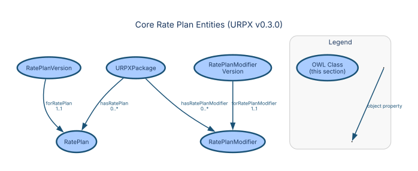

### URPXDocument

**URI:** `https://urpx-org.github.io/urpx/ontology/URPXDocument`  
**Parent:** `owl:Thing`

**Description:** Base container for all URPX content types with subclass-specific capabilities

**Semantic Context:**  
An URPXDocument represents a complete, self-contained specification
of utility pricing at a point in time. It serves as the exchange unit
between utilities, regulators, and third-party systems.

**Properties:**

| Property | Type | Cardinality | Range | Description |
|----------|------|-------------|-------|-------------|
| `urpx:dateCreated` | Datatype | 0..1 | `xsd:date` | Date the source document or data was created |
| `urpx:dateReceived` | Datatype | 0..1 | `xsd:date` | Date the document was received |
| `urpx:dateTimeCreated` | Datatype | 0..1 | `xsd:dateTime` | Date and time the source document or data was created |
| `urpx:dateTimeReceived` | Datatype | 0..1 | `xsd:dateTime` | Date and time the document was received |
| `urpx:description` | Datatype | 0..1 | `xsd:string` | Detailed description of the item |
| `urpx:effectiveDate` | Datatype | 0..1 | `xsd:date` | Date when entity becomes active |
| `urpx:effectiveDateTime` | Datatype | 0..1 | `xsd:dateTime` | Date/time when entity becomes active |
| `urpx:expectedEndDate` | Datatype | 0..1 | `xsd:date` | Provisional end date subject to change |
| `urpx:expectedEndDateTime` | Datatype | 0..1 | `xsd:dateTime` | Provisional end date/time subject to change |
| `urpx:expirationDate` | Datatype | 0..1 | `xsd:date` | Date when entity becomes inactive |
| `urpx:expirationDateTime` | Datatype | 0..1 | `xsd:dateTime` | Date/time when entity becomes inactive |
| `urpx:hasRatePlan` | Object | 0..* | [`RatePlan`](#urpxrateplan) | Links document to rate plans |
| `urpx:hasRatePlanModifier` | Object | 0..* | [`RatePlanModifier`](#urpxrateplanmodifier) | Rate plan modifiers available in this document |
| `urpx:hasTariffPublication` | Object | 0..* | [`TariffPublication`](#urpxtariffpublication) | References to formal tariff publications |
| `urpx:name` | Datatype | 0..1 | `xsd:string` | The name of the item |
| `urpx:priceCurrency` | Datatype | 0..1 | `xsd:string` | ISO 4217 three-letter currency code |
| `urpx:targetURPXVersion` | Datatype | 1..1 | `xsd:anyURI` | The URPX ontology version this document was authored against. |
| `urpx:timezoneIdentifier` | Datatype | 0..1 | `xsd:string` | IANA timezone identifier for this location dataset |
| `urpx:url` | Datatype | 0..1 | `xsd:anyURI` | URL of the item |
| `urpx:version` | Datatype | 0..1 | `xsd:string` | The version of the CreativeWork embodied by a specified resource |

---

### RatePlan

**URI:** `https://urpx-org.github.io/urpx/ontology/RatePlan`  
**Parent:** `owl:Thing`

**Description:** Master template for a utility rate plan that contains temporal versions

**Semantic Context:**  
A RatePlan represents the regulatory-approved pricing structure that
persists across time, containing multiple versions as rates change
due to regulatory orders, fuel adjustments, or seasonal variations.

**Properties:**

| Property | Type | Cardinality | Range | Description |
|----------|------|-------------|-------|-------------|
| `urpx:applicableToRateGroup` | Object | 0..* | [`RateGroup`](#urpxrategroup) | Rate groups this modifier or rate plan can apply to |
| `urpx:applicableToRatePlan` | Object | 0..* | [`RatePlan`](#urpxrateplan) | Rate plans this modifier or supply plan can be applied to |
| `urpx:dateApproved` | Datatype | 0..1 | `xsd:date` | Regulatory approval date |
| `urpx:dateCreated` | Datatype | 0..1 | `xsd:date` | Date the source document or data was created |
| `urpx:datePublished` | Datatype | 0..1 | `xsd:date` | Date of first broadcast/publication |
| `urpx:dateTimeApproved` | Datatype | 0..1 | `xsd:dateTime` | Regulatory approval date and time |
| `urpx:dateTimeCreated` | Datatype | 0..1 | `xsd:dateTime` | Date and time the source document or data was created |
| `urpx:dateTimePublished` | Datatype | 0..1 | `xsd:dateTime` | Date and time of first broadcast/publication |
| `urpx:description` | Datatype | 0..1 | `xsd:string` | Detailed description of the item |
| `urpx:effectiveDate` | Datatype | 0..1 | `xsd:date` | Date when entity becomes active |
| `urpx:effectiveDateTime` | Datatype | 0..1 | `xsd:dateTime` | Date/time when entity becomes active |
| `urpx:expirationDate` | Datatype | 0..1 | `xsd:date` | Date when entity becomes inactive |
| `urpx:expirationDateTime` | Datatype | 0..1 | `xsd:dateTime` | Date/time when entity becomes inactive |
| `urpx:hasLocationDataSet` | Object | 0..* | [`LocationDataSet`](#urpxlocationdataset) | Links organization to versioned location auxiliary data |
| `urpx:hasRateGroup` | Object | 0..* | [`RateGroup`](#urpxrategroup) | Links rate plan to specific rate group |
| `urpx:hasRatePlanVersion` | Object | 1..* | [`RatePlanVersion`](#urpxrateplanversion) | Links rate plan to its temporal versions |
| `urpx:hasServiceClass` | Object | 0..* | [`ServiceClass`](#urpxserviceclass) | Service classes applicable to this rate plan |
| `urpx:initialEffectiveDate` | Datatype | 1..1 | `xsd:date` | Date when this rate plan was first introduced |
| `urpx:name` | Datatype | 1..1 | `xsd:string` | The name of the item |
| `urpx:priceCurrency` | Datatype | 0..1 | `xsd:string` | ISO 4217 three-letter currency code |
| `urpx:ratePlanUniqueIdentifier` | Datatype | 1..1 | `xsd:string` | Unique rate plan identifier using alphanumeric and hyphen only |
| `urpx:timezoneIdentifier` | Datatype | 0..1 | `xsd:string` | IANA timezone identifier for this location dataset |
| `urpx:url` | Datatype | 0..1 | `xsd:anyURI` | URL of the item |
| `urpx:version` | Datatype | 0..1 | `xsd:string` | The version of the CreativeWork embodied by a specified resource |

---

### RatePlanVersion

**URI:** `https://urpx-org.github.io/urpx/ontology/RatePlanVersion`  
**Parent:** `owl:Thing`

**Description:** Temporal instance of a rate plan with specific effective dates and prices

**Semantic Context:**  
Each RatePlanVersion represents the actual rates customers pay during
a specific time period. Versions transition seamlessly to ensure
continuous pricing coverage.

**Properties:**

| Property | Type | Cardinality | Range | Description |
|----------|------|-------------|-------|-------------|
| `urpx:applicableToRatePlan` | Object | 0..* | [`RatePlan`](#urpxrateplan) | Rate plans this modifier or supply plan can be applied to |
| `urpx:applicableToRatePlanVersion` | Object | 0..* | [`RatePlanVersion`](#urpxrateplanversion) | Rate plan versions this modifier can be applied to |
| `urpx:changeDescription` | Datatype | 0..1 | `xsd:string` | Detailed explanation of changes |
| `urpx:changeReason` | Datatype | 1..1 | — | Reason for version change (regulatory filing categories) |
| `urpx:commodity` | Datatype | 0..* | — | Industry-standard commodity type specification |
| `urpx:customerChoice` | Datatype | 0..1 | — | Indicates whether enrollment in this rate plan version is voluntary or mandatory |
| `urpx:dateApproved` | Datatype | 0..1 | `xsd:date` | Regulatory approval date |
| `urpx:datePublished` | Datatype | 0..1 | `xsd:date` | Date of first broadcast/publication |
| `urpx:dateTimeApproved` | Datatype | 0..1 | `xsd:dateTime` | Regulatory approval date and time |
| `urpx:dateTimePublished` | Datatype | 0..1 | `xsd:dateTime` | Date and time of first broadcast/publication |
| `urpx:description` | Datatype | 0..1 | `xsd:string` | Detailed description of the item |
| `urpx:effectiveDate` | Datatype | 0..1 | `xsd:date` | Date when entity becomes active |
| `urpx:effectiveDateTime` | Datatype | 0..1 | `xsd:dateTime` | Date/time when entity becomes active |
| `urpx:expectedEndDate` | Datatype | 0..1 | `xsd:date` | Provisional end date subject to change |
| `urpx:expectedEndDateTime` | Datatype | 0..1 | `xsd:dateTime` | Provisional end date/time subject to change |
| `urpx:expirationDate` | Datatype | 0..1 | `xsd:date` | Date when entity becomes inactive |
| `urpx:expirationDateTime` | Datatype | 0..1 | `xsd:dateTime` | Date/time when entity becomes inactive |
| `urpx:hasDataSourceReference` | Object | 0..* | [`DataSourceReference`](#urpxdatasourcereference) | Links an entity to a structured data source reference. |
| `urpx:hasEligibilityRule` | Object | 0..* | [`EligibilityRule`](#urpxeligibilityrule) | Customer qualification rules |
| `urpx:hasModifierOptions` | Object | 0..* | [`RatePlanModifier`](#urpxrateplanmodifier) | Links rate plan version to its available modifier options |
| `urpx:hasModifierVersionOptions` | Object | 0..* | [`RatePlanModifierVersion`](#urpxrateplanmodifierversion) | Modifier versions available as options for this rate plan version |
| `urpx:hasPlanElements` | Object | 1..1 | [`PlanElements`](#urpxplanelements) | Centralized temporal and pricing elements for rate plan or modifier versions |
| `urpx:hasPrices` | Object | 1..1 | [`Prices`](#urpxprices) | Links rate plan version to actual price instances with rate values |
| `urpx:hasRateCase` | Object | 0..* | [`RateCase`](#urpxratecase) | Links a rate plan version or pricing artifact to one or more associated rate case proceedings |
| `urpx:isDefault` | Datatype | 0..1 | `xsd:boolean` | Indicates this rate plan version is the default selection |
| `urpx:minimumTenure` | Datatype | 0..1 | `xsd:duration` | The minimum duration a customer must remain enrolled in a rate plan, program, or service offering. |
| `urpx:name` | Datatype | 0..1 | `xsd:string` | The name of the item |
| `urpx:observesHoliday` | Object | 0..* | [`Holiday`](#urpxholiday) | Specific holidays observed by this rate plan version |
| `urpx:priceCurrency` | Datatype | 0..1 | `xsd:string` | ISO 4217 three-letter currency code |
| `urpx:publishedBy` | Object | 1..1 | [`Organization`](#urpxorganization) | Organization that publishes this rate plan version or rate plan modifier version |
| `urpx:referencesGeneralRule` | Object | 0..* | [`GeneralRule`](#urpxgeneralrule) | References a general rule applicable to this rate plan version or modifier version |
| `urpx:serviceRole` | Datatype | 1..1 | — | Service role for rate plan (distribution/retail/bundled) |
| `urpx:supersedes` | Object | 0..1 | [`RatePlanVersion`](#urpxrateplanversion) | References the previous version this one replaces |
| `urpx:url` | Datatype | 0..1 | `xsd:anyURI` | URL of the item |
| `urpx:version` | Datatype | 0..1 | `xsd:string` | The version of the CreativeWork embodied by a specified resource |

---

### RatePlanModifier

**URI:** `https://urpx-org.github.io/urpx/ontology/RatePlanModifier`  
**Parent:** `owl:Thing`

**Description:** Master template for a rate plan modifier that contains temporal versions

**Semantic Context:**  
A RatePlanModifier represents an optional add-on or rider that can
modify the base rate plan. Examples include low-income discounts,
demand response programs, and renewable energy riders.

**Properties:**

| Property | Type | Cardinality | Range | Description |
|----------|------|-------------|-------|-------------|
| `urpx:applicableToRateGroup` | Object | 0..* | [`RateGroup`](#urpxrategroup) | Rate groups this modifier or rate plan can apply to |
| `urpx:dateApproved` | Datatype | 0..1 | `xsd:date` | Regulatory approval date |
| `urpx:dateCreated` | Datatype | 0..1 | `xsd:date` | Date the source document or data was created |
| `urpx:datePublished` | Datatype | 0..1 | `xsd:date` | Date of first broadcast/publication |
| `urpx:dateTimeApproved` | Datatype | 0..1 | `xsd:dateTime` | Regulatory approval date and time |
| `urpx:dateTimeCreated` | Datatype | 0..1 | `xsd:dateTime` | Date and time the source document or data was created |
| `urpx:dateTimePublished` | Datatype | 0..1 | `xsd:dateTime` | Date and time of first broadcast/publication |
| `urpx:description` | Datatype | 0..1 | `xsd:string` | Detailed description of the item |
| `urpx:effectiveDate` | Datatype | 0..1 | `xsd:date` | Date when entity becomes active |
| `urpx:effectiveDateTime` | Datatype | 0..1 | `xsd:dateTime` | Date/time when entity becomes active |
| `urpx:expirationDate` | Datatype | 0..1 | `xsd:date` | Date when entity becomes inactive |
| `urpx:expirationDateTime` | Datatype | 0..1 | `xsd:dateTime` | Date/time when entity becomes inactive |
| `urpx:hasLocationDataSet` | Object | 0..* | [`LocationDataSet`](#urpxlocationdataset) | Links organization to versioned location auxiliary data |
| `urpx:hasRatePlanModifierVersion` | Object | 1..* | [`RatePlanModifierVersion`](#urpxrateplanmodifierversion) | Links modifier to its temporal versions |
| `urpx:hasServiceClass` | Object | 0..* | [`ServiceClass`](#urpxserviceclass) | Service classes applicable to this rate plan |
| `urpx:initialEffectiveDate` | Datatype | 1..1 | `xsd:date` | Date when this rate plan was first introduced |
| `urpx:modifierUniqueIdentifier` | Datatype | 1..1 | `xsd:string` | Unique modifier identifier using alphanumeric and hyphen only |
| `urpx:name` | Datatype | 1..1 | `xsd:string` | The name of the item |
| `urpx:priceCurrency` | Datatype | 0..1 | `xsd:string` | ISO 4217 three-letter currency code |
| `urpx:timezoneIdentifier` | Datatype | 0..1 | `xsd:string` | IANA timezone identifier for this location dataset |
| `urpx:url` | Datatype | 0..1 | `xsd:anyURI` | URL of the item |
| `urpx:version` | Datatype | 0..1 | `xsd:string` | The version of the CreativeWork embodied by a specified resource |

---

### RatePlanModifierVersion

**URI:** `https://urpx-org.github.io/urpx/ontology/RatePlanModifierVersion`  
**Parent:** `owl:Thing`

**Description:** Temporal instance of a rate plan modifier with specific effective dates and prices

**Semantic Context:**  
A time-bound instance of a modifier, analogous to RatePlanVersion.
Modifier versions track changes to rider rates and conditions over time.

**Properties:**

| Property | Type | Cardinality | Range | Description |
|----------|------|-------------|-------|-------------|
| `urpx:applicableToRatePlan` | Object | 0..* | [`RatePlan`](#urpxrateplan) | Rate plans this modifier or supply plan can be applied to |
| `urpx:applicableToRatePlanVersion` | Object | 0..* | [`RatePlanVersion`](#urpxrateplanversion) | Rate plan versions this modifier can be applied to |
| `urpx:changeDescription` | Datatype | 0..1 | `xsd:string` | Detailed explanation of changes |
| `urpx:changeReason` | Datatype | 1..1 | — | Reason for version change (regulatory filing categories) |
| `urpx:commodity` | Datatype | 0..* | — | Industry-standard commodity type specification |
| `urpx:dateApproved` | Datatype | 0..1 | `xsd:date` | Regulatory approval date |
| `urpx:dateCreated` | Datatype | 0..1 | `xsd:date` | Date the source document or data was created |
| `urpx:datePublished` | Datatype | 0..1 | `xsd:date` | Date of first broadcast/publication |
| `urpx:dateTimeApproved` | Datatype | 0..1 | `xsd:dateTime` | Regulatory approval date and time |
| `urpx:dateTimeCreated` | Datatype | 0..1 | `xsd:dateTime` | Date and time the source document or data was created |
| `urpx:dateTimePublished` | Datatype | 0..1 | `xsd:dateTime` | Date and time of first broadcast/publication |
| `urpx:description` | Datatype | 0..1 | `xsd:string` | Detailed description of the item |
| `urpx:effectiveDate` | Datatype | 0..1 | `xsd:date` | Date when entity becomes active |
| `urpx:effectiveDateTime` | Datatype | 0..1 | `xsd:dateTime` | Date/time when entity becomes active |
| `urpx:expectedEndDate` | Datatype | 0..1 | `xsd:date` | Provisional end date subject to change |
| `urpx:expectedEndDateTime` | Datatype | 0..1 | `xsd:dateTime` | Provisional end date/time subject to change |
| `urpx:expirationDate` | Datatype | 0..1 | `xsd:date` | Date when entity becomes inactive |
| `urpx:expirationDateTime` | Datatype | 0..1 | `xsd:dateTime` | Date/time when entity becomes inactive |
| `urpx:hasDataSourceReference` | Object | 0..* | [`DataSourceReference`](#urpxdatasourcereference) | Links an entity to a structured data source reference. |
| `urpx:hasEligibilityRule` | Object | 0..* | [`EligibilityRule`](#urpxeligibilityrule) | Customer qualification rules |
| `urpx:hasPlanElements` | Object | 1..1 | [`PlanElements`](#urpxplanelements) | Centralized temporal and pricing elements for rate plan or modifier versions |
| `urpx:hasPrices` | Object | 1..1 | [`Prices`](#urpxprices) | Links rate plan version to actual price instances with rate values |
| `urpx:hasRateCase` | Object | 0..* | [`RateCase`](#urpxratecase) | Links a rate plan version or pricing artifact to one or more associated rate case proceedings |
| `urpx:minimumTenure` | Datatype | 0..1 | `xsd:duration` | The minimum duration a customer must remain enrolled in a rate plan, program, or service offering. |
| `urpx:modifierCategory` | Datatype | 0..1 | — | Category of modifier for organization (Business categorization) |
| `urpx:modifierType` | Datatype | 0..1 | — | Type of rate plan modifier (Utility rate modifiers) |
| `urpx:modifierVersionNumber` | Datatype | 1..1 | `xsd:string` | Modifier version number |
| `urpx:name` | Datatype | 0..1 | `xsd:string` | The name of the item |
| `urpx:priceCurrency` | Datatype | 0..1 | `xsd:string` | ISO 4217 three-letter currency code |
| `urpx:publishedBy` | Object | 1..1 | [`Organization`](#urpxorganization) | Organization that publishes this rate plan version or rate plan modifier version |
| `urpx:referencesGeneralRule` | Object | 0..* | [`GeneralRule`](#urpxgeneralrule) | References a general rule applicable to this rate plan version or modifier version |
| `urpx:serviceRole` | Datatype | 1..1 | — | Service role for rate plan (distribution/retail/bundled) |
| `urpx:supersedes` | Object | 0..1 | [`RatePlanModifierVersion`](#urpxrateplanmodifierversion) | References the previous version this one replaces |
| `urpx:url` | Datatype | 0..1 | `xsd:anyURI` | URL of the item |
| `urpx:version` | Datatype | 0..1 | `xsd:string` | The version of the CreativeWork embodied by a specified resource |

---

### AccountServiceAgreement

**URI:** `https://urpx-org.github.io/urpx/ontology/AccountServiceAgreement`  
**Parent:** `owl:Thing`

**Description:** Links rate plan contracts to service delivery terms

**Properties:**

| Property | Type | Cardinality | Range | Description |
|----------|------|-------------|-------|-------------|
| `urpx:contractEffectiveDate` | Datatype | 1..1 | `xsd:dateTime` | Effective date and time of service agreement contract |
| `urpx:contractExpirationDate` | Datatype | 0..1 | `xsd:dateTime` | Expiration date and time of service agreement contract |

---

## Pricing & Alternatives Entities

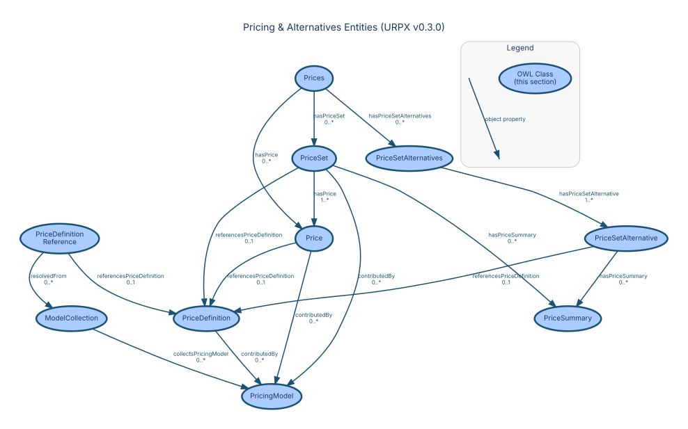

### Prices

**URI:** `https://urpx-org.github.io/urpx/ontology/Prices`  
**Parent:** `owl:Thing`

**Description:** Centralized container for all price-related content within a rate plan version. Consolidates base price sets and alternative price sets, providing single point of access for all prices. Each RatePlanVersion has exactly one Prices container.

**Properties:**

| Property | Type | Cardinality | Range | Description |
|----------|------|-------------|-------|-------------|
| `urpx:hasPrice` | Object | 0..* | [`Price`](#urpxprice) | Links price set to individual prices |
| `urpx:hasPriceSet` | Object | 0..* | [`PriceSet`](#urpxpriceset) | Links Prices container to base/default price sets |
| `urpx:hasPriceSetAlternatives` | Object | 0..* | [`PriceSetAlternatives`](#urpxpricesetalternatives) | Links Prices container directly to PriceSetAlternatives instances for mutually exclusive price set options. |

---

### PriceSet

**URI:** `https://urpx-org.github.io/urpx/ontology/PriceSet`  
**Parent:** `owl:Thing`

**Description:** Logical grouping of related prices for organization and calculation

**Semantic Context:**  
PriceSets organize prices into meaningful groups (e.g., "Summer Energy
Prices", "Demand Prices") that simplify rate understanding and bill
presentation.

**Properties:**

| Property | Type | Cardinality | Range | Description |
|----------|------|-------------|-------|-------------|
| `urpx:adder` | Datatype | 0..1 | `xsd:decimal` | Fixed amount added to calculated price |
| `urpx:appliesInSeason` | Object | 0..* | [`Season`](#urpxseason) | Season(s) this time bracket applies to |
| `urpx:baseQuantity` | Datatype | 0..1 | `xsd:decimal` | Base quantity for per-unit pricing (e.g., 'per 2 households') |
| `urpx:billPortion` | Datatype | 0..1 | — | Identifies which portion of the bill this charge, metric, or price set belongs to |
| `urpx:billingCycleCode` | Datatype | 0..1 | `xsd:string` | Billing cycle identifier aligned with utility billing periods |
| `urpx:chargeCategory` | Datatype | 0..1 | — | Business purpose classification of a charge |
| `urpx:chargeType` | Datatype | 0..* | — | Specific implementation type of a charge |
| `urpx:commodity` | Datatype | 0..1 | — | Industry-standard commodity type specification |
| `urpx:description` | Datatype | 0..1 | `xsd:string` | Detailed description of the item |
| `urpx:endDate` | Datatype | 0..1 | `xsd:date` | End date for validity period (date only, no time component). Omit for indefinite validity. |
| `urpx:endDateTime` | Datatype | 0..1 | `xsd:dateTime` | End date and time for validity period (with time component). Omit for indefinite validity. |
| `urpx:expectedEndDate` | Datatype | 0..1 | `xsd:date` | Provisional end date subject to change |
| `urpx:expectedEndDateTime` | Datatype | 0..1 | `xsd:dateTime` | Provisional end date/time subject to change |
| `urpx:hasAlternative` | Object | 0..* | [`ProfileAlternative`](#urpxprofilealternative) | Links alternatives container to specific price set options |
| `urpx:hasApplicabilityGroup` | Object | 0..* | [`ApplicabilityGroup`](#urpxapplicabilitygroup) | Links price set to applicability rules |
| `urpx:hasApplicabilityRule` | Object | 0..* | [`ApplicabilityRule`](#urpxapplicabilityrule) | Conditions for price application |
| `urpx:hasCalculationMethod` | Object | 0..1 | [`CalculationMethod`](#urpxcalculationmethod) | Links price to its calculation method |
| `urpx:hasDataSourceReference` | Object | 0..* | [`DataSourceReference`](#urpxdatasourcereference) | Links an entity to a structured data source reference. |
| `urpx:hasMetricSpecification` | Object | 0..1 | [`MetricSpecification`](#urpxmetricspecification) | Defines measurement specifications for prices or pricing model components |
| `urpx:hasPrice` | Object | 1..* | [`Price`](#urpxprice) | Links price set to individual prices |
| `urpx:hasPriceSummary` | Object | 0..* | [`PriceSummary`](#urpxpricesummary) | Links price set to summary totals |
| `urpx:hasRateCase` | Object | 0..* | [`RateCase`](#urpxratecase) | Links a rate plan version or pricing artifact to one or more associated rate case proceedings |
| `urpx:multiplier` | Datatype | 0..1 | `xsd:decimal` | Multiplication factor for price calculations |
| `urpx:name` | Datatype | 0..1 | `xsd:string` | The name of the item |
| `urpx:priceCurrency` | Datatype | 0..1 | `xsd:string` | ISO 4217 three-letter currency code |
| `urpx:priceMatchingKey` | Datatype | 0..1 | `xsd:string` | Key for identifying equivalent prices across alternatives |
| `urpx:primaryChargeType` | Datatype | 0..1 | — | The primary charge type when multiple types apply |
| `urpx:referencesMetricInput` | Object | 0..* | [`MetricInput`](#urpxmetricinput) | Links to metric inputs for measurement and profile metric input definitions |
| `urpx:referencesPriceDefinition` | Object | 0..1 | [`PriceDefinition`](#urpxpricedefinition) | IRI reference linking a Price, PriceSet, or PriceSetAlternative instance to its PriceDefinition |
| `urpx:referencesServiceTier` | Object | 0..1 | [`ServiceTier`](#urpxservicetier) | IRI reference to service tier for price application |
| `urpx:referencesTouPeriod` | Object | 0..1 | [`TOUPeriod`](#urpxtouperiod) | IRI reference to TOU period for price application |
| `urpx:serviceTierNumber` | Datatype | 0..1 | `xsd:integer` | Integer reference to service tier for upfront-defined tiers |
| `urpx:startDate` | Datatype | 0..1 | `xsd:date` | The start date and time of the item (in ISO 8601 date format) |
| `urpx:startDateTime` | Datatype | 0..1 | `xsd:dateTime` | The start date and time of the item (in ISO 8601 date format) |
| `urpx:touPeriodNumber` | Datatype | 0..1 | `xsd:integer` | Integer reference to TOU period ID for price application |

---

### PriceSetAlternative

**URI:** `https://urpx-org.github.io/urpx/ontology/PriceSetAlternative`  
**Parent:** `PriceSet`

**Description:** Price set that represents one alternative in a mutually exclusive set of options. Subclass of PriceSet with required reference to applicable ProfileAlternative. Lives in Prices container alongside base price sets, but distinguished by its connection to dimension-based alternatives.

**Properties:**

| Property | Type | Cardinality | Range | Description |
|----------|------|-------------|-------|-------------|
| `urpx:adder` | Datatype | 0..1 | `xsd:decimal` | Fixed amount added to calculated price |
| `urpx:alternativeLabel` | Datatype | 0..1 | `xsd:string` | Human-readable label describing this alternative's profile |
| `urpx:appliesInSeason` | Object | 0..* | [`Season`](#urpxseason) | Season(s) this time bracket applies to |
| `urpx:baseQuantity` | Datatype | 0..1 | `xsd:decimal` | Base quantity for per-unit pricing (e.g., 'per 2 households') |
| `urpx:billPortion` | Datatype | 0..1 | — | Identifies which portion of the bill this charge, metric, or price set belongs to |
| `urpx:billingCycleCode` | Datatype | 0..1 | `xsd:string` | Billing cycle identifier aligned with utility billing periods |
| `urpx:chargeCategory` | Datatype | 0..1 | — | Business purpose classification of a charge |
| `urpx:chargeType` | Datatype | 0..* | — | Specific implementation type of a charge |
| `urpx:commodity` | Datatype | 0..1 | — | Industry-standard commodity type specification |
| `urpx:description` | Datatype | 0..1 | `xsd:string` | Detailed description of the item |
| `urpx:endDate` | Datatype | 0..1 | `xsd:date` | End date for validity period (date only, no time component). Omit for indefinite validity. |
| `urpx:endDateTime` | Datatype | 0..1 | `xsd:dateTime` | End date and time for validity period (with time component). Omit for indefinite validity. |
| `urpx:expectedEndDate` | Datatype | 0..1 | `xsd:date` | Provisional end date subject to change |
| `urpx:expectedEndDateTime` | Datatype | 0..1 | `xsd:dateTime` | Provisional end date/time subject to change |
| `urpx:hasAlternative` | Object | 0..* | [`ProfileAlternative`](#urpxprofilealternative) | Links alternatives container to specific price set options |
| `urpx:hasApplicabilityGroup` | Object | 0..* | [`ApplicabilityGroup`](#urpxapplicabilitygroup) | Links price set to applicability rules |
| `urpx:hasApplicabilityRule` | Object | 0..* | [`ApplicabilityRule`](#urpxapplicabilityrule) | Conditions for price application |
| `urpx:hasCalculationMethod` | Object | 0..1 | [`CalculationMethod`](#urpxcalculationmethod) | Links price to its calculation method |
| `urpx:hasDataSourceReference` | Object | 0..* | [`DataSourceReference`](#urpxdatasourcereference) | Links an entity to a structured data source reference. |
| `urpx:hasMetricSpecification` | Object | 0..1 | [`MetricSpecification`](#urpxmetricspecification) | Defines measurement specifications for prices or pricing model components |
| `urpx:hasPrice` | Object | 1..* | [`Price`](#urpxprice) | Links price set to individual prices |
| `urpx:hasPriceSummary` | Object | 0..* | [`PriceSummary`](#urpxpricesummary) | Links price set to summary totals |
| `urpx:hasRateCase` | Object | 0..* | [`RateCase`](#urpxratecase) | Links a rate plan version or pricing artifact to one or more associated rate case proceedings |
| `urpx:multiplier` | Datatype | 0..1 | `xsd:decimal` | Multiplication factor for price calculations |
| `urpx:name` | Datatype | 0..1 | `xsd:string` | The name of the item |
| `urpx:priceCurrency` | Datatype | 0..1 | `xsd:string` | ISO 4217 three-letter currency code |
| `urpx:priceMatchingKey` | Datatype | 0..1 | `xsd:string` | Key for identifying equivalent prices across alternatives |
| `urpx:primaryChargeType` | Datatype | 0..1 | — | The primary charge type when multiple types apply |
| `urpx:referencesMetricInput` | Object | 0..* | [`MetricInput`](#urpxmetricinput) | Links to metric inputs for measurement and profile metric input definitions |
| `urpx:referencesPriceDefinition` | Object | 0..1 | [`PriceDefinition`](#urpxpricedefinition) | IRI reference linking a Price, PriceSet, or PriceSetAlternative instance to its PriceDefinition |
| `urpx:referencesProfileAlternative` | Object | 1..1 | [`ProfileAlternative`](#urpxprofilealternative) | IRI reference linking a price set alternative or price definition to its applicable ProfileAlternative. This property connects the price storage layer (Prices container) to the dimension definition layer (ProfileAlternatives), enabling the price set to indicate which dimension configuration it applies to. |
| `urpx:referencesServiceTier` | Object | 0..1 | [`ServiceTier`](#urpxservicetier) | IRI reference to service tier for price application |
| `urpx:referencesTouPeriod` | Object | 0..1 | [`TOUPeriod`](#urpxtouperiod) | IRI reference to TOU period for price application |
| `urpx:serviceTierNumber` | Datatype | 0..1 | `xsd:integer` | Integer reference to service tier for upfront-defined tiers |
| `urpx:startDate` | Datatype | 0..1 | `xsd:date` | The start date and time of the item (in ISO 8601 date format) |
| `urpx:startDateTime` | Datatype | 0..1 | `xsd:dateTime` | The start date and time of the item (in ISO 8601 date format) |
| `urpx:touPeriodNumber` | Datatype | 0..1 | `xsd:integer` | Integer reference to TOU period ID for price application |

---

### PriceSetAlternatives

**URI:** `https://urpx-org.github.io/urpx/ontology/PriceSetAlternatives`  
**Parent:** `owl:Thing`

**Description:** Set of price sets that represents a set of alternatives in a mutually exclusive set of options.

**Properties:**

| Property | Type | Cardinality | Range | Description |
|----------|------|-------------|-------|-------------|
| `urpx:hasPriceSetAlternative` | Object | 1..* | [`PriceSetAlternative`](#urpxpricesetalternative) | Links PriceSetAlternatives container to individual PriceSetAlternative instances. |
| `urpx:name` | Datatype | 0..1 | `xsd:string` | The name of the item |
| `urpx:priceMatchingKey` | Datatype | 0..1 | `xsd:string` | Key for identifying equivalent prices across alternatives |
| `urpx:referencesProfileAlternatives` | Object | 1..1 | [`ProfileAlternatives`](#urpxprofilealternatives) | Links price set alternatives or price definition container to the profile alternatives definition. |

---

### Price

**URI:** `https://urpx-org.github.io/urpx/ontology/Price`  
**Parent:** `owl:Thing`

**Description:** Individual pricing component with rate and applicability rules

**Semantic Context:**  
Prices are the atomic units of utility pricing. Each price represents
a specific cost element with its own calculation method, applicability
rules, and pricing parameters.

**Properties:**

| Property | Type | Cardinality | Range | Description |
|----------|------|-------------|-------|-------------|
| `urpx:adder` | Datatype | 0..1 | `xsd:decimal` | Fixed amount added to calculated price |
| `urpx:amount` | Datatype | 0..1 | `xsd:decimal` | Fixed amount for prices not based on consumption |
| `urpx:appliesInSeason` | Object | 0..* | [`Season`](#urpxseason) | Season(s) this time bracket applies to |
| `urpx:basePrice` | Datatype | 0..1 | `xsd:decimal` | Base price before adjustments |
| `urpx:baseQuantity` | Datatype | 0..1 | `xsd:decimal` | Base quantity for per-unit pricing (e.g., 'per 2 households') |
| `urpx:basedOnPrice` | Datatype | 0..* | — | References another price or price summary that this price depends on for calculation |
| `urpx:billPortion` | Datatype | 0..1 | — | Identifies which portion of the bill this charge, metric, or price set belongs to |
| `urpx:billingCycleCode` | Datatype | 0..1 | `xsd:string` | Billing cycle identifier aligned with utility billing periods |
| `urpx:chargeCategory` | Datatype | 0..1 | — | Business purpose classification of a charge |
| `urpx:chargeType` | Datatype | 0..* | — | Specific implementation type of a charge |
| `urpx:commodity` | Datatype | 0..1 | — | Industry-standard commodity type specification |
| `urpx:currentPrice` | Datatype | 0..1 | `xsd:decimal` | Current effective price |
| `urpx:description` | Datatype | 0..1 | `xsd:string` | Detailed description of the item |
| `urpx:endDate` | Datatype | 0..1 | `xsd:date` | End date for validity period (date only, no time component). Omit for indefinite validity. |
| `urpx:endDateTime` | Datatype | 0..1 | `xsd:dateTime` | End date and time for validity period (with time component). Omit for indefinite validity. |
| `urpx:expectedEndDate` | Datatype | 0..1 | `xsd:date` | Provisional end date subject to change |
| `urpx:expectedEndDateTime` | Datatype | 0..1 | `xsd:dateTime` | Provisional end date/time subject to change |
| `urpx:hasApplicabilityGroup` | Object | 0..* | [`ApplicabilityGroup`](#urpxapplicabilitygroup) | Links price set to applicability rules |
| `urpx:hasApplicabilityRule` | Object | 0..* | [`ApplicabilityRule`](#urpxapplicabilityrule) | Conditions for price application |
| `urpx:hasCalculationMethod` | Object | 0..1 | [`CalculationMethod`](#urpxcalculationmethod) | Links price to its calculation method |
| `urpx:hasDataSourceReference` | Object | 0..* | [`DataSourceReference`](#urpxdatasourcereference) | Links an entity to a structured data source reference. |
| `urpx:hasDynamicPricing` | Object | 0..1 | [`DynamicPricing`](#urpxdynamicpricing) | Links price to dynamic pricing configuration |
| `urpx:hasMetricSpecification` | Object | 0..1 | [`MetricSpecification`](#urpxmetricspecification) | Defines measurement specifications for prices or pricing model components |
| `urpx:hasRateCase` | Object | 0..* | [`RateCase`](#urpxratecase) | Links a rate plan version or pricing artifact to one or more associated rate case proceedings |
| `urpx:multiplier` | Datatype | 0..1 | `xsd:decimal` | Multiplication factor for price calculations |
| `urpx:name` | Datatype | 0..1 | `xsd:string` | The name of the item |
| `urpx:priceCurrency` | Datatype | 0..1 | `xsd:string` | ISO 4217 three-letter currency code |
| `urpx:priceMatchingKey` | Datatype | 0..1 | `xsd:string` | Key for identifying equivalent prices across alternatives |
| `urpx:primaryChargeType` | Datatype | 0..1 | — | The primary charge type when multiple types apply |
| `urpx:referencesMetricInput` | Object | 0..* | [`MetricInput`](#urpxmetricinput) | Links to metric inputs for measurement and profile metric input definitions |
| `urpx:referencesPriceDefinition` | Object | 0..1 | [`PriceDefinition`](#urpxpricedefinition) | IRI reference linking a Price, PriceSet, or PriceSetAlternative instance to its PriceDefinition |
| `urpx:referencesServiceTier` | Object | 0..1 | [`ServiceTier`](#urpxservicetier) | IRI reference to service tier for price application |
| `urpx:referencesTouPeriod` | Object | 0..1 | [`TOUPeriod`](#urpxtouperiod) | IRI reference to TOU period for price application |
| `urpx:serviceTierNumber` | Datatype | 0..1 | `xsd:integer` | Integer reference to service tier for upfront-defined tiers |
| `urpx:startDate` | Datatype | 0..1 | `xsd:date` | The start date and time of the item (in ISO 8601 date format) |
| `urpx:startDateTime` | Datatype | 0..1 | `xsd:dateTime` | The start date and time of the item (in ISO 8601 date format) |
| `urpx:touPeriodNumber` | Datatype | 0..1 | `xsd:integer` | Integer reference to TOU period ID for price application |
| `urpx:unitPrice` | Datatype | 0..1 | `xsd:decimal` | Price per unit of consumption |

---

### PriceDefinition

**URI:** `https://urpx-org.github.io/urpx/ontology/PriceDefinition`  
**Parent:** `owl:Thing`

**Description:** A structural definition of a price, excluding instance-specific details like start/end dates, amount, and unit price.

**Semantic Context:**  
A PriceDefinition provides structural price information that can be
shared across multiple prices, reducing redundancy in rate plan
specifications.

**Properties:**

| Property | Type | Cardinality | Range | Description |
|----------|------|-------------|-------|-------------|
| `urpx:appliesInSeason` | Object | 0..* | [`Season`](#urpxseason) | Season(s) this time bracket applies to |
| `urpx:baseQuantity` | Datatype | 0..1 | `xsd:decimal` | Base quantity for per-unit pricing (e.g., 'per 2 households') |
| `urpx:basedOnPrice` | Datatype | 0..* | — | References another price or price summary that this price depends on for calculation |
| `urpx:billPortion` | Datatype | 0..1 | — | Identifies which portion of the bill this charge, metric, or price set belongs to |
| `urpx:billingCycleCode` | Datatype | 0..1 | `xsd:string` | Billing cycle identifier aligned with utility billing periods |
| `urpx:chargeCategory` | Datatype | 0..1 | — | Business purpose classification of a charge |
| `urpx:chargeType` | Datatype | 0..* | — | Specific implementation type of a charge |
| `urpx:commodity` | Datatype | 0..1 | — | Industry-standard commodity type specification |
| `urpx:description` | Datatype | 0..1 | `xsd:string` | Detailed description of the item |
| `urpx:hasApplicabilityGroup` | Object | 0..* | [`ApplicabilityGroup`](#urpxapplicabilitygroup) | Links price set to applicability rules |
| `urpx:hasApplicabilityRule` | Object | 0..* | [`ApplicabilityRule`](#urpxapplicabilityrule) | Conditions for price application |
| `urpx:hasCalculationMethod` | Object | 0..1 | [`CalculationMethod`](#urpxcalculationmethod) | Links price to its calculation method |
| `urpx:hasDataSourceReference` | Object | 0..* | [`DataSourceReference`](#urpxdatasourcereference) | Links an entity to a structured data source reference. |
| `urpx:hasMetricSpecification` | Object | 0..1 | [`MetricSpecification`](#urpxmetricspecification) | Defines measurement specifications for prices or pricing model components |
| `urpx:hasRateCase` | Object | 0..* | [`RateCase`](#urpxratecase) | Links a rate plan version or pricing artifact to one or more associated rate case proceedings |
| `urpx:name` | Datatype | 1..1 | `xsd:string` | The name of the item |
| `urpx:priceCurrency` | Datatype | 0..1 | `xsd:string` | ISO 4217 three-letter currency code |
| `urpx:priceMatchingKey` | Datatype | 0..1 | `xsd:string` | Key for identifying equivalent prices across alternatives |
| `urpx:primaryChargeType` | Datatype | 0..1 | — | The primary charge type when multiple types apply |
| `urpx:referencesLedger` | Object | 1..1 | [`Ledger`](#urpxledger) | Links a PriceDefinition to its associated Ledger. |
| `urpx:referencesMetricInput` | Object | 0..* | [`MetricInput`](#urpxmetricinput) | Links to metric inputs for measurement and profile metric input definitions |
| `urpx:referencesProfileAlternative` | Object | 0..* | [`ProfileAlternative`](#urpxprofilealternative) | IRI reference linking a price set alternative or price definition to its applicable ProfileAlternative. This property connects the price storage layer (Prices container) to the dimension definition layer (ProfileAlternatives), enabling the price set to indicate which dimension configuration it applies to. |
| `urpx:referencesProfileAlternatives` | Object | 0..1 | [`ProfileAlternatives`](#urpxprofilealternatives) | Links price set alternatives or price definition container to the profile alternatives definition. |
| `urpx:referencesServiceTier` | Object | 0..1 | [`ServiceTier`](#urpxservicetier) | IRI reference to service tier for price application |
| `urpx:referencesTouPeriod` | Object | 0..1 | [`TOUPeriod`](#urpxtouperiod) | IRI reference to TOU period for price application |
| `urpx:serviceTierNumber` | Datatype | 0..1 | `xsd:integer` | Integer reference to service tier for upfront-defined tiers |
| `urpx:touPeriodNumber` | Datatype | 0..1 | `xsd:integer` | Integer reference to TOU period ID for price application |

---

### PriceSummary

**URI:** `https://urpx-org.github.io/urpx/ontology/PriceSummary`  
**Parent:** `owl:Thing`

**Description:** Total or subtotal aggregating multiple price line items

**Properties:**

| Property | Type | Cardinality | Range | Description |
|----------|------|-------------|-------|-------------|
| `urpx:includesPrice` | Object | 2..* | [`Price`](#urpxprice) | Prices included in this summary for aggregation |
| `urpx:name` | Datatype | 0..1 | `xsd:string` | The name of the item |
| `urpx:summaryAmount` | Datatype | 1..1 | `xsd:decimal` | Calculated total value for this summary |

---

### PriceUpdateRule

**URI:** `https://urpx-org.github.io/urpx/ontology/PriceUpdateRule`  
**Parent:** `owl:Thing`

**Description:** Rule defining when and how dynamic prices are calculated

**Properties:**

| Property | Type | Cardinality | Range | Description |
|----------|------|-------------|-------|-------------|
| `urpx:description` | Datatype | 0..1 | `xsd:string` | Detailed description of the item |
| `urpx:name` | Datatype | 0..1 | `xsd:string` | The name of the item |
| `urpx:priority` | Datatype | 0..1 | `xsd:integer` | Priority for overlapping entities |

---

## Metric & Measurement Entities

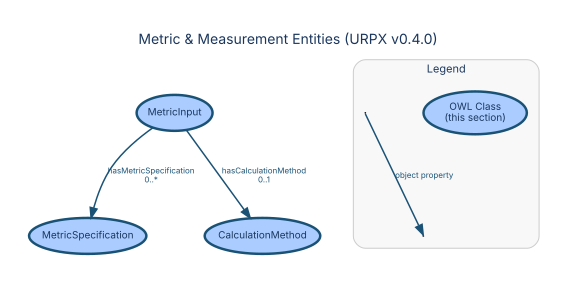

### MetricInput

**URI:** `https://urpx-org.github.io/urpx/ontology/MetricInput`  
**Parent:** `owl:Thing`

**Description:** Organizational unit for pricing rules supporting measured MetricInputs (raw meter data), profile MetricInputs (profile properties), and calculated MetricInputs (derived metrics)

**Semantic Context:**  
MetricInput is the organizational unit for pricing rules. It supports
measured inputs (raw meter data), calculated inputs (derived metrics),
aggregated inputs (sum of other inputs), and profile inputs (based on
customer/service point attributes). Prices and ledgers reference
MetricInputs rather than defining measurements inline.

**Properties:**

| Property | Type | Cardinality | Range | Description |
|----------|------|-------------|-------|-------------|
| `urpx:calculationRule` | Datatype | 0..1 | — | Calculation rule for derived MetricInputs |
| `urpx:description` | Datatype | 0..1 | `xsd:string` | Detailed description of the item |
| `urpx:hasMetricSpecification` | Object | 0..* | [`MetricSpecification`](#urpxmetricspecification) | Defines measurement specifications for prices or pricing model components |
| `urpx:metricInputType` | Datatype | 1..1 | — | Type of MetricInput for measurement organization |
| `urpx:name` | Datatype | 1..1 | `xsd:string` | The name of the item |
| `urpx:profileMetricProperty` | Datatype | 0..1 | — | IRI reference to the profile property this metric uses |

---

### MetricSpecification

**URI:** `https://urpx-org.github.io/urpx/ontology/MetricSpecification`  
**Parent:** `owl:Thing`

**Description:** Measurement specification for common billing scenarios

**Semantic Context:**  
MetricSpecification defines the technical details of what is being
measured — commodity, measurement kind, unit of measure, and interval.
Multiple MetricSpecifications can compose a single MetricInput.

**Properties:**

| Property | Type | Cardinality | Range | Description |
|----------|------|-------------|-------|-------------|
| `urpx:accumulationMethod` | Datatype | 0..1 | — | How measurement values accumulate over time |
| `urpx:commodity` | Datatype | 0..1 | — | Industry-standard commodity type specification |
| `urpx:flowDirection` | Datatype | 0..1 | — | Direction of energy flow for measurement |
| `urpx:intervalAlignment` | Datatype | 0..1 | — | Defines how the interval time window is anchored (e.g., rolling-to-date, billing-cycle-aligned, calendar-aligned). |
| `urpx:intervalDuration` | Datatype | 0..1 | `xsd:duration` | ISO 8601 duration for the interval. Primary specification for the time window length. |
| `urpx:intervalSelection` | Datatype | 0..1 | — | Defines how the time window data is selected or aggregated for the interval (e.g., rolling, consecutive periods, fixed period). |
| `urpx:intervalType` | Datatype | 0..1 | — | Semantic type label for the interval (optional) |
| `urpx:measurementKind` | Datatype | 0..1 | — | Kind of measurement being performed |
| `urpx:phaseCodeKind` | Datatype | 0..1 | — | Phase code classification |
| `urpx:unitOfMeasure` | Datatype | 0..1 | — | Industry-standard unit of measure specification |

---

### CalculationMethod

**URI:** `https://urpx-org.github.io/urpx/ontology/CalculationMethod`  
**Parent:** `owl:Thing`

**Description:** Defines how prices are calculated over billing intervals

**Properties:**

| Property | Type | Cardinality | Range | Description |
|----------|------|-------------|-------|-------------|
| `urpx:aggregationMethod` | Datatype | 0..1 | — | Statistical method for aggregating interval measurements |
| `urpx:calculationFormula` | Datatype | 0..1 | `xsd:string` | Formula defining calculation logic for complex scenarios |
| `urpx:description` | Datatype | 0..1 | `xsd:string` | Detailed description of the item |
| `urpx:intervalAlignment` | Datatype | 0..1 | — | Defines how the interval time window is anchored (e.g., rolling-to-date, billing-cycle-aligned, calendar-aligned). |
| `urpx:intervalDuration` | Datatype | 0..1 | `xsd:duration` | ISO 8601 duration for the interval. Primary specification for the time window length. |
| `urpx:intervalSelection` | Datatype | 0..1 | — | Defines how the time window data is selected or aggregated for the interval (e.g., rolling, consecutive periods, fixed period). |
| `urpx:intervalType` | Datatype | 0..1 | — | Semantic type label for the interval (optional) |
| `urpx:name` | Datatype | 0..1 | `xsd:string` | The name of the item |

---

## Plan Elements & Billing Entities

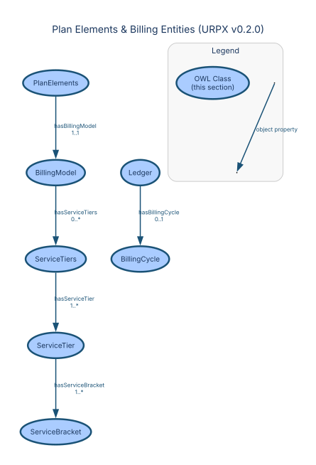

### PlanElements

**URI:** `https://urpx-org.github.io/urpx/ontology/PlanElements`  
**Parent:** `owl:Thing`

**Description:** Centralized container for temporal and pricing elements of rate plan or modifier versions

**Semantic Context:**  
PlanElements is the centralized container for all non-price components
of a rate plan version: temporal schedules, metric definitions, billing
models, and profile alternatives. This separation keeps the Prices
container focused on pricing data alone.

**Properties:**

| Property | Type | Cardinality | Range | Description |
|----------|------|-------------|-------|-------------|
| `urpx:hasBillingModel` | Object | 1..1 | [`BillingModel`](#urpxbillingmodel) | Billing rules and calculation patterns for rate plan version |
| `urpx:hasHolidayCalendar` | Object | 0..* | [`HolidayCalendar`](#urpxholidaycalendar) | Holiday calendar reference for TOU calculations, versioned location data, or centralized temporal definitions |
| `urpx:hasMetricInput` | Object | 1..* | [`MetricInput`](#urpxmetricinput) | Links plan elements to metric inputs for measurement organization |
| `urpx:hasProfileAlternatives` | Object | 0..1 | [`ProfileAlternatives`](#urpxprofilealternatives) | Links plan elements to profile alternatives requiring user selection of mutually exclusive options |
| `urpx:hasSeasons` | Object | 0..* | [`Season`](#urpxseason) | Seasonal definitions for rate plan or modifier version |

---

### BillingModel

**URI:** `https://urpx-org.github.io/urpx/ontology/BillingModel`  
**Parent:** `owl:Thing`

**Description:** Billing-specific rules and calculation patterns for rate plan version with ledger-based organization

**Semantic Context:**  
A BillingModel defines the billing structure for a rate plan version,
including TOU schedules, billing cycles, and ledger configuration.

**Properties:**

| Property | Type | Cardinality | Range | Description |
|----------|------|-------------|-------|-------------|
| `urpx:hasLedger` | Object | 0..* | [`Ledger`](#urpxledger) | Links plan elements to ledgers for billing segregation |
| `urpx:hasPriceDefinition` | Object | 1..* | [`PriceDefinition`](#urpxpricedefinition) | Links a billing model to its price definitions. |
| `urpx:hasServiceTiers` | Object | 0..* | [`ServiceTiers`](#urpxservicetiers) | Container for multiple service tier definitions |
| `urpx:hasTOUSchedule` | Object | 0..* | [`TOUSchedule`](#urpxtouschedule) | Defines time-of-use pricing schedules |
| `urpx:prorationMethod` | Datatype | 0..1 | `xsd:string` | Method for prorating prices during partial billing periods |

---

### BillingCycle

**URI:** `https://urpx-org.github.io/urpx/ontology/BillingCycle`  
**Parent:** `owl:Thing`

**Description:** Standardized billing period definitions

**Properties:**

| Property | Type | Cardinality | Range | Description |
|----------|------|-------------|-------|-------------|
| `urpx:cycleStartDay` | Datatype | 0..1 | `xsd:integer` | Day of month when billing cycle starts |
| `urpx:endDate` | Datatype | 0..1 | `xsd:date` | End date for validity period (date only, no time component). Omit for indefinite validity. |
| `urpx:endDateTime` | Datatype | 0..1 | `xsd:dateTime` | End date and time for validity period (with time component). Omit for indefinite validity. |
| `urpx:expectedEndDate` | Datatype | 0..1 | `xsd:date` | Provisional end date subject to change |
| `urpx:expectedEndDateTime` | Datatype | 0..1 | `xsd:dateTime` | Provisional end date/time subject to change |
| `urpx:intervalAlignment` | Datatype | 0..1 | — | Defines how the interval time window is anchored (e.g., rolling-to-date, billing-cycle-aligned, calendar-aligned). |
| `urpx:intervalDuration` | Datatype | 0..1 | `xsd:duration` | ISO 8601 duration for the interval. Primary specification for the time window length. |
| `urpx:intervalSelection` | Datatype | 0..1 | — | Defines how the time window data is selected or aggregated for the interval (e.g., rolling, consecutive periods, fixed period). |
| `urpx:intervalType` | Datatype | 0..1 | — | Semantic type label for the interval (optional) |
| `urpx:startDate` | Datatype | 0..1 | `xsd:date` | The start date and time of the item (in ISO 8601 date format) |
| `urpx:startDateTime` | Datatype | 0..1 | `xsd:dateTime` | The start date and time of the item (in ISO 8601 date format) |

---

### Ledger

**URI:** `https://urpx-org.github.io/urpx/ontology/Ledger`  
**Parent:** `owl:Thing`

**Description:** Enables multiple ledgers for separation of supply vs delivery charges or other billing segregations

**Semantic Context:**  
A Ledger groups prices by measurement context within a billing model.
Each ledger references a MetricInput and contains the prices that
apply to that measurement.

**Properties:**

| Property | Type | Cardinality | Range | Description |
|----------|------|-------------|-------|-------------|
| `urpx:description` | Datatype | 0..1 | `xsd:string` | Detailed description of the item |
| `urpx:hasBillingCycle` | Object | 0..1 | [`BillingCycle`](#urpxbillingcycle) | Links Ledger to billing cycle definitions |
| `urpx:ledgerType` | Datatype | 0..1 | — | Type of ledger for billing segregation |
| `urpx:name` | Datatype | 1..1 | `xsd:string` | The name of the item |
| `urpx:referencesMetricInput` | Object | 0..* | [`MetricInput`](#urpxmetricinput) | Links to metric inputs for measurement and profile metric input definitions |
| `urpx:settlementInterval` | Datatype | 0..1 | `xsd:duration` | Period over which ledger balances are settled |

---

### ServiceTier

**URI:** `https://urpx-org.github.io/urpx/ontology/ServiceTier`  
**Parent:** `owl:Thing`

**Description:** Usage tier definition with upper/lower bounds and inclusivity for tiered pricing

**Properties:**

| Property | Type | Cardinality | Range | Description |
|----------|------|-------------|-------|-------------|
| `urpx:lowerBound` | Datatype | 0..1 | `xsd:decimal` | Lower threshold value for tier applicability |
| `urpx:lowerBoundOperator` | Datatype | 0..1 | — | Comparison operator for lower bound evaluation |
| `urpx:name` | Datatype | 0..1 | `xsd:string` | The name of the item |
| `urpx:serviceTierNumber` | Datatype | 1..1 | `xsd:integer` | Integer reference to service tier for upfront-defined tiers |
| `urpx:upperBound` | Datatype | 0..1 | `xsd:decimal` | Upper threshold value for tier applicability |
| `urpx:upperBoundOperator` | Datatype | 0..1 | — | Comparison operator for upper bound evaluation |

---

### ServiceTiers

**URI:** `https://urpx-org.github.io/urpx/ontology/ServiceTiers`  
**Parent:** `owl:Thing`

**Description:** Container for multiple service tiers within a billing model

**Properties:**

| Property | Type | Cardinality | Range | Description |
|----------|------|-------------|-------|-------------|
| `urpx:appliesInSeason` | Object | 0..* | [`Season`](#urpxseason) | Season(s) this service tier group applies to |
| `urpx:hasServiceTier` | Object | 1..* | [`ServiceTier`](#urpxservicetier) | Service tier definitions for tiered pricing structures |
| `urpx:referencesMetricInput` | Object | 0..* | [`MetricInput`](#urpxmetricinput) | Links to metric inputs for measurement and profile metric input definitions |
| `urpx:referencesProfileAlternative` | Object | 0..1 | [`ProfileAlternative`](#urpxprofilealternative) | IRI reference linking a price set alternative or price definition to its applicable ProfileAlternative. This property connects the price storage layer (Prices container) to the dimension definition layer (ProfileAlternatives), enabling the price set to indicate which dimension configuration it applies to. |

---

## Temporal & Scheduling Entities

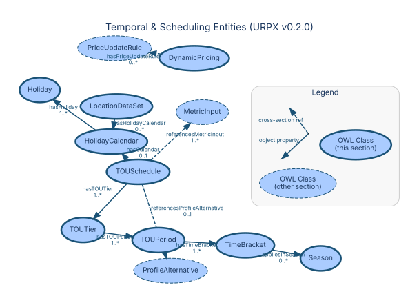

### Season

**URI:** `https://urpx-org.github.io/urpx/ontology/Season`  
**Parent:** `owl:Thing`

**Description:** Seasonal period definition with flexible date or month-based specifications

**Semantic Context:**  
Seasons define temporal periods that affect pricing. Utilities typically
define summer/winter seasons with different rate structures for each.
Seasons recur yearly and are referenced by TimeBrackets.

**Properties:**

| Property | Type | Cardinality | Range | Description |
|----------|------|-------------|-------|-------------|
| `urpx:endDate` | Datatype | 0..1 | `xsd:date` | End date for validity period (date only, no time component). Omit for indefinite validity. |
| `urpx:endDateTime` | Datatype | 0..1 | `xsd:dateTime` | End date and time for validity period (with time component). Omit for indefinite validity. |
| `urpx:month` | Datatype | 0..* | `xsd:gMonth` | Month when this season applies (ISO 8601 gMonth format) |
| `urpx:seasonName` | Datatype | 1..1 | `xsd:string` | Name for this season |
| `urpx:startDate` | Datatype | 0..1 | `xsd:date` | The start date and time of the item (in ISO 8601 date format) |
| `urpx:startDateTime` | Datatype | 0..1 | `xsd:dateTime` | The start date and time of the item (in ISO 8601 date format) |
| `urpx:yearlyRecurrence` | Datatype | 0..1 | `xsd:boolean` | Whether this season recurs yearly |

---

### TOUSchedule

**URI:** `https://urpx-org.github.io/urpx/ontology/TOUSchedule`  
**Parent:** `owl:Thing`

**Description:** Container for time-based pricing tiers and periods with optional holiday calendar

**Semantic Context:**  
A TOUSchedule organizes time-of-use tiers into a complete schedule.
Each schedule contains tiers (Peak, Off-Peak, etc.) which contain
periods with specific time brackets.

**Properties:**

| Property | Type | Cardinality | Range | Description |
|----------|------|-------------|-------|-------------|
| `urpx:hasCalendar` | Object | 0..1 | [`HolidayCalendar`](#urpxholidaycalendar) | References holiday calendar for this TOU schedule |
| `urpx:hasTOUTier` | Object | 1..* | [`TOUTier`](#urpxtoutier) | Links TOU schedule to pricing tiers (peak, mid-peak, off-peak) |
| `urpx:name` | Datatype | 0..1 | `xsd:string` | The name of the item |
| `urpx:referencesMetricInput` | Object | 1..* | [`MetricInput`](#urpxmetricinput) | Links to metric inputs for measurement and profile metric input definitions |
| `urpx:referencesProfileAlternative` | Object | 0..1 | [`ProfileAlternative`](#urpxprofilealternative) | IRI reference linking a price set alternative or price definition to its applicable ProfileAlternative. This property connects the price storage layer (Prices container) to the dimension definition layer (ProfileAlternatives), enabling the price set to indicate which dimension configuration it applies to. |

---

### TOUTier

**URI:** `https://urpx-org.github.io/urpx/ontology/TOUTier`  
**Parent:** `owl:Thing`

**Description:** Price tier grouping TOU periods of similar pricing level (peak, mid-peak, off-peak)

**Properties:**

| Property | Type | Cardinality | Range | Description |
|----------|------|-------------|-------|-------------|
| `urpx:hasTOUPeriod` | Object | 1..* | [`TOUPeriod`](#urpxtouperiod) | Links TOU tier to specific time periods |
| `urpx:tierSourceName` | Datatype | 0..1 | `xsd:string` | Utility's original name for this tier |
| `urpx:touTierNumber` | Datatype | 1..1 | `xsd:integer` | Tier number in descending price order (1=highest price) |
| `urpx:touTierStandardName` | Datatype | 0..1 | — | Standard TOU tier type name for time-of-use pricing tiers |

---

### TOUPeriod

**URI:** `https://urpx-org.github.io/urpx/ontology/TOUPeriod`  
**Parent:** `owl:Thing`

**Description:** Specific time period with unique ID for linking to prices

**Properties:**

| Property | Type | Cardinality | Range | Description |
|----------|------|-------------|-------|-------------|
| `urpx:endDate` | Datatype | 0..1 | `xsd:date` | End date for validity period (date only, no time component). Omit for indefinite validity. |
| `urpx:endDateTime` | Datatype | 0..1 | `xsd:dateTime` | End date and time for validity period (with time component). Omit for indefinite validity. |
| `urpx:expectedEndDate` | Datatype | 0..1 | `xsd:date` | Provisional end date subject to change |
| `urpx:expectedEndDateTime` | Datatype | 0..1 | `xsd:dateTime` | Provisional end date/time subject to change |
| `urpx:hasTimeBracket` | Object | 1..* | [`TimeBracket`](#urpxtimebracket) | Defines when TOU period applies |
| `urpx:name` | Datatype | 1..1 | `xsd:string` | The name of the item |
| `urpx:priority` | Datatype | 0..1 | `xsd:integer` | Priority for overlapping entities |
| `urpx:startDate` | Datatype | 0..1 | `xsd:date` | The start date and time of the item (in ISO 8601 date format) |
| `urpx:startDateTime` | Datatype | 0..1 | `xsd:dateTime` | The start date and time of the item (in ISO 8601 date format) |
| `urpx:touPeriodNumber` | Datatype | 1..1 | `xsd:integer` | Integer reference to TOU period ID for price application |

---

### TimeBracket

**URI:** `https://urpx-org.github.io/urpx/ontology/TimeBracket`  
**Parent:** `owl:Thing`

**Description:** Time window definition with day type and holiday handling

**Properties:**

| Property | Type | Cardinality | Range | Description |
|----------|------|-------------|-------|-------------|
| `urpx:appliesInSeason` | Object | 0..* | [`Season`](#urpxseason) | Season(s) this time bracket applies to |
| `urpx:dayType` | Datatype | 1..1 | — | Type of days this time bracket applies to (ISO 8601 aligned) |
| `urpx:endTime` | Datatype | 1..1 | `xsd:time` | End time for this bracket |
| `urpx:includeHolidays` | Datatype | 0..1 | `xsd:boolean` | Whether this bracket applies on holidays |
| `urpx:includeNonHolidays` | Datatype | 0..1 | `xsd:boolean` | Whether this bracket applies on non-holidays |
| `urpx:startTime` | Datatype | 1..1 | `xsd:time` | Start time for this bracket |

---

### HolidayCalendar

**URI:** `https://urpx-org.github.io/urpx/ontology/HolidayCalendar`  
**Parent:** `owl:Thing`

**Description:** Collection of holidays affecting TOU period application with versioning support

**Properties:**

| Property | Type | Cardinality | Range | Description |
|----------|------|-------------|-------|-------------|
| `urpx:hasHoliday` | Object | 1..* | [`Holiday`](#urpxholiday) | Individual holidays in the calendar |

---

### Holiday

**URI:** `https://urpx-org.github.io/urpx/ontology/Holiday`  
**Parent:** `owl:Thing`

**Description:** Single holiday definition with date or calculation rule

**Properties:**

| Property | Type | Cardinality | Range | Description |
|----------|------|-------------|-------|-------------|
| `urpx:holidayDate` | Datatype | 0..1 | `xsd:date` | Specific date for fixed holidays |
| `urpx:holidayName` | Datatype | 1..1 | `xsd:string` | Name of the holiday |
| `urpx:holidayRule` | Datatype | 0..1 | `xsd:string` | Rule for calculating holiday date |
| `urpx:observanceRule` | Datatype | 0..1 | — | How the holiday is observed when it falls on weekends (government holiday standards) |

---

### LocationDataSet

**URI:** `https://urpx-org.github.io/urpx/ontology/LocationDataSet`  
**Parent:** `owl:Thing`

**Description:** Versioned auxiliary location data including holiday calendars, timezone, and DST rules

**Properties:**

| Property | Type | Cardinality | Range | Description |
|----------|------|-------------|-------|-------------|
| `urpx:daylightSavingRules` | Datatype | 0..1 | `xsd:string` | Daylight saving time rules for this location |
| `urpx:expectedEndDate` | Datatype | 0..1 | `xsd:date` | Provisional end date subject to change |
| `urpx:expectedEndDateTime` | Datatype | 0..1 | `xsd:dateTime` | Provisional end date/time subject to change |
| `urpx:hasHolidayCalendar` | Object | 0..* | [`HolidayCalendar`](#urpxholidaycalendar) | Holiday calendar reference for TOU calculations, versioned location data, or centralized temporal definitions |
| `urpx:timezoneIdentifier` | Datatype | 0..1 | `xsd:string` | IANA timezone identifier for this location dataset |

---

### DynamicPricing

**URI:** `https://urpx-org.github.io/urpx/ontology/DynamicPricing`  
**Parent:** `owl:Thing`

**Description:** Configuration for real-time or event-based variable pricing

**Properties:**

| Property | Type | Cardinality | Range | Description |
|----------|------|-------------|-------|-------------|
| `urpx:dynamicPricingType` | Datatype | 1..1 | — | Type of dynamic pricing (FERC market terminology) |
| `urpx:hasPriceUpdateRule` | Object | 0..* | [`PriceUpdateRule`](#urpxpriceupdaterule) | Rules governing price updates |
| `urpx:priceCeiling` | Datatype | 0..1 | `xsd:decimal` | Maximum allowed price |
| `urpx:priceFloor` | Datatype | 0..1 | `xsd:decimal` | Minimum allowed price |
| `urpx:priceSource` | Datatype | 0..* | — | Source of dynamic price information (FERC market sources) |
| `urpx:updateFrequency` | Datatype | 0..1 | — | How frequently dynamic prices are updated (ISO 8601 intervals) |

---

## Condition Modeling

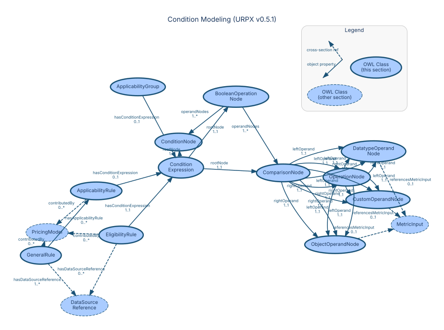

### EligibilityRule

**URI:** `https://urpx-org.github.io/urpx/ontology/EligibilityRule`  
**Parent:** `owl:Thing`

**Description:** Conditions determining customer and service point qualification

**Semantic Context:**  
Eligibility rules encode complex business logic that determines which
customers can access specific rates, ensuring regulatory compliance
and proper rate application.

**Properties:**

| Property | Type | Cardinality | Range | Description |
|----------|------|-------------|-------|-------------|
| `urpx:description` | Datatype | 0..1 | `xsd:string` | Detailed description of the item |
| `urpx:hasConditionExpression` | Object | 1..1 | [`ConditionExpression`](#urpxconditionexpression) | Links a rule to its structured condition expression |
| `urpx:hasDataSourceReference` | Object | 0..* | [`DataSourceReference`](#urpxdatasourcereference) | Links an entity to a structured data source reference. |
| `urpx:name` | Datatype | 0..1 | `xsd:string` | The name of the item |

---

### GeneralRule

**URI:** `https://urpx-org.github.io/urpx/ontology/GeneralRule`  
**Parent:** `owl:Thing`

**Description:** A rule or statement that applies across rate plans and rate plan versions, not tied to a single billing context

**Properties:**

| Property | Type | Cardinality | Range | Description |
|----------|------|-------------|-------|-------------|
| `urpx:description` | Datatype | 0..1 | `xsd:string` | Detailed description of the item |
| `urpx:generalRuleID` | Datatype | 1..1 | `xsd:string` | Unique identifier for a general rule |
| `urpx:hasApplicabilityRule` | Object | 0..* | [`ApplicabilityRule`](#urpxapplicabilityrule) | Conditions for price application |
| `urpx:hasDataSourceReference` | Object | 1..* | [`DataSourceReference`](#urpxdatasourcereference) | Links an entity to a structured data source reference. |
| `urpx:name` | Datatype | 0..1 | `xsd:string` | The name of the item |

---

### ConditionExpression

**URI:** `https://urpx-org.github.io/urpx/ontology/ConditionExpression`  
**Parent:** `owl:Thing`

**Description:** Rule-level wrapper for structured condition applicability used in EligibilityRule, ApplicabilityRule, ApplicabilityGroup, ProfileAlternative

**Properties:**

| Property | Type | Cardinality | Range | Description |
|----------|------|-------------|-------|-------------|
| `urpx:rootNode` | Datatype | 1..1 | — | Points from a ConditionExpression to its single root ConditionNode |

---

### ApplicabilityRule

**URI:** `https://urpx-org.github.io/urpx/ontology/ApplicabilityRule`  
**Parent:** `owl:Thing`

**Description:** Conditions determining when a price applies to usage

**Properties:**

| Property | Type | Cardinality | Range | Description |
|----------|------|-------------|-------|-------------|
| `urpx:hasConditionExpression` | Object | 0..1 | [`ConditionExpression`](#urpxconditionexpression) | Links a rule to its structured condition expression |
| `urpx:month` | Datatype | 0..* | `xsd:gMonth` | Month when this season applies (ISO 8601 gMonth format) |
| `urpx:name` | Datatype | 0..1 | `xsd:string` | The name of the item |

---

### ApplicabilityGroup

**URI:** `https://urpx-org.github.io/urpx/ontology/ApplicabilityGroup`  
**Parent:** `owl:Thing`

**Description:** Geographic and service class applicability rules for statement prices

**Semantic Context:**  
Applicability groups enable complex conditional logic for price
application, supporting sophisticated rate designs that vary by
location, customer type, or usage patterns.

**Properties:**

| Property | Type | Cardinality | Range | Description |
|----------|------|-------------|-------|-------------|
| `urpx:applicabilityLogic` | Datatype | 0..1 | `xsd:string` | Boolean logic for complex applicability rules |
| `urpx:appliesForCustomerKind` | Datatype | 0..* | — | Links applicability group to customer kind classification |
| `urpx:appliesForCustomerSubKind` | Datatype | 0..* | — | Links applicability group to customer sub-kind classification |
| `urpx:appliesInCounty` | Object | 0..* | [`County`](#urpxcounty) | Links applicability group to county-level geographic scope |
| `urpx:appliesInGeographicZone` | Datatype | 0..* | — | Links applicability group to geographic zone |
| `urpx:appliesInMunicipality` | Object | 0..* | [`Municipality`](#urpxmunicipality) | Links applicability group to municipality-level geographic scope |
| `urpx:appliesInServiceTerritory` | Object | 0..* | [`ServiceTerritory`](#urpxserviceterritory) | Links applicability group to service territory geographic scope |
| `urpx:appliesInState` | Object | 0..* | [`State`](#urpxstate) | Links applicability group to state-level geographic scope |
| `urpx:endUse` | Datatype | 0..1 | — | End use classification for electric service (heating vs non-heating) |
| `urpx:geographicScope` | Datatype | 0..1 | — | Geographic scope of applicability (ISO 3166 admin levels) |
| `urpx:hasConditionExpression` | Object | 0..1 | [`ConditionExpression`](#urpxconditionexpression) | Links a rule to its structured condition expression |
| `urpx:name` | Datatype | 0..1 | `xsd:string` | The name of the item |
| `urpx:serviceClassPattern` | Datatype | 0..1 | `xsd:string` | Service class pattern for applicability matching |
| `urpx:voltageLevel` | Datatype | 0..1 | — | Service voltage level classification for rate applicability and service point profiles |

---

### BooleanOperationNode

**URI:** `https://urpx-org.github.io/urpx/ontology/BooleanOperationNode`  
**Parent:** `ConditionNode`

**Description:** Boolean combinator node in a condition expression tree

**Properties:**

| Property | Type | Cardinality | Range | Description |
|----------|------|-------------|-------|-------------|
| `urpx:logicExpression` | Datatype | 0..1 | `xsd:string` | Optional textual expression attached to a comparison or boolean operation node |
| `urpx:operandNodes` | Datatype | 1..* | — | Child condition nodes used by a BooleanOperationNode |
| `urpx:operator` | Datatype | 1..1 | — | References the operator used by a comparison boolean-operation or nested operation node |

---

### ComparisonNode

**URI:** `https://urpx-org.github.io/urpx/ontology/ComparisonNode`  
**Parent:** `ConditionNode`

**Description:** Atomic comparison predicate in a condition expression

**Properties:**

| Property | Type | Cardinality | Range | Description |
|----------|------|-------------|-------|-------------|
| `urpx:description` | Datatype | 0..1 | `xsd:string` | Detailed description of the item |
| `urpx:leftOperand` | Datatype | 1..1 | — | Left operand for ordered comparison or nested operation evaluation |
| `urpx:logicExpression` | Datatype | 0..1 | `xsd:string` | Optional textual expression attached to a comparison or boolean operation node |
| `urpx:name` | Datatype | 0..1 | `xsd:string` | The name of the item |
| `urpx:operator` | Datatype | 1..1 | — | References the operator used by a comparison boolean-operation or nested operation node |
| `urpx:rightOperand` | Datatype | 1..1 | — | Right operand for ordered comparison or nested operation evaluation |

---

### OperationNode

**URI:** `https://urpx-org.github.io/urpx/ontology/OperationNode`  
**Parent:** `owl:Thing`

**Description:** Expression node for nested arithmetic or derived comparison preparation

**Properties:**

| Property | Type | Cardinality | Range | Description |
|----------|------|-------------|-------|-------------|
| `urpx:leftOperand` | Datatype | 1..1 | — | Left operand for ordered comparison or nested operation evaluation |
| `urpx:operator` | Datatype | 1..1 | — | References the operator used by a comparison boolean-operation or nested operation node |
| `urpx:rightOperand` | Datatype | 1..1 | — | Right operand for ordered comparison or nested operation evaluation |

---

### ConditionNode

**URI:** `https://urpx-org.github.io/urpx/ontology/ConditionNode`  
**Parent:** `owl:Thing`

**Description:** Abstract superclass for nodes that may appear in a ConditionExpression tree

---

### CustomOperandNode

**URI:** `https://urpx-org.github.io/urpx/ontology/CustomOperandNode`  
**Parent:** `owl:Thing`

**Description:** Fallback operand node for custom condition properties and custom literal values

**Properties:**

| Property | Type | Cardinality | Range | Description |
|----------|------|-------------|-------|-------------|
| `urpx:booleanValue` | Datatype | 0..1 | `xsd:boolean` | Boolean literal value used in a condition operand node |
| `urpx:customConditionProperty` | Datatype | 0..1 | `xsd:string` | Fallback custom property identifier for custom operand nodes in human-readable language |
| `urpx:dateTimeValue` | Datatype | 0..1 | `xsd:dateTime` | DateTime literal value used in a condition operand node |
| `urpx:dateValue` | Datatype | 0..1 | `xsd:date` | Date literal value used in a condition operand node |
| `urpx:decimalValue` | Datatype | 0..1 | `xsd:decimal` | Decimal literal value used in a condition operand node |
| `urpx:durationValue` | Datatype | 0..1 | `xsd:duration` | Duration literal value used in a condition operand node |
| `urpx:gMonthValue` | Datatype | 0..1 | `xsd:gMonth` | gMonth literal value used in a condition operand node |
| `urpx:gYearValue` | Datatype | 0..1 | `xsd:gYear` | gYear literal value used in a condition operand node |
| `urpx:integerValue` | Datatype | 0..1 | `xsd:integer` | Integer literal value used in a condition operand node |
| `urpx:referencesMetricInput` | Datatype | 0..1 | — | Links to metric inputs for measurement and profile metric input definitions |
| `urpx:stringValue` | Datatype | 0..1 | `xsd:string` | String literal value used in a condition operand node |
| `urpx:timeValue` | Datatype | 0..1 | `xsd:time` | Time literal value used in a condition operand node |

---

### DatatypeOperandNode

**URI:** `https://urpx-org.github.io/urpx/ontology/DatatypeOperandNode`  
**Parent:** `owl:Thing`

**Description:** Operand node for datatype-valued condition properties and datatype literal values

**Properties:**

| Property | Type | Cardinality | Range | Description |
|----------|------|-------------|-------|-------------|
| `urpx:booleanValue` | Datatype | 0..1 | `xsd:boolean` | Boolean literal value used in a condition operand node |
| `urpx:conditionProperty` | Datatype | 0..1 | — | IRI reference to the ontology property evaluated by an operand node |
| `urpx:dateTimeValue` | Datatype | 0..1 | `xsd:dateTime` | DateTime literal value used in a condition operand node |
| `urpx:dateValue` | Datatype | 0..1 | `xsd:date` | Date literal value used in a condition operand node |
| `urpx:decimalValue` | Datatype | 0..1 | `xsd:decimal` | Decimal literal value used in a condition operand node |
| `urpx:durationValue` | Datatype | 0..1 | `xsd:duration` | Duration literal value used in a condition operand node |
| `urpx:gMonthValue` | Datatype | 0..1 | `xsd:gMonth` | gMonth literal value used in a condition operand node |
| `urpx:gYearValue` | Datatype | 0..1 | `xsd:gYear` | gYear literal value used in a condition operand node |
| `urpx:integerValue` | Datatype | 0..1 | `xsd:integer` | Integer literal value used in a condition operand node |
| `urpx:referencesMetricInput` | Datatype | 0..1 | — | Links to metric inputs for measurement and profile metric input definitions |
| `urpx:stringValue` | Datatype | 0..1 | `xsd:string` | String literal value used in a condition operand node |
| `urpx:timeValue` | Datatype | 0..1 | `xsd:time` | Time literal value used in a condition operand node |

---

### ObjectOperandNode

**URI:** `https://urpx-org.github.io/urpx/ontology/ObjectOperandNode`  
**Parent:** `owl:Thing`

**Description:** Operand node for object-valued condition properties and object references

**Properties:**

| Property | Type | Cardinality | Range | Description |
|----------|------|-------------|-------|-------------|
| `urpx:conditionProperty` | Datatype | 0..1 | — | IRI reference to the ontology property evaluated by an operand node |
| `urpx:referencesMetricInput` | Datatype | 0..1 | — | Links to metric inputs for measurement and profile metric input definitions |
| `urpx:referencesValue` | Datatype | 0..1 | — | IRI reference to an object or enumeration value used by an object operand node |

---

## Customer & Service Profile Entities

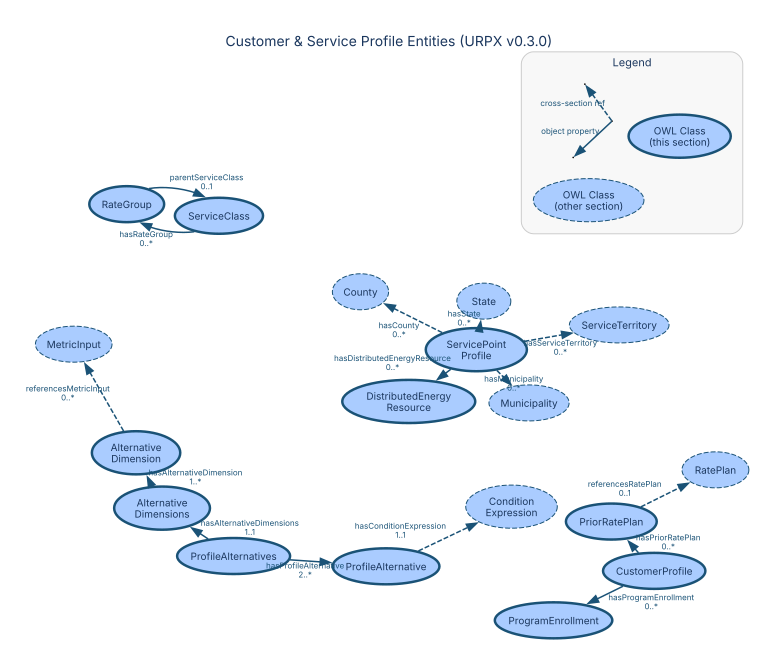

### Profile

**URI:** `https://urpx-org.github.io/urpx/ontology/Profile`  
**Parent:** `owl:Thing`

**Description:** Abstract parent for all profile types used in rate plan eligibility and service delivery evaluation

---

### CustomerProfile

**URI:** `https://urpx-org.github.io/urpx/ontology/CustomerProfile`  
**Parent:** `Profile`

**Description:** Customer business and social characteristics for rate eligibility and program participation evaluation

**Semantic Context:**  
Customer profiles enable sophisticated rate targeting based on usage
patterns, demand characteristics, and customer attributes without
exposing individual customer data.

**Properties:**

| Property | Type | Cardinality | Range | Description |
|----------|------|-------------|-------|-------------|
| `urpx:annualIncomeRange` | Datatype | 0..* | — | Annual income range bracket (HEAP eligibility) |
| `urpx:assistanceEligibilityLevel` | Datatype | 0..* | — | Assistance program eligibility level |
| `urpx:billingCycleCode` | Datatype | 0..* | `xsd:string` | Billing cycle identifier aligned with utility billing periods |
| `urpx:creditRating` | Datatype | 0..* | `xsd:string` | Reference to external credit rating classification |
| `urpx:entityType` | Datatype | 0..* | — | Legal entity type |
| `urpx:hasCustomerKind` | Datatype | 0..* | — | Primary customer classification |
| `urpx:hasCustomerSubKind` | Datatype | 0..* | — | Detailed customer classification |
| `urpx:hasPriorRatePlan` | Object | 0..* | [`PriorRatePlan`](#urpxpriorrateplan) | Links customer profile to previous rate plan enrollment |
| `urpx:hasProgramEnrollment` | Object | 0..* | [`ProgramEnrollment`](#urpxprogramenrollment) | Links customer profile to program enrollments |
| `urpx:householdCount` | Datatype | 0..* | `xsd:integer` | Number of households served by this customer account |
| `urpx:householdSize` | Datatype | 0..* | `xsd:integer` | Number of people in household (HEAP eligibility) |
| `urpx:isCCACustomer` | Datatype | 0..* | `xsd:boolean` | Whether the customer is served by a Community Choice Aggregator |
| `urpx:isCommunitySolarCustomer` | Datatype | 0..* | `xsd:boolean` | Whether the customer participates in a community solar program |
| `urpx:occupancyCount` | Datatype | 0..1 | `xsd:integer` | Number of occupants at premises |
| `urpx:specialNeedsStatus` | Datatype | 0..* | — | Special needs classification |
| `urpx:taxExemptStatus` | Datatype | 0..* | — | Tax exemption status |
| `urpx:usageThreshold` | Datatype | 0..* | `xsd:decimal` | Annual usage threshold in kWh |

---

### ServicePointProfile

**URI:** `https://urpx-org.github.io/urpx/ontology/ServicePointProfile`  
**Parent:** `Profile`

**Description:** Service delivery point characteristics for rate plan eligibility and service configuration evaluation

**Semantic Context:**  
Service point profiles describe the physical characteristics of the
service delivery point — voltage level, metering configuration, DER
installations, and connection type.

**Properties:**

| Property | Type | Cardinality | Range | Description |
|----------|------|-------------|-------|-------------|
| `urpx:averageMonthlyUsage` | Datatype | 0..1 | `xsd:decimal` | Average monthly usage in kWh |
| `urpx:billedDemand` | Datatype | 0..1 | `xsd:decimal` | Utility-estimated demand for billing in kW |
| `urpx:buildingSquareFootage` | Datatype | 0..1 | `xsd:decimal` | Building size in square feet |
| `urpx:connectionKind` | Datatype | 0..1 | — | Type of connection at service point |
| `urpx:endUse` | Datatype | 0..1 | — | End use classification for electric service (heating vs non-heating) |
| `urpx:geographicZone` | Datatype | 0..* | — | Geographic classification (Census geographic types) |
| `urpx:hasDistributedEnergyResource` | Object | 0..* | [`DistributedEnergyResource`](#urpxdistributedenergyresource) | Distributed energy resources associated with this service point |
| `urpx:hasHVAC` | Datatype | 0..* | — | HVAC equipment associated with this service point |
| `urpx:hasMeteringConfiguration` | Datatype | 0..1 | — | Metering configuration type |
| `urpx:loadProfile` | Datatype | 0..1 | — | Load profile classification |
| `urpx:meterCount` | Datatype | 0..1 | `xsd:integer` | Count of meters at service point |
| `urpx:nominalVoltage` | Datatype | 0..1 | `xsd:decimal` | Nominal service voltage in volts |
| `urpx:phaseCodeKind` | Datatype | 0..1 | — | Phase code classification |
| `urpx:premiseType` | Datatype | 0..1 | — | Type of premise served |
| `urpx:ratedPowerCapacity` | Datatype | 0..1 | `xsd:decimal` | Rated power capacity in kW |
| `urpx:seasonalPattern` | Datatype | 0..1 | — | Seasonal usage pattern classification |
| `urpx:usageVariability` | Datatype | 0..1 | `xsd:decimal` | Usage variability coefficient |
| `urpx:voltageLevel` | Datatype | 0..1 | — | Service voltage level classification for rate applicability and service point profiles |

---

### ProfileAlternative

**URI:** `https://urpx-org.github.io/urpx/ontology/ProfileAlternative`  
**Parent:** `owl:Thing`

**Description:** Specific combination of dimension values representing one alternative choice. Defines the dimensions along which price set alternatives differ, enabling mutually exclusive options for user selection. Each dimension set specifies dimension-value pairs that characterize a particular alternative configuration.

**Properties:**

| Property | Type | Cardinality | Range | Description |
|----------|------|-------------|-------|-------------|
| `urpx:defaultSelectionLogic` | Datatype | 0..1 | `xsd:string` | Logic for auto-selecting default alternative |
| `urpx:hasConditionExpression` | Object | 1..1 | [`ConditionExpression`](#urpxconditionexpression) | Links a rule to its structured condition expression |
| `urpx:name` | Datatype | 1..1 | `xsd:string` | The name of the item |

---

### ProfileAlternatives

**URI:** `https://urpx-org.github.io/urpx/ontology/ProfileAlternatives`  
**Parent:** `owl:Thing`

**Description:** Container for alternative dimension structures requiring user selection. Provides the bridge between customer profile characteristics and mutually exclusive alternative choices. Each ProfileAlternatives instance groups related alternative dimension sets that define the available options for a specific selection context.

**Properties:**

| Property | Type | Cardinality | Range | Description |
|----------|------|-------------|-------|-------------|
| `urpx:hasAlternativeDimensions` | Object | 1..1 | [`AlternativeDimensions`](#urpxalternativedimensions) | Links ProfileAlternatives to its AlternativeDimensions container, which wraps the alternative dimension sets and their metadata |
| `urpx:hasProfileAlternative` | Object | 2..* | [`ProfileAlternative`](#urpxprofilealternative) | Links ProfileAlternatives container to individual ProfileAlternative instances, each representing one mutually exclusive alternative choice configuration |
| `urpx:name` | Datatype | 1..1 | `xsd:string` | The name of the item |

---

### AlternativeDimension

**URI:** `https://urpx-org.github.io/urpx/ontology/AlternativeDimension`  
**Parent:** `owl:Thing`

**Description:** Dimension along which price set alternatives differ using ontology properties

**Properties:**

| Property | Type | Cardinality | Range | Description |
|----------|------|-------------|-------|-------------|
| `urpx:customDimensionProperty` | Datatype | 0..1 | `xsd:string` | Fallback custom property identifier used when no suitable URPX-vocabulary dimension exists |
| `urpx:dimensionDisplayName` | Datatype | 1..1 | `xsd:string` | Human-readable name for UI display |
| `urpx:dimensionProperty` | Datatype | 0..1 | `xsd:anyURI` | URI of the ontology property this dimension represents when modeled in URPX vocabulary |
| `urpx:hasPossibleValues` | Datatype | 1..* | — | List of possible values |
| `urpx:referencesMetricInput` | Object | 0..* | [`MetricInput`](#urpxmetricinput) | Links to metric inputs for measurement and profile metric input definitions |

---

### AlternativeDimensions

**URI:** `https://urpx-org.github.io/urpx/ontology/AlternativeDimensions`  
**Parent:** `owl:Thing`

**Description:** Dimensions defining the set of profileAlternatives. 

**Properties:**

| Property | Type | Cardinality | Range | Description |
|----------|------|-------------|-------|-------------|
| `urpx:hasAlternativeDimension` | Object | 1..* | [`AlternativeDimension`](#urpxalternativedimension) | Dimensions along which alternatives differ |

---

### ServiceClass

**URI:** `https://urpx-org.github.io/urpx/ontology/ServiceClass`  
**Parent:** `owl:Thing`

**Description:** Region-specific rate classification with raw and cleaned identifiers

**Semantic Context:**  
Service classes bridge the gap between utility-specific terminology
and standardized classifications, enabling cross-utility comparisons
while preserving original designations.

**Properties:**

| Property | Type | Cardinality | Range | Description |
|----------|------|-------------|-------|-------------|
| `urpx:hasRateGroup` | Object | 0..* | [`RateGroup`](#urpxrategroup) | Links rate plan to specific rate group |
| `urpx:serviceClassCleaned` | Datatype | 0..1 | `xsd:string` | Cleaned alphanumeric service class identifier |
| `urpx:serviceClassName` | Datatype | 1..1 | `xsd:string` | Human-readable service class name |
| `urpx:serviceClassRaw` | Datatype | 1..1 | `xsd:string` | Raw service class identifier as published in tariff |

---

### RateGroup

**URI:** `https://urpx-org.github.io/urpx/ontology/RateGroup`  
**Parent:** `ServiceClass`

**Description:** Specific rate grouping within a service class (e.g., Rate I, Rate II)

**Properties:**

| Property | Type | Cardinality | Range | Description |
|----------|------|-------------|-------|-------------|
| `urpx:parentServiceClass` | Object | 0..1 | [`ServiceClass`](#urpxserviceclass) | Parent service class for this rate group |
| `urpx:rateGroupIdentifier` | Datatype | 1..1 | `xsd:string` | Unique identifier for the rate group |
| `urpx:rateGroupName` | Datatype | 1..1 | `xsd:string` | Human-readable name for the rate group |

---

### ProgramEnrollment

**URI:** `https://urpx-org.github.io/urpx/ontology/ProgramEnrollment`  
**Parent:** `owl:Thing`

**Description:** Customer enrollment in utility programs for eligibility determination

**Properties:**

| Property | Type | Cardinality | Range | Description |
|----------|------|-------------|-------|-------------|
| `urpx:enrollmentEndDate` | Datatype | 0..1 | `xsd:date` | End date of enrollment |
| `urpx:enrollmentStartDate` | Datatype | 0..1 | `xsd:date` | Start date of enrollment |
| `urpx:enrollmentStatus` | Datatype | 0..1 | — | Current enrollment status (lifecycle states) |
| `urpx:minimumTenure` | Datatype | 0..1 | `xsd:duration` | The minimum duration a customer must remain enrolled in a rate plan, program, or service offering. |
| `urpx:programName` | Datatype | 1..1 | `xsd:string` | Name of the utility program |
| `urpx:programType` | Datatype | 0..1 | — | Category of utility program |
| `urpx:url` | Datatype | 0..1 | `xsd:anyURI` | URL of the item |

---

### PriorRatePlan

**URI:** `https://urpx-org.github.io/urpx/ontology/PriorRatePlan`  
**Parent:** `owl:Thing`

**Description:** Reference to customer's previous rate plan for eligibility determination

**Properties:**

| Property | Type | Cardinality | Range | Description |
|----------|------|-------------|-------|-------------|
| `urpx:enrollmentEndDate` | Datatype | 0..1 | `xsd:date` | End date of enrollment |
| `urpx:enrollmentStartDate` | Datatype | 0..1 | `xsd:date` | Start date of enrollment |
| `urpx:enrollmentStatus` | Datatype | 0..1 | — | Current enrollment status (lifecycle states) |
| `urpx:minimumTenure` | Datatype | 0..1 | `xsd:duration` | The minimum duration a customer must remain enrolled in a rate plan, program, or service offering. |
| `urpx:referencesRatePlan` | Object | 0..1 | [`RatePlan`](#urpxrateplan) | Links prior rate plan to the actual rate plan |
| `urpx:serviceRole` | Datatype | 0..1 | — | Service role for rate plan (distribution/retail/bundled) |

---

### DistributedEnergyResource

**URI:** `https://urpx-org.github.io/urpx/ontology/DistributedEnergyResource`  
**Parent:** `owl:Thing`

**Description:** On-site generation and storage capabilities

**Properties:**

| Property | Type | Cardinality | Range | Description |
|----------|------|-------------|-------|-------------|
| `urpx:connectorType` | Datatype | 0..1 | — | EV connector type |
| `urpx:derType` | Datatype | 1..1 | — | Type of distributed energy resource |
| `urpx:evChargingCapacity` | Datatype | 0..1 | `xsd:decimal` | EV charging capacity in kW |
| `urpx:interconnectionStatus` | Datatype | 1..1 | — | Grid interconnection status |
| `urpx:inverterType` | Datatype | 0..1 | — | Solar inverter type |
| `urpx:panelOrientation` | Datatype | 0..1 | — | Solar panel orientation |
| `urpx:powerRating` | Datatype | 0..1 | `xsd:decimal` | Power rating for charging/discharging in kW |
| `urpx:roundTripEfficiency` | Datatype | 0..1 | `xsd:decimal` | Round trip efficiency as percentage |
| `urpx:smartChargingEnabled` | Datatype | 0..1 | `xsd:boolean` | Smart charging capability enabled |
| `urpx:solarCapacity` | Datatype | 0..1 | `xsd:decimal` | Solar generation capacity in kW |
| `urpx:storageCapacity` | Datatype | 0..1 | `xsd:decimal` | Energy storage capacity in kWh |
| `urpx:windCapacity` | Datatype | 0..1 | `xsd:decimal` | Wind generation capacity in kW |

---

### Scenario

**URI:** `https://urpx-org.github.io/urpx/ontology/Scenario`  
**Parent:** `owl:Thing`

**Description:** Input container grouping customer and service point profiles for broad rate plan eligibility evaluation.

**Properties:**

| Property | Type | Cardinality | Range | Description |
|----------|------|-------------|-------|-------------|
| `urpx:hasCustomerProfile` | Object | 0..1 | [`CustomerProfile`](#urpxcustomerprofile) | Links scenario to customer profile for business/social characteristics |
| `urpx:hasServicePointProfile` | Object | 0..1 | [`ServicePointProfile`](#urpxservicepointprofile) | Links scenario to service point profile for physical service delivery characteristics |

---

## Organization Entities

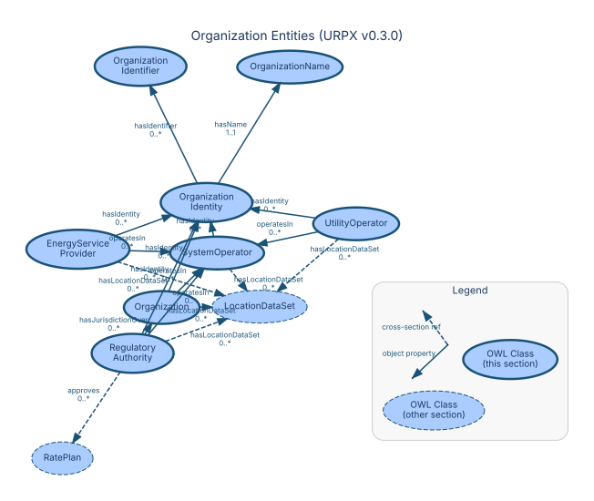

### Organization

**URI:** `https://urpx-org.github.io/urpx/ontology/Organization`  
**Parent:** `owl:Thing`

**Description:** Any entity participating in energy markets or rate regulation

**Semantic Context:**  
Organizations represent the entities involved in utility rate
administration — utilities, regulators, system operators, and
energy service providers.

**Properties:**

| Property | Type | Cardinality | Range | Description |
|----------|------|-------------|-------|-------------|
| `urpx:alternateName` | Datatype | 0..1 | `xsd:string` | An alias for the item |
| `urpx:commodity` | Datatype | 0..* | — | Industry-standard commodity type specification |
| `urpx:hasIdentity` | Object | 0..* | [`OrganizationIdentity`](#urpxorganizationidentity) | Links organization to temporal identity records |
| `urpx:hasLocationDataSet` | Object | 0..* | [`LocationDataSet`](#urpxlocationdataset) | Links organization to versioned location auxiliary data |
| `urpx:legalName` | Datatype | 0..1 | `xsd:string` | Official legal name of the organization |
| `urpx:operatesIn` | Object | 0..* | [`SystemOperator`](#urpxsystemoperator) | Links organization to ISO/RTO markets |
| `urpx:organizationType` | Datatype | 1..1 | — | Classification of organization type (organization types) |
| `urpx:publishes` | Object | 0..* | [`RatePlan`](#urpxrateplan) | Links organization to rate plans it publishes |

---

### RegulatoryAuthority

**URI:** `https://urpx-org.github.io/urpx/ontology/RegulatoryAuthority`  
**Parent:** `Organization`

**Description:** Entity with jurisdiction to approve and regulate utility rates

**Properties:**

| Property | Type | Cardinality | Range | Description |
|----------|------|-------------|-------|-------------|
| `urpx:alternateName` | Datatype | 0..1 | `xsd:string` | An alias for the item |
| `urpx:approves` | Object | 0..* | [`RatePlan`](#urpxrateplan) | Links regulator to approved rate plans |
| `urpx:commodity` | Datatype | 0..* | — | Industry-standard commodity type specification |
| `urpx:hasIdentity` | Object | 0..* | [`OrganizationIdentity`](#urpxorganizationidentity) | Links organization to temporal identity records |
| `urpx:hasJurisdictionOver` | Object | 0..* | [`Organization`](#urpxorganization) | Links regulator to regulated entities |
| `urpx:hasLocationDataSet` | Object | 0..* | [`LocationDataSet`](#urpxlocationdataset) | Links organization to versioned location auxiliary data |
| `urpx:legalName` | Datatype | 0..1 | `xsd:string` | Official legal name of the organization |
| `urpx:operatesIn` | Object | 0..* | [`SystemOperator`](#urpxsystemoperator) | Links organization to ISO/RTO markets |
| `urpx:organizationType` | Datatype | 1..1 | — | Classification of organization type (organization types) |
| `urpx:publishes` | Object | 0..* | [`RatePlan`](#urpxrateplan) | Links organization to rate plans it publishes |
| `urpx:regulatoryScope` | Datatype | 1..1 | — | Scope of regulatory oversight (regulatory functions) |

---

### SystemOperator

**URI:** `https://urpx-org.github.io/urpx/ontology/SystemOperator`  
**Parent:** `Organization`

**Description:** ISO, RTO, or transmission system operator managing grid operations

**Properties:**

| Property | Type | Cardinality | Range | Description |
|----------|------|-------------|-------|-------------|
| `urpx:alternateName` | Datatype | 0..1 | `xsd:string` | An alias for the item |
| `urpx:commodity` | Datatype | 0..* | — | Industry-standard commodity type specification |
| `urpx:hasIdentity` | Object | 0..* | [`OrganizationIdentity`](#urpxorganizationidentity) | Links organization to temporal identity records |
| `urpx:hasLocationDataSet` | Object | 0..* | [`LocationDataSet`](#urpxlocationdataset) | Links organization to versioned location auxiliary data |
| `urpx:legalName` | Datatype | 0..1 | `xsd:string` | Official legal name of the organization |
| `urpx:organizationType` | Datatype | 1..1 | — | Classification of organization type (organization types) |
| `urpx:publishes` | Object | 0..* | [`RatePlan`](#urpxrateplan) | Links organization to rate plans it publishes |

---

### UtilityOperator

**URI:** `https://urpx-org.github.io/urpx/ontology/UtilityOperator`  
**Parent:** `Organization`

**Description:** Entity providing utility services and publishing rate plans

**Properties:**

| Property | Type | Cardinality | Range | Description |
|----------|------|-------------|-------|-------------|
| `urpx:ownershipType` | Datatype | 0..1 | — | Ownership structure of utility (EIA ownership categories) |

---

### EnergyServiceProvider

**URI:** `https://urpx-org.github.io/urpx/ontology/EnergyServiceProvider`  
**Parent:** `Organization`

**Description:** Retail energy provider, aggregator, or energy service company

**Properties:**

| Property | Type | Cardinality | Range | Description |
|----------|------|-------------|-------|-------------|
| `urpx:alternateName` | Datatype | 0..1 | `xsd:string` | An alias for the item |
| `urpx:commodity` | Datatype | 0..* | — | Industry-standard commodity type specification |
| `urpx:hasIdentity` | Object | 0..* | [`OrganizationIdentity`](#urpxorganizationidentity) | Links organization to temporal identity records |
| `urpx:hasLocationDataSet` | Object | 0..* | [`LocationDataSet`](#urpxlocationdataset) | Links organization to versioned location auxiliary data |
| `urpx:legalName` | Datatype | 0..1 | `xsd:string` | Official legal name of the organization |
| `urpx:operatesIn` | Object | 0..* | [`SystemOperator`](#urpxsystemoperator) | Links organization to ISO/RTO markets |
| `urpx:organizationType` | Datatype | 1..1 | — | Classification of organization type (organization types) |
| `urpx:publishes` | Object | 0..* | [`RatePlan`](#urpxrateplan) | Links organization to rate plans it publishes |
| `urpx:serviceRole` | Datatype | 1..1 | — | Service role for rate plan (distribution/retail/bundled) |

---

### OrganizationEvent

**URI:** `https://urpx-org.github.io/urpx/ontology/OrganizationEvent`  
**Parent:** `owl:Thing`

**Description:** Corporate transition event affecting organization structure or identity

**Properties:**

| Property | Type | Cardinality | Range | Description |
|----------|------|-------------|-------|-------------|
| `urpx:regulatoryApproval` | Datatype | 0..1 | `xsd:string` | Reference to regulatory approval document |

---

### OrganizationIdentity

**URI:** `https://urpx-org.github.io/urpx/ontology/OrganizationIdentity`  
**Parent:** `owl:Thing`

**Description:** Temporal identity record tracking names and identifiers over time

**Properties:**

| Property | Type | Cardinality | Range | Description |
|----------|------|-------------|-------|-------------|
| `urpx:hasIdentifier` | Object | 0..* | [`OrganizationIdentifier`](#urpxorganizationidentifier) | Links identity to external identifiers |
| `urpx:hasName` | Object | 1..1 | [`OrganizationName`](#urpxorganizationname) | Links identity to organization names |
| `urpx:identityValidFrom` | Datatype | 0..1 | `xsd:dateTime` | Start date for this identity record |
| `urpx:identityValidTo` | Datatype | 0..1 | `xsd:dateTime` | End date for this identity record |

---

### OrganizationIdentifier

**URI:** `https://urpx-org.github.io/urpx/ontology/OrganizationIdentifier`  
**Parent:** `owl:Thing`

**Description:** External identifier from regulatory or financial systems

**Properties:**

| Property | Type | Cardinality | Range | Description |
|----------|------|-------------|-------|-------------|
| `urpx:identifierJurisdiction` | Datatype | 0..1 | `xsd:string` | Jurisdiction where identifier is valid |
| `urpx:identifierScheme` | Datatype | 0..1 | — | Identification scheme or system (Standard ID systems) |
| `urpx:utilityId` | Datatype | 0..1 | `xsd:string` | Utility identifier as defined by the implementing jurisdiction |

---

### OrganizationName

**URI:** `https://urpx-org.github.io/urpx/ontology/OrganizationName`  
**Parent:** `owl:Thing`

**Description:** Name variant with type, language, and canonical/preferred status

**Properties:**

| Property | Type | Cardinality | Range | Description |
|----------|------|-------------|-------|-------------|
| `urpx:abbreviation` | Datatype | 0..1 | `xsd:string` | Short form or abbreviation of name |
| `urpx:isCanonical` | Datatype | 0..1 | `xsd:boolean` | Whether this is the official/canonical name |
| `urpx:isPreferred` | Datatype | 0..1 | `xsd:boolean` | Whether this name is preferred for display |
| `urpx:name` | Datatype | 0..1 | `xsd:string` | The name of the item |
| `urpx:nameType` | Datatype | 0..1 | — | Classification of name usage (entity naming) |

---

### OrganizationTransition

**URI:** `https://urpx-org.github.io/urpx/ontology/OrganizationTransition`  
**Parent:** `owl:Thing`

**Description:** N-ary relator for complex organization transitions

**Properties:**

| Property | Type | Cardinality | Range | Description |
|----------|------|-------------|-------|-------------|
| `urpx:regulatoryApproval` | Datatype | 0..1 | `xsd:string` | Reference to regulatory approval document |

---

## Geographic Entities

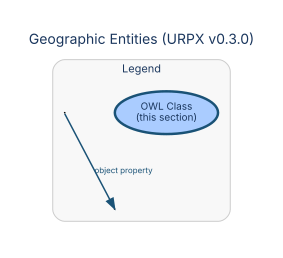

### AdministrativeBoundary

**URI:** `https://urpx-org.github.io/urpx/ontology/AdministrativeBoundary`  
**Parent:** `owl:Thing`

**Description:** Government-defined geographic boundary for administrative purposes

**Semantic Context:**  
Administrative boundaries define the geographic jurisdictions
relevant to utility regulation — states, counties, and municipalities.

---

### State

**URI:** `https://urpx-org.github.io/urpx/ontology/State`  
**Parent:** `AdministrativeBoundary`

**Description:** State, province, or equivalent first-level administrative division

---

### County

**URI:** `https://urpx-org.github.io/urpx/ontology/County`  
**Parent:** `AdministrativeBoundary`

**Description:** County or equivalent second-level administrative division

---

### Municipality

**URI:** `https://urpx-org.github.io/urpx/ontology/Municipality`  
**Parent:** `AdministrativeBoundary`

**Description:** City, town, or incorporated municipal area

---

### ServiceTerritory

**URI:** `https://urpx-org.github.io/urpx/ontology/ServiceTerritory`  
**Parent:** `owl:Thing`

**Description:** Geographic area where a utility provides service to customers

**Semantic Context:**  
A service territory defines the geographic area served by a utility,
potentially spanning multiple administrative boundaries.

---

## Document Type Entities

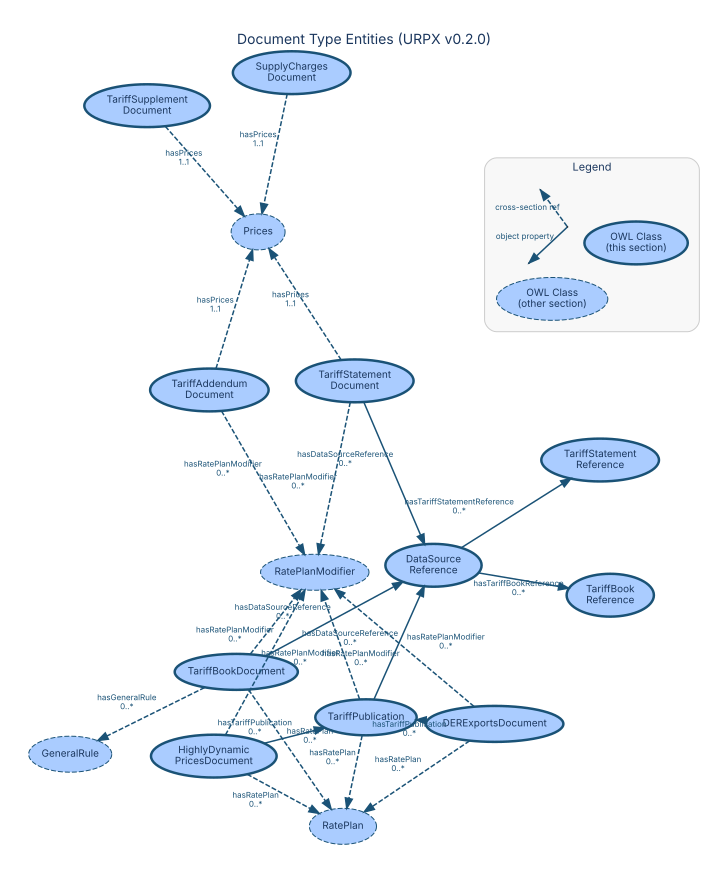

### TariffPublication

**URI:** `https://urpx-org.github.io/urpx/ontology/TariffPublication`  
**Parent:** `owl:Thing`

**Description:** Formal regulatory filing

**Semantic Context:**  
A TariffPublication represents a regulatory filing that may contain
multiple document types (tariff books, statements, supplements).

**Properties:**

| Property | Type | Cardinality | Range | Description |
|----------|------|-------------|-------|-------------|
| `urpx:dateApproved` | Datatype | 0..1 | `xsd:date` | Regulatory approval date |
| `urpx:dateCreated` | Datatype | 0..1 | `xsd:date` | Date the source document or data was created |
| `urpx:dateModified` | Datatype | 0..1 | `xsd:date` | Date the source document or data was last updated |
| `urpx:datePublished` | Datatype | 0..1 | `xsd:date` | Date of first broadcast/publication |
| `urpx:dateReceived` | Datatype | 0..1 | `xsd:date` | Date the document was received |
| `urpx:dateTimeApproved` | Datatype | 0..1 | `xsd:dateTime` | Regulatory approval date and time |
| `urpx:dateTimeCreated` | Datatype | 0..1 | `xsd:dateTime` | Date and time the source document or data was created |
| `urpx:dateTimeModified` | Datatype | 0..1 | `xsd:dateTime` | Date and time the source document or data was last updated |
| `urpx:dateTimePublished` | Datatype | 0..1 | `xsd:dateTime` | Date and time of first broadcast/publication |
| `urpx:dateTimeReceived` | Datatype | 0..1 | `xsd:dateTime` | Date and time the document was received |
| `urpx:description` | Datatype | 0..1 | `xsd:string` | Detailed description of the item |
| `urpx:effectiveDate` | Datatype | 0..1 | `xsd:date` | Date when entity becomes active |
| `urpx:effectiveDateTime` | Datatype | 0..1 | `xsd:dateTime` | Date/time when entity becomes active |
| `urpx:expectedEndDate` | Datatype | 0..1 | `xsd:date` | Provisional end date subject to change |
| `urpx:expectedEndDateTime` | Datatype | 0..1 | `xsd:dateTime` | Provisional end date/time subject to change |
| `urpx:expirationDate` | Datatype | 0..1 | `xsd:date` | Date when entity becomes inactive |
| `urpx:expirationDateTime` | Datatype | 0..1 | `xsd:dateTime` | Date/time when entity becomes inactive |
| `urpx:filingNumber` | Datatype | 0..1 | `xsd:string` | Official regulatory filing or docket number |
| `urpx:hasDataSourceReference` | Object | 0..* | [`DataSourceReference`](#urpxdatasourcereference) | Links an entity to a structured data source reference. |
| `urpx:hasRatePlan` | Object | 0..* | [`RatePlan`](#urpxrateplan) | Links document to rate plans |
| `urpx:hasRatePlanModifier` | Object | 0..* | [`RatePlanModifier`](#urpxrateplanmodifier) | Rate plan modifiers available in this document |
| `urpx:issuingAuthority` | Datatype | 0..1 | `xsd:string` | Organization that issued or approved the publication |
| `urpx:name` | Datatype | 1..1 | `xsd:string` | The name of the item |
| `urpx:pageReference` | Datatype | 0..* | `xsd:string` | Page numbers or sections where rate plan information appears |
| `urpx:priceCurrency` | Datatype | 0..1 | `xsd:string` | ISO 4217 three-letter currency code |
| `urpx:publicationType` | Datatype | 0..1 | — | Type of tariff publication document (Regulatory document types) |
| `urpx:timezoneIdentifier` | Datatype | 0..1 | `xsd:string` | IANA timezone identifier for this location dataset |
| `urpx:url` | Datatype | 0..1 | `xsd:anyURI` | URL of the item |
| `urpx:version` | Datatype | 0..1 | `xsd:string` | The version of the CreativeWork embodied by a specified resource |

---

### TariffBookDocument

**URI:** `https://urpx-org.github.io/urpx/ontology/TariffBookDocument`  
**Parent:** `URPXDocument`

**Description:** Tariff book document containing rate plans, modifiers, prices, and general rules

**Properties:**

| Property | Type | Cardinality | Range | Description |
|----------|------|-------------|-------|-------------|
| `urpx:description` | Datatype | 0..1 | `xsd:string` | Detailed description of the item |
| `urpx:effectiveDate` | Datatype | 0..1 | `xsd:date` | Date when entity becomes active |
| `urpx:effectiveDateTime` | Datatype | 0..1 | `xsd:dateTime` | Date/time when entity becomes active |
| `urpx:expectedEndDate` | Datatype | 0..1 | `xsd:date` | Provisional end date subject to change |
| `urpx:expectedEndDateTime` | Datatype | 0..1 | `xsd:dateTime` | Provisional end date/time subject to change |
| `urpx:expirationDate` | Datatype | 0..1 | `xsd:date` | Date when entity becomes inactive |
| `urpx:expirationDateTime` | Datatype | 0..1 | `xsd:dateTime` | Date/time when entity becomes inactive |
| `urpx:hasDataSourceReference` | Object | 0..* | [`DataSourceReference`](#urpxdatasourcereference) | Links an entity to a structured data source reference. |
| `urpx:hasGeneralRule` | Object | 0..* | [`GeneralRule`](#urpxgeneralrule) | Links a TariffBookDocument to its general rules |
| `urpx:hasRatePlan` | Object | 0..* | [`RatePlan`](#urpxrateplan) | Links document to rate plans |
| `urpx:hasRatePlanModifier` | Object | 0..* | [`RatePlanModifier`](#urpxrateplanmodifier) | Rate plan modifiers available in this document |
| `urpx:name` | Datatype | 1..1 | `xsd:string` | The name of the item |
| `urpx:priceCurrency` | Datatype | 0..1 | `xsd:string` | ISO 4217 three-letter currency code |
| `urpx:timezoneIdentifier` | Datatype | 0..1 | `xsd:string` | IANA timezone identifier for this location dataset |
| `urpx:url` | Datatype | 0..1 | `xsd:anyURI` | URL of the item |
| `urpx:version` | Datatype | 0..1 | `xsd:string` | The version of the CreativeWork embodied by a specified resource |

---

### TariffStatementDocument

**URI:** `https://urpx-org.github.io/urpx/ontology/TariffStatementDocument`  
**Parent:** `URPXDocument`

**Description:** PSC statement filing with prices and modifiers but no rate plans

**Properties:**

| Property | Type | Cardinality | Range | Description |
|----------|------|-------------|-------|-------------|
| `urpx:description` | Datatype | 0..1 | `xsd:string` | Detailed description of the item |
| `urpx:effectiveDate` | Datatype | 0..1 | `xsd:date` | Date when entity becomes active |
| `urpx:effectiveDateTime` | Datatype | 0..1 | `xsd:dateTime` | Date/time when entity becomes active |
| `urpx:expectedEndDate` | Datatype | 0..1 | `xsd:date` | Provisional end date subject to change |
| `urpx:expectedEndDateTime` | Datatype | 0..1 | `xsd:dateTime` | Provisional end date/time subject to change |
| `urpx:expirationDate` | Datatype | 0..1 | `xsd:date` | Date when entity becomes inactive |
| `urpx:expirationDateTime` | Datatype | 0..1 | `xsd:dateTime` | Date/time when entity becomes inactive |
| `urpx:hasDataSourceReference` | Object | 0..* | [`DataSourceReference`](#urpxdatasourcereference) | Links an entity to a structured data source reference. |
| `urpx:hasPrices` | Object | 1..1 | [`Prices`](#urpxprices) | Links rate plan version to actual price instances with rate values |
| `urpx:hasRatePlanModifier` | Object | 0..* | [`RatePlanModifier`](#urpxrateplanmodifier) | Rate plan modifiers available in this document |
| `urpx:name` | Datatype | 1..1 | `xsd:string` | The name of the item |
| `urpx:priceCurrency` | Datatype | 0..1 | `xsd:string` | ISO 4217 three-letter currency code |
| `urpx:tariffStatementType` | Datatype | 0..1 | — | Type of regulatory statement filing (PSC statement types) |
| `urpx:timezoneIdentifier` | Datatype | 0..1 | `xsd:string` | IANA timezone identifier for this location dataset |
| `urpx:url` | Datatype | 0..1 | `xsd:anyURI` | URL of the item |
| `urpx:version` | Datatype | 0..1 | `xsd:string` | The version of the CreativeWork embodied by a specified resource |

---

### TariffSupplementDocument

**URI:** `https://urpx-org.github.io/urpx/ontology/TariffSupplementDocument`  
**Parent:** `URPXDocument`

**Description:** Supplemental filing containing only rate plan modifiers

**Properties:**

| Property | Type | Cardinality | Range | Description |
|----------|------|-------------|-------|-------------|
| `urpx:description` | Datatype | 0..1 | `xsd:string` | Detailed description of the item |
| `urpx:effectiveDate` | Datatype | 0..1 | `xsd:date` | Date when entity becomes active |
| `urpx:effectiveDateTime` | Datatype | 0..1 | `xsd:dateTime` | Date/time when entity becomes active |
| `urpx:expectedEndDate` | Datatype | 0..1 | `xsd:date` | Provisional end date subject to change |
| `urpx:expectedEndDateTime` | Datatype | 0..1 | `xsd:dateTime` | Provisional end date/time subject to change |
| `urpx:expirationDate` | Datatype | 0..1 | `xsd:date` | Date when entity becomes inactive |
| `urpx:expirationDateTime` | Datatype | 0..1 | `xsd:dateTime` | Date/time when entity becomes inactive |
| `urpx:hasPrices` | Object | 1..1 | [`Prices`](#urpxprices) | Links rate plan version to actual price instances with rate values |
| `urpx:name` | Datatype | 1..1 | `xsd:string` | The name of the item |
| `urpx:priceCurrency` | Datatype | 0..1 | `xsd:string` | ISO 4217 three-letter currency code |
| `urpx:timezoneIdentifier` | Datatype | 0..1 | `xsd:string` | IANA timezone identifier for this location dataset |
| `urpx:url` | Datatype | 0..1 | `xsd:anyURI` | URL of the item |
| `urpx:version` | Datatype | 0..1 | `xsd:string` | The version of the CreativeWork embodied by a specified resource |

---

### TariffAddendumDocument

**URI:** `https://urpx-org.github.io/urpx/ontology/TariffAddendumDocument`  
**Parent:** `URPXDocument`

**Description:** Addendum filing for corrections or clarifications

**Properties:**

| Property | Type | Cardinality | Range | Description |
|----------|------|-------------|-------|-------------|
| `urpx:description` | Datatype | 0..1 | `xsd:string` | Detailed description of the item |
| `urpx:effectiveDate` | Datatype | 0..1 | `xsd:date` | Date when entity becomes active |
| `urpx:effectiveDateTime` | Datatype | 0..1 | `xsd:dateTime` | Date/time when entity becomes active |
| `urpx:expectedEndDate` | Datatype | 0..1 | `xsd:date` | Provisional end date subject to change |
| `urpx:expectedEndDateTime` | Datatype | 0..1 | `xsd:dateTime` | Provisional end date/time subject to change |
| `urpx:expirationDate` | Datatype | 0..1 | `xsd:date` | Date when entity becomes inactive |
| `urpx:expirationDateTime` | Datatype | 0..1 | `xsd:dateTime` | Date/time when entity becomes inactive |
| `urpx:hasPrices` | Object | 1..1 | [`Prices`](#urpxprices) | Links rate plan version to actual price instances with rate values |
| `urpx:hasRatePlanModifier` | Object | 0..* | [`RatePlanModifier`](#urpxrateplanmodifier) | Rate plan modifiers available in this document |
| `urpx:name` | Datatype | 1..1 | `xsd:string` | The name of the item |
| `urpx:priceCurrency` | Datatype | 0..1 | `xsd:string` | ISO 4217 three-letter currency code |
| `urpx:timezoneIdentifier` | Datatype | 0..1 | `xsd:string` | IANA timezone identifier for this location dataset |
| `urpx:url` | Datatype | 0..1 | `xsd:anyURI` | URL of the item |
| `urpx:version` | Datatype | 0..1 | `xsd:string` | The version of the CreativeWork embodied by a specified resource |

---

### SupplyChargesDocument

**URI:** `https://urpx-org.github.io/urpx/ontology/SupplyChargesDocument`  
**Parent:** `URPXDocument`

**Description:** Supply prices document for competitive retail energy pricing

**Properties:**

| Property | Type | Cardinality | Range | Description |
|----------|------|-------------|-------|-------------|
| `urpx:description` | Datatype | 0..1 | `xsd:string` | Detailed description of the item |
| `urpx:effectiveDate` | Datatype | 0..1 | `xsd:date` | Date when entity becomes active |
| `urpx:effectiveDateTime` | Datatype | 0..1 | `xsd:dateTime` | Date/time when entity becomes active |
| `urpx:expirationDate` | Datatype | 0..1 | `xsd:date` | Date when entity becomes inactive |
| `urpx:expirationDateTime` | Datatype | 0..1 | `xsd:dateTime` | Date/time when entity becomes inactive |
| `urpx:hasPrices` | Object | 1..1 | [`Prices`](#urpxprices) | Links rate plan version to actual price instances with rate values |
| `urpx:name` | Datatype | 1..1 | `xsd:string` | The name of the item |
| `urpx:priceCurrency` | Datatype | 0..1 | `xsd:string` | ISO 4217 three-letter currency code |
| `urpx:timezoneIdentifier` | Datatype | 0..1 | `xsd:string` | IANA timezone identifier for this location dataset |
| `urpx:url` | Datatype | 0..1 | `xsd:anyURI` | URL of the item |
| `urpx:version` | Datatype | 0..1 | `xsd:string` | The version of the CreativeWork embodied by a specified resource |

---

### HighlyDynamicPricesDocument

**URI:** `https://urpx-org.github.io/urpx/ontology/HighlyDynamicPricesDocument`  
**Parent:** `URPXDocument`

**Description:** Real-time pricing data requiring smart home and EMS integration

**Properties:**

| Property | Type | Cardinality | Range | Description |
|----------|------|-------------|-------|-------------|
| `urpx:description` | Datatype | 0..1 | `xsd:string` | Detailed description of the item |
| `urpx:effectiveDate` | Datatype | 0..1 | `xsd:date` | Date when entity becomes active |
| `urpx:effectiveDateTime` | Datatype | 0..1 | `xsd:dateTime` | Date/time when entity becomes active |
| `urpx:expectedEndDate` | Datatype | 0..1 | `xsd:date` | Provisional end date subject to change |
| `urpx:expectedEndDateTime` | Datatype | 0..1 | `xsd:dateTime` | Provisional end date/time subject to change |
| `urpx:expirationDate` | Datatype | 0..1 | `xsd:date` | Date when entity becomes inactive |
| `urpx:expirationDateTime` | Datatype | 0..1 | `xsd:dateTime` | Date/time when entity becomes inactive |
| `urpx:hasRatePlan` | Object | 0..* | [`RatePlan`](#urpxrateplan) | Links document to rate plans |
| `urpx:hasRatePlanModifier` | Object | 0..* | [`RatePlanModifier`](#urpxrateplanmodifier) | Rate plan modifiers available in this document |
| `urpx:hasTariffPublication` | Object | 0..* | [`TariffPublication`](#urpxtariffpublication) | References to formal tariff publications |
| `urpx:name` | Datatype | 1..1 | `xsd:string` | The name of the item |
| `urpx:priceCurrency` | Datatype | 0..1 | `xsd:string` | ISO 4217 three-letter currency code |
| `urpx:timezoneIdentifier` | Datatype | 0..1 | `xsd:string` | IANA timezone identifier for this location dataset |
| `urpx:url` | Datatype | 0..1 | `xsd:anyURI` | URL of the item |
| `urpx:version` | Datatype | 0..1 | `xsd:string` | The version of the CreativeWork embodied by a specified resource |

---

### DERExportsDocument

**URI:** `https://urpx-org.github.io/urpx/ontology/DERExportsDocument`  
**Parent:** `URPXDocument`

**Description:** DER export pricing structures for distributed energy resources

**Properties:**

| Property | Type | Cardinality | Range | Description |
|----------|------|-------------|-------|-------------|
| `urpx:description` | Datatype | 0..1 | `xsd:string` | Detailed description of the item |
| `urpx:effectiveDate` | Datatype | 0..1 | `xsd:date` | Date when entity becomes active |
| `urpx:effectiveDateTime` | Datatype | 0..1 | `xsd:dateTime` | Date/time when entity becomes active |
| `urpx:expectedEndDate` | Datatype | 0..1 | `xsd:date` | Provisional end date subject to change |
| `urpx:expectedEndDateTime` | Datatype | 0..1 | `xsd:dateTime` | Provisional end date/time subject to change |
| `urpx:expirationDate` | Datatype | 0..1 | `xsd:date` | Date when entity becomes inactive |
| `urpx:expirationDateTime` | Datatype | 0..1 | `xsd:dateTime` | Date/time when entity becomes inactive |
| `urpx:hasRatePlan` | Object | 0..* | [`RatePlan`](#urpxrateplan) | Links document to rate plans |
| `urpx:hasRatePlanModifier` | Object | 0..* | [`RatePlanModifier`](#urpxrateplanmodifier) | Rate plan modifiers available in this document |
| `urpx:hasTariffPublication` | Object | 0..* | [`TariffPublication`](#urpxtariffpublication) | References to formal tariff publications |
| `urpx:name` | Datatype | 1..1 | `xsd:string` | The name of the item |
| `urpx:priceCurrency` | Datatype | 0..1 | `xsd:string` | ISO 4217 three-letter currency code |
| `urpx:timezoneIdentifier` | Datatype | 0..1 | `xsd:string` | IANA timezone identifier for this location dataset |
| `urpx:url` | Datatype | 0..1 | `xsd:anyURI` | URL of the item |
| `urpx:version` | Datatype | 0..1 | `xsd:string` | The version of the CreativeWork embodied by a specified resource |

---

### DataSourceReference

**URI:** `https://urpx-org.github.io/urpx/ontology/DataSourceReference`  
**Parent:** `owl:Thing`

**Description:** Structured reference to a data source including filename, URL, and media type.

**Properties:**

| Property | Type | Cardinality | Range | Description |
|----------|------|-------------|-------|-------------|
| `urpx:accessURL` | Datatype | 0..1 | `xsd:anyURI` | URL from which the data was directly accessed or downloaded |
| `urpx:anchorLink` | Datatype | 0..1 | `xsd:anyURI` | URL or fragment identifier pointing to a specific location within a tariff book PDF |
| `urpx:dataSourceType` | Datatype | 0..1 | — | Type of source of the data |
| `urpx:dateApproved` | Datatype | 0..1 | `xsd:date` | Regulatory approval date |
| `urpx:dateCreated` | Datatype | 0..1 | `xsd:date` | Date the source document or data was created |
| `urpx:dateModified` | Datatype | 0..1 | `xsd:date` | Date the source document or data was last updated |
| `urpx:datePublished` | Datatype | 0..1 | `xsd:date` | Date of first broadcast/publication |
| `urpx:dateReceived` | Datatype | 0..1 | `xsd:date` | Date the document was received |
| `urpx:dateRetrieved` | Datatype | 0..1 | `xsd:date` | Date on which data was retrieved |
| `urpx:dateTimeApproved` | Datatype | 0..1 | `xsd:dateTime` | Regulatory approval date and time |
| `urpx:dateTimeCreated` | Datatype | 0..1 | `xsd:dateTime` | Date and time the source document or data was created |
| `urpx:dateTimeModified` | Datatype | 0..1 | `xsd:dateTime` | Date and time the source document or data was last updated |
| `urpx:dateTimePublished` | Datatype | 0..1 | `xsd:dateTime` | Date and time of first broadcast/publication |
| `urpx:dateTimeReceived` | Datatype | 0..1 | `xsd:dateTime` | Date and time the document was received |
| `urpx:dateTimeRetrieved` | Datatype | 0..1 | `xsd:dateTime` | Date and time on which data was retrieved |
| `urpx:description` | Datatype | 0..1 | `xsd:string` | Detailed description of the item |
| `urpx:effectiveDate` | Datatype | 0..1 | `xsd:date` | Date when entity becomes active |
| `urpx:effectiveDateTime` | Datatype | 0..1 | `xsd:dateTime` | Date/time when entity becomes active |
| `urpx:expirationDate` | Datatype | 0..1 | `xsd:date` | Date when entity becomes inactive |
| `urpx:expirationDateTime` | Datatype | 0..1 | `xsd:dateTime` | Date/time when entity becomes inactive |
| `urpx:fileName` | Datatype | 0..1 | `xsd:string` | Name of document or file including filename extension if present. |
| `urpx:hasTariffBookReference` | Object | 0..* | [`TariffBookReference`](#urpxtariffbookreference) | Links a DataSourceReference to tariff book sections |
| `urpx:hasTariffStatementReference` | Object | 0..* | [`TariffStatementReference`](#urpxtariffstatementreference) | Links a DataSourceReference to a structured tariff statement filing reference |
| `urpx:mediaType` | Datatype | 0..1 | — | Document media type as published by IANA. |
| `urpx:name` | Datatype | 0..1 | `xsd:string` | The name of the item |
| `urpx:pageEnd` | Datatype | 0..1 | `xsd:integer` | Ending page number in the source document |
| `urpx:pageStart` | Datatype | 0..1 | `xsd:integer` | Starting page number in the source document |
| `urpx:url` | Datatype | 0..1 | `xsd:anyURI` | URL of the item |

---

### TariffBookReference

**URI:** `https://urpx-org.github.io/urpx/ontology/TariffBookReference`  
**Parent:** `owl:Thing`

**Description:** Structured reference to a specific location within a tariff book PDF

**Properties:**

| Property | Type | Cardinality | Range | Description |
|----------|------|-------------|-------|-------------|
| `urpx:anchorLink` | Datatype | 0..1 | `xsd:anyURI` | URL or fragment identifier pointing to a specific location within a tariff book PDF |
| `urpx:dateApproved` | Datatype | 0..1 | `xsd:date` | Regulatory approval date |
| `urpx:dateCreated` | Datatype | 0..1 | `xsd:date` | Date the source document or data was created |
| `urpx:dateModified` | Datatype | 0..1 | `xsd:date` | Date the source document or data was last updated |
| `urpx:datePublished` | Datatype | 0..1 | `xsd:date` | Date of first broadcast/publication |
| `urpx:dateReceived` | Datatype | 0..1 | `xsd:date` | Date the document was received |
| `urpx:dateTimeApproved` | Datatype | 0..1 | `xsd:dateTime` | Regulatory approval date and time |
| `urpx:dateTimeCreated` | Datatype | 0..1 | `xsd:dateTime` | Date and time the source document or data was created |
| `urpx:dateTimeModified` | Datatype | 0..1 | `xsd:dateTime` | Date and time the source document or data was last updated |
| `urpx:dateTimePublished` | Datatype | 0..1 | `xsd:dateTime` | Date and time of first broadcast/publication |
| `urpx:dateTimeReceived` | Datatype | 0..1 | `xsd:dateTime` | Date and time the document was received |
| `urpx:description` | Datatype | 0..1 | `xsd:string` | Detailed description of the item |
| `urpx:leafEnd` | Datatype | 0..1 | `xsd:string` | Last leaf number in the tariff book for the referenced content |
| `urpx:leafStart` | Datatype | 0..1 | `xsd:string` | First leaf number in the tariff book for the referenced content |
| `urpx:pageEnd` | Datatype | 0..1 | `xsd:integer` | Ending page number in the source document |
| `urpx:pageStart` | Datatype | 0..1 | `xsd:integer` | Starting page number in the source document |

---

### TariffStatementReference

**URI:** `https://urpx-org.github.io/urpx/ontology/TariffStatementReference`  
**Parent:** `owl:Thing`

**Description:** Structured reference to a PSC statement filing PDF with provenance and statement type

**Properties:**

| Property | Type | Cardinality | Range | Description |
|----------|------|-------------|-------|-------------|
| `urpx:anchorLink` | Datatype | 0..1 | `xsd:anyURI` | URL or fragment identifier pointing to a specific location within a tariff book PDF |
| `urpx:dateApproved` | Datatype | 0..1 | `xsd:date` | Regulatory approval date |
| `urpx:dateCreated` | Datatype | 0..1 | `xsd:date` | Date the source document or data was created |
| `urpx:dateModified` | Datatype | 0..1 | `xsd:date` | Date the source document or data was last updated |
| `urpx:datePublished` | Datatype | 0..1 | `xsd:date` | Date of first broadcast/publication |
| `urpx:dateReceived` | Datatype | 0..1 | `xsd:date` | Date the document was received |
| `urpx:dateTimeApproved` | Datatype | 0..1 | `xsd:dateTime` | Regulatory approval date and time |
| `urpx:dateTimeCreated` | Datatype | 0..1 | `xsd:dateTime` | Date and time the source document or data was created |
| `urpx:dateTimeModified` | Datatype | 0..1 | `xsd:dateTime` | Date and time the source document or data was last updated |
| `urpx:dateTimePublished` | Datatype | 0..1 | `xsd:dateTime` | Date and time of first broadcast/publication |
| `urpx:dateTimeReceived` | Datatype | 0..1 | `xsd:dateTime` | Date and time the document was received |
| `urpx:leafEnd` | Datatype | 0..1 | `xsd:string` | Last leaf number in the tariff book for the referenced content |
| `urpx:leafStart` | Datatype | 0..1 | `xsd:string` | First leaf number in the tariff book for the referenced content |
| `urpx:pageEnd` | Datatype | 0..1 | `xsd:integer` | Ending page number in the source document |
| `urpx:pageStart` | Datatype | 0..1 | `xsd:integer` | Starting page number in the source document |
| `urpx:tariffStatementType` | Datatype | 0..1 | — | Type of regulatory statement filing (PSC statement types) |

---

## Regulatory Entities

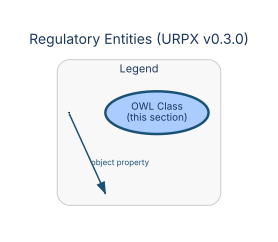

### RateCase

**URI:** `https://urpx-org.github.io/urpx/ontology/RateCase`  
**Parent:** `owl:Thing`

**Description:** Public service commission proceeding concerning rate plan or price changes for cost-of-service regulated utilities

**Properties:**

| Property | Type | Cardinality | Range | Description |
|----------|------|-------------|-------|-------------|
| `urpx:caseNumber` | Datatype | 1..1 | `xsd:string` | Jurisdiction-specific identifier assigned to a rate case proceeding |
| `urpx:description` | Datatype | 0..1 | `xsd:string` | Detailed description of the item |
| `urpx:name` | Datatype | 0..1 | `xsd:string` | The name of the item |
| `urpx:priority` | Datatype | 0..1 | `xsd:integer` | Priority for overlapping entities |
| `urpx:url` | Datatype | 1..1 | `xsd:anyURI` | URL of the item |

---

## Enumerations

### AccumulationValue

| Value | Description |
|-------|-------------|
| `urpx:bulk` | — |
| `urpx:delta` | — |
| `urpx:instantaneous` | — |
| `urpx:summation` | — |

### AggregationMethodValue

| Value | Description |
|-------|-------------|
| `urpx:average` | — |
| `urpx:maximum` | — |
| `urpx:median` | — |
| `urpx:minimum` | — |
| `urpx:sum` | — |

### AnnualIncomeRangeValue

| Value | Description |
|-------|-------------|
| `urpx:highIncome` | — |
| `urpx:lowIncome` | — |
| `urpx:middleIncome` | — |
| `urpx:moderateIncome` | — |
| `urpx:veryLowIncome` | — |

### AssistanceEligibilityLevelValue

| Value | Description |
|-------|-------------|
| `urpx:notQualifiedAssistance` | — |
| `urpx:provisionallyQualifiedAssistance` | — |
| `urpx:qualifiedAssistance` | — |
| `urpx:underReviewAssistance` | — |

### BillPortionValue

| Value | Description |
|-------|-------------|
| `urpx:bundledPortion` | — |
| `urpx:deliveryPortion` | — |
| `urpx:supplyPortion` | — |

### BooleanOperatorValue

| Value | Description |
|-------|-------------|
| `urpx:andOperator` | Represents logical conjunction in condition-expression boolean composition |
| `urpx:notOperator` | Represents logical negation in condition-expression boolean composition |
| `urpx:orOperator` | Represents logical disjunction in condition-expression boolean composition |

### ChangeReasonValue

| Value | Description |
|-------|-------------|
| `urpx:changeReasonOther` | — |
| `urpx:correction` | — |
| `urpx:fuelAdjustment` | — |
| `urpx:initial` | — |
| `urpx:rateCase` | — |
| `urpx:regulatoryOrder` | — |
| `urpx:riderUpdate` | — |
| `urpx:seasonalChange` | — |

### ChargeCategoryValue

| Value | Description |
|-------|-------------|
| `urpx:adjustment` | — |
| `urpx:auxiliaryCharge` | — |
| `urpx:discount` | — |
| `urpx:environmental` | — |
| `urpx:infrastructure` | — |
| `urpx:regulatory` | — |
| `urpx:serviceCharge` | — |
| `urpx:taxes` | — |

### ChargeTypeValue

| Value | Description |
|-------|-------------|
| `urpx:adjustmentPowerCost` | — |
| `urpx:adjustmentRenewable` | — |
| `urpx:adjustmentTariff` | — |
| `urpx:ancillaryServices` | — |
| `urpx:capacity` | — |
| `urpx:capacityCharge` | — |
| `urpx:capitalCredit` | — |
| `urpx:complianceCharge` | — |
| `urpx:congestionCharge` | — |
| `urpx:conservationCharge` | — |
| `urpx:contractMisc` | — |
| `urpx:creditAdministrative` | — |
| `urpx:creditEnergy` | — |
| `urpx:creditGeneration` | — |
| `urpx:creditInfrastructure` | — |
| `urpx:creditMisc` | — |
| `urpx:creditPriceProtection` | — |
| `urpx:creditRenewable` | — |
| `urpx:creditTariffRider` | — |
| `urpx:deliveryCharge` | — |
| `urpx:demandDirect` | — |
| `urpx:demandIndirect` | — |
| `urpx:demandSideManagement` | — |
| `urpx:depositCredit` | — |
| `urpx:depositInterest` | — |
| `urpx:depositRequest` | — |
| `urpx:distributedGeneration` | — |
| `urpx:distributionCharge` | — |
| `urpx:donation` | — |
| `urpx:efficiencyFunding` | — |
| `urpx:energyStorage` | — |
| `urpx:environmentalFunding` | — |
| `urpx:facilities` | — |
| `urpx:generation` | — |
| `urpx:handling` | — |
| `urpx:heapDiscount` | — |
| `urpx:initiationCharge` | — |
| `urpx:minimumBill` | — |
| `urpx:minimumCharge` | — |
| `urpx:nonBypassableCharge` | — |
| `urpx:powerFactor` | — |
| `urpx:publicBenefits` | — |
| `urpx:recoverySurcharge` | — |
| `urpx:reliabilityCharge` | — |
| `urpx:renewableFunding` | — |
| `urpx:rentalFee` | — |
| `urpx:serviceMetered` | — |
| `urpx:serviceNonMetered` | — |
| `urpx:strandedCosts` | — |
| `urpx:systemBenefitCharge` | — |
| `urpx:tariffRider` | — |
| `urpx:taxAdjustment` | — |
| `urpx:taxCredit` | — |
| `urpx:taxMisc` | — |
| `urpx:taxMunicipal` | — |
| `urpx:taxSales` | — |
| `urpx:taxState` | — |
| `urpx:taxUtility` | — |
| `urpx:transitionCharge` | — |
| `urpx:transmission` | — |
| `urpx:usageCharge` | — |
| `urpx:volumetricCharge` | — |

### CommodityValue

| Value | Description |
|-------|-------------|
| `urpx:biomass` | — |
| `urpx:cableTv` | — |
| `urpx:chilledWater` | — |
| `urpx:coal` | — |
| `urpx:commodityOther` | — |
| `urpx:compressedAir` | — |
| `urpx:diesel` | — |
| `urpx:districtCooling` | — |
| `urpx:districtHeating` | — |
| `urpx:electricity` | — |
| `urpx:fuelOil` | — |
| `urpx:gasoline` | — |
| `urpx:geothermal` | — |
| `urpx:hotWater` | — |
| `urpx:hydroelectric` | — |
| `urpx:internet` | — |
| `urpx:irrigation` | — |
| `urpx:naturalGas` | — |
| `urpx:nonPotableWater` | — |
| `urpx:nuclear` | — |
| `urpx:potableWater` | — |
| `urpx:propane` | — |
| `urpx:recycling` | — |
| `urpx:security` | — |
| `urpx:sewage` | — |
| `urpx:solar` | — |
| `urpx:steam` | — |
| `urpx:stormwater` | — |
| `urpx:telecommunications` | — |
| `urpx:wasteHeat` | — |
| `urpx:wasteManagement` | — |
| `urpx:water` | — |
| `urpx:wind` | — |

### ConnectionKindValue

| Value | Description |
|-------|-------------|
| `urpx:directConnection` | — |
| `urpx:overheadConnection` | — |
| `urpx:padMountedConnection` | — |
| `urpx:permanentConnection` | — |
| `urpx:temporaryConnection` | — |
| `urpx:undergroundConnection` | — |

### ConnectorTypeValue

| Value | Description |
|-------|-------------|
| `urpx:ccs` | — |
| `urpx:chademo` | — |
| `urpx:dcFast` | — |
| `urpx:level1` | — |
| `urpx:level2` | — |
| `urpx:teslaSupercharger` | — |

### CustomerChoiceValue

| Value | Description |
|-------|-------------|
| `urpx:mandatoryChoice` | — |
| `urpx:voluntaryChoice` | — |

### CustomerKindValue

| Value | Description |
|-------|-------------|
| `urpx:commercialKind` | — |
| `urpx:enterpriseKind` | — |
| `urpx:industrialKind` | — |
| `urpx:internalUseKind` | — |
| `urpx:nonResidentialKind` | — |
| `urpx:residentialKind` | — |
| `urpx:serviceProviderKind` | — |

### CustomerSubKindValue

| Value | Description |
|-------|-------------|
| `urpx:commercialPumping` | — |
| `urpx:commercialStandard` | — |
| `urpx:commercialStreetlight` | — |
| `urpx:energyScheduler` | — |
| `urpx:energySupplier` | — |
| `urpx:industrialLargeLoad` | — |
| `urpx:industrialStandard` | — |
| `urpx:regionalOperator` | — |
| `urpx:religiousInstitution` | — |
| `urpx:residentialFarm` | — |
| `urpx:residentialMultiUnit` | — |
| `urpx:residentialStandard` | — |
| `urpx:subsidiary` | — |
| `urpx:windMachine` | — |

### DERTypeValue

| Value | Description |
|-------|-------------|
| `urpx:evChargingDER` | — |
| `urpx:generatorDER` | — |
| `urpx:geothermalDER` | — |
| `urpx:hydroDER` | — |
| `urpx:nuclearDER` | — |
| `urpx:solarDER` | — |
| `urpx:storageDER` | — |
| `urpx:wasteDigestionDER` | — |
| `urpx:windDER` | — |

### DataSourceTypeValue

| Value | Description |
|-------|-------------|
| `urpx:apiSource` | — |
| `urpx:databaseSource` | — |
| `urpx:manualSource` | — |
| `urpx:regulatoryWebsiteSource` | — |
| `urpx:utilityWebsiteSource` | — |

### DayTypeValue

| Value | Description |
|-------|-------------|
| `urpx:allDays` | — |
| `urpx:customDays` | — |
| `urpx:weekdayDays` | — |
| `urpx:weekendDays` | — |

### DynamicPricingTypeValue

| Value | Description |
|-------|-------------|
| `urpx:criticalPeakPricing` | — |
| `urpx:demandResponsePricing` | — |
| `urpx:eventDrivenPricing` | — |
| `urpx:indexBasedPricing` | — |
| `urpx:realTimePricing` | — |
| `urpx:timeVaryingPricing` | — |

### EndUseValue

| Value | Description |
|-------|-------------|
| `urpx:agriculturalEndUse` | — |
| `urpx:cookingEndUse` | — |
| `urpx:dataCenterEndUse` | — |
| `urpx:dryingEndUse` | — |
| `urpx:heatingEndUse` | — |
| `urpx:lightingEndUse` | — |
| `urpx:municipalEndUse` | — |
| `urpx:nonheatingEndUse` | — |
| `urpx:otherEndUse` | — |
| `urpx:refrigerationEndUse` | — |
| `urpx:spaceCoolingEndUse` | — |
| `urpx:spaceHeatingEndUse` | — |
| `urpx:streetLightingEndUse` | — |
| `urpx:waterHeatingEndUse` | — |

### EnrollmentStatusValue

| Value | Description |
|-------|-------------|
| `urpx:activeStatus` | — |
| `urpx:expiredStatus` | — |
| `urpx:inactiveStatus` | — |
| `urpx:pendingStatus` | — |
| `urpx:suspendedStatus` | — |
| `urpx:terminatedStatus` | — |

### EntityTypeValue

| Value | Description |
|-------|-------------|
| `urpx:corporationEntity` | — |
| `urpx:entityOther` | — |
| `urpx:governmentEntity` | — |
| `urpx:individualEntity` | — |
| `urpx:llcEntity` | — |
| `urpx:nonprofitEntity` | — |
| `urpx:partnershipEntity` | — |
| `urpx:trustEntity` | — |

### FlowDirectionValue

| Value | Description |
|-------|-------------|
| `urpx:bidirectional` | — |
| `urpx:forward` | — |
| `urpx:net` | — |
| `urpx:reverse` | — |

### GeographicScopeValue

| Value | Description |
|-------|-------------|
| `urpx:countyScope` | — |
| `urpx:customScope` | — |
| `urpx:municipalityScope` | — |
| `urpx:serviceTerritoryScope` | — |
| `urpx:statewideScope` | — |

### GeographicZoneValue

| Value | Description |
|-------|-------------|
| `urpx:coastalZone` | — |
| `urpx:desertZone` | — |
| `urpx:geographicZoneOther` | — |
| `urpx:industrialZone` | — |
| `urpx:mountainZone` | — |
| `urpx:ruralZone` | — |
| `urpx:suburbanZone` | — |
| `urpx:urbanZone` | — |

### HVACKindValue

| Value | Description |
|-------|-------------|
| `urpx:airConditioner` | — |
| `urpx:airSourceHeatPump` | — |
| `urpx:districtHeatingConnection` | — |
| `urpx:groundSourceHeatPump` | — |
| `urpx:spaceHeater` | — |

### IdentifierSchemeValue

| Value | Description |
|-------|-------------|
| `urpx:companyNumberScheme` | — |
| `urpx:dunsScheme` | — |
| `urpx:eiaScheme` | — |
| `urpx:gleifScheme` | — |
| `urpx:gridScheme` | — |
| `urpx:isinScheme` | — |
| `urpx:leiScheme` | — |
| `urpx:localRegulatorScheme` | — |
| `urpx:vatScheme` | — |

### InterconnectionStatusValue

| Value | Description |
|-------|-------------|
| `urpx:disconnectedStatus` | — |
| `urpx:interconnectedStatus` | — |
| `urpx:notApplicableInterconnection` | — |
| `urpx:pendingInterconnection` | — |

### IntervalAlignmentValue

| Value | Description |
|-------|-------------|
| `urpx:billingPeriodAligned` | — |
| `urpx:calendarAligned` | — |
| `urpx:fixedAligned` | — |
| `urpx:rollingAligned` | — |

### IntervalSelectionValue

| Value | Description |
|-------|-------------|
| `urpx:consecutivePeriodsSelection` | — |
| `urpx:fixedWindowSelection` | — |
| `urpx:rollingWindowSelection` | — |

### IntervalTypeValue

| Value | Description |
|-------|-------------|
| `urpx:annualInterval` | — |
| `urpx:customInterval` | — |
| `urpx:dailyInterval` | — |
| `urpx:fifteenMinuteInterval` | — |
| `urpx:fiveMinuteInterval` | — |
| `urpx:hourlyInterval` | — |
| `urpx:monthlyInterval` | — |
| `urpx:quarterlyInterval` | — |
| `urpx:realTimeInterval` | — |
| `urpx:thirtyMinuteInterval` | — |
| `urpx:weeklyInterval` | — |

### InverterTypeValue

| Value | Description |
|-------|-------------|
| `urpx:centralInverter` | — |
| `urpx:hybridInverter` | — |
| `urpx:microInverter` | — |
| `urpx:powerOptimizer` | — |
| `urpx:stringInverter` | — |

### LedgerTypeValue

| Value | Description |
|-------|-------------|
| `urpx:bundledLedger` | — |
| `urpx:calculatedLedger` | — |
| `urpx:deliveryLedger` | — |
| `urpx:distributionLedger` | — |
| `urpx:measuredLedger` | — |
| `urpx:profileMetricLedger` | — |
| `urpx:supplyLedger` | — |
| `urpx:transmissionLedger` | — |

### LoadProfileValue

| Value | Description |
|-------|-------------|
| `urpx:baseload` | — |
| `urpx:intermittent` | — |
| `urpx:loadProfileOther` | — |
| `urpx:peaking` | — |
| `urpx:seasonal` | — |
| `urpx:variable` | — |

### MeasurementTypeValue

| Value | Description |
|-------|-------------|
| `urpx:current` | — |
| `urpx:demand` | — |
| `urpx:energy` | — |
| `urpx:frequency` | — |
| `urpx:power` | — |
| `urpx:powerFactor` | — |
| `urpx:pressure` | — |
| `urpx:temperature` | — |
| `urpx:voltage` | — |
| `urpx:volume` | — |
| `urpx:volumetricFlow` | — |

### MediaTypeValue

| Value | Description |
|-------|-------------|
| `urpx:applicationJson` | — |
| `urpx:applicationPdf` | — |
| `urpx:applicationVndMsExcel` | — |
| `urpx:applicationVndOasisOpendocumentSpreadsheet` | — |
| `urpx:applicationVndOasisOpendocumentText` | — |
| `urpx:applicationVndOpenxmlformatsOfficedocumentSpreadsheetmlSheet` | — |
| `urpx:imageGif` | — |
| `urpx:imageJpeg` | — |
| `urpx:imagePng` | — |
| `urpx:textCsv` | — |
| `urpx:textHtml` | — |
| `urpx:textPlain` | — |
| `urpx:textRtf` | — |
| `urpx:textXml` | — |

### MeteringConfigurationValue

| Value | Description |
|-------|-------------|
| `urpx:ami` | — |
| `urpx:demandConfiguration` | — |
| `urpx:interval` | — |
| `urpx:manual` | — |
| `urpx:netMetering` | — |
| `urpx:prepaid` | — |

### MetricInputTypeValue

| Value | Description |
|-------|-------------|
| `urpx:aggregatedMetricInput` | — |
| `urpx:calculatedMetricInput` | — |
| `urpx:measuredMetricInput` | — |
| `urpx:profileMetricInput` | — |
| `urpx:virtualMetricInput` | — |

### ModifierCategoryValue

| Value | Description |
|-------|-------------|
| `urpx:billingCategory` | — |
| `urpx:customerServiceCategory` | — |
| `urpx:demandManagementCategory` | — |
| `urpx:environmentalCategory` | — |
| `urpx:modifierCategoryOther` | — |
| `urpx:promotionalCategory` | — |
| `urpx:regulatoryCategory` | — |

### ModifierTypeValue

| Value | Description |
|-------|-------------|
| `urpx:addOn` | — |
| `urpx:adjustment` | — |
| `urpx:credit` | — |
| `urpx:demandResponse` | — |
| `urpx:evCharging` | — |
| `urpx:greenEnergy` | — |
| `urpx:modifierTypeOther` | — |
| `urpx:optIn` | — |
| `urpx:optOut` | — |
| `urpx:rider` | — |

### NameTypeValue

| Value | Description |
|-------|-------------|
| `urpx:abbreviationName` | — |
| `urpx:acronymName` | — |
| `urpx:brandName` | — |
| `urpx:commonName` | — |
| `urpx:dbaName` | — |
| `urpx:formerName` | — |
| `urpx:legalName` | Official legal name of the organization |
| `urpx:tradeName` | — |

### ObservanceRuleValue

| Value | Description |
|-------|-------------|
| `urpx:actualDateObservance` | — |
| `urpx:fridayIfWeekendObservance` | — |
| `urpx:mondayIfWeekendObservance` | — |
| `urpx:nearestWeekdayObservance` | — |

### OperatorValue

| Value | Description |
|-------|-------------|
| `urpx:addOperator` | Represents addition in condition expressions |
| `urpx:andOperator` | Represents logical conjunction in condition-expression boolean composition |
| `urpx:betweenOperator` | — |
| `urpx:containsOperator` | — |
| `urpx:divideOperator` | Represents division in condition expressions |
| `urpx:equalsOperator` | — |
| `urpx:greaterThanOperator` | — |
| `urpx:greaterThanOrEqualOperator` | — |
| `urpx:inOperator` | — |
| `urpx:lessThanOperator` | — |
| `urpx:lessThanOrEqualOperator` | — |
| `urpx:multiplyOperator` | Represents multiplication in condition expressions |
| `urpx:notEqualsOperator` | — |
| `urpx:notInOperator` | — |
| `urpx:notOperator` | Represents logical negation in condition-expression boolean composition |
| `urpx:orOperator` | Represents logical disjunction in condition-expression boolean composition |
| `urpx:subtractOperator` | Represents subtraction in condition expressions |

### OrganizationTypeValue

| Value | Description |
|-------|-------------|
| `urpx:aggregatorOrganization` | — |
| `urpx:cooperativeOrganization` | — |
| `urpx:espOrganization` | — |
| `urpx:ippOrganization` | — |
| `urpx:isoRtoOrganization` | — |
| `urpx:municipalOrganization` | — |
| `urpx:parentOrganization` | — |
| `urpx:regulatorOrganization` | — |
| `urpx:utilityOrganization` | — |

### OwnershipTypeValue

| Value | Description |
|-------|-------------|
| `urpx:cooperativeOwnership` | — |
| `urpx:federalOwnership` | — |
| `urpx:investorOwned` | — |
| `urpx:municipalOwnership` | — |
| `urpx:privateOwnership` | — |
| `urpx:stateOwnership` | — |
| `urpx:tribalOwnership` | — |

### PanelOrientationValue

| Value | Description |
|-------|-------------|
| `urpx:east` | — |
| `urpx:multipleOrientations` | — |
| `urpx:north` | — |
| `urpx:northeast` | — |
| `urpx:northwest` | — |
| `urpx:south` | — |
| `urpx:southeast` | — |
| `urpx:southwest` | — |
| `urpx:tracking` | — |
| `urpx:west` | — |

### PhaseCodeKindValue

| Value | Description |
|-------|-------------|
| `urpx:A` | — |
| `urpx:AB` | — |
| `urpx:ABC` | — |
| `urpx:ABCN` | — |
| `urpx:ABN` | — |
| `urpx:AC` | — |
| `urpx:ACN` | — |
| `urpx:AN` | — |
| `urpx:AtoAv` | — |
| `urpx:B` | — |
| `urpx:BAv` | — |
| `urpx:BC` | — |
| `urpx:BCN` | — |
| `urpx:BN` | — |
| `urpx:C` | — |
| `urpx:CAv` | — |
| `urpx:CN` | — |
| `urpx:N` | — |
| `urpx:NG` | — |
| `urpx:S1` | — |
| `urpx:S12` | — |
| `urpx:S12N` | — |
| `urpx:S1N` | — |
| `urpx:S2` | — |
| `urpx:S2N` | — |

### PremiseTypeValue

| Value | Description |
|-------|-------------|
| `urpx:hospital` | — |
| `urpx:manufacturing` | — |
| `urpx:multiFamily` | — |
| `urpx:office` | — |
| `urpx:premiseTypeOther` | — |
| `urpx:retailStore` | — |
| `urpx:school` | — |
| `urpx:singleFamily` | — |
| `urpx:warehouse` | — |

### PriceSourceValue

| Value | Description |
|-------|-------------|
| `urpx:algorithmicSource` | — |
| `urpx:capacityAuctionSource` | — |
| `urpx:demandForecastSource` | — |
| `urpx:gasIndexSource` | — |
| `urpx:manualOverrideSource` | — |
| `urpx:renewableForecastSource` | — |
| `urpx:wholesaleMarketSource` | — |

### ProgramTypeValue

| Value | Description |
|-------|-------------|
| `urpx:communityChoiceAggregation` | — |
| `urpx:communitySolar` | — |
| `urpx:demandResponseProgram` | — |
| `urpx:energyEfficiencyProgram` | — |
| `urpx:greenEnergyProgram` | — |
| `urpx:lowIncomeProgram` | — |
| `urpx:timeOfUseProgram` | — |

### PublicationTypeValue

| Value | Description |
|-------|-------------|
| `urpx:amendment` | — |
| `urpx:notice` | — |
| `urpx:order` | — |
| `urpx:ratePlanModifierPublication` | — |
| `urpx:ratePlanPublication` | — |
| `urpx:regulatoryFiling` | — |
| `urpx:supplement` | — |
| `urpx:tariffBook` | — |
| `urpx:tariffBookLeaves` | — |
| `urpx:tariffStatement` | — |

### RegulatoryScopeValue

| Value | Description |
|-------|-------------|
| `urpx:distributionRegulation` | — |
| `urpx:environmentalRegulation` | — |
| `urpx:marketRegulation` | — |
| `urpx:ratesRegulation` | — |
| `urpx:safetyRegulation` | — |
| `urpx:transmissionRegulation` | — |

### SeasonalPatternValue

| Value | Description |
|-------|-------------|
| `urpx:flatPattern` | — |
| `urpx:summerPeakPattern` | — |
| `urpx:variablePattern` | — |
| `urpx:winterPeakPattern` | — |

### ServiceRoleValue

| Value | Description |
|-------|-------------|
| `urpx:aggregationRole` | — |
| `urpx:bundledServiceRole` | — |
| `urpx:communitySolarServiceRole` | — |
| `urpx:demandResponseRole` | — |
| `urpx:distributionServiceRole` | — |
| `urpx:energyEfficiencyRole` | — |
| `urpx:retailSupplyRole` | — |
| `urpx:solarInstallationRole` | — |

### SpecialNeedsStatusValue

| Value | Description |
|-------|-------------|
| `urpx:disabilityAccommodation` | — |
| `urpx:lifeSupport` | — |
| `urpx:medicalEquipment` | — |
| `urpx:noSpecialNeeds` | — |
| `urpx:vulnerableCustomer` | — |

### TOUTierStandardNameValue

| Value | Description |
|-------|-------------|
| `urpx:criticalPeakTier` | — |
| `urpx:midPeakTier` | — |
| `urpx:offPeakTier` | — |
| `urpx:peakTier` | — |
| `urpx:shoulderTier` | — |
| `urpx:superOffPeakTier` | — |
| `urpx:superPeakTier` | — |

### TariffStatementTypeValue

| Value | Description |
|-------|-------------|
| `urpx:distributionStatement` | — |
| `urpx:fuelAdjustmentStatement` | — |
| `urpx:purchasedPowerStatement` | — |
| `urpx:statementTypeOther` | — |
| `urpx:transmissionStatement` | — |

### TaxExemptStatusValue

| Value | Description |
|-------|-------------|
| `urpx:exempt` | — |
| `urpx:nonExempt` | — |
| `urpx:partialExempt` | — |
| `urpx:pendingVerification` | — |

### UnitOfMeasureValue

| Value | Description |
|-------|-------------|
| `urpx:GW` | — |
| `urpx:GWh` | — |
| `urpx:Gbps` | — |
| `urpx:MVA` | — |
| `urpx:MVAh` | — |
| `urpx:MW` | — |
| `urpx:MWh` | — |
| `urpx:Mbps` | — |
| `urpx:VA` | — |
| `urpx:VAh` | — |
| `urpx:VAr` | — |
| `urpx:VArh` | — |
| `urpx:W` | — |
| `urpx:Wh` | — |
| `urpx:acre` | — |
| `urpx:barrel` | — |
| `urpx:bcf` | — |
| `urpx:bit` | — |
| `urpx:btu` | — |
| `urpx:byte` | — |
| `urpx:ccf` | — |
| `urpx:cord` | — |
| `urpx:count` | — |
| `urpx:cubicFoot` | — |
| `urpx:cubicMeter` | — |
| `urpx:decatherm` | — |
| `urpx:gallon` | — |
| `urpx:hectare` | — |
| `urpx:hertz` | — |
| `urpx:item` | — |
| `urpx:kVA` | — |
| `urpx:kVAh` | — |
| `urpx:kVAr` | — |
| `urpx:kVArh` | — |
| `urpx:kW` | — |
| `urpx:kWh` | — |
| `urpx:kilogallon` | — |
| `urpx:kilogram` | — |
| `urpx:kilometer` | — |
| `urpx:liter` | — |
| `urpx:mcf` | — |
| `urpx:metricTon` | — |
| `urpx:mile` | — |
| `urpx:mmbtu` | — |
| `urpx:mmcf` | — |
| `urpx:percent` | — |
| `urpx:pound` | — |
| `urpx:ratio` | — |
| `urpx:squareFoot` | — |
| `urpx:squareMeter` | — |
| `urpx:tcf` | — |
| `urpx:therm` | — |
| `urpx:ton` | — |
| `urpx:unitOther` | — |

### UpdateFrequencyValue

| Value | Description |
|-------|-------------|
| `urpx:continuousUpdates` | — |
| `urpx:dailyUpdates` | — |
| `urpx:eventTriggeredUpdates` | — |
| `urpx:every15Minutes` | — |
| `urpx:every5Minutes` | — |
| `urpx:hourlyUpdates` | — |
| `urpx:monthlyUpdates` | — |
| `urpx:onDemandUpdates` | — |
| `urpx:weeklyUpdates` | — |

### VoltageLevelValue

| Value | Description |
|-------|-------------|
| `urpx:distributionVoltage` | — |
| `urpx:primaryVoltage` | — |
| `urpx:secondaryVoltage` | — |
| `urpx:subTransmissionVoltage` | — |
| `urpx:transmissionVoltage` | — |

---

*Generated by `generate-data-dictionary.py` from URPX ontology v0.2.0 on 2026-05-04.*
