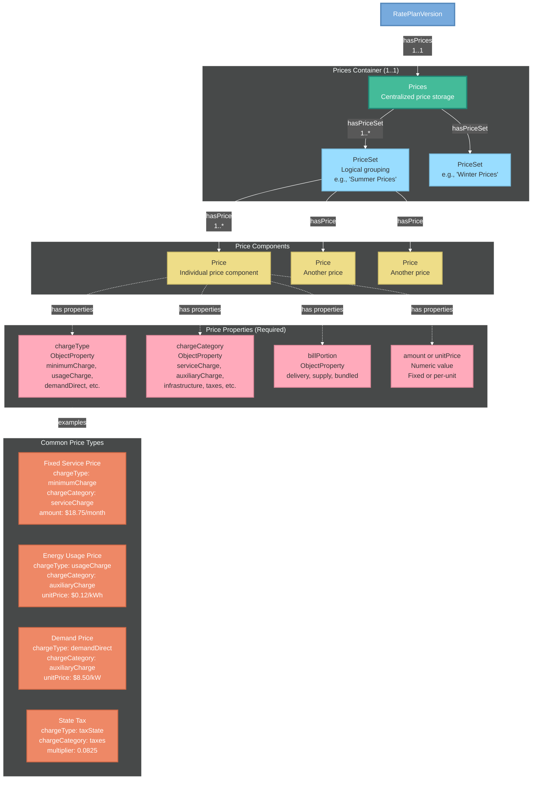
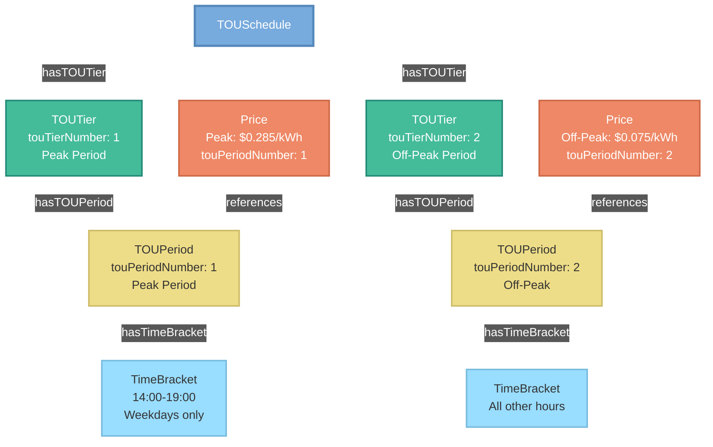

# URPX Data Dictionary

**Version:** 0.1.1
**Last Updated:** 2026-02-18
**Ontology Source:** [`urpx-ontology.ttl`](../../ontology/urpx-ontology.ttl)

[← Back to Index](../index.md) | [Overview](urpx-overview.md) | [Tutorial](urpx-tutorial.md) | [Examples](urpx-examples.md)

---

## Introduction

The Utility Rate Plan Exchange (URPX) Data Dictionary provides comprehensive documentation of all classes, properties, and enumerations within the URPX v0.1.1 ontology. This reference guide serves as the authoritative source for understanding the semantic structure and constraints that govern URPX.

**Important:** This is a pre-draft version for working group review. All definitions are based on [`urpx-ontology.ttl`](../../ontology/urpx-ontology.ttl).

### How to Use This Dictionary

This dictionary is organized into major sections:

1. **Classes** - Entity definitions with semantic context and relationships
2. **Properties** - Attribute and relationship definitions (see Properties Reference section)
3. **Enumerations** - Controlled vocabularies with valid values
4. **Validation Rules** - Constraints and business rules

Each entry includes:
- **Definition**: What the concept represents in the utility domain
- **Technical Specification**: Data types, constraints, and cardinality
- **Relationships**: How the concept connects to other elements
- **Cross-References**: Links to related concepts

### Namespace Prefixes

| Prefix | Namespace URI | Description |
|--------|--------------|-------------|
| `urpx:` | https://schema.urpx.org/ | Core URPX ontology|
| `xsd:` | http://www.w3.org/2001/XMLSchema# | XML Schema datatypes |
| `owl:` | http://www.w3.org/2002/07/owl# | OWL ontology language |
| `rdfs:` | http://www.w3.org/2000/01/rdf-schema# | RDF Schema |
| `skos:` | http://www.w3.org/2004/02/skos/core# | SKOS vocabulary |

**Note:** All URPX entities are now in the single `urpx:` namespace. Previous separate namespaces have been consolidated into [`urpx-ontology.ttl`](../../ontology/urpx-ontology.ttl).

---

## Table of Contents

### Classes (Entities)
- [Core Rate Plan Entities](#core-rate-plan-entities)
- [Pricing & Alternatives Entities](#pricing--alternatives-entities)
- [Metric & Measurement Entities](#metric--measurement-entities)
- [Temporal & Scheduling Entities](#temporal--scheduling-entities)
- [Billing Entities](#billing-entities)
- [Rules & Eligibility Entities](#rules--eligibility-entities)
- [Organization Entities](#organization-entities)
- [Geographic Entities](#geographic-entities)
- [Document Type Entities](#document-type-entities)
- [Miscellaneous Entities](#miscellaneous-entities)

### Properties (Attributes & Relations)
- [Temporal Properties](#temporal-properties)
- [Identification Properties](#identification-properties)
- [Pricing Properties](#pricing-properties)
- [Classification Properties](#classification-properties)
- [Measurement Properties](#measurement-properties)
- [Relationship Properties](#relationship-properties)
- [Geographic Properties](#geographic-properties)
- [Constraint Properties](#constraint-properties)
- [Status & Lifecycle Properties](#status--lifecycle-properties)
- [Reference Properties](#reference-properties)
- [Metadata Properties](#metadata-properties)

### Enumerations (Controlled Vocabularies)
- [Customer & Profile](#customer--profile)
- [Charge & Price Classification](#charge--price-classification)
- [Temporal & Scheduling](#temporal--scheduling)
- [Status & Lifecycle](#status--lifecycle)
- [Pricing Models](#pricing-models)
- [Organization](#organization)
- [Geographic](#geographic)
- [Service Point & DER](#service-point--der)
- [Measurement & Metrics](#measurement--metrics)
- [Rules & Logic](#rules--logic)
- [Billing](#billing)
- [Programs](#programs)
- [Alternatives](#alternatives)
- [Document & Publication](#document--publication)

### Validation & Constraints
- [Core Validation Requirements](#core-validation-requirements)
- [Business Logic Validation](#business-logic-validation)
- [Data Type Validation](#data-type-validation)
- [Cross-Reference Validation](#cross-reference-validation)
- [SHACL Validation Examples](#shacl-validation-examples)
- [Error Handling](#error-handling)

### Cross-Reference Index

---

## Core Classes

### Document and Rate Plan Classes

#### urpx:URPXDocument
**Description:** The root container that can encapsulate all rate plan information, customer profiles, and temporal schedules for a utility's pricing structure. Contains metadata for the document.

**Semantic Context:**  
An URPXDocument represents a complete, self-contained specification of utility pricing at a point in time. It serves as the exchange unit between utilities, regulators, and third-party systems.

**Parent:** `owl:Thing`

**Key Properties:** (See [Properties Reference](#properties-reference) for full details)

| Property | Cardinality | Range | Description |
|----------|-------------|-------|-------------|
| [`urpx:identifier`](#urpx-identifier) | 1..1 | xsd:string | Unique identifier |
| [`urpx:version`](#urpx-version) | 1..1 | xsd:string | Document version |
| [`urpx:effectiveDate`](#urpx-effective-date) | 1..1 | xsd:dateTime | When document becomes active |
| [`urpx:name`](#urpx-name) | 1..1 | xsd:string | Human-readable name |
| [`urpx:description`](#urpx-description) | 0..1 | xsd:string | Detailed description |

**Relationships:**
- `urpx:hasRatePlan` → RatePlan (0..n)
- `urpx:hasCustomerProfile` → CustomerProfile (0..n)
- `urpx:hasHolidayCalendar` → HolidayCalendar (0..1)
- `urpx:hasStatementDocument` → StatementDocument (0..n)

---

#### urpx:RatePlan
**Description:** The master template for a utility rate plan that contains all temporal versions and governs how prices are applied to customer accounts.

**Semantic Context:**  
A RatePlan represents the regulatory-approved pricing structure that persists across time, containing multiple versions as rates change due to regulatory orders, fuel adjustments, or seasonal variations.

**Parent:** `owl:Thing`

**Key Properties:** (See [Properties Reference](#properties-reference) for full details)

| Property | Cardinality | Range | Description |
|----------|-------------|-------|-------------|
| [`urpx:identifier`](#urpx-identifier) | 1..1 | xsd:string | Unique plan identifier |
| [`urpx:name`](#urpx-name) | 1..1 | xsd:string | Official rate plan name |
| [`urpx:initialEffectiveDate`](#urpx-initial-effective-date) | 0..1 | xsd:date | Date plan was first introduced |
| [`urpx:timezoneIdentifier`](#urpx-timezone-identifier) | 0..1 | xsd:string | IANA timezone identifier |

**Relationships:**
- `urpx:hasRatePlanVersion` → RatePlanVersion (1..n) - Temporal versions of this plan
- `urpx:hasLocationDataSet` → LocationDataSet (0..n) - Versioned location data (timezones, holiday calendars)
- `urpx:hasServiceClass` → ServiceClass (0..n) - Applicable service classes
- `urpx:hasEligibilityRule` → EligibilityRule (0..n) - Customer qualification rules
- `urpx:hasApplicabilityGroup` → ApplicabilityGroup (0..n) - Default applicability rules
- `urpx:publishedBy` → Organization (1..1) - Publishing utility
- `urpx:approvedBy` → RegulatoryAuthority (0..n) - Approving authority
- `urpx:applicableInTerritory` → ServiceTerritory (0..n) - Applicable service territories

**See Also:** [RatePlanVersion](#urpx-rate-plan-version), [EligibilityRule](#urpx-eligibility-rule)

---

#### urpx:RatePlanVersion
**Description:** A temporal instance of a rate plan with specific effective dates, prices, and pricing rules that apply during its validity period.

**Semantic Context:**  
Each RatePlanVersion represents the actual rates customers pay during a specific time period. Versions transition seamlessly to ensure continuous pricing coverage.

**Parent:** `owl:Thing`

**Key Properties:** (See [Properties Reference](#properties-reference) for full details)

| Property | Cardinality | Range | Description |
|----------|-------------|-------|-------------|
| [`urpx:versionNumber`](#urpx-version-number) | 1..1 | xsd:string | Semantic version identifier |
| [`urpx:effectiveDateTime`](#urpx-effective-date-time) | 1..1 | xsd:dateTime | When version becomes active |
| [`urpx:expirationDateTime`](#urpx-expiration-date-time) | 0..1 | xsd:dateTime | When version expires |
| [`urpx:changeReason`](#urpx-change-reason) | 1..1 | ChangeReasonValue | Reason for new version |
| [`urpx:changeDescription`](#urpx-change-description) | 0..1 | xsd:string | Detailed change explanation |
| [`urpx:approvalDate`](#urpx-approval-date) | 0..1 | xsd:dateTime | Regulatory approval date |

**See Also:** [RatePlan](#urpx-rate-plan), [RatePlanModifierVersion](#urpx-rate-plan-modifier-version), [ChangeReasonValue](#change-reason-value)

**Relationships:**
- `urpx:supersedes` → RatePlanVersion (0..1) - References previous version in the temporal chain
- `urpx:hasModifier` → RatePlanModifier (0..n) - Rate Plan Modifiers available in this version
- `urpx:hasPlanElements` → PlanElements (1..1) - Links to the centralized temporal and metric container (required)

- `urpx:hasPrices` → Prices (1..1) - Links to the single price container (required)


---

### Service and Customer Classes

#### urpx:ServiceClass
**Description:** Region-specific rate classification that maps utility-specific service codes to standardized categories.

**Semantic Context:**  
Service classes bridge the gap between utility-specific terminology and standardized classifications, enabling cross-utility comparisons while preserving original designations.

**Parent:** `owl:Thing`

**Key Properties:**
| Property | Required | Type | Constraints | Description |
|----------|----------|------|-------------|-------------|
| `urpx:serviceClassRaw` | ✓ | string | | Original utility designation |
| `urpx:serviceClassCleaned` | ✓ | string | Pattern: `^[A-Z0-9-]+$` | Standardized identifier |
| `urpx:serviceClassName` | ✓ | string | Max 255 chars | Descriptive name |

---

#### urpx:CustomerProfile
**Description:** A template defining customer characteristics used to determine rate eligibility and applicable charges.

**Semantic Context:**  
Customer profiles enable sophisticated rate targeting based on usage patterns, demand characteristics, and customer attributes without exposing individual customer data.

**Parent:** `owl:Thing`

**Key Properties:** (See [Properties Reference](#properties-reference) for full details)

| Property | Cardinality | Range | Description |
|----------|-------------|-------|-------------|
| [`urpx:profileId`](#urpx-profile-id) | 1..1 | xsd:string | Unique profile identifier (e.g., 'RES-URB-HEAT') |
| [`urpx:name`](#urpx-name) | 1..1 | xsd:string | Human-readable profile name |
| [`urpx:customerKind`](#urpx-customer-kind) | 1..1 | CustomerKindValue | Primary classification (e.g., Residential, Commercial) |
| [`urpx:customerSubKind`](#urpx-customer-sub-kind) | 0..n | CustomerSubKindValue | Detailed classification (e.g., Single-Family, Retail) |
| [`urpx:entityType`](#urpx-entity-type) | 1..1 | EntityTypeValue | Legal entity type (e.g., Corporation, Individual) |
| [`urpx:geographicZone`](#urpx-geographic-zone) | 0..1 | GeographicZoneValue | Location-based zone |
| [`urpx:taxExemptStatus`](#urpx-tax-exempt-status) | 1..1 | TaxExemptStatusValue | Tax exemption status |
| [`urpx:isCCACustomer`](#urpx-is-cca-customer) | 0..1 | xsd:boolean | CCA program participation flag |
| [`urpx:householdCount`](#urpx-household-count) | 0..1 | xsd:integer | Number of households served (for multi-unit/master-metered) |
| [`urpx:creditRating`](#urpx-credit-rating) | 0..1 | xsd:string | Reference to external credit rating |

**Relationships:**
- `urpx:hasCustomerKind` → CustomerKindValue (0..n) - Primary customer classification
- `urpx:hasCustomerSubKind` → CustomerSubKindValue (0..n) - Detailed customer classification
- `urpx:hasPriorRatePlan` → PriorRatePlan (0..n) - Previous rate plan enrollment history
- `urpx:hasProgramEnrollment` → ProgramEnrollment (0..n) - Program participation (e.g., Low Income, DR)
- `urpx:hasProfileAlternatives` → ProfileAlternatives (0..1) - User-selectable profile options (e.g., Heating vs. Non-Heating)

**See Also:** [ServicePointProfile](#urpx-service-point-profile), [ProfileAlternative](#urpx-profile-alternative), [MetricInput](#urpx-metric-input)

---

#### urpx:EligibilityRule
**Description:** Conditions that must be met for a customer to qualify for a rate plan or modifier.

**Semantic Context:**  
Eligibility rules encode complex business logic that determines which customers can access specific rates, ensuring regulatory compliance and proper rate application.

**Parent:** `owl:Thing`

**Key Properties:**
| Property | Required | Type | Constraints | Description |
|----------|----------|------|-------------|-------------|
| `urpx:ruleType` | ✓ | string | [Enum](#rule-types) | Type of eligibility check |
| `urpx:operator` | ✓ | string | [Enum](#operators) | Comparison operator |
| `urpx:value` | ✓ | string | | Comparison value |
| `urpx:description` | | string | Max 500 chars | Rule explanation |

---

### Prices



#### urpx:PriceSet
**Description:** A logical grouping of related prices that are calculated and applied together.

**Semantic Context:**
PriceSets organize prices into meaningful groups (e.g., "Summer Energy Prices", "Demand Prices") that simplify rate understanding and bill presentation.

**Parent:** `owl:Thing`

**Key Properties:**
| Property | Required | Type | Constraints | Description |
|----------|----------|------|-------------|-------------|
| `urpx:name` | ✓ | string | Max 255 chars | Set name |
| `urpx:description` | | string | Max 1000 chars | Set description |
| `urpx:startDate` | | dateTime | | When prices begin |
| `urpx:endDate` | | dateTime | | When prices end |
| `urpx:expectedEndDate` | | dateTime | | Anticipated end date |

**Relationships:**
- `urpx:hasPrice` → Price (1..n)
- `urpx:hasPriceSummary` → PriceSummary (0..n)
- `urpx:hasStatementPrice` → StatementPrice (0..n)

**Document Reference Properties:**
| Property | Type | Description |
|----------|------|-------------|
| `urpx:dataSourceReference` | string | Reference to data source file (CSV, JSON, etc.) containing price information |
| `urpx:tariffBookReference` | string | Reference to tariff book PDF with leaf/page numbers for price source |
| `urpx:tariffStatementReference` | string | Reference to PSC statement filing PDF containing price information |

---

#### urpx:Price
**Description:** An individual pricing component that defines how costs are calculated for specific usage, demand, or service elements.

**Semantic Context:**
Prices are the atomic units of utility pricing. Each price represents a specific cost element with its own calculation method, applicability rules, and pricing parameters.

**Parent:** `owl:Thing`

**Key Properties:**
| Property | Required | Type | Constraints | Description |
|----------|----------|------|-------------|-------------|
| `urpx:name` | ✓ | string | Max 255 chars | Price name |
| `urpx:referencesPriceDefinition` | no | ObjectProperty | PriceDefinition | Link to structural price definition |
|`startDate` xone `startDateTime` | ✓ | xsd:date or xsd

**Price Fields (at least one required):**
| Property | Type | Description |
|----------|------|-------------|
| `urpx:amount` | decimal | Fixed charge amount |
| `urpx:unitPrice` | decimal | Price per unit |
| `urpx:basePrice` | decimal | Base price before adjustments |
| `urpx:currentPrice` | decimal | Current effective price |

**Additional Properties:**
| Property | Type | Description |
|----------|------|-------------|
| `urpx:tierNumber` | integer | Tier level (1-based) |
| `urpx:tierThreshold` | decimal | Tier trigger point |
| `urpx:multiplier` | decimal | Price multiplier |
| `urpx:adder` | decimal | Price adder |
| `urpx:touPeriodNumber` | integer | TOU period reference |

**Relationships:**
- `urpx:hasApplicabilityRule` → ApplicabilityRule (0..n)
- `urpx:hasDynamicPricing` → DynamicPricing (0..1)
- `urpx:hasApplicabilityGroup` → ApplicabilityGroup (0..n)

**Document Reference Properties:**
| Property | Type | Description |
|----------|------|-------------|
| `urpx:dataSourceReference` | string | Reference to data source file (CSV, JSON, etc.) containing price information |
| `urpx:tariffBookReference` | string | Reference to tariff book PDF with leaf/page numbers for price source |
| `urpx:tariffStatementReference` | string | Reference to PSC statement filing PDF containing price information |

**Note:** Individual prices can have their own document references or inherit them from their parent PriceSet for traceability and regulatory compliance.

---

### Statement Classes

#### urpx:StatementDocument
**Description:** A formal document filed with regulatory authorities that contains official rate schedules and charges.

**Semantic Context:**  
Statement documents represent the legal rate schedules filed with Public Service Commissions. They provide the authoritative source for utility pricing and ensure regulatory compliance.

**Parent:** `owl:Thing`

**Key Properties:**
| Property | Required | Type | Constraints | Description |
|----------|----------|------|-------------|-------------|
| `urpx:statementId` | ✓ | string | | Unique statement identifier |
| `urpx:statementType` | ✓ | string | [Enum](#statement-types) | Document type |
| `urpx:filingDate` | ✓ | dateTime | | Date filed with regulator |
| `urpx:effectiveDate` | ✓ | dateTime | | When rates become effective |
| `urpx:docketNumber` | | string | | Regulatory docket reference |
| `urpx:statementStatus` | | string | [Enum](#statement-status) | Current status |

**Relationships:**
- `urpx:hasStatementCharge` → StatementCharge (1..n)
- `urpx:filedWith` → RegulatoryAuthority (1..1)
- `urpx:replacesStatement` → StatementDocument (0..1)

---

#### urpx:StatementPrice
**Description:** A specific price item within a regulatory statement document, representing an official rate component.

**Semantic Context:**
Statement prices are the individual line items in regulatory filings. They provide the granular detail required for compliance reporting and rate case proceedings.

**Parent:** `owl:Thing`

**Key Properties:**
| Property | Required | Type | Constraints | Description |
|----------|----------|------|-------------|-------------|
| `urpx:identifier` | ✓ | string | | Official price identifier |
| `urpx:name` | ✓ | string | Max 255 chars | Official price name |
| `urpx:description` | | string | Max 1000 chars | Detailed description |
| `urpx:rateSchedule` | | string | | Associated rate schedule |
| `urpx:amount` | | decimal | | Fixed amount |
| `urpx:unitPrice` | | decimal | | Variable rate |
| `urpx:unitOfMeasure` | | [Enum](#units) | UnitOfMeasureValue | Unit of measure enumeration |

**Relationships:**
- `urpx:implementedAs` → Price (0..n)
- `urpx:hasApplicabilityGroup` → ApplicabilityGroup (0..n)

---

#### urpx:ApplicabilityGroup
**Description:** A collection of conditions that determine when charges or rate plans apply to specific customers or situations.

**Semantic Context:**  
Applicability groups enable complex conditional logic for charge application, supporting sophisticated rate designs that vary by location, customer type, or usage patterns.

**Parent:** `owl:Thing`

**Key Properties:**
| Property | Required | Type | Constraints | Description |
|----------|----------|------|-------------|-------------|
| `urpx:groupName` | ✓ | string | Max 255 chars | Group identifier |
| `urpx:groupType` | | string | [Enum](#group-types) | Type of applicability |
| `urpx:priority` | | integer | | Evaluation order |
| `urpx:isExclusive` | | boolean | | Mutual exclusivity flag |

**Relationships:**
- `urpx:hasApplicabilityRule` → ApplicabilityRule (1..n)
- `urpx:appliesInTerritory` → ServiceTerritory (0..n)
- `urpx:appliesInState` → State (0..n)
- `urpx:appliesInCounty` → County (0..n)
- `urpx:appliesInMunicipality` → Municipality (0..n)

---

### Time-of-Use Classes



#### urpx:TOUSchedule
**Description:** Container for time-based pricing tiers and periods that define when different rates apply.

**Semantic Context:**  
TOU schedules implement dynamic pricing that encourages load shifting by varying prices based on system demand patterns and time of day.

**Parent:** `owl:Thing`

**Key Properties:**
| Property | Required | Type | Constraints | Description |
|----------|----------|------|-------------|-------------|
| `urpx:name` | ✓ | string | Max 255 chars | Schedule name |
| `urpx:description` | | string | Max 1000 chars | Schedule description |
| `urpx:scheduleType` | | string | [Enum](#schedule-types) | Type of TOU schedule |

**Relationships:**
- `urpx:hasTOUTier` → TOUTier (1..n)
- `urpx:hasCalendar` → HolidayCalendar (0..1)
- `urpx:hasMeasurement` → Measurement (0..n)

---

#### urpx:TOUTier
**Description:** A price tier that groups TOU periods with similar pricing levels.

**Semantic Context:**  
TOU tiers organize periods into pricing levels (e.g., peak, off-peak) that reflect the relative cost of providing electricity at different times.

**Parent:** `owl:Thing`

**Key Properties:**
| Property | Required | Type | Constraints | Description |
|----------|----------|------|-------------|-------------|
| `urpx:touTierNumber` | ✓ | integer | 1-based, 1=highest | Tier priority |
| `urpx:tierStandardName` | ✓ | string | [Enum](#tou-period-types) | Standard tier name |
| `urpx:tierSourceName` | | string | Max 255 chars | Utility-specific name |

**Relationships:**
- `urpx:hasTOUPeriod` → TOUPeriod (1..n)

---

### Metric & Measurement Classes

#### urpx:MetricSpecification
**Description:** Defines the precise measurement context for pricing, including commodity, kind, unit, and flow direction.

**Semantic Context:**
MetricSpecification is the core definition of *what* is measured. It covers the technical details (e.g., kWh consumption, forward flow, 15-minute interval) that a Price or ServiceTier depends on. It is designed to be referenced by a [MetricInput](#urpx-metric-input) for measurement organization and can also directly be included with a price for transformations to serialized formats.

**Parent:** `owl:Thing`

**Key Properties:**
| Property | Required | Type | Constraints | Description |
|----------|----------|------|-------------|-------------|
| `urpx:measurementKind` | ✓ | MeasurementTypeValue | [Enum](#measurement-types) | Kind of measurement (e.g., energy, demand) |
| `urpx:unitOfMeasure` | ✓ | UnitOfMeasureValue | [Enum](#units) | Unit of measure (e.g., kWh, kW) |
| `urpx:commodity` | ✓ | CommodityValue | [Enum](#commodity-values) | Commodity type (e.g., electricity, natural gas) |
| `urpx:flowDirection` | | FlowDirectionValue | [Enum](#flow-direction-values) | Direction of flow (forward, reverse, net) |
| `urpx:accumulationMethod` | | AccumulationValue | [Enum](#accumulation-values) | How values accumulate (delta, bulk, instantaneous) |
| `urpx:intervalDuration` | | duration | ISO 8601 | Primary specification for time window length |
| `urpx:intervalAlignment` | | IntervalAlignmentValue | [Enum](#interval-alignment-values) | How the interval time window is anchored (e.g., rolling, calendar-aligned) |

**Referenced By:**
- `urpx:hasMetricSpecification` from MetricInput

---

#### urpx:MetricInput
**Description:** Organizational unit for measurement specifications that links pricing to specific measurement contexts.

**Semantic Context:**
MetricInput provides a structured way to define what is measured for rate application. It supports Measured (raw meter data), Calculated (derived metrics), Aggregated (sum of inputs), Virtual (synthetic), and Profile (profile-based) metrics.

**Parent:** `owl:Thing`

**Key Properties:**
| Property | Required | Type | Constraints | Description |
|----------|----------|------|-------------|-------------|
| `urpx:identifier` | ✓ | string | Pattern: `^[A-Z0-9-]+$` | Unique MetricInput identifier |
| `urpx:name` | ✓ | string | Max 255 chars | Human-readable name |
| `urpx:description` | | string | Max 1000 chars | Detailed description |
| `urpx:metricInputType` | ✓ | MetricInputTypeValue | [Enum](#metric-input-type-values) | Type: measured, calculated, aggregated, virtual, or profile |

**Relationships:**
- `urpx:hasMetricSpecification` → MetricSpecification (1..n)
- `urpx:hasServiceTier` → ServiceTier (0..n) - Service tier definitions for tiered pricing
- `urpx:calculationRule` → (blank node) - For calculated MetricInputs
- `urpx:profileMetricProperty` → rdf:Property (0..1) - For profile MetricInputs

**Referenced By:**
- `urpx:hasMetricInput` from PlanElements
- `urpx:referencesMetricInput` from Price, PriceSet, ServiceTier, TOUSchedule, Ledger

---

### Architecture & Container Classes

#### urpx:Prices
**Description:** Centralized container for all price-related content within a rate plan version.

**Semantic Context:**
Prices consolidates base price sets and alternative price sets, providing a single point of access for all pricing structures. Each [RatePlanVersion](#urpx-rate-plan-version) has exactly one Prices container.

**Parent:** `owl:Thing`

**Relationships:**
- `urpx:hasPriceSet` → PriceSet (0..n) - Base/default price sets
- `urpx:hasPrice` → Price (0..n) - Individual prices (can be direct or within sets)
- `urpx:hasPriceSetAlternatives` → PriceSetAlternatives (0..n) - Alternative pricing options


**Referenced By:**
- `urpx:hasPrices` from RatePlanVersion

---

#### urpx:PlanElements
**Description:** Centralized container for temporal and pricing elements of rate plan or modifier versions.

**Semantic Context:**
PlanElements contains parameters needed for cost model calculations including seasons, holiday calendars, metric inputs, billing models, and profile alternatives. Used by both [RatePlanVersion](#urpx-rate-plan-version) and [RatePlanModifierVersion](#urpx-rate-plan-modifier-version) for unified structure.

**Parent:** `owl:Thing`

**Relationships:**
- `urpx:hasSeasons` → Season (0..n)
- `urpx:hasHolidayCalendar` → HolidayCalendar (0..1)
- `urpx:hasMetricInput` → MetricInput (0..n)
- `urpx:hasBillingModel` → BillingModel (0..1)
- `urpx:hasProfileAlternatives` → ProfileAlternatives (0..1)

**Referenced By:**
- `urpx:hasPlanElements` from RatePlanVersion, RatePlanModifierVersion

---

### Billing Architecture Classes

#### urpx:BillingModel
**Description:** Billing-specific rules and calculation patterns with ledger-based organization.

**Semantic Context:**
BillingModel defines calculation rules, proration patterns, and adjustment mechanisms. Contains one or more ledgers for organizing prices by billing category (supply, delivery, etc.).

**Parent:** `owl:Thing`

**Key Properties:**
| Property | Required | Type | Constraints | Description |
|----------|----------|------|-------------|-------------|
| `urpx:name` | | string | Max 255 chars | Billing model name |
| `urpx:description` | | string | Max 1000 chars | Detailed description |
| `urpx:prorationMethod` | | string | [Enum](#proration-methods) | Method for prorating during partial periods |

**Relationships:**
- `urpx:hasLedger` → Ledger (1..n) - Ledgers for billing segregation
- `urpx:hasTOUSchedule` → TOUSchedule (0..n) - TOU schedules

**Referenced By:**
- `urpx:hasBillingModel` from PlanElements

---

#### urpx:Ledger
**Description:** Enables multiple ledgers for separation of supply vs delivery charges or other billing segregations.

**Semantic Context:**
Ledgers support complex billing scenarios with multiple charge categories (e.g., supply, delivery, transmission). Each ledger references [MetricInput](#urpx-metric-input) (many-to-many).

**Parent:** `owl:Thing`

**Key Properties:**
| Property | Required | Type | Constraints | Description |
|----------|----------|------|-------------|-------------|
| `urpx:name` | ✓ | string | Max 255 chars | Ledger name |
| `urpx:ledgerType` | ✓ | LedgerTypeValue | [Enum](#ledger-types) | Type: supply, delivery, transmission, distribution, bundled |
| `urpx:settlementInterval` | | duration | ISO 8601 | Period over which balances are settled |

**Relationships:**
- `urpx:referencesMetricInput` → MetricInput (1..n) - Metric inputs for this ledger
- `urpx:hasBillingCycle` → BillingCycle (0..n) - Billing cycle definitions
- `urpx:hasPriceDefinition` → PriceDefinition (0..n) - Price structure definitions

**Referenced By:**
- `urpx:hasLedger` from BillingModel

---

### Profile & Alternatives Classes

#### urpx:ProfileAlternatives
**Description:** Container for alternative dimension structures requiring user selection.

**Semantic Context:**
ProfileAlternatives bridges customer and service point profile characteristics and mutually exclusive choices within a rate plan or rate plan modifier requiring explicit user choice (e.g., heating vs. non-heating service, different HVAC types).

**Parent:** `owl:Thing`

**Relationships:**
- `urpx:hasAlternativeDimensions` → AlternativeDimensions (1..1) - Dimension definitions
- `urpx:hasProfileAlternative` → ProfileAlternative (2..n) - Individual alternatives (minimum 2)

**Referenced By:**
- `urpx:hasProfileAlternatives` from PlanElements
- `urpx:referencesProfileAlternatives` from PriceSetAlternatives

---

#### urpx:ProfileAlternative
**Description:** Specific combination of dimension values representing one alternative choice.

**Semantic Context:**
ProfileAlternative defines dimensions along which price set alternatives differ, enabling mutually exclusive options for user selection. Each specifies dimension-value pairs characterizing a particular configuration.

**Parent:** `owl:Thing`

**Key Properties:**
| Property | Required | Type | Constraints | Description |
|----------|----------|------|-------------|-------------|
| `urpx:alternativesType` | ✓ | AlternativesTypeValue | [Enum](#alternatives-type-values) | Internal classification |
| `urpx:defaultSelectionLogic` | | string | | Logic for auto-selecting default |

**Relationships:**
- `urpx:hasDimensionValue` → (blank node) (1..n) - Dimension-value pairs using forDimension + valueIRI
- `urpx:hasAlternativeDimension` → AlternativeDimension (0..n) - Dimensions for this alternative

**Referenced By:**
- `urpx:referencesProfileAlternative` from PriceSetAlternative

---

#### urpx:PriceSetAlternatives
**Description:** Container for mutually exclusive price set alternatives requiring user selection.

**Semantic Context:**
PriceSetAlternatives groups related PriceSetAlternative instances representing different pricing options based on customer profile characteristics, geographic locations, or service configurations.

**Parent:** `owl:Thing`

**Relationships:**
- `urpx:hasPriceSetAlternative` → PriceSetAlternative (2..n) - Individual alternatives (minimum 2)
- `urpx:referencesProfileAlternatives` → ProfileAlternatives (1..1) - Links to dimension definition

**Referenced By:**
- `urpx:hasPriceSetAlternatives` from Prices

---

#### urpx:PriceSetAlternative
**Description:** Individual price set representing one alternative in a mutually exclusive set of options.

**Semantic Context:**
PriceSetAlternative is a subclass of PriceSet with a required reference to its applicable ProfileAlternative. Resides in the Prices container alongside base price sets but distinguished by its connection to dimension-based alternatives.

**Parent:** `urpx:PriceSet`

**Relationships:**
- `urpx:referencesProfileAlternative` → ProfileAlternative (1..1) - Links to defining alternative
- Inherits `urpx:hasPrice` → Price (1..n) from PriceSet

---

#### urpx:AlternativeDimensions
**Description:** Container wrapping alternative dimension sets and their metadata.

**Semantic Context:**
AlternativeDimensions organizes related dimensions within a ProfileAlternatives context.

**Parent:** `owl:Thing`

**Referenced By:**
- `urpx:hasAlternativeDimensions` from ProfileAlternatives

---

#### urpx:AlternativeDimension
**Description:** Dimension along which price set alternatives differ using ontology properties.

**Semantic Context:**
AlternativeDimension defines customer profile attributes that determine which PriceSet alternative applies. Uses actual ontology properties (e.g., urpx:endUse, urpx:hasHVAC, urpx:voltageLevel).

**Parent:** `owl:Thing`

**Key Properties:**
| Property | Required | Type | Constraints | Description |
|----------|----------|------|-------------|-------------|
| `urpx:dimensionDisplayName` | ✓ | string | Max 255 chars | Human-readable name for UI |
| `urpx:dimensionProperty` | ✓ | anyURI | | URI of ontology property this represents |

**Relationships:**
- `urpx:hasPossibleValues` → rdf:List - Structured possible values with labels for GUI

---

## Organization Classes

### urpx-org:Organization
**Description:** Base class for any entity participating in energy markets or rate regulation.

**Semantic Context:**  
Organizations form the institutional framework of the utility industry, from service providers to regulators to parent companies.

**Parent:** `org:Organization`

**Key Properties:**
| Property | Required | Type | Constraints | Description |
|----------|----------|------|-------------|-------------|
| `urpx-org:organizationId` | ✓ | string | | Unique identifier |
| `urpx-org:organizationType` | ✓ | string | [Enum](#organization-types) | Entity type |
| `urpx-org:status` | ✓ | string | [Enum](#organization-status) | Current status |
| `urpx-org:foundedDate` | | date | | Establishment date |
| `urpx-org:dissolvedDate` | | date | | Dissolution date |

**Relationships:**
- `urpx-org:hasIdentity` → OrganizationIdentity (1..n)
- `urpx-org:hasParent` → ParentCompany (0..1)
- `urpx-org:hasEvent` → OrganizationEvent (0..n)

---

### urpx-org:UtilityOperator
**Description:** Entity providing utility services and publishing rate plans.

**Semantic Context:**  
Utility operators are the primary actors in the URPX ecosystem, creating and maintaining the rate plans that determine customer costs.

**Parent:** `urpx-org:Organization`

**Key Properties:**
| Property | Required | Type | Constraints | Description |
|----------|----------|------|-------------|-------------|
| `urpx-org:utilityType` | ✓ | string | [Enum](#utility-types) | Service type |
| `urpx-org:ownershipType` | | string | [Enum](#ownership-types) | Ownership model |
| `urpx-org:customerCount` | | integer | | Number of customers |
| `urpx-org:annualRevenue` | | decimal | | Annual revenue |
| `urpx-org:reportingCurrency` | | string | ISO 4217 | Currency for financials |

**Relationships:**
- `urpx-org:hasServiceTerritory` → ServiceTerritory (1..n)
- `urpx-org:regulatedBy` → RegulatoryAuthority (0..n)
- `urpx-org:publishes` → RatePlan (0..n)

---

## Geographic Classes

### urpx-geo:ServiceTerritory
**Description:** Geographic area where an organization provides service.

**Semantic Context:**  
Service territories define the spatial boundaries of utility operations and regulatory jurisdiction, critical for determining applicable rates.

**Parent:** `owl:Thing`

**Key Properties:**
| Property | Required | Type | Constraints | Description |
|----------|----------|------|-------------|-------------|
| `urpx-geo:territoryId` | ✓ | string | | Unique identifier |
| `urpx-geo:territoryName` | | string | | Territory name |
| `urpx-geo:territoryType` | ✓ | string | [Enum](#territory-types) | Territory classification |
| `urpx-geo:utilityServiceKind` | ✓ | string | [Enum](#service-types) | Services provided |
| `urpx-geo:effectiveFrom` | | date | | Start of territory |
| `urpx-geo:effectiveTo` | | date | | End of territory |

**Relationships:**
- `urpx-geo:hasTerritorySegment` → TerritorySegment (1..n)
- `urpx-geo:containsState` → State (0..n)
- `urpx-geo:containsCounty` → County (0..n)
- `urpx-geo:containsMunicipality` → Municipality (0..n)

---

### urpx-geo:State
**Description:** U.S. state or Canadian province for geographic applicability.

**Parent:** `owl:Thing`

**Key Properties:**
| Property | Required | Type | Constraints | Description |
|----------|----------|------|-------------|-------------|
| `urpx-geo:stateCode` | ✓ | string | 2-letter code | State abbreviation |
| `urpx-geo:stateName` | ✓ | string | | Full state name |
| `urpx-geo:countryCode` | | string | ISO 3166 | Country code |

---

### urpx-geo:County
**Description:** County-level geographic division for rate applicability.

**Parent:** `owl:Thing`

**Key Properties:**
| Property | Required | Type | Constraints | Description |
|----------|----------|------|-------------|-------------|
| `urpx-geo:countyCode` | ✓ | string | FIPS code | County identifier |
| `urpx-geo:countyName` | ✓ | string | | County name |

**Relationships:**
- `urpx-geo:inState` → State (1..1)

---

### urpx-geo:Municipality
**Description:** City or town-level geographic division.

**Parent:** `owl:Thing`

**Key Properties:**
| Property | Required | Type | Constraints | Description |
|----------|----------|------|-------------|-------------|
| `urpx-geo:municipalityCode` | ✓ | string | | Municipality code |
| `urpx-geo:municipalityName` | ✓ | string | | Municipality name |
| `urpx-geo:municipalityType` | | string | [Enum](#municipality-types) | Type of municipality |

**Relationships:**
- `urpx-geo:inCounty` → County (0..1)
- `urpx-geo:inState` → State (1..1)

---

## Properties Reference

### Temporal Properties

---

#### urpx:effectiveDateTime

**Definition:** The date and time when a core entity (document, version, modifier) becomes active.

**Domain:** URPXDocument, RatePlanVersion, RatePlanModifierVersion
**Range:** xsd:dateTime
**Cardinality:** 1..1 (Required)

**Usage:** Marks when a rate plan version, document, or modifier becomes active. See [Temporal Constraints](#temporal-constraints) for timezone requirements.

---

#### urpx:expirationDateTime

**Definition:** The date and time when a core entity expires and ceases to apply.

**Domain:** RatePlanVersion, RatePlanModifierVersion
**Range:** xsd:dateTime
**Cardinality:** 0..1

**Usage:** Marks when a temporal entity expires. Null implies indefinite validity until superseded.

---

#### urpx:expectedEndDateTime

**Definition:** A provisional end date/time subject to change.

**Domain:** Price, PriceSet, URPXDocument, TariffPublication, RatePlanVersion, RatePlanModifierVersion, LocationDataSet
**Range:** xsd:dateTime
**Cardinality:** 0..1

**Usage:** Used when a definitive end date is unknown (e.g., rates effective 'until further notice').

---

#### urpx:submissionDate

**Definition:** The date and time the entity was submitted to a regulatory authority.

**Domain:** RatePlan
**Range:** xsd:dateTime
**Cardinality:** 0..1

---

#### urpx:approvalDate

**Definition:** The date and time the entity received formal regulatory approval.

**Domain:** RatePlanVersion
**Range:** xsd:dateTime
**Cardinality:** 0..1

---

#### urpx:filingDate

**Definition:** The date and time a regulatory statement document was filed.

**Domain:** StatementDocument
**Range:** xsd:dateTime
**Cardinality:** 1..1 (Required)

---

#### urpx:contractEffectiveDate

**Definition:** The effective date and time of a service agreement contract.

**Domain:** AccountServiceAgreement
**Range:** xsd:dateTime
**Cardinality:** 0..1

---

#### urpx:contractExpirationDate

**Definition:** The expiration date and time of a service agreement contract.

**Domain:** AccountServiceAgreement
**Range:** xsd:dateTime
**Cardinality:** 0..1

---

#### urpx:ratePlanAssignmentDate

**Definition:** Date/time when a customer was assigned to a rate plan.

**Domain:** ServiceAccount
**Range:** xsd:dateTime
**Cardinality:** 0..1

---

#### urpx:startDate

**Definition:** The non-time-specific start date of a pricing or temporal element.

**Domain:** Price, PriceSet, TOUPeriod, BillingCycle, Season
**Range:** xsd:date or xsd:dateTime
**Cardinality:** 0..1

---

#### urpx:endDate

**Definition:** The non-time-specific end date of a pricing or temporal element.

**Domain:** Price, PriceSet, TOUPeriod, BillingCycle, Season
**Range:** xsd:date or xsd:dateTime
**Cardinality:** 0..1

---

### Pricing Properties

---

#### urpx:amount

**Definition:** Fixed amount for prices not based on consumption.

**Domain:** Price, PriceSummary
**Range:** xsd:decimal
**Cardinality:** 0..1

**Usage:** Fixed pricing for fees, service prices, or flat-rate billing. Mandatory if other pricing fields are absent.

---

#### urpx:unitPrice

**Definition:** Price per unit of consumption or demand.

**Domain:** Price
**Range:** xsd:decimal
**Cardinality:** 0..1

**Usage:** Per-unit pricing for usage-based prices. Use with [urpx:unitOfMeasure](#urpx-unit-of-measure) to specify pricing basis.

---

#### urpx:basePrice

**Definition:** Base price before application of multipliers or adders.

**Domain:** Price
**Range:** xsd:decimal
**Cardinality:** 0..1

**Usage:** Used as the starting point for dynamic calculation formulas.

---

#### urpx:currentPrice

**Definition:** The current effective price, typically for dynamic pricing.

**Domain:** Price
**Range:** xsd:decimal
**Cardinality:** 0..1

**Usage:** For dynamic pricing, represents the current calculated price.

---

#### urpx:multiplier

**Definition:** Multiplication factor for price calculations.

**Domain:** Price, PriceSet
**Range:** xsd:decimal
**Cardinality:** 0..1

**Usage:** Applied to the base price or amount for adjustments.

---

#### urpx:adder

**Definition:** Fixed amount added to a calculated price.

**Domain:** Price, TOUPeriod
**Range:** xsd:decimal
**Cardinality:** 0..1

**Usage:** Applied after multiplication for the final price.

---

#### urpx:tierThreshold

**Definition:** Upper bound of usage tier (pre-MetricInput architecture).

**Domain:** Price
**Range:** xsd:decimal
**Cardinality:** 0..1

**Usage:** Represents the maximum usage for a specific price tier. Largely superseded by the [ServiceTier](#urpx-service-tier) class for new development, but retained for legacy mapping.

---

#### urpx:baseQuantity

**Definition:** Base quantity for per-unit pricing (e.g., 'per 2 households').

**Domain:** Price
**Range:** xsd:decimal
**Cardinality:** 0..1

**Usage:** Specifies the base quantity when price is expressed as 'per X units'.

---

#### urpx:priceCurrency

**Definition:** ISO 4217 three-letter currency code.

**Domain:** Price, PriceSet, RatePlan, RatePlanVersion, URPXDocument, RatePlanModifier, RatePlanModifierVersion
**Range:** xsd:string
**Cardinality:** 0..1

**Usage:** Currency code (e.g., USD, EUR). Price-level currency overrides document-level currency.

---

### Classification Properties

---

#### urpx:endUse

**Definition:** Classification of electric service end use.

**Domain:** ProfileAlternative, ServicePointProfile
**Range:** EndUseValue
**Cardinality:** 0..1

---

#### urpx:hasHVAC

**Definition:** HVAC equipment type for electrification rates.

**Domain:** ServicePointProfile
**Range:** HVACKindValue
**Cardinality:** 0..n

---

#### urpx:ledgerType

**Definition:** Type of ledger for billing cost component separation.

**Domain:** Ledger
**Range:** LedgerTypeValue
**Cardinality:** 1..1 (Required)

---

#### urpx:metricInputType

**Definition:** Classification of MetricInput source/type.

**Domain:** MetricInput
**Range:** MetricInputTypeValue
**Cardinality:** 1..1 (Required)

---

## Enumerations

### Customer & Profile

---

#### urpx:CustomerKindValue
**Definition:** Primary customer type classification aligned with industry standards (e.g., Green Button).
**Used By:** [urpx:hasCustomerKind](#urpx-has-customer-kind)

| IRI | Label | Definition |
|-----|-------|------------|
| urpx:commercialKind | Commercial | All commercial customers |
| urpx:enterpriseKind | Enterprise | Large multi-site businesses or government entities |
| urpx:industrialKind | Industrial | All industrial customers |
| urpx:internalUseKind | Internal Use | Internal utility or internal government accounts |
| urpx:nonResidentialKind | Non-Residential | All non-residential customers (commercial and industrial) |
| urpx:residentialKind | Residential | All residential customers |
| urpx:serviceProviderKind | Service Provider | Utility or Energy Service Provider (ESP) |

---

#### urpx:CustomerSubKindValue
**Definition:** Detailed customer classification organized by parent kind for specific rate segmentation.
**Used By:** [urpx:hasCustomerSubKind](#urpx-has-customer-sub-kind)

| IRI | Label | Definition |
|-----|-------|------------|
| urpx:commercialPumping | Commercial Pumping | Water/sewer pumping stations |
| urpx:commercialStandard | Commercial Standard | Standard small to mid-sized commercial operations |
| urpx:commercialStreetlight | Commercial Streetlight | Street lighting and public lighting service |
| urpx:energyScheduler | Energy Scheduler | Entities managing energy delivery schedules |
| urpx:energySupplier | Energy Supplier | Third-party energy suppliers |
| urpx:industrialLargeLoad | Industrial Large Load | Large industrial facilities requiring dedicated service |
| urpx:industrialStandard | Industrial Standard | Standard industrial facilities |
| urpx:regionalOperator | Regional Operator | Regional utility or grid operator accounts |
| urpx:religiousInstitution | Religious Institution | Non-profit religious institutions |
| urpx:residentialFarm | Residential Farm | Residential properties with agricultural usage |
| urpx:residentialMultiUnit | Residential Multi-Unit | Multi-unit residential buildings |
| urpx:residentialStandard | Residential Standard | Standard single-family residential customers |
| urpx:subsidiary | Subsidiary | Subsidiary company accounts |
| urpx:windMachine | Wind Machine | Agricultural wind machines/pumps |

---

#### urpx:EntityTypeValue
**Definition:** Legal entity type classification for compliance and regulatory reporting.
**Used By:** [urpx:entityType](#urpx-entity-type)

| IRI | Label | Definition |
|-----|-------|------------|
| urpx:corporationEntity | Corporation | Legally incorporated entity |
| urpx:entityOther | Other | Other legal entity type not listed |
| urpx:governmentEntity | Government | Government or municipal entity |
| urpx:individualEntity | Individual | Single person account |
| urpx:llcEntity | LLC | Limited Liability Company |
| urpx:nonprofitEntity | Non-Profit | Non-profit organization |
| urpx:partnershipEntity | Partnership | Partnership organization |
| urpx:trustEntity | Trust | Legal trust |

---

#### urpx:TaxExemptStatusValue
**Definition:** Tax exemption status classification for tax-based rate eligibility.
**Used By:** [urpx:taxExemptStatus](#urpx-tax-exempt-status)

| IRI | Label | Definition |
|-----|-------|------------|
| urpx:exempt | Exempt | Fully exempt from specified taxes |
| urpx:nonExempt | Non-Exempt | Fully subject to specified taxes |
| urpx:partialExempt | Partial Exempt | Partially exempt from specified taxes |
| urpx:pendingVerification | Pending Verification | Status pending tax authority verification |

---

#### urpx:AnnualIncomeRangeValue
**Definition:** Privacy-preserving income brackets for assistance program qualification.
**Used By:** [urpx:annualIncomeRange](#urpx-annual-income-range)

| IRI | Label | Definition |
|-----|-------|------------|
| urpx:highIncome | High Income | Above 200% of area median income (AMI) |
| urpx:lowIncome | Low Income | 50-80% of AMI |
| urpx:middleIncome | Middle Income | 120-200% of AMI |
| urpx:moderateIncome | Moderate Income | 80-120% of AMI |
| urpx:veryLowIncome | Very Low Income | Below 50% of AMI |

---

#### urpx:SpecialNeedsStatusValue
**Definition:** Special needs classification affecting rate eligibility and service priority.
**Used By:** [urpx:specialNeedsStatus](#urpx-special-needs-status)

| IRI | Label | Definition |
|-----|-------|------------|
| urpx:disabilityAccommodation | Disability Accommodation | Requires service accommodation for disability |
| urpx:lifeSupport | Life Support | Requires essential life support services |
| urpx:medicalEquipment | Medical Equipment | Customer uses life-sustaining medical equipment |
| urpx:noSpecialNeeds | No Special Needs | No special needs classification |
| urpx:vulnerableCustomer | Vulnerable Customer | Customer requiring special attention (e.g., age, illness) |

---

#### urpx:AssistanceEligibilityLevelValue
**Definition:** Qualification level for utility assistance programs.
**Used By:** [urpx:assistanceEligibilityLevel](#urpx-assistance-eligibility-level)

| IRI | Label | Definition |
|-----|-------|------------|
| urpx:notQualifiedAssistance | Not Qualified | Does not meet program eligibility criteria |
| urpx:provisionallyQualifiedAssistance | Provisionally Qualified | Conditionally approved pending verification |
| urpx:qualifiedAssistance | Qualified | Fully qualified for assistance program |
| urpx:underReviewAssistance | Under Review | Application under review |

---

#### urpx:EnrollmentStatusValue
**Definition:** Enrollment lifecycle status for program participation.
**Used By:** [urpx:enrollmentStatus](#urpx-enrollment-status)

| IRI | Label | Definition |
|-----|-------|------------|
| urpx:activeStatus | Active | Currently enrolled and participating |
| urpx:expiredStatus | Expired | Enrollment period has ended |
| urpx:inactiveStatus | Inactive | Enrollment is inactive |
| urpx:pendingStatus | Pending | Enrollment pending processing |
| urpx:suspendedStatus | Suspended | Enrollment temporarily suspended |
| urpx:terminatedStatus | Terminated | Enrollment has been terminated |

---

### Charge & Price Classification

---

#### urpx:ChargeTypeValue
**Definition:** Specific charge type implementations (e.g., DeliveryCharge, TaxSales, DemandDirect).
**Used By:** [urpx:chargeType](#urpx-charge-type)

| IRI | Label | Definition |
|-----|-------|------------|
| urpx:adjustmentPowerCost | Adjustment Power Cost | Adjustment for changes in power costs |
| urpx:adjustmentRenewable | Adjustment Renewable | Adjustment for renewable energy costs |
| urpx:adjustmentTariff | Adjustment Tariff | General tariff rate adjustment |
| urpx:ancillaryServices | Ancillary Services | Grid ancillary services charge |
| urpx:capacity | Capacity | General capacity-related charge |
| urpx:capacityCharge | Capacity Charge | Charge for reserved capacity |
| urpx:capitalCredit | Capital Credit | Cooperative capital credit allocation |
| urpx:complianceCharge | Compliance Charge | Regulatory compliance cost charge |
| urpx:congestionCharge | Congestion Charge | Locational marginal pricing congestion component |
| urpx:conservationCharge | Conservation Charge | Energy conservation program charge |
| urpx:contractMisc | Contract Misc | Miscellaneous contract-related charge |
| urpx:creditAdministrative | Credit Administrative | Administrative or billing credit |
| urpx:creditEnergy | Credit Energy | Credit for energy charges |
| urpx:creditGeneration | Credit Generation | Credit for customer generation |
| urpx:creditInfrastructure | Credit Infrastructure | Credit against infrastructure charges |
| urpx:creditMisc | Credit Misc | Other credits |
| urpx:creditPriceProtection | Credit Price Protection | Credit from price protection program |
| urpx:creditRenewable | Credit Renewable | Credit for renewable energy |
| urpx:creditTariffRider | Credit Tariff Rider | Credit from tariff rider |
| urpx:deliveryCharge | Delivery Charge | Combined charge for energy delivery |
| urpx:demandDirect | Demand Direct | Charge based on peak demand measurement |
| urpx:demandIndirect | Demand Indirect | Allocated or estimated demand charge |
| urpx:demandSideManagement | Demand Side Management | DSM program charge |
| urpx:depositCredit | Deposit Credit | Return of security deposit |
| urpx:depositInterest | Deposit Interest | Interest on security deposit |
| urpx:depositRequest | Deposit Request | Security deposit requirement |
| urpx:distributedGeneration | Distributed Generation | Charge related to distributed generation |
| urpx:distributionCharge | Distribution Charge | Local distribution system charge |
| urpx:donation | Donation | Voluntary donation or contribution |
| urpx:efficiencyFunding | Efficiency Funding | Energy efficiency program funding |
| urpx:energyStorage | Energy Storage | Energy storage-related charge |
| urpx:environmentalFunding | Environmental Funding | Environmental program funding charge |
| urpx:facilities | Facilities | Charge for specific facilities or equipment |
| urpx:generation | Generation | Charge for electricity generation |
| urpx:handling | Handling | Administrative handling fee |
| urpx:heapDiscount | Heap Discount | Home Energy Assistance Program discount |
| urpx:initiationCharge | Initiation Charge | One-time charge for service initiation or reconnection |
| urpx:minimumBill | Minimum Bill | Ensures total bill meets a minimum amount |
| urpx:minimumCharge | Minimum Charge | Fixed monthly minimum charge for being a customer |
| urpx:nonBypassableCharge | Non-Bypassable Charge | Charges that apply regardless of energy supplier choice |
| urpx:powerFactor | Power Factor | Power factor correction charge or penalty |
| urpx:publicBenefits | Public Benefits | Public purpose program charge |
| urpx:recoverySurcharge | Recovery Surcharge | Surcharge for cost recovery |
| urpx:reliabilityCharge | Reliability Charge | Reliability-must-run contracts and capacity performance charges |
| urpx:renewableFunding | Renewable Funding | Charge supporting renewable energy programs |
| urpx:rentalFee | Rental Fee | Equipment rental charges |
| urpx:serviceMetered | Service Metered | Service charge based on metered usage |
| urpx:serviceNonMetered | Service Non Metered | Fixed service charge for unmetered services |
| urpx:strandedCosts | Stranded Costs | Recovery of stranded utility investments |
| urpx:systemBenefitCharge | System Benefit Charge | Universal service fund and public purpose program charges |
| urpx:tariffRider | Tariff Rider | Additional tariff provision or adjustment |
| urpx:taxAdjustment | Tax Adjustment | Adjustment to tax calculations |
| urpx:taxCredit | Tax Credit | Credit against taxes |
| urpx:taxMisc | Tax Misc | Other tax-related charges |
| urpx:taxMunicipal | Tax Municipal | City or local government tax |
| urpx:taxSales | Tax Sales | General sales tax |
| urpx:taxState | Tax State | State-level tax |
| urpx:taxUtility | Tax Utility | Tax on utility services |
| urpx:transitionCharge | Transition Charge | Market restructuring and stranded cost recovery charges |
| urpx:transmission | Transmission | High-voltage transmission system charge |
| urpx:usageCharge | Usage Charge | Volumetric energy consumption charge |
| urpx:volumetricCharge | Volumetric Charge | Generic volumetric charge based on usage quantity |

---

#### urpx:ChargeCategoryValue
**Definition:** Categorizes charges by their business function (e.g., Adjustment, Infrastructure, Taxes).
**Used By:** [urpx:chargeCategory](#urpx-charge-category)

| IRI | Label | Definition |
|-----|-------|------------|
| urpx:adjustment | Adjustment | Rate adjustments, true-ups, and reconciliation charges |
| urpx:auxiliaryCharge | Auxiliary Charge | Ancillary services and miscellaneous fees |
| urpx:discount | Discount | Discounts, rebates, and bill reductions |
| urpx:environmental | Environmental | Environmental and renewable energy program charges |
| urpx:infrastructure | Infrastructure | General infrastructure investment charge |
| urpx:regulatory | Regulatory | Regulatory compliance and mandated program charges |
| urpx:serviceCharge | Service Charge | Base service fees, customer charges, and monthly recurring charges |
| urpx:taxes | Taxes | All tax-related charges including state, local, and utility taxes |

---

#### urpx:BillPortionValue
**Definition:** Specifies which portion of the bill a charge belongs to (e.g., Delivery, Supply).
**Used By:** [urpx:billPortion](#urpx-bill-portion)

| IRI | Label | Definition |
|-----|-------|------------|
| urpx:bundledPortion | Bundled | Combined delivery and supply charges not separately stated |
| urpx:deliveryPortion | Delivery | Charges for delivering energy to the customer |
| urpx:supplyPortion | Supply | Charges for energy commodity and generation |

---

### Temporal & Scheduling

---

#### urpx:TOUTierStandardNameValue
**Definition:** Standard time-of-use (TOU) tier terminology for grouping periods by price level.
**Used By:** [urpx:touTierStandardName](#urpx-tou-tier-standard-name)

| IRI | Label | Definition |
|-----|-------|------------|
| urpx:criticalPeakTier | Critical Peak | Critical event pricing tier |
| urpx:midPeakTier | Mid Peak | Moderate peak period tier |
| urpx:offPeakTier | Off Peak | Standard off-peak tier |
| urpx:peakTier | Peak | Standard peak period tier |
| urpx:shoulderTier | Shoulder | Transition period between peak and off-peak |
| urpx:superOffPeakTier | Super Off Peak | Lowest price tier |
| urpx:superPeakTier | Super Peak | Highest price tier |

---

#### urpx:DayTypeValue
**Definition:** Classification of days for temporal logic and scheduling.
**Used By:** [urpx:dayType](#urpx-day-type)

| IRI | Label | Definition |
|-----|-------|------------|
| urpx:allDays | All Days | All days of the week |
| urpx:customDays | Custom Days | Custom defined day set |
| urpx:weekdayDays | Weekday | Monday through Friday |
| urpx:weekendDays | Weekend | Saturday and Sunday |

---

#### urpx:IntervalTypeValue
**Definition:** Semantic type label for standard temporal intervals used in billing and measurement (consolidated).
**Used By:** [urpx:intervalType](#urpx-interval-type)

| IRI | Label | Definition |
|-----|-------|------------|
| urpx:annualInterval | Annual Interval | Annual intervals |
| urpx:customInterval | Custom Interval | Custom defined interval length |
| urpx:dailyInterval | Daily Interval | Daily intervals |
| urpx:fifteenMinuteInterval | 15 Minute Interval | 15-minute intervals |
| urpx:fiveMinuteInterval | 5 Minute Interval | 5-minute intervals |
| urpx:hourlyInterval | Hourly Interval | Hourly updates |
| urpx:monthlyInterval | Monthly Interval | Monthly intervals |
| urpx:quarterlyInterval | Quarterly Interval | Quarterly intervals |
| urpx:realTimeInterval | Real Time Interval | Continuous updates |
| urpx:thirtyMinuteInterval | 30 Minute Interval | 30-minute intervals |
| urpx:weeklyInterval | Weekly Interval | Weekly intervals |

---

#### urpx:SeasonalPatternValue
**Definition:** Seasonal usage pattern classification (e.g., Summer Peak, Winter Peak).
**Used By:** [urpx:seasonalPattern](#urpx-seasonal-pattern)

| IRI | Label | Definition |
|-----|-------|------------|
| urpx:flatPattern | Flat | Consistent usage pattern year-round |
| urpx:summerPeakPattern | Summer Peak | Usage highest during summer months |
| urpx:variablePattern | Variable | Non-standard or fluctuating seasonal pattern |
| urpx:winterPeakPattern | Winter Peak | Usage highest during winter months |

---

#### urpx:ObservanceRuleValue
**Definition:** Rules for how holidays are observed when they fall on weekends.
**Used By:** [urpx:observanceRule](#urpx-observance-rule)

| IRI | Label | Definition |
|-----|-------|------------|
| urpx:actualDateObservance | Actual Date | Holiday observed on its actual calendar date |
| urpx:fridayIfWeekendObservance | Friday If Weekend | Observed on preceding Friday if holiday falls on weekend |
| urpx:mondayIfWeekendObservance | Monday If Weekend | Observed on following Monday if holiday falls on weekend |
| urpx:nearestWeekdayObservance | Nearest Weekday | Observed on nearest weekday to actual date |

---

### Status and Lifecycle

---

#### urpx:ChangeReasonValue
**Definition:** Standardized reasons for introducing a new version of a rate plan or modifier.
**Used By:** [urpx:changeReason](#urpx-change-reason)

| IRI | Label | Definition |
|-----|-------|------------|
| urpx:changeReasonOther | Other | Other change reason not listed |
| urpx:correction | Correction | Correction of an error in a previous filing |
| urpx:fuelAdjustment | Fuel Adjustment | Change due to fuel cost adjustment mechanism |
| urpx:initial | Initial | First filing or version of a new rate plan |
| urpx:rateCase | Rate Case | Change resulting from general rate case proceeding |
| urpx:regulatoryOrder | Regulatory Order | Change mandated by regulator order |
| urpx:riderUpdate | Rider Update | Change to a rate rider or surcharge component |
| urpx:seasonalChange | Seasonal Change | Scheduled seasonal rate adjustment |

---

### Pricing Models

---

#### urpx:DynamicPricingTypeValue
**Definition:** Types of dynamic pricing mechanisms aligned with FERC market terminology.
**Used By:** [urpx:dynamicPricingType](#urpx-dynamic-pricing-type)

| IRI | Label | Definition |
|-----|-------|------------|
| urpx:criticalPeakPricing | Critical Peak Pricing | High prices during a limited number of critical peak periods |
| urpx:demandResponsePricing | Demand Response Pricing | Pricing designed to elicit a change in consumption from end-use customers |
| urpx:eventDrivenPricing | Event Driven Pricing | Pricing triggered by system events (e.g., critical peak events) |
| urpx:indexBasedPricing | Index Based Pricing | Pricing linked to a market index (e.g., natural gas) |
| urpx:realTimePricing | Real Time Pricing | Pricing determined in real-time based on market conditions |
| urpx:timeVaryingPricing | Time Varying Pricing | Rates that change based on time schedule (includes TOU) |

---

#### urpx:UpdateFrequencyValue
**Definition:** How frequently dynamic prices are updated.
**Used By:** [urpx:updateFrequency](#urpx-update-frequency)

| IRI | Label | Definition |
|-----|-------|------------|
| urpx:continuousUpdates | Continuous Updates | Updates are continuous (e.g., streaming) |
| urpx:dailyUpdates | Daily Updates | Updates occur daily |
| urpx:eventTriggeredUpdates | Event Triggered Updates | Updates triggered by a specific event |
| urpx:every15Minutes | Every 15 Minutes | Updates occur every 15 minutes |
| urpx:every5Minutes | Every 5 Minutes | Updates occur every 5 minutes |
| urpx:hourlyUpdates | Hourly Updates | Updates occur every hour |
| urpx:monthlyUpdates | Monthly Updates | Updates occur monthly |
| urpx:onDemandUpdates | On Demand Updates | Updates only occur upon request |
| urpx:weeklyUpdates | Weekly Updates | Updates occur weekly |

---

#### urpx:PriceSourceValue
**Definition:** Sources for dynamic price information aligned with FERC market terminology.
**Used By:** [urpx:priceSource](#urpx-price-source)

| IRI | Label | Definition |
|-----|-------|------------|
| urpx:algorithmicSource | Algorithmic | Price determined by an algorithmic calculation |
| urpx:capacityAuctionSource | Capacity Auction | Prices based on capacity market auction results |
| urpx:demandForecastSource | Demand Forecast | Prices based on predicted demand |
| urpx:gasIndexSource | Gas Index | Prices based on a natural gas market index |
| urpx:manualOverrideSource | Manual Override | Price set manually by operator (e.g., emergency) |
| urpx:renewableForecastSource | Renewable Forecast | Prices based on renewable energy forecast |
| urpx:wholesaleMarketSource | Wholesale Market | Prices based on wholesale energy market data |

---

#### urpx:IntervalAlignmentValue
**Definition:** How measurement intervals align to time boundaries.
**Used By:** [urpx:intervalAlignment](#urpx-interval-alignment)

| IRI | Label | Definition |
|-----|-------|------------|
| urpx:billingPeriodAligned | Billing Period Aligned | Intervals align to billing period boundaries |
| urpx:calendarAligned | Calendar Aligned | Intervals align to calendar boundaries (hour, day, month) |
| urpx:fixedAligned | Fixed Aligned | Intervals align to a fixed reference point |
| urpx:rollingAligned | Rolling Aligned | Intervals roll forward from a starting point |

---

#### urpx:IntervalSelectionValue
**Definition:** Method for selecting measurement intervals in calculations.
**Used By:** [urpx:intervalSelection](#urpx-interval-selection)

| IRI | Label | Definition |
|-----|-------|------------|
| urpx:consecutivePeriodsSelection | Consecutive Periods | Uses consecutive measurement periods |
| urpx:fixedWindowSelection | Fixed Window | Uses a fixed time window |
| urpx:rollingWindowSelection | Rolling Window | Uses a rolling window of intervals |

---

### Organization

---

#### urpx:OrganizationTypeValue
**Definition:** Classification of organizations in the energy ecosystem.
**Used By:** [urpx:organizationType](#urpx-organization-type)

| IRI | Label | Definition |
|-----|-------|------------|
| urpx:aggregatorOrganization | Aggregator | Load aggregator or CCA |
| urpx:cooperativeOrganization | Cooperative | Member-owned cooperative |
| urpx:espOrganization | ESP | Energy Service Provider (competitive retail) |
| urpx:ippOrganization | IPP | Independent Power Producer |
| urpx:isoRtoOrganization | ISO/RTO | Independent System Operator / Regional Transmission Organization |
| urpx:municipalOrganization | Municipal | Municipal utility or entity |
| urpx:parentOrganization | Parent Company | Parent holding company |
| urpx:regulatorOrganization | Regulator | Regulatory authority (e.g., PUC, FERC) |
| urpx:utilityOrganization | Utility | Regulated utility service provider |

---

#### urpx:OwnershipTypeValue
**Definition:** Ownership structure of the utility organization.
**Used By:** [urpx:ownershipType](#urpx-ownership-type)

| IRI | Label | Definition |
|-----|-------|------------|
| urpx:cooperativeOwnership | Cooperative | Member-owned cooperative |
| urpx:federalOwnership | Federal | Federally owned entity (e.g., TVA, BPA) |
| urpx:investorOwned | Investor Owned | Investor-owned utility (IOU) |
| urpx:municipalOwnership | Municipal | Municipally owned utility (MOU) |
| urpx:privateOwnership | Private | Privately owned non-utility entity |
| urpx:stateOwnership | State | State-owned entity |
| urpx:tribalOwnership | Tribal | Tribally owned utility |

---

#### urpx:RegulatoryScopeValue
**Definition:** Functional scope of a regulatory authority.
**Used By:** [urpx:regulatoryScope](#urpx-regulatory-scope)

| IRI | Label | Definition |
|-----|-------|------------|
| urpx:distributionRegulation | Distribution | Authority over distribution system operations |
| urpx:environmentalRegulation | Environmental | Authority over environmental compliance |
| urpx:marketRegulation | Market Regulation | Authority to regulate wholesale markets |
| urpx:ratesRegulation | Rates Regulation | Authority to regulate rates and tariffs |
| urpx:safetyRegulation | Safety Regulation | Authority to regulate safety standards |
| urpx:transmissionRegulation | Transmission | Authority over transmission siting and access |

---

#### urpx:IdentifierSchemeValue
**Definition:** Identifier system or registry used for organization identification.
**Used By:** [urpx:identifierScheme](#urpx-identifier-scheme)

| IRI | Label | Definition |
|-----|-------|------------|
| urpx:companyNumberScheme | Company Number | National company registration number |
| urpx:dunsScheme | DUNS | Dun & Bradstreet DUNS number |
| urpx:eiaScheme | EIA | US Energy Information Administration identifier |
| urpx:gleifScheme | GLEIF | Global Legal Entity Identifier Foundation |
| urpx:gridScheme | GRID | Global Research Identifier Database |
| urpx:isinScheme | ISIN | International Securities Identification Number |
| urpx:leiScheme | LEI | Legal Entity Identifier |
| urpx:localRegulatorScheme | Local Regulator | Local regulatory authority identifier |
| urpx:vatScheme | VAT | Value Added Tax registration number |

---

#### urpx:NameTypeValue
**Definition:** Classification of organization name types.
**Used By:** [urpx:nameType](#urpx-name-type)

| IRI | Label | Definition |
|-----|-------|------------|
| urpx:abbreviationName | Abbreviation | Shortened form of the name |
| urpx:acronymName | Acronym | Initialism or acronym |
| urpx:brandName | Brand Name | Marketing or brand name |
| urpx:commonName | Common Name | Commonly used informal name |
| urpx:dbaName | DBA | Doing Business As name |
| urpx:formerName | Former Name | Previously used name |
| urpx:legalName | Legal Name | Official registered legal name |
| urpx:tradeName | Trade Name | Name used in commerce |

---

### Geographic

#### Territory Types
Types of service territories.

```
exclusive          # Exclusive service rights
non-exclusive      # Non-exclusive territory
wholesale          # Wholesale service area
retail             # Retail service area
transmission       # Transmission zone
distribution       # Distribution territory
generation         # Generation zone
```

#### Service Types
Types of services in territories.

```
electric           # Electric service
gas                # Gas service
water              # Water service
combined           # Multiple services
```

#### Municipality Types
Types of municipalities.

```
city               # City
town               # Town
village            # Village
borough            # Borough
township           # Township
county             # County jurisdiction
district           # District
```

#### urpx:GeographicScopeValue
**Definition:** Geographic scope level for applicability rules.
**Used By:** [urpx:geographicScope](#urpx-geographic-scope)

| IRI | Label | Definition |
|-----|-------|------------|
| urpx:countyScope | County | County-level geographic scope |
| urpx:customScope | Custom | Custom-defined geographic boundary |
| urpx:municipalityScope | Municipality | Municipality-level scope |
| urpx:serviceTerritoryScope | Service Territory | Utility service territory scope |
| urpx:statewideScope | Statewide | State-level geographic scope |

---

#### urpx:GeographicZoneValue
**Definition:** Geographic zone classification for rate differentiation.
**Used By:** [urpx:geographicZone](#urpx-geographic-zone)

| IRI | Label | Definition |
|-----|-------|------------|
| urpx:coastalZone | Coastal | Coastal geographic zone |
| urpx:desertZone | Desert | Desert geographic zone |
| urpx:geographicZoneOther | Other | Other geographic zone not listed |
| urpx:industrialZone | Industrial | Industrial geographic zone |
| urpx:mountainZone | Mountain | Mountain geographic zone |
| urpx:ruralZone | Rural | Rural geographic zone |
| urpx:suburbanZone | Suburban | Suburban geographic zone |
| urpx:urbanZone | Urban | Urban geographic zone |

---

### Service Point & DER

---

#### urpx:PremiseTypeValue
**Definition:** Type of premise served (e.g., Single-Family, Office).
**Used By:** [urpx:premiseType](#urpx-premise-type)

| IRI | Label | Definition |
|-----|-------|------------|
| urpx:hospital | Hospital | Medical care facility |
| urpx:manufacturing | Manufacturing | Industrial manufacturing facility |
| urpx:multiFamily | Multi-Family | Multi-unit residential building |
| urpx:office | Office | Commercial office space |
| urpx:premiseTypeOther | Other | Other premise type not listed |
| urpx:retailStore | Retail Store | Commercial retail space |
| urpx:school | School | Educational institution |
| urpx:singleFamily | Single Family | Detached single-family dwelling |
| urpx:warehouse | Warehouse | Storage and distribution facility |

---

#### urpx:ConnectionKindValue
**Definition:** Service connection type aligned with CIM IEC 61968.
**Used By:** [urpx:connectionKind](#urpx-connection-kind)

| IRI | Label | Definition |
|-----|-------|------------|
| urpx:directConnection | Direct | Direct connection to grid |
| urpx:overheadConnection | Overhead | Overhead service drop |
| urpx:padMountedConnection | Pad Mounted | Pad-mounted transformer connection |
| urpx:permanentConnection | Permanent | Permanent service connection |
| urpx:temporaryConnection | Temporary | Temporary service connection |
| urpx:undergroundConnection | Underground | Underground service lateral |

---

#### urpx:PhaseCodeKindValue
**Definition:** Electrical phase configuration aligned with CIM IEC 61968.
**Used By:** [urpx:phaseCodeKind](#urpx-phase-code-kind)

| IRI | Label | Definition |
|-----|-------|------------|
| urpx:A | Phase A | Single phase A |
| urpx:AB | Phase AB | Two-phase AB |
| urpx:ABC | Three Phase | Three-phase ABC |
| urpx:ABCN | Three Phase Neutral | Three-phase ABC with neutral |
| urpx:ABN | Phase AB Neutral | Two-phase AB with neutral |
| urpx:AC | Phase AC | Two-phase AC |
| urpx:ACN | Phase AC Neutral | Two-phase AC with neutral |
| urpx:AN | Phase A Neutral | Single phase A with neutral |
| urpx:AtoAv | A to Average | Phase A to average |
| urpx:B | Phase B | Single phase B |
| urpx:BAv | B Average | Phase B average |
| urpx:BC | Phase BC | Two-phase BC |
| urpx:BCN | Phase BC Neutral | Two-phase BC with neutral |
| urpx:BN | Phase B Neutral | Single phase B with neutral |
| urpx:C | Phase C | Single phase C |
| urpx:CAv | C Average | Phase C average |
| urpx:CN | Phase C Neutral | Single phase C with neutral |
| urpx:N | Neutral | Neutral only |
| urpx:NG | Neutral Ground | Neutral to ground |
| urpx:S1 | Split Phase 1 | Split phase leg 1 |
| urpx:S12 | Split Phase 1-2 | Split phase 120/240V |
| urpx:S12N | Split Phase 1-2 Neutral | Split phase 120/240V with neutral |
| urpx:S1N | Split Phase 1 Neutral | Split phase leg 1 with neutral |
| urpx:S2 | Split Phase 2 | Split phase leg 2 |
| urpx:S2N | Split Phase 2 Neutral | Split phase leg 2 with neutral |

---

#### urpx:MeteringConfigurationValue
**Definition:** Metering configuration type (e.g., Net, Interval).
**Used By:** [urpx:meteringConfiguration](#urpx-metering-configuration)

| IRI | Label | Definition |
|-----|-------|------------|
| urpx:ami | AMI | Advanced Metering Infrastructure |
| urpx:demandConfiguration | Demand | Maximum demand recording meter |
| urpx:interval | Interval | Interval data recording meter |
| urpx:manual | Manual | Manually read meter |
| urpx:netMetering | Net Metering | Net metering configuration - bidirectional meter for DER net metering |
| urpx:prepaid | Prepaid | Prepaid metering configuration |

---

#### urpx:DERTypeValue
**Definition:** Distributed Energy Resource (DER) type classification.
**Used By:** [urpx:derType](#urpx-der-type)

| IRI | Label | Definition |
|-----|-------|------------|
| urpx:evChargingDER | EV Charging | Electric vehicle charging station |
| urpx:generatorDER | Generator | Fossil fuel backup generator |
| urpx:geothermalDER | Geothermal | Geothermal energy system |
| urpx:hydroDER | Hydro | Small-scale hydroelectric generation |
| urpx:nuclearDER | Nuclear | Small modular nuclear reactor |
| urpx:solarDER | Solar | Solar photovoltaic system |
| urpx:storageDER | Storage | Battery energy storage system |
| urpx:wasteDigestionDER | Waste Digestion | Biogas/waste digestion generation |
| urpx:windDER | Wind | Wind turbine generation |

---

#### urpx:EndUseValue

**Definition:** Enumeration of electric service end use classifications for rate differentiation.

**Used By:** `urpx:endUse`

**Valid Values:**

| IRI | Label | Notation | Definition |
|-----|-------|----------|------------|
| urpx:agriculturalEndUse | Agricultural | AGRIC | Agricultural operations |
| urpx:cookingEndUse | Cooking | COOK | Cooking appliances |
| urpx:dataCenterEndUse | Data Center | DATACTR | Data center operations |
| urpx:dryingEndUse | Drying | DRY | Clothes drying |
| urpx:heatingEndUse | Heating | HEAT | Electric heating service - space heating, water heating, thermal applications |
| urpx:lightingEndUse | Lighting | LIGHT | Lighting systems |
| urpx:municipalEndUse | Municipal | MUNIC | Municipal services |
| urpx:nonheatingEndUse | Non-Heating | NONHEAT | General electric service excluding heating - lighting, appliances, motors |
| urpx:otherEndUse | Other | OTHER | Other end use not classified above |
| urpx:refrigerationEndUse | Refrigeration | REFRIG | Refrigeration equipment |
| urpx:spaceCoolingEndUse | Space Cooling | SPACECOOL | Air conditioning and building cooling |
| urpx:spaceHeatingEndUse | Space Heating | SPACEHEAT | Building interior space heating |
| urpx:streetLightingEndUse | Street Lighting | STREETLT | Street and outdoor lighting |
| urpx:waterHeatingEndUse | Water Heating | WATERHEAT | Domestic hot water heating |

**Usage Context:**
End use classification enables:
- Heating vs. non-heating rate differentiation
- End-use-specific pricing (e.g., water heating rates)
- Electrification program targeting
- Load management by end use
- ProfileAlternatives based on end use

---

#### urpx:HVACKindValue
**Definition:** HVAC equipment type for electrification rates.
**Used By:** [urpx:hasHVAC](#urpx-has-hvac)

| IRI | Label | Definition |
|-----|-------|------------|
| urpx:airConditioner | Air Conditioner | Standard air conditioning unit |
| urpx:airSourceHeatPump | Air Source Heat Pump | Air source heat pump (ASHP) |
| urpx:districtHeatingConnection | District Heating | Connection to district heating loop |
| urpx:groundSourceHeatPump | Ground Source Heat Pump | Geothermal heat pump (GSHP) |
| urpx:spaceHeater | Space Heater | Electric space heater |

---

#### urpx:ConnectorTypeValue
**Definition:** EV charging connector type classification.
**Used By:** [urpx:connectorType](#urpx-connector-type)

| IRI | Label | Definition |
|-----|-------|------------|
| urpx:ccs | CCS | Combined Charging System connector |
| urpx:chademo | CHAdeMO | CHAdeMO DC fast charging connector |
| urpx:dcFast | DC Fast | Generic DC fast charging |
| urpx:level1 | Level 1 | Standard 120V AC charging |
| urpx:level2 | Level 2 | 240V AC charging |
| urpx:teslaSupercharger | Tesla Supercharger | Tesla proprietary connector |

---

#### urpx:InterconnectionStatusValue
**Definition:** DER interconnection status with the grid.
**Used By:** [urpx:interconnectionStatus](#urpx-interconnection-status)

| IRI | Label | Definition |
|-----|-------|------------|
| urpx:disconnectedStatus | Disconnected | DER is disconnected from grid |
| urpx:interconnectedStatus | Interconnected | DER is interconnected and operational |
| urpx:notApplicableInterconnection | Not Applicable | Interconnection status not applicable |
| urpx:pendingInterconnection | Pending | Interconnection application pending |

---

#### urpx:InverterTypeValue
**Definition:** Solar/DER inverter technology classification.
**Used By:** [urpx:inverterType](#urpx-inverter-type)

| IRI | Label | Definition |
|-----|-------|------------|
| urpx:centralInverter | Central Inverter | Single large inverter for array |
| urpx:hybridInverter | Hybrid Inverter | Combined solar and battery inverter |
| urpx:microInverter | Micro Inverter | Panel-level micro inverter |
| urpx:powerOptimizer | Power Optimizer | DC-DC power optimizer per panel |
| urpx:stringInverter | String Inverter | String-level inverter |

---

#### urpx:LoadProfileValue
**Definition:** Customer load profile pattern classification.
**Used By:** [urpx:loadProfile](#urpx-load-profile)

| IRI | Label | Definition |
|-----|-------|------------|
| urpx:baseload | Baseload | Consistent load throughout the day |
| urpx:intermittent | Intermittent | Irregular or unpredictable load pattern |
| urpx:loadProfileOther | Other | Other load profile not classified |
| urpx:peaking | Peaking | Load concentrated during peak hours |
| urpx:seasonal | Seasonal | Load varies significantly by season |
| urpx:variable | Variable | Variable load pattern |

---

#### urpx:PanelOrientationValue
**Definition:** Solar panel orientation for DER rate eligibility.
**Used By:** [urpx:panelOrientation](#urpx-panel-orientation)

| IRI | Label | Definition |
|-----|-------|------------|
| urpx:east | East | Panels facing east |
| urpx:multipleOrientations | Multiple Orientations | Panels in multiple directions |
| urpx:north | North | Panels facing north |
| urpx:northeast | Northeast | Panels facing northeast |
| urpx:northwest | Northwest | Panels facing northwest |
| urpx:south | South | Panels facing south |
| urpx:southeast | Southeast | Panels facing southeast |
| urpx:southwest | Southwest | Panels facing southwest |
| urpx:tracking | Tracking | Solar tracking system |
| urpx:west | West | Panels facing west |

---

#### urpx:VoltageLevelValue
**Definition:** Service voltage level classification.
**Used By:** [urpx:voltageLevel](#urpx-voltage-level)

| IRI | Label | Definition |
|-----|-------|------------|
| urpx:distributionVoltage | Distribution | Distribution voltage level |
| urpx:primaryVoltage | Primary | Primary distribution voltage |
| urpx:secondaryVoltage | Secondary | Secondary (service) voltage |
| urpx:subTransmissionVoltage | Sub-Transmission | Sub-transmission voltage level |
| urpx:transmissionVoltage | Transmission | Transmission voltage level |

---

### Measurement & Metrics

---

#### urpx:MeasurementTypeValue
**Definition:** The physical quantity being measured (e.g., Energy, Demand).
**Used By:** [urpx:measurementKind](#urpx-measurement-kind)

| IRI | Label | Definition |
|-----|-------|------------|
| urpx:current | Current | Electric current flow |
| urpx:demand | Demand | Power demand (kW) |
| urpx:energy | Energy | Energy consumption (kWh) |
| urpx:frequency | Frequency | AC frequency |
| urpx:power | Power | Real power (W) |
| urpx:powerFactor | Power Factor | Ratio of real to apparent power |
| urpx:pressure | Pressure | Fluid pressure |
| urpx:temperature | Temperature | Ambient or fluid temperature |
| urpx:voltage | Voltage | Electric potential difference |
| urpx:volume | Volume | Fluid volume (water/gas) |
| urpx:volumetricFlow | Volumetric Flow | Fluid flow rate |

---

#### urpx:UnitOfMeasureValue
**Definition:** Standard units of measurement aligned with industry practice.
**Used By:** [urpx:unitOfMeasure](#urpx-unit-of-measure)

| IRI | Label | Definition |
|-----|-------|------------|
| urpx:acre | Acre | Land area (acre) |
| urpx:barrel | Barrel | Petroleum barrel |
| urpx:bcf | BCF | Billion cubic feet (Gas) |
| urpx:bit | Bit | Data unit |
| urpx:btu | BTU | British thermal unit |
| urpx:byte | Byte | Data unit (8 bits) |
| urpx:ccf | CCF | Hundred cubic feet (Gas/Water) |
| urpx:cord | Cord | Cord of wood |
| urpx:count | Count | Discrete count |
| urpx:cubicFoot | Cubic Foot | Volume in cubic feet |
| urpx:cubicMeter | Cubic Meter | Volume in cubic meters |
| urpx:day | Day | Per day (Daily charges) |
| urpx:decatherm | Decatherm | Decatherm (Gas) |
| urpx:gallon | Gallon | US Gallon (Water) |
| urpx:Gbps | Gbps | Gigabits per second |
| urpx:GW | GW | Gigawatt |
| urpx:GWh | GWh | Gigawatt-hour |
| urpx:hectare | Hectare | Land area (hectare) |
| urpx:hertz | Hertz | Frequency (Hz) |
| urpx:item | Item | Discrete item |
| urpx:kilogallon | Kilogallon | Thousand gallons (Water) |
| urpx:kilogram | Kilogram | Mass in kilograms |
| urpx:kilometer | Kilometer | Distance in kilometers |
| urpx:kVA | kVA | Kilovolt-ampere (Apparent Power) |
| urpx:kVAh | kVAh | Kilovolt-ampere-hour |
| urpx:kVAr | kVAr | Kilovolt-ampere reactive |
| urpx:kVArh | kVArh | Kilovolt-ampere reactive-hour |
| urpx:kW | kW | Kilowatt (Power/Demand) |
| urpx:kWh | kWh | Kilowatt-hour (Energy) |
| urpx:liter | Liter | Volume in liters |
| urpx:Mbps | Mbps | Megabits per second |
| urpx:mcf | MCF | Thousand cubic feet (Gas) |
| urpx:metricTon | Metric Ton | Mass in metric tons |
| urpx:mile | Mile | Distance in miles |
| urpx:mmbtu | MMBTU | Million British thermal units |
| urpx:mmcf | MMCF | Million cubic feet (Gas) |
| urpx:MVA | MVA | Megavolt-ampere |
| urpx:MVAh | MVAh | Megavolt-ampere-hour |
| urpx:MW | MW | Megawatt |
| urpx:MWh | MWh | Megawatt-hour |
| urpx:percent | Percent | Percentage value |
| urpx:pound | Pound | Mass in pounds |
| urpx:ratio | Ratio | Dimensionless ratio |
| urpx:squareFoot | Square Foot | Area in square feet |
| urpx:squareMeter | Square Meter | Area in square meters |
| urpx:tcf | TCF | Trillion cubic feet (Gas) |
| urpx:therm | Therm | Thermal energy unit (Gas) |
| urpx:ton | Ton | Mass in short tons |
| urpx:unitOther | Other | Other unit of measure |
| urpx:VA | VA | Volt-ampere (Apparent Power) |
| urpx:VAh | VAh | Volt-ampere-hour |
| urpx:VAr | VAr | Volt-ampere reactive |
| urpx:VArh | VArh | Volt-ampere reactive-hour |
| urpx:W | W | Watt |
| urpx:Wh | Wh | Watt-hour |
| urpx:year | Year | Per year (Annual charges) |

---

#### urpx:FlowDirectionValue
**Definition:** Direction of energy flow relative to the customer.
**Used By:** [urpx:flowDirection](#urpx-flow-direction)

| IRI | Label | Definition |
|-----|-------|------------|
| urpx:bidirectional | Bidirectional | Both directions measured separately |
| urpx:forward | Forward | Import from grid (Consumption) |
| urpx:net | Net | Net flow (Import - Export) |
| urpx:reverse | Reverse | Export to grid (Generation) |

---

#### urpx:AccumulationValue
**Definition:** How measurement values accumulate over time.
**Used By:** [urpx:accumulationMethod](#urpx-accumulation-method)

| IRI | Label | Definition |
|-----|-------|------------|
| urpx:bulk | Bulk | Cumulative total reading |
| urpx:delta | Delta | Change in value over interval |
| urpx:instantaneous | Instantaneous | Snapshot value at specific time |
| urpx:summation | Summation | Sum of values over period |

---

#### urpx:MetricInputTypeValue
**Definition:** Classification of MetricInput source/type.
**Used By:** [urpx:metricInputType](#urpx-metric-input-type)

| IRI | Label | Definition |
|-----|-------|------------|
| urpx:aggregatedMetricInput | Aggregated | Sum/aggregation of multiple inputs |
| urpx:calculatedMetricInput | Calculated | Derived from calculation rule |
| urpx:measuredMetricInput | Measured | Raw meter data |
| urpx:profileMetricInput | Profile | Based on static profile property |
| urpx:virtualMetricInput | Virtual | Synthetic metric for billing |

---

#### urpx:AggregationMethodValue
**Definition:** Method used to aggregate measurement values.
**Used By:** [urpx:aggregationMethod](#urpx-aggregation-method)

| IRI | Label | Definition |
|-----|-------|------------|
| urpx:average | Average | Arithmetic mean of values |
| urpx:maximum | Maximum | Highest value in set |
| urpx:median | Median | Median value in set |
| urpx:minimum | Minimum | Lowest value in set |
| urpx:sum | Sum | Sum of all values |

---

### Rules & Logic

---

#### urpx:OperatorValue
**Definition:** Comparison operator for rule evaluation logic.
**Used By:** [urpx:operator](#urpx-operator)

| IRI | Label | Definition |
|-----|-------|------------|
| urpx:betweenOperator | Between | Value is within range (inclusive) |
| urpx:containsOperator | Contains | Value contains substring/item |
| urpx:equalsOperator | Equals | Value matches exactly (=) |
| urpx:greaterThanOperator | Greater Than | Value is strictly greater (>) |
| urpx:greaterThanOrEqualOperator | Greater Than Or Equal | Value is greater or equal (>=) |
| urpx:inOperator | In | Value is in list |
| urpx:lessThanOperator | Less Than | Value is strictly less (<) |
| urpx:lessThanOrEqualOperator | Less Than Or Equal | Value is less or equal (<=) |
| urpx:notEqualsOperator | Not Equals | Value does not match (!=) |
| urpx:notInOperator | Not In | Value is not in list |

---

### Billing

---

#### urpx:LedgerTypeValue
**Definition:** Type of ledger for billing cost component separation.
**Used By:** [urpx:ledgerType](#urpx-ledger-type)

| IRI | Label | Definition |
|-----|-------|------------|
| urpx:bundledLedger | Bundled | Combined supply and delivery charges |
| urpx:calculatedLedger | Calculated | Ledger for calculated or derived charges |
| urpx:deliveryLedger | Delivery | Transmission/distribution charges |
| urpx:distributionLedger | Distribution | Distribution-only charges |
| urpx:measuredLedger | Measured | Ledger for metered/measured charges |
| urpx:profileMetricLedger | Profile Metric | Ledger for profile-based metric charges |
| urpx:supplyLedger | Supply | Generation/energy commodity charges |
| urpx:transmissionLedger | Transmission | Transmission-only charges |

---

### Programs

---

#### urpx:ProgramTypeValue
**Definition:** Utility program classification for enrollment eligibility.
**Used By:** [urpx:programType](#urpx-program-type)

| IRI | Label | Definition |
|-----|-------|------------|
| urpx:communityChoiceAggregation | CCA | Community Choice Aggregation service |
| urpx:communitySolar | Community Solar | Shared solar subscription |
| urpx:demandResponseProgram | Demand Response | Load reduction program |
| urpx:energyEfficiencyProgram | Energy Efficiency | Efficiency incentive program |
| urpx:greenEnergyProgram | Green Energy | Renewable energy option |
| urpx:lowIncomeProgram | Low Income | Income-qualified assistance (CARE, HEAP) |
| urpx:timeOfUseProgram | Time-of-Use | Optional TOU rate enrollment |

---

#### urpx:ModifierCategoryValue
**Definition:** Business category of a rate plan modifier.
**Used By:** [urpx:modifierCategory](#urpx-modifier-category)

| IRI | Label | Definition |
|-----|-------|------------|
| urpx:billingCategory | Billing | Billing-related modifier |
| urpx:customerServiceCategory | Customer Service | Customer service modifier |
| urpx:demandManagementCategory | Demand Management | Demand-side management modifier |
| urpx:environmentalCategory | Environmental | Environmental program modifier |
| urpx:modifierCategoryOther | Other | Other modifier category |
| urpx:promotionalCategory | Promotional | Promotional or marketing modifier |
| urpx:regulatoryCategory | Regulatory | Regulatory compliance modifier |

---

#### urpx:ModifierTypeValue
**Definition:** Functional type of rate plan modifier.
**Used By:** [urpx:modifierType](#urpx-modifier-type)

| IRI | Label | Definition |
|-----|-------|------------|
| urpx:addOn | Add-On | Additional service added to base rate plan |
| urpx:adjustment | Adjustment | Rate adjustment or true-up |
| urpx:credit | Credit | Credit applied to customer bill |
| urpx:demandResponse | Demand Response | Demand response program modifier |
| urpx:evCharging | EV Charging | Electric vehicle charging modifier |
| urpx:greenEnergy | Green Energy | Green energy or renewable modifier |
| urpx:modifierTypeOther | Other | Other modifier type |
| urpx:optIn | Opt-In | Optional program requiring enrollment |
| urpx:optOut | Opt-Out | Default program with opt-out option |
| urpx:rider | Rider | Tariff rider or surcharge |

---

### Alternatives

---

#### urpx:AlternativesTypeValue
**Definition:** Internal classification for alternative dimension sets.
**Used By:** [urpx:alternativesType](#urpx-alternatives-type)

| IRI | Label | Definition |
|-----|-------|------------|
| urpx:billingCycleAlternatives | Billing Cycle | Alternatives based on billing cycles |
| urpx:customerProfileAlternatives | Customer Profile | Alternatives based on customer characteristics |
| urpx:geographicAlternatives | Geographic | Alternatives based on location/zone |
| urpx:serviceClassAlternatives | Service Class | Alternatives based on service level |
| urpx:temporalAlternatives | Temporal | Alternatives based on time periods |

---

### Document & Publication

---

#### urpx:PublicationTypeValue
**Definition:** Regulatory document classification.
**Used By:** [urpx:publicationType](#urpx-publication-type)

| IRI | Label | Definition |
|-----|-------|------------|
| urpx:amendment | Amendment | Amendment to existing tariff |
| urpx:notice | Notice | Public notice |
| urpx:order | Order | Regulatory order |
| urpx:ratePlanModifierPublication | Modifier Publication | Publication containing rate plan modifier details |
| urpx:ratePlanPublication | Rate Plan Publication | Publication containing full rate plan details |
| urpx:regulatoryFiling | Regulatory Filing | Formal filing document |
| urpx:supplement | Supplement | Supplemental filing |
| urpx:tariffBook | Tariff Book | Complete tariff book |
| urpx:tariffStatement | Tariff Statement | Periodic price statement |

---

### Data & Service Classification

---

#### urpx:DataSourceTypeValue
**Definition:** Source format for rate plan data ingestion.
**Used By:** [urpx:dataSourceType](#urpx-data-source-type)

| IRI | Label | Definition |
|-----|-------|------------|
| urpx:apiSource | API | Data sourced from API |
| urpx:csvSource | CSV | Data sourced from CSV file |
| urpx:databaseSource | Database | Data sourced from database |
| urpx:jsonSource | JSON | Data sourced from JSON file |
| urpx:manualSource | Manual | Data entered manually |
| urpx:pdfSource | PDF | Data sourced from PDF document |
| urpx:spreadsheetSource | Spreadsheet | Data sourced from spreadsheet |
| urpx:xmlSource | XML | Data sourced from XML file |

---

#### urpx:ServiceRoleValue
**Definition:** Role of the rate plan or modifier within the service delivery chain.
**Used By:** [urpx:serviceRole](#urpx-service-role)

| IRI | Label | Definition |
|-----|-------|------------|
| urpx:aggregationRole | Aggregation | Load aggregation service role |
| urpx:bundledServiceRole | Bundled Service | Combined delivery and supply service |
| urpx:communitySolarServiceRole | Community Solar | Community solar service role |
| urpx:demandResponseRole | Demand Response | Demand response service role |
| urpx:distributionServiceRole | Distribution | Distribution service role |
| urpx:energyEfficiencyRole | Energy Efficiency | Energy efficiency service role |
| urpx:retailSupplyRole | Retail Supply | Retail energy supply service |
| urpx:solarInstallationRole | Solar Installation | Solar installation service role |

---

#### urpx:StatementTypeValue
**Definition:** Classification of regulatory statement documents.
**Used By:** [urpx:statementType](#urpx-statement-type)

| IRI | Label | Definition |
|-----|-------|------------|
| urpx:distributionStatement | Distribution | Distribution-related statement |
| urpx:fuelAdjustmentStatement | Fuel Adjustment | Fuel cost adjustment statement |
| urpx:purchasedPowerStatement | Purchased Power | Purchased power cost statement |
| urpx:rateStatement | Rate | General rate statement |
| urpx:statementTypeOther | Other | Other statement type not listed |
| urpx:transmissionStatement | Transmission | Transmission-related statement |

---

## Validation Rules

### SHACL Validation

Draft SHACL validation shapes are available at [`shacl/urpx-shacl.ttl`](../../shacl/urpx-shacl.ttl) (~3,635 lines). This unified file contains comprehensive shapes for all major URPX classes including RatePlan, Price, PriceDefinition, BillingModel, TOUSchedule, EligibilityRule, Organization, and more.

### Core Validation Requirements

#### Required Fields
All entities must satisfy these fundamental requirements:

1. **Identifier Requirements**
   - All primary entities must have unique identifiers
   - Identifiers must match pattern: `^[A-Z0-9-]+$`
   - Identifiers cannot be changed once assigned

2. **Temporal Consistency**
   - Effective dates must precede expiration dates
   - Charge dates must fall within parent ChargeSet dates
   - Version effective dates cannot overlap (except drafts)

3. **Price Field Requirements**
   - Every Price must have at least one price field:
     - `amount` for fixed prices
     - `unitPrice` for variable prices
     - `basePrice` for base rates
     - `currentPrice` for current rates
   - Price fields must be non-negative decimals

4. **Relationship Cardinality**
   - RatePlan must have at least one RatePlanVersion
   - PriceSet must have at least one Price
   - TOUSchedule must have at least one TOUTier
   - TOUTier must have at least one TOUPeriod

### Business Logic Validation

#### Rate Plan Validation
```sparql
# No overlapping effective versions
FILTER NOT EXISTS {
  ?version1 urpx:effectiveDate ?date1 .
  ?version2 urpx:effectiveDate ?date2 .
  ?version1 urpx:expirationDate ?exp1 .
  ?version2 urpx:expirationDate ?exp2 .
  FILTER(?version1 != ?version2)
  FILTER(?date1 < ?exp2 && ?date2 < ?exp1)
  FILTER(?version1 urpx:versionStatus "effective")
  FILTER(?version2 urpx:versionStatus "effective")
}
```

#### Price Validation
```sparql
# Prices with start date must have end date or expected end
FILTER(
  !BOUND(?startDate) ||
  BOUND(?endDate) ||
  BOUND(?expectedEndDate)
)

# TOU period numbers must be unique within schedule
FILTER NOT EXISTS {
  ?period1 urpx:touPeriodNumber ?num .
  ?period2 urpx:touPeriodNumber ?num .
  FILTER(?period1 != ?period2)
}
```

#### Geographic Validation
```sparql
# Counties must reference valid states
?county urpx-geo:inState ?state .
?state a urpx-geo:State .

# Municipalities must reference valid states
?municipality urpx-geo:inState ?state .
?state a urpx-geo:State .
```

### Data Type Validation

#### String Constraints
| Field Type | Maximum Length | Pattern |
|------------|---------------|---------|
| Identifiers | 100 chars | `^[A-Z0-9-]+$` |
| Names | 255 chars | Any UTF-8 |
| Descriptions | 1000 chars | Any UTF-8 |
| Codes | 50 chars | `^[A-Z0-9_-]+$` |

#### Numeric Constraints
| Field Type | Range | Precision |
|------------|-------|-----------|
| Prices | 0 to 999999.999999 | 6 decimal places |
| Percentages | 0 to 100 | 2 decimal places |
| Tier Numbers | 1 to 99 | Integer |
| Priority | 1 to 999 | Integer |

#### Temporal Constraints
| Field Type | Format | Timezone |
|------------|--------|----------|
| Dates | ISO 8601 Date | Inherited from parent |
| DateTimes | ISO 8601 DateTime | Inherited from parent |
| Times | ISO 8601 Time | Inherited from parent |
| Durations | ISO 8601 Duration | N/A |

**Critical ISO 8601 Requirements:**
- **DateTime properties inherit timezone information**
- TimeBracket times inherit timezone context from parent `RatePlan` `timeZone` property
- Validation to enforce timezone presence: `FILTER (!REGEX(STR(?value), "[+-]\\d{2}:\\d{2}$|Z$"))`

### Cross-Reference Validation

#### Organization References
- All `publishedBy` references must point to valid UtilityOperator instances
- All `approvedBy` references must point to valid RegulatoryAuthority instances
- All `regulatedBy` references must point to valid RegulatoryAuthority instances

#### Geographic References
- All `applicableInTerritory` must point to valid ServiceTerritory instances
- All `appliesInState` must point to valid State instances
- All `appliesInCounty` must point to valid County instances

#### Temporal References
- All `supersedes` references must point to earlier versions
- All `replacesStatement` references must point to earlier statements

### SHACL Validation Examples

#### Rate Plan Definition Shape
```turtle
urpx:RatePlanShape
  a sh:NodeShape ;
  sh:targetClass urpx:RatePlan ;
  sh:property [
    sh:path urpx:identifier ;
    sh:minCount 1 ;
    sh:maxCount 1 ;
    sh:datatype xsd:string ;
    sh:pattern "^[A-Z0-9-]+$" ;
  ] ;
  sh:property [
    sh:path urpx:hasRatePlanVersion ;
    sh:minCount 1 ;
    sh:class urpx:RatePlanVersion ;
  ] .
```

#### Price Shape with Price Validation
```turtle
urpx:PriceShape
  a sh:NodeShape ;
  sh:targetClass urpx:Price ;
  sh:or (
    [ sh:property [ sh:path urpx:amount ; sh:minCount 1 ] ]
    [ sh:property [ sh:path urpx:unitPrice ; sh:minCount 1 ] ]
    [ sh:property [ sh:path urpx:basePrice ; sh:minCount 1 ] ]
    [ sh:property [ sh:path urpx:currentPrice ; sh:minCount 1 ] ]
  ) .
```

### Error Handling

#### Validation Error Categories

1. **Critical Errors** (Must be fixed)
   - Missing required fields
   - Invalid data types
   - Broken references
   - Constraint violations

2. **Warnings** (Should be reviewed)
   - Missing recommended fields
   - Unusual value ranges
   - Deprecated enumerations
   - Incomplete relationships

3. **Information** (For awareness)
   - Use of default values
   - Automatic corrections applied
   - Migration notes
   - Best practice suggestions

#### Common Validation Errors

| Error Code | Description | Resolution |
|------------|-------------|------------|
| `URPX-001` | Missing required identifier | Add unique identifier matching pattern |
| `URPX-002` | Invalid date range | Ensure start date precedes end date |
| `URPX-003` | No price fields on price | Add at least one price property |
| `URPX-004` | Overlapping rate versions | Adjust version dates to prevent overlap |
| `URPX-005` | Invalid enumeration value | Use value from approved enumeration list |
| `URPX-006` | Broken entity reference | Ensure referenced entity exists |
| `URPX-007` | Duplicate TOU period number | Use unique period numbers in schedule |
| `URPX-008` | Invalid currency code | Use ISO 4217 currency code |
| `URPX-009` | Invalid timezone | Use IANA timezone identifier |
| `URPX-010` | Cardinality violation | Adjust number of relationships |

---

## Change Log

### Version 0.1.1 (2025-11-23)
- Initial release with comprehensive ontology
- Added statement charges for PSC filings
- Implemented flexible pricing with unitPrice/amount
- Enhanced geographic applicability (state/county/municipality)
- Added customer eligibility features (prior plans, programs)
- Expanded enumerations for all entity types
- Implemented relator patterns for complex relationships
- Added measurement and aggregation methods
- Comprehensive SHACL validation rules

---

*This data dictionary is maintained as part of the Utility Rate Plan Exchange (URPX) standard. For the latest version and updates, visit [GitHub](https://github.com/urpx/standard).*

[← Back to Index](../index.md) | [Overview](urpx-overview.md) | [Tutorial](urpx-tutorial.md) | [Examples](urpx-examples.md)
