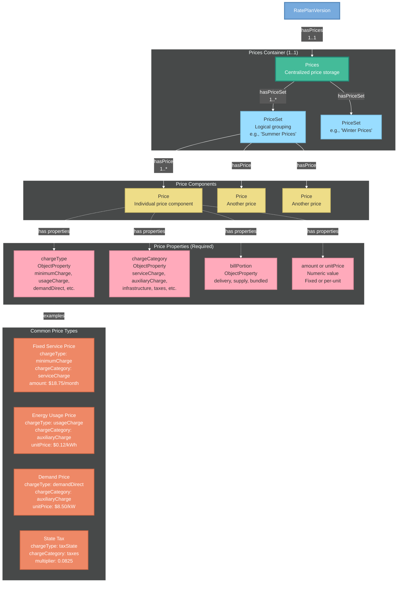
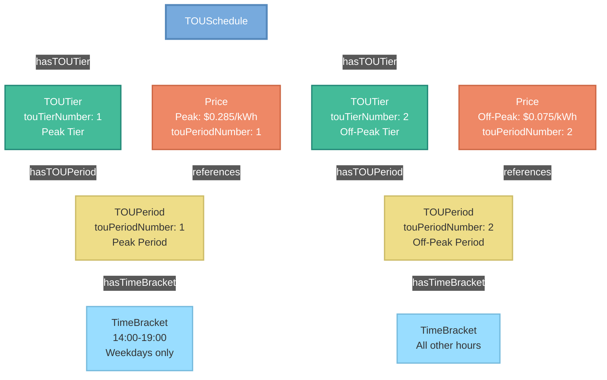

# URPX Diagram Index

**Version:** 0.2.0 (Pre-draft)
**Last Updated:** January 26, 2026

[← Back to Index](../index.md)

---

## Overview

This index catalogs all diagrams used in URPX documentation pages. All diagrams use the Paul Tol 2.7 Light color scheme for consistency and accessibility.

---

## Core Architecture Diagrams

### URPX Core Schema Diagram

> **Status:** Work in Progress (Moved to Drafts)

**File:** `dev-documentation/documentation-drafts/diagrams-drafts/urpx-core-schema-diagram.mmd`  
**Used in:** [Overview](urpx-overview.md)  
**Shows:** Complete URPX architecture including document hierarchy, rate plan structure, charges container, plan elements, eligibility rules, and standards alignment

---

### Price Structure Diagram

**File:** `documentation/diagrams/urpx-price-structure-diagram.mmd`  
**Used in:** Data Dictionary (planned)  
**Shows:** Prices → PriceSet → Price hierarchy with required properties and common examples

---

### TOU Structure Diagram

**File:** `documentation/diagrams/urpx-tou-structure-diagram.mmd`  
**Used in:** Data Dictionary (planned)  
**Shows:** TOUSchedule → TOUTier → TOUPeriod → TimeBracket hierarchy with price references

---

## Temporal & Versioning

### Temporal Versioning Diagram

> **Status:** Work in Progress (Moved to Drafts)

**File:** `dev-documentation/documentation-drafts/diagrams-drafts/urpx-temporal-versioning-diagram.mmd`  
**Used in:** [Overview](urpx-overview.md)  
**Shows:** Rate plan version timeline, version properties, change events, and regulatory tracking

---

## Rules & Eligibility

### Charge Types Diagram

> **Status:** Work in Progress (Moved to Drafts)

**File:** `dev-documentation/documentation-drafts/diagrams-drafts/urpx-charge-types-diagram.mmd`  
**Used in:** [Overview](urpx-overview.md)  
**Shows:** Charge type taxonomy, commodities, units of measure, and standards compliance

---

## Educational Diagrams

### Rate Plan Knowledge Graph

> **Status:** Work in Progress (Moved to Drafts)

**File:** `dev-documentation/documentation-drafts/diagrams-drafts/urpx-rate-plan-graph.mmd`  
**Used in:** [Semantic Web Guide](urpx-semantic-web-guide.md)  
**Shows:** Knowledge graph representation of rate plan data

---

### RDF Triple Example

> **Status:** Work in Progress (Moved to Drafts)

**File:** `dev-documentation/documentation-drafts/diagrams-drafts/urpx-rdf-triple-example.mmd`  
**Used in:** [Semantic Web Guide](urpx-semantic-web-guide.md)  
**Shows:** RDF triple basics and structure

---

### SPARQL Query Visual

```mermaid
%%{init: {'theme':'base', 'themeVariables': { 'primaryColor':'#77AADD', 'primaryTextColor':'#000', 'primaryBorderColor':'#000', 'lineColor':'#000', 'secondaryColor':'#EEDD88', 'tertiaryColor':'#FFAABB', 'background':'transparent'}}}%%
graph LR
    subgraph "SPARQL Query"
        Q["SELECT ?price ?name ?price<br/>WHERE {<br/>  ?ratePlan urpx:identifier 'RES-TOU-2025' ;<br/>    hasRatePlanVersion/hasPrices/<br/>    hasPriceSet/hasPrice ?Price .<br/>  ?Price urpx:name ?name ;<br/>    urpx:unitPrice ?price .<br/>}"]
    end
    
    subgraph "Graph Traversal"
        RP[RatePlan<br/>RES-TOU-2025]
        RPV[RatePlanVersion]
        PRC[Prices]
        PS[PriceSet]
        P1[Price 1]
        P2[Price 2]
        P3[Price 3]
        
        RP -->|hasRatePlanVersion| RPV
        RPV -->|hasPrices| PRC
        PRC -->|hasPriceSet| PS
        PS -->|hasPrice| P1
        PS -->|hasPrice| P2
        PS -->|hasPrice| P3
    end
    
    subgraph "Results"
        R1["Peak Energy, $0.28/kWh"]
        R2["Off-Peak Energy, $0.09/kWh"]
        R3["Service Charge, $15.00/month"]
    end
    
    Q -.->|navigates| RP
    P1 -.->|binds| R1
    P2 -.->|binds| R2
    P3 -.->|binds| R3
    
    style Q fill:#EEDD88,stroke:#000,stroke-width:2px,color:#000
    style RP fill:#77AADD,stroke:#000,stroke-width:2px,color:#000
    style RPV fill:#99DDFF,stroke:#000,stroke-width:2px,color:#000
    style PRC fill:#BBCC33,stroke:#000,stroke-width:2px,color:#000
    style PS fill:#EEDD88,stroke:#000,stroke-width:2px,color:#000
    style P1 fill:#FFAABB,stroke:#000,stroke-width:2px,color:#000
    style P2 fill:#FFAABB,stroke:#000,stroke-width:2px,color:#000
    style P3 fill:#FFAABB,stroke:#000,stroke-width:2px,color:#000
    style R1 fill:#44BB99,stroke:#000,stroke-width:2px,color:#000
    style R2 fill:#44BB99,stroke:#000,stroke-width:2px,color:#000
    style R3 fill:#44BB99,stroke:#000,stroke-width:2px,color:#000
```

**File:** `documentation/diagrams/urpx-sparql-query-visual.mmd`  
**Used in:** [Semantic Web Guide](urpx-semantic-web-guide.md)  
**Shows:** SPARQL query patterns and examples

---

## Color Scheme

All diagrams use the **Paul Tol 2.7 Light** color palette:

| Color | Hex Code | Usage |
|-------|----------|-------|
| Light Blue | `#77AADD` | Primary classes, documents |
| Cyan | `#99DDFF` | Secondary elements, components |
| Teal | `#44BB99` | Containers, active elements |
| Yellow | `#EEDD88` | Data, details |
| Peach | `#EE8866` | Specialized, standards |
| Pink | `#FFAABB` | Core content, profiles |

---

## Diagram Files

All diagram source files are located in `documentation/diagrams/`:

- **Mermaid files** (`.mmd`) - Source diagrams
- **SVG exports** (`.svg`) - Rendered diagrams for documentation

For the complete diagram catalog including development diagrams, see `dev-documentation/documentation-drafts/diagrams-drafts/`.

---

[← Back to Index](../index.md)
