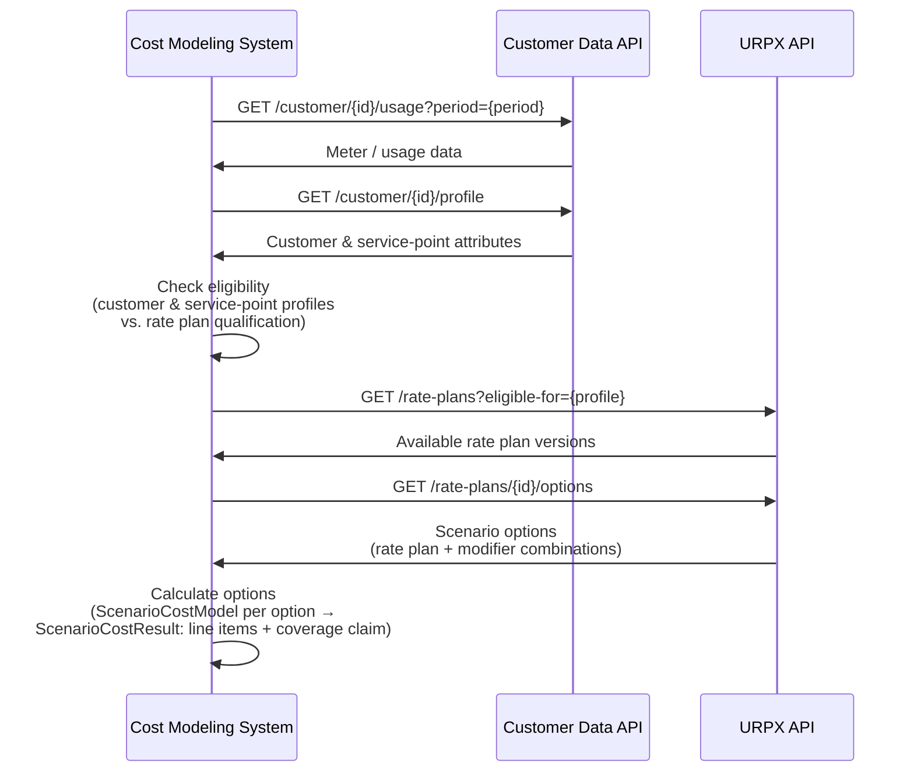

<!-- SPDX-FileCopyrightText: The URPX Authors -->
<!-- SPDX-License-Identifier: W3C-20150513 -->

---
site_category: integration
site_id: interoperability
site_title: "Interoperability & Integration"
site_label: "Interoperability"
site_position: 1
---

# URPX Interoperability & Standards Integration

**Version:** 0.5.1 (Working Group Draft)
**Last Updated:** 2026-10-04

> **Draft.** The mapping profiles on this page are under working group review. Only the Schema.org profile is published; see [Mapping Profile Publication](#mapping-profile-publication).

**Comprehensive guide to URPX interoperability, multi-standard integration, and semantic mapping.**

[← Back to Index](/docs/getting-started/overview)

---

## Table of Contents

1. [Overview](#overview)
2. [Standards Ecosystem](#standards-ecosystem)
3. [Mapping Methodology](#mapping-methodology)
4. [SKOS Semantic Approach](#skos-semantic-approach)
5. [Standards and Draft Alignments](#standards-and-draft-alignments)
    - [Green Button Alliance](#green-button-alliance)
    - [LF Energy CDS](#lf-energy-cds)
    - [Common Information Model (CIM)](#common-information-model-cim)
    - [OpenADR](#openadr)
    - [Smart Home & IoT (Matter, Zigbee)](#smart-home--iot-matter-zigbee)
6. [Mapping Profile Publication](#mapping-profile-publication)
7. [Integration Patterns](#integration-patterns)

---

## Overview

URPX follows a **complementary architecture** approach: it integrates with existing utility data standards to provide complete rate plan information within the broader energy data ecosystem. URPX provides formal mappings that preserve semantics across system boundaries.

### Why Multi-Standard Integration Matters

Utility rate plan data does not exist in isolation. It must integrate with:
- **Customer data systems** (Green Button, LF Energy CDS)
- **Demand response** (OpenADR, IEEE 2030.5)
- **Smart home/IoT** (Zigbee, Matter, Thread)
- **Grid operations** (CIM, IEC standards)

URPX mappings are designed for bidirectional data exchange that preserves meaning across these ecosystems.

---

## Standards Ecosystem

### URPX Standards Integration Architecture


### Integration Principles

**Data Separation**
- URPX: Public rate plan structures, pricing, eligibility rules
- CDS: Customer accounts, service agreements, personal information
- Green Button: Interval usage data, consumption measurements

**Reference Architecture**
- URPX references CDS and Green Button entities via URIs
- No data duplication across standards
- Clear privacy boundaries maintained

---

## Mapping Methodology

URPX uses formal RDF mappings to connect with other standards. A complete mapping profile is expected to cover:

**1. Vocabulary Alignment**
- Class mappings (URPX classes ↔ Standard classes)
- Property mappings (URPX properties ↔ Standard properties)
- Value set mappings (Enumerations and controlled vocabularies)

**2. Transformation Rules**
- Data type conversions
- Unit transformations
- Temporal format alignment
- Structural reorganization patterns

**3. Bidirectional Fidelity**
- Round-trip conversion verification
- Lossless transformation where possible
- Extension fields for standard-specific data

---

## SKOS Semantic Approach

To map URPX to existing standards without creating hard technical dependencies, URPX uses **SKOS (Simple Knowledge Organization System)**. SKOS is a W3C standard designed for linking controlled vocabularies and taxonomies across different domains.

**Mapping Logic used in URPX:**

* **`skos:exactMatch`**: Used for concepts that are semantically identical (e.g., `urpx:unitPrice` to a specific API field).
* **`skos:broadMatch`**: Used when the target concept is broader than the URPX concept (e.g., a general line item in the target standard against a specific URPX price). `skos:narrowMatch` states the reverse (e.g., URPX supports water and gas while the target is energy-only).
* **`skos:relatedMatch`**: Used for functional links where structures differ but the purpose is shared (e.g., linking a Rate Plan to an IoT Pricing Signal).

---

## Standards and Draft Alignments

Mapping work is in progress. The alignments in this section show the approach and the matches drafted so far; they are under working-group review and will change. Only the Schema.org mapping is published as a settled profile. See [Mapping Profile Publication](#mapping-profile-publication) for the status of each file.

### Green Button Alliance

**Purpose**: Customer usage data exchange standard.

#### Integration Logic
Green Button provides interval usage measurements that align with URPX time-of-use (TOU) periods for accurate cost calculation.

**Cost Calculation Flow**:
1. URPX provides TOU schedule and charge structure
2. Green Button provides interval usage data
3. System maps usage to applicable TOU periods
4. Charges applied based on matched periods
5. Total cost calculated

#### Mapping Example
```turtle
@prefix skos: <http://www.w3.org/2004/02/skos/core#> .
@prefix urpx: <https://urpx.org/ns/ontology/> .
@prefix gb: <http://naesb.org/espi#> .

# Core Structural Alignment
urpx:RatePlan skos:relatedMatch gb:PricingStructure ;
    skos:note "The RatePlan URL maps to the PricingStructure URI in ESPI UsagePoint." .

urpx:Price skos:broadMatch gb:LineItem ;
    skos:note "URPX procedural prices map to static ESPI bill line items." .

# Line Item Alignment (ESPI V4 ItemKind)
gb:ItemKind_AdministrativeFee a skos:Concept ;
    skos:notation "4" ;
    skos:closeMatch urpx:serviceCharge ;
    skos:note "Green Button Administrative Fee line items map to URPX serviceCharge." .
```

### LF Energy CDS

**Purpose**: Connected Data Specifications (CDS), the LF Energy family of data access standards; its Customer Data specification covers accounts and billing.

#### Integration Logic
URPX maintains privacy boundaries through reference-only integration. Service account and agreement data lives in the customer data system; URPX carries `urpx:AccountServiceAgreement` as the contractual hook for eligibility and refers to the customer record by its URI. URPX billing cycles align with CDS billing periods.

#### Mapping Example
```turtle
@prefix skos: <http://www.w3.org/2004/02/skos/core#> .
@prefix urpx: <https://urpx.org/ns/ontology/> .
@prefix lfe: <https://lfenergy.org/cds/> .

# Charge Type Mapping
lfe:BaseCharge a skos:Concept ;
    skos:exactMatch urpx:minimumCharge ;
    skos:note "LF Energy BaseCharge maps to URPX minimumCharge." .

lfe:ConsumptionCharge a skos:Concept ;
    skos:exactMatch urpx:usageCharge ;
    skos:note "LF Energy ConsumptionCharge maps to URPX usageCharge." .
```

### Common Information Model (CIM)

**Purpose**: Enterprise utility system integration (IEC 61968/61970).

#### Integration Logic
URPX aligns its measurement properties with CIM, particularly for measurement definitions.

- `measurementKind` ↔ CIM ReadingType
- `unitOfMeasure` ↔ CIM UnitSymbol
- `phaseCodeKind` ↔ CIM PhaseCode

#### Mapping Example
```turtle
@prefix skos: <http://www.w3.org/2004/02/skos/core#> .
@prefix urpx: <https://urpx.org/ns/ontology/> .
@prefix cim: <http://iec.ch/TC57/CIM-generic#> .

# Class Alignment
urpx:TOUPeriod skos:narrowMatch cim:TimeTariffInterval ;
    skos:note "Generalized for multi-utility use; CIM equivalent is energy-specific." .

urpx:Price skos:exactMatch cim:Price .
```

### OpenADR

**Purpose**: Demand response and grid signal communication.

**Mapping Scope**:
- OpenADR event signals ↔ URPX dynamic pricing events
- OpenADR programs ↔ URPX rate plan modifiers

#### Mapping Example
```turtle
@prefix skos: <http://www.w3.org/2004/02/skos/core#> .
@prefix urpx: <https://urpx.org/ns/ontology/> .
@prefix oadr: <http://openadr.org/oadr#> .

# Event Mapping, OpenADR 2.0b terms
urpx:DynamicPricing skos:relatedMatch oadr:EiEvent ;
    skos:note "URPX defines the pricing periods, price definitions, and price values feeding either to or from pricing servers; OpenADR signals real-time values." .

urpx:currentPrice skos:relatedMatch oadr:oadrPayload ;
    skos:note "Maps to the price signal value within an OpenADR message." .
```

### Smart Home & IoT (Matter, Zigbee)

**Purpose**: Device interoperability and home automation.

#### Matter Integration
Bridges utility rate plan structures to residential Energy Management Clusters in the Matter 1.4+ standard.

```turtle
@prefix skos: <http://www.w3.org/2004/02/skos/core#> .
@prefix urpx: <https://urpx.org/ns/ontology/> .
@prefix matter: <http://csa-iot.org/matter#> .

urpx:TOUTierStandardNameValue skos:relatedMatch matter:EnergyManagementCluster ;
    skos:note "Maps Peak/Off-Peak tier names to Matter device power-shifting states." .
```

#### Zigbee Integration
Maps rate plan prices to the legacy and modern HAN (Home Area Network) clusters.

```turtle
@prefix skos: <http://www.w3.org/2004/02/skos/core#> .
@prefix urpx: <https://urpx.org/ns/ontology/> .
@prefix zigbee: <http://zigbee.org/sep#> .

urpx:Price skos:relatedMatch zigbee:PriceCluster ;
    skos:note "Maps URPX Price instances to Zigbee cost attributes." .
```

---

## Mapping Profile Publication

A published mapping profile carries header metadata, vocabulary declarations, and its mapping rules.

**Directory**: `skos/standards-integration/`

**Naming Convention**: `urpx-{standard-name}-mapping.ttl`

**Versioning**: Mapping files are versioned independently from the URPX core vocabulary (Major.Minor.Patch). The published Schema.org file does not yet declare a version.

**Status**: Mapping is an active work stream, and the profiles are at different stages. The table below states each profile's status.

| Profile | File | Status |
| --- | --- | --- |
| Schema.org | `urpx-schema-mapping.ttl` | Published |

Two further profiles, Green Button (NAESB ESPI) and LF Energy CDS, are work in progress under working group review. A draft profile's matches are open to change; a profile is published here once the working group has reviewed it.

---

## Integration Patterns

### Pattern 1: Rate Plan Cost Modeling

**Use Case**: Retrieve a customer's meter and account data, determine eligible rate plans, and compute cost options for a scenario. The URPX API calls are illustrative; the API specification is under development.



### Pattern 2: Conditional Mapping

**Use When**: Mapping depends on context or additional properties. In SKOS, this is handled via `skos:closeMatch` or `skos:broadMatch` with explanatory notes, as SKOS does not natively support computational conditions.

**Example**: a source identifier maps to `urpx:ratePlanUniqueIdentifier` by default, and to a `urpx:RatePlanIdentifier` when the source also names the register the value comes from. Schema.org's `schema:identifier` is the general case: a bare text value, or a `schema:PropertyValue` whose `propertyID` names the register.

```turtle
@prefix skos: <http://www.w3.org/2004/02/skos/core#> .
@prefix urpx: <https://urpx.org/ns/ontology/> .
@prefix schema: <http://schema.org/> .

schema:identifier a skos:Concept ;
    skos:closeMatch urpx:ratePlanUniqueIdentifier ;
    skos:note "Maps to urpx:ratePlanUniqueIdentifier by default. When the source value is a schema:PropertyValue whose propertyID names a register, it belongs on a urpx:RatePlanIdentifier instead: the register becomes urpx:scheme and the value skos:notation. RatePlanIdentifierShape requires both, so a bare text identifier with no register stays on ratePlanUniqueIdentifier." .
```

---

[← Back to Index](/docs/getting-started/overview) | [Semantic Web Guide](urpx-semantic-web-guide.md)
