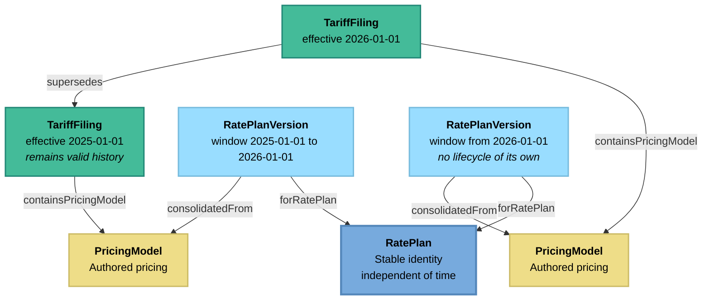

<!-- SPDX-FileCopyrightText: The URPX Authors -->
<!-- SPDX-License-Identifier: W3C-20150513 -->

---
site_category: getting-started
site_id: overview
site_title: "URPX Overview"
site_label: "Overview"
site_position: 1
---

# URPX Overview

**Version**: 0.5.1 (Working Group Draft)
**Last Updated**: 2026-07-07
**Status**: Active

## Understanding the Utility Rate Plan Exchange Standard

[← Back to Index](/docs/getting-started/overview)

### Introduction

The Utility Rate Plan Exchange (URPX) standard addresses a fundamental challenge in the energy industry: the lack of a common structure and exchange method for sharing utility rate plan information. With thousands of utilities each publishing rate plans in their own formats, comparing prices, analyzing trends, and building energy applications has been unnecessarily complex.

URPX provides a solution through a comprehensive, standards-based approach to rate plan representation.

### The Challenge

Utility rate plans are surprisingly complex. A single rate plan might include:

- **Multiple price types** - Energy prices, demand prices, customer prices, and various fees
- **Time-varying prices** - Different prices for peak vs. off-peak hours
- **Seasonal variations** - Summer and winter pricing schedules
- **Tiered structures** - Prices that change based on usage levels
- **Eligibility requirements** - Restrictions based on customer type, location, or usage patterns
- **Regulatory traceability** - Rate case proceedings, case numbers, filing references, approval dates, and legal citations

Without a standard format, each system must custom-build parsers for every utility's rate plan structure - a massive duplication of effort that slows innovation and limits data accessibility.

### The URPX Solution

URPX provides a complete framework for rate plan representation using semantic web technologies:

#### 1. Ontology-Based Design
Built on RDF and OWL standards, URPX defines a rich vocabulary for describing every aspect of utility rate plans. This semantic approach ensures data is both machine-readable and human-understandable.

#### 2. Modular Architecture

URPX is built on a core ontology ([`urpx-ontology.ttl`](../../ontology/urpx-ontology.ttl)) that includes:

**Core Rate Plan Structure:**
- Rate plan identities and derived version snapshots
- Pricing models carried by publications
- Prices and price sets
- TOU schedules and pricing rules

**Charge Classification:**
- Charge types (minimumCharge, usageCharge, demandDirect, etc.)
- Charge categories (serviceCharge, auxiliaryCharge, infrastructure, taxes)
- Bill portions (deliveryPortion, supplyPortion, bundledPortion)

**Geography:**
- Service territories
- States, counties, municipalities
- Geographic zones and boundaries

**Organization:**
- Utility operators
- Regulatory authorities
- Corporate structures

**Profiles:**
- Customer and service point profiles

#### 3. Core Features

**Comprehensive Rate Plan Modeling**
- Complete price structures (energy, demand, service, taxes)
- Time-of-use schedules with seasonal variations
- Customer eligibility and profile requirements
- Geographic applicability rules
- Temporal versioning with explicit `RateCase` traceability

**Semantic Web Foundation**
- RDF/OWL ontology for formal semantics
- SHACL validation for data quality
- SPARQL queries for powerful analysis
- JSON-LD for developer-friendly format
- Standards-based interoperability

**Source Publications**

URPX cites the published sources that pricing content comes from. Every external published artifact is a `SourcePublication`, and its kind is given by the `publicationType` enumeration:

- `tariffBook` - Complete tariff books
- `tariffStatement` - PSC periodic filings (statements)
- `tariffSupplement` / `tariffAddendum` - Supplements and addenda
- `supplyCharges` - Competitive market supply pricing
- `highlyDynamicPrices` - Dynamic pricing structures
- `derExports` - Prices for DER exports
- `marketPriceFeed` - Published market price feeds

The URPX exchange package itself (`URPXPackage`) is a separate concept: it is URPX's own container for exchanging content between systems, while a `SourcePublication` is a third-party artifact that URPX references but does not own.

#### 4. Validation Framework
SHACL (Shapes Constraint Language) rules ensure data quality and consistency:

```turtle
# Example: every rate plan version must name its plan and declare its coverage
urpx-shacl:RatePlanVersionShape a sh:NodeShape ;
    sh:targetClass urpx:RatePlanVersion ;
    sh:property [
        sh:path urpx:forRatePlan ;
        sh:class urpx:RatePlan ;
        sh:minCount 1 ;
        sh:message "Rate plan version must link back to its rate plan identity"
    ] ;
    sh:property [
        sh:path urpx:hasCoverageClaim ;
        sh:class urpx:CoverageClaim ;
        sh:minCount 1 ;
        sh:message "Rate plan version must declare a coverage claim"
    ] .
```

### Core Concepts

#### Rate Plans

A `RatePlan` is the stable identity of a utility rate plan, independent of time: a durable record carrying the plan's name, identifiers (`hasIdentifier` / `RatePlanIdentifier`), service class and rate group links, and publisher. The identity itself carries no pricing content: pricing is stated by pricing models and read from derived version snapshots.

#### Rate Plan Modifiers

A `RatePlanModifier` is the parallel identity record for an optional add-on (a rider): something a customer takes in addition to a rate plan, never on its own. Modifiers follow the same pattern as plans: a stable identity, pricing models that state pricing content, and derived `RatePlanModifierVersion` snapshots linked back via `forRatePlanModifier`.

#### Pricing Models and Publications

Utilities rarely publish a complete rate plan in one place. A tariff book states delivery charges, a monthly statement adjusts one charge, a market feed publishes supply prices. URPX models each published statement of pricing as a `PricingModel`, an authored, citable, possibly-partial unit of pricing content carried by a publication:

- A `SourcePublication` is the external published artifact (its kind given by `publicationType`)
- A `TariffFiling` is the regulatory publication unit within a source publication, holding pricing models via `containsPricingModel`
- A `DataSourceReference` records exactly where an URPX fact was interpreted from: file name or URL, media type, and an optional selector into a page or region
- Each `PricingModel` carries a `confidence` value (`verified`, `estimated`, or `projected`) stating how its content relates to the published source

#### Rate Plan Versions and Coverage

A `RatePlanVersion` is the derived, complete snapshot of the resolved plan facts for a temporal window: the artifact a billing engine or comparison tool actually reads. It is consolidated from the applicable pricing models and linked back to the plan identity via `forRatePlan`. Completeness is honest by construction: every version must declare a `CoverageClaim`. Only the completeness result (`completenessResult`) is required; the self-containment flag (`selfContained`) and an explaining `Evaluation` are optional additions.

#### Prices

Individual pricing components with specific charge types, charge categories, and bill portions. Every price may have:
- chargeType (implementation: minimumCharge, usageCharge, etc.)
- chargeCategory (purpose: serviceCharge, auxiliaryCharge, etc.)
- hasMetricSpecification with billPortion (delivery, supply, bundled)

#### Time-of-Use

Rate plans can vary pricing by time of day, day of week, and season. TOU structures include:
- Seasons (Summer, Winter, or custom periods)
- TOUTiers (Peak, Mid-Peak, Off-Peak)
- TOUPeriods with specific time brackets
- Holiday calendar integration

#### Customer Profiles

Eligibility and applicability determined by:
- CustomerProfile (business and social characteristics)
- ServicePointProfile (physical service delivery characteristics)

#### Rate Plan Structure

A rate plan in URPX separates the identity from the resolved snapshot. The exchange package carries the identity; each version is a top-level node that points back to its plan:

```
URPXPackage (exchange container)
  └── RatePlan (stable identity)
      ├── RatePlanIdentifier (hasIdentifier)
      └── ServiceClass / RateGroup links

RatePlanVersion (derived snapshot — forRatePlan → RatePlan)
  ├── CoverageClaim (hasCoverageClaim)
  │   └── Evaluation (explainedBy)
  ├── EligibilityRule (customer requirements)
  │   └── ConditionExpression
  ├── PlanElements
  │   └── BillingModel
  │        ├── TOUSchedule (time-of-use rules)
  │        │   └── TOUTier (price level)
  │        │       └── TOUPeriod (time window)
  │        └── ServiceTiers (service tier group container)
  │            └── ServiceTier (service tier constraints)
  └── Prices (container for all prices)
      └── PriceSet (logical grouping)
          └── Price (individual price component)
```

#### Temporal Versioning

Rate plans evolve over time. URPX separates the plan's permanent identity from the snapshots that describe it, and keeps the timeline on the publication chain:



- **RatePlan** - The permanent identity of a rate plan
- **RatePlanVersion** - The resolved snapshot for a temporal window, linked back to its plan via `forRatePlan` and consolidated from the pricing models in force via `consolidatedFrom`. A version carries no lifecycle of its own: its place in the timeline derives from the filing chain
- **TariffFiling** - The regulatory publication unit, carrying its pricing models via `containsPricingModel` and the publication lifecycle. `supersedes` is a forward-in-time change of effective period and leaves the superseded filing as valid history; `replaces` is a same-period correction; `cancelledBy` with `cancelledOn` is a withdrawal
- **Version Transitions** - Tracked with `changeReason` plus optional linked `RateCase` records

When a rate plan version, rate plan modifier version, price definition, price set, price set alternative, or price is established or revised through a formal proceeding, URPX links the affected artifact to one or more `RateCase` resources via `hasRateCase`. Each `RateCase` carries the proceeding `caseNumber`, a source `url`, optional `name` and `description`, and optional `priority` when multiple proceedings overlap.

#### Charge Types

URPX supports the full spectrum of utility charges:

**Energy Prices**
- Usage-based pricing ($/kWh)
- Tiered structures with thresholds
- Time-of-use differentiation

**Demand Prices**
- Peak demand pricing ($/kW)
- Ratchet provisions
- Coincident peak adjustments

**Fixed Prices**
- Customer charges
- Meter charges
- Service fees

**Credits & Adjustments**
- Renewable energy credits
- Low-income discounts
- Fuel cost adjustments

### Statement Prices Integration

Regulatory statements typically adjust a single charge rather than restate a whole plan. URPX models this directly: the statement is a `SourcePublication`, the filed excerpt is a `TariffFiling`, and the pricing content it carries is a `PricingModel`, deliberately partial, citable back to its source:

```turtle
# The published statement, cited as an external source
ex:psc-statement-2025-001 a urpx:SourcePublication ;
    urpx:name "PSC Statement 2025-EL-0123" ;
    urpx:publicationType urpx:tariffStatement ;
    urpx:effectiveDate "2025-01-15"^^xsd:date .

# The filed excerpt carrying the pricing content
ex:filing-2025-001 a urpx:TariffFiling ;
    urpx:filingNumber "2025-EL-0123" ;
    urpx:effectiveDate "2025-01-15"^^xsd:date ;
    urpx:documentedBy [ a urpx:DataSourceReference ;
        urpx:sourcePublication ex:psc-statement-2025-001 ;
        urpx:fileName "psc-statement-2025-001.pdf" ] ;
    urpx:containsPricingModel ex:pm-transmission-2025 .

# The authored pricing content — the same structure a rate plan version
# carries: PlanElements define what is measured and how the charge is
# defined; Prices carry the dated values.
ex:pm-transmission-2025 a urpx:PricingModel ;
    urpx:confidence urpx:verified ;
    urpx:hasPlanElements [ a urpx:PlanElements ;
        urpx:hasMetricInput ex:mi-energy-kwh ;
        urpx:hasBillingModel [ a urpx:BillingModel ;
            urpx:hasLedger ex:ledger-delivery ;
            urpx:hasPriceDefinition ex:pd-transmission ] ] ;
    urpx:hasPrices [ a urpx:Prices ;
        urpx:hasPriceSet [ a urpx:PriceSet ;
            urpx:hasPrice [ a urpx:Price ;
                urpx:name "Transmission Service Price" ;
                urpx:referencesPriceDefinition ex:pd-transmission ;
                urpx:unitPrice 0.0234 ;  # $/kWh
                urpx:startDate "2025-01-15"^^xsd:date ] ] ] .

# The stable charge definition the dated price instantiates
ex:pd-transmission a urpx:PriceDefinition ;
    urpx:name "Transmission Service Charge" ;
    urpx:chargeType urpx:transmission ;
    urpx:chargeCategory urpx:infrastructure ;
    urpx:billPortion urpx:deliveryPortion ;
    urpx:referencesLedger ex:ledger-delivery ;
    urpx:referencesMetricInput ex:mi-energy-kwh .
```

Reading the chain top-down: the **statement** (`SourcePublication`) is the external document; the **filing** (`TariffFiling`) is the URPX content unit within it, citing its exact source through a `DataSourceReference`; the **pricing model** is the authored pricing the filing carries. Inside the pricing model the structure is the same as inside a rate plan version: `PlanElements` hold the measurement definition (`MetricInput`) and the `BillingModel` with its ledger and stable `PriceDefinition`s, while `Prices` hold the dated values that reference those definitions. When a version snapshot is later consolidated, this pricing model contributes its price to the resolved `RatePlanVersion` for the window in which the statement is effective.

### A California Example: Identity and Partial Coverage

Not every rate plan version is self-contained, and a plan identity often carries more than one identifier. A California Community Choice Aggregation (CCA) or Direct Access customer takes delivery service priced by the utility while generation is priced by a third party, so the utility's version carries delivery in full but references generation externally.

The plan identity carries the identifiers a customer and downstream systems key on. In California the MIDAS RIN (printed on the bill, and the key under which the utility uploads the rate's prices to the state MIDAS feed) rides alongside the utility's own tariff code:

```turtle
ex:pge-e-tou-c a urpx:RatePlan ;
    urpx:ratePlanUniqueIdentifier "E-TOU-C" ;
    urpx:name "Residential Time-of-Use (Peak Pricing 4-9 p.m.)" ;
    urpx:initialEffectiveDate "2024-01-01"^^xsd:date ;
    urpx:hasIdentifier
        [ a urpx:RatePlanIdentifier ;
          urpx:scheme urpx:ca-midas-rin ;
          skos:notation "USCA-PGCE-TIME-0001" ] ,
        [ a urpx:RatePlanIdentifier ;
          urpx:scheme urpx:utility-tariff-code ;
          skos:notation "E-TOU-C" ] .
```

The resolved version for a CCA customer then declares partial coverage. Only `completenessResult` is required on the `CoverageClaim`; `selfContained` and an explaining `Evaluation` are optional, but both make the partial case legible:

```turtle
ex:pge-e-tou-c-cca-2026-03-01 a urpx:RatePlanVersion ;
    urpx:forRatePlan ex:pge-e-tou-c ;
    urpx:effectiveDate "2026-03-01"^^xsd:date ;
    # delivery PlanElements and Prices carried in full (elided here)
    urpx:hasCoverageClaim [ a urpx:CoverageClaim ;
        urpx:completenessResult urpx:partial ;
        urpx:selfContained false ;
        urpx:explainedBy [ a urpx:Evaluation ;
            urpx:evaluationKind urpx:coverageEvaluation ;
            urpx:description "Delivery charges are carried in full from the PG&E tariff book. Generation is priced by the customer's Community Choice Aggregator and referenced externally, not restated here." ] ] .
```

The externally-priced generation is attached through a `PriceDefinitionReference` whose `referenceInclusion` is `retrievedElsewhere`, which is what makes `selfContained` false and `completenessResult` `partial`.

### Geographic Applicability

Prices apply within named geographic areas. Geographic scope is expressed through the general applicability model: an `ApplicabilityRule` carries a `ConditionExpression` that tests geographic vocabulary such as the `ServiceTerritory` class and the `GeographicScopeValue` enumeration (`statewideScope`, `countyScope`, `serviceTerritoryScope`, `municipalityScope`, `customScope`). See the [Condition Modeling](urpx-condition-modeling.md) page for the full applicability pattern.

### Customer Eligibility

**Prior Rate Plan Requirements**
```turtle
ex:EVRateEligibility a urpx:PriorRatePlan ;
    urpx:name "Standard Residential Rate Plan" ;
    urpx:minimumTenure "P12M"^^xsd:duration .  # 12 months 
```

**Program Enrollment Requirements**
```turtle
ex:DemandResponseProgram a urpx:ProgramEnrollment ;
    urpx:programName "SmartAC Program" ;
    urpx:programType "urpx:demandResponseProgram" ;
    urpx:enrollmentStatus "urpx:activeStatus" ;
```

### Data Quality & Validation

URPX includes SHACL (Shapes Constraint Language) validation shapes in a unified file ([`shacl/urpx-shacl.ttl`](/ontology/urpx-shacl.ttl)):

**Core Validation**: Rate plan structure integrity, price consistency rules, temporal constraint validation

**Organization Validation**: Identity tracking consistency, corporate relationship rules, regulatory jurisdiction validation

**Geography Validation**: Territory coverage rules, hierarchical boundary consistency, coordinate range validation

Because SHACL shapes are modular and composable, additional shape definitions can be authored to enforce jurisdiction-specific constraints, such as required fields, value ranges, or expected relationships between classes that vary by regulatory context.

### Benefits of URPX

#### For Utilities
- **Standardized Publishing** - One format for all consumers
- **Regulatory Compliance** - Built-in support for filing requirements
- **Version Management** - Track price changes over time
- **Reduced Support** - Self-documenting data format

#### For Developers
- **Consistent API** - Same structure across all utilities
- **Rich Semantics** - Machine-understandable relationships
- **Validation Tools** - Ensure data quality
- **Query Capabilities** - SPARQL for complex analysis

#### For Customers
- **Rate Plan Comparison** - Apples-to-apples comparisons
- **Bill Transparency** - Understand price components
- **Optimization Tools** - Find best prices for usage patterns
- **Historical Analysis** - Track price changes over time

#### For Researchers
- **Comprehensive Data** - All rate plan components captured
- **Standards-Based** - Integration with other datasets
- **Temporal Analysis** - Study rate plan evolution
- **Geographic Analysis** - Regional pricing patterns

### Use Cases

**Utility Operations:**
- Publishing rate plans in standardized format
- Regulatory filing compliance
- Customer service support

**Software Development:**
- Rate plan comparison applications
- Bill calculation engines
- Energy management systems
- Customer portals

**Analysis & Research:**
- Rate plan structure analysis
- Regional pricing comparisons
- Policy impact studies
- Market trend analysis

### Next Steps

Ready to work with URPX data? Here are your next steps:

1. **[Read the Tutorial](urpx-tutorial.md)** - Learn by building a simple rate plan
2. **[Review the Data Dictionary](urpx-data-dictionary.md)** - Understand all classes and properties

### Summary

URPX transforms utility rate plan data from isolated silos into an interconnected, semantic web of pricing information. By providing a comprehensive standard for rate representation, URPX enables innovation in energy applications while ensuring data quality and regulatory compliance.

The modular design, industry alignment, and robust validation framework make URPX suitable for everything from simple residential rate plans to complex industrial rate plans with real-time pricing.

---

[← Back to Index](/docs/getting-started/overview) | [Next: Tutorial →](urpx-tutorial.md)
