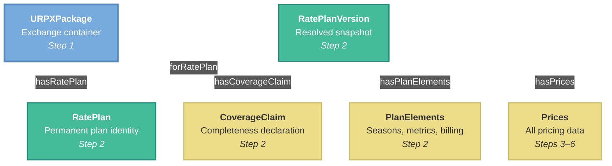
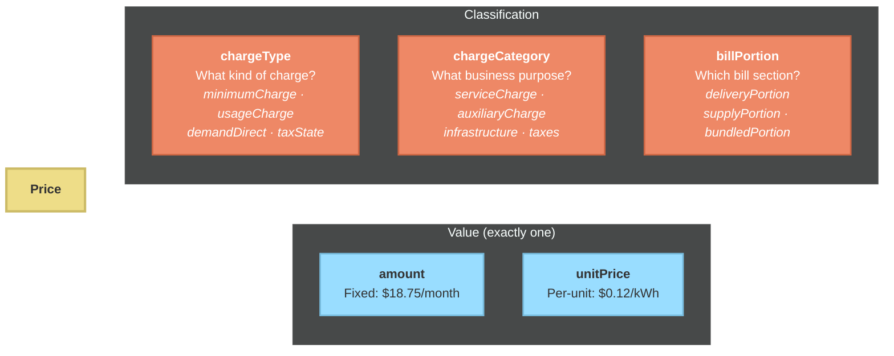
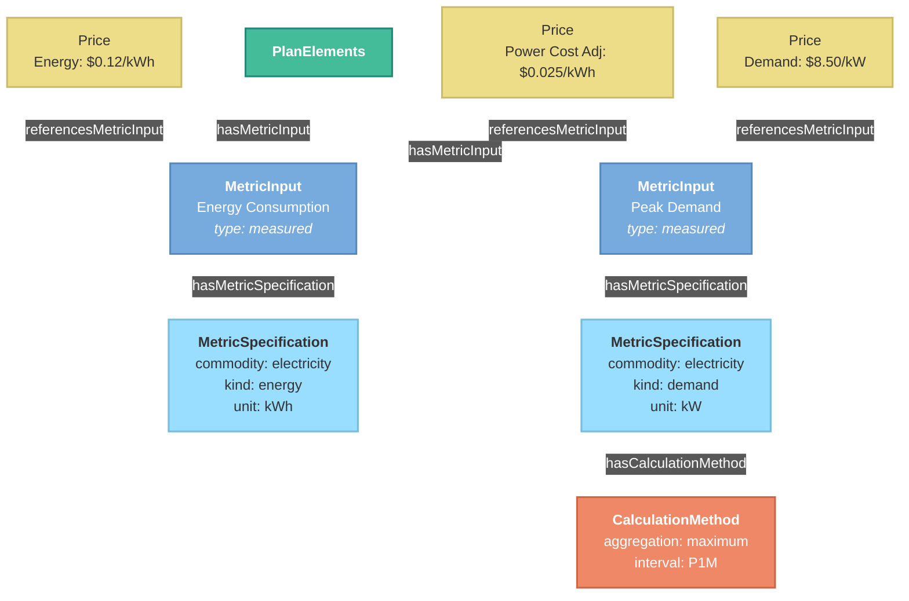
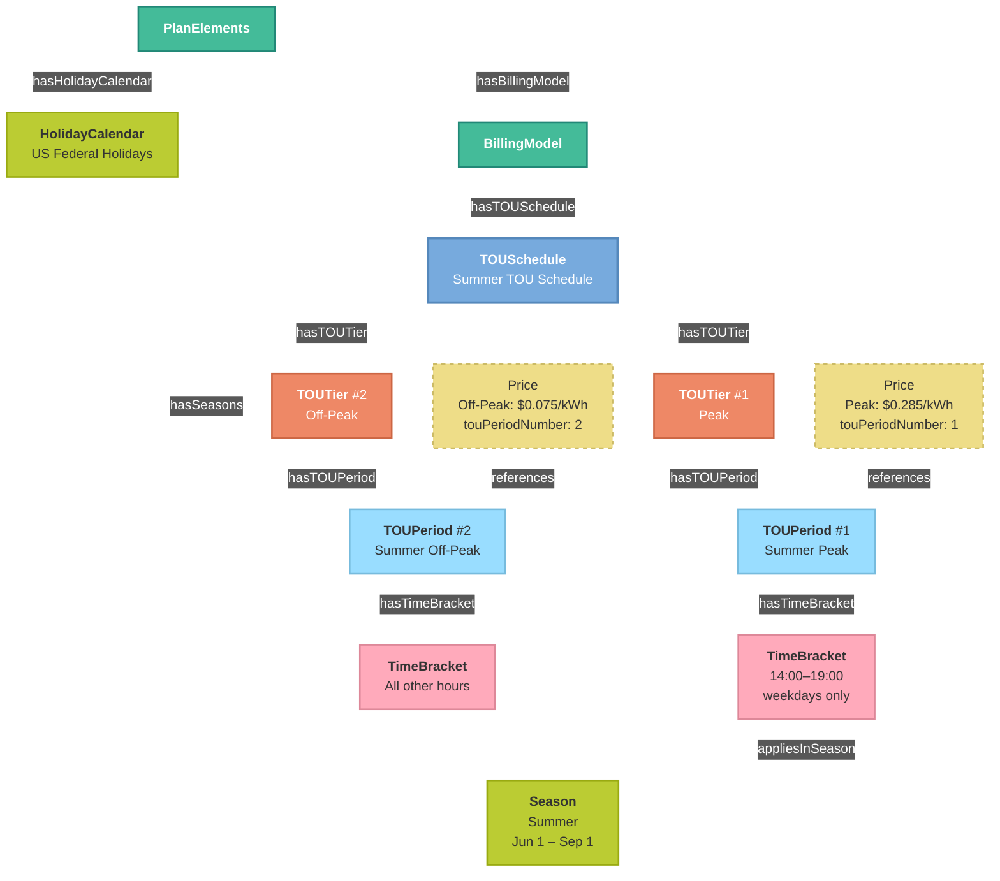
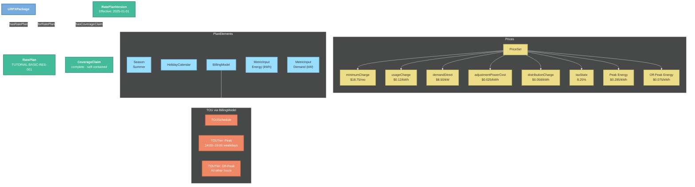

<!-- SPDX-FileCopyrightText: Flux Tailor LLC -->
<!-- SPDX-License-Identifier: W3C-20150513 -->
<!-- SPDX-Transition-License-After-Draft: W3C-20150513 -->
<!-- Comment: Transitioned to W3C Document License upon Working Group Draft acceptance. See TRANSITION.md. -->

---
site_category: getting-started
site_id: tutorial
site_title: "Tutorial"
site_position: 2
---

# URPX Tutorial: Building Your First Rate Plan

**Version:** 0.5.0 (Pre-draft)
**Last Updated:** 2026-08-20
**Status:** Active

**Learn the basics of creating and validating utility rate plan data using the URPX v0.5.0 ontology**

---

## Table of Contents

1. [Prerequisites](#prerequisites)
2. [Understanding URPX Basics](#understanding-urpx-basics)
3. [Creating a Simple Rate Plan](#creating-a-simple-rate-plan)
4. [Adding Complex Prices](#adding-complex-prices)
5. [Time-of-Use Pricing](#time-of-use-pricing)
6. [Validation and Best Practices](#validation-and-best-practices)
7. [Next Steps](#next-steps)

---

## Prerequisites

Before starting this tutorial, ensure you have:

- Basic understanding of JSON-LD or Turtle/RDF
- Familiarity with utility billing concepts
- Access to the URPX ontology files

### Required Files
- `../../ontology/urpx-ontology.ttl` - URPX ontology file.

> **Note:** Draft SHACL validation shapes are available at [`shacl/urpx-shacl.ttl`](../../shacl/urpx-shacl.ttl).

---

## Understanding URPX Basics

### Terminology

**Rate Plan vs Tariff vs Price**

Understanding these distinctions is critical for working with URPX. For a more detailed explanation, please see the [URPX FAQ](urpx-faq.md).

- **Rate Plan**: A complete package with all parameters needed to calculate customer cost: prices, TOU schedules, service tiers, seasonal variations, eligibility rules, and applicability conditions. The rate plan is the first-class thing URPX models.
- **Tariff**: A regulatory document (tariff book) containing material from one or more rate plans. Published by utilities and approved by regulatory authorities. In URPX, tariffs are publication vehicles (places where parts of a rate plan appear), not the plan itself.
- **Price**: A single value applied to something measured or counted (e.g., $0.12/kWh, an $18.75 monthly charge), incomplete without the full rate plan context.

**Why URPX says "price", not "rate".** In everyday utility usage, "rate" can mean at least three different things: a single per-unit value ("the summer rate is $0.12/kWh"), a named grouping inside a service classification ("Rate I", "Rate II"), or the whole plan ("switch to the EV rate"). Because one word carries three meanings, URPX does not use "rate" on its own anywhere in the vocabulary. A single value is a **price** (`Price`, `PriceSet`). The complete package is a **rate plan** (`RatePlan`). And the named grouping has its own term:

- **Rate Group** (`RateGroup`): The named grouping within a service class that utilities themselves often call a "rate", for example, *Rate I* within *Service Classification No. 1*. A rate group is a subdivision of a service class, not a kind of service class: Rate I is not a type of SC 1, it is a grouping inside it (`parentServiceClass` points from the rate group to its service class). A rate plan links to its grouping via `hasRateGroup`, so when a utility's published material says "SC 1 Rate I", the plan maps directly to that published grouping, without importing the ambiguous word "rate" into any other part of the model.

**In URPX**: We model rate plans (complete packages), their prices, and the rate groups that connect them to the utility's own published groupings. Tariff documents are containers where parts of rate plans appear, plus regulatory metadata.

### Rate Plan vs Rate Plan Modifier

The [Terminology](#terminology) section above covers the base service and how it is published. URPX also has a second identity for content that changes what a customer pays without being a rate plan in its own right: the **rate plan modifier**.

- **Rate Plan** (`RatePlan`): the base service a customer is on, what a customer would be billed under with no modifiers applied.
- **Rate Plan Modifier** (`RatePlanModifier`): a separately published layer (a rider, discount, credit, or adjustment) that modifies a base rate plan. Examples include low-income discounts, green energy options, demand response programs, and distributed energy resource (DER) export crediting.

**Why two classes.** If every combination of a base rate plan and its available riders were modeled as its own rate plan, the number of distinct plan identities would grow combinatorially with the number of modifiers a utility offers: one rate plan for the discount alone, another for the discount plus the green energy option, another for all programs together, and so on. URPX avoids this by composing a base `RatePlan` with independently published modifier layers instead of enumerating every combination as its own plan. A customer's actual cost comes from the rate plan plus whichever modifiers apply to that customer, not from a single all-in-one plan identity.

**Independently published, independently sourced.** A rate plan modifier is not a section of its base plan's publication. Its pricing content is typically authored and revised on its own: its own tariff filing or statement, on its own revision cycle, carrying its own source references, separate from the base plan's. `RatePlanModifier` carries its own identifier class, `RatePlanModifierIdentifier`, parallel to `RatePlanIdentifier`. The `PricingModel` instances that carry a modifier's authored pricing content reach it through `referencesRatePlanModifier`, the modifier-side counterpart to `referencesRatePlan`.

**Shaped like a rate plan, but applied onto one.** Mechanically, `RatePlanModifier` mirrors `RatePlan`: it is disjoint from its own derived snapshot class, `RatePlanModifierVersion`, the same way `RatePlan` is disjoint from `RatePlanVersion`. A `RatePlanModifierVersion` links back to its identity with `forRatePlanModifier`, the counterpart to `forRatePlan`, and it carries seasons, metric inputs, and prices through the same `PlanElements` and `Prices` structures as a `RatePlanVersion`. What a modifier does not do is stand on its own: it is meant to be applied onto a rate plan rather than enrolled in by itself. A `RatePlanVersion` records which modifiers are available to it (`hasModifierOptions` for the modifier identities, `hasModifierVersionOptions` for the resolved modifier versions) rather than a modifier carrying a full customer bill on its own.

A short comparison, if it helps: a condiment modifies a dish without becoming a new dish. A rate plan modifier works the same way: it changes what is on the bill without becoming a new rate plan.

#### Scope: Rate Plan Data, Not Enrollment Events

URPX represents rate plan data: the plan, its modifiers, the pricing that applies, and the conditions under which it applies. `offeredBy` names the organization that offers it.

It does not represent the event-based data that moves customers between plans, the adds, drops, and updates applied to customer profiles as enrollments start, change, and end. `CustomerProfile` and `ProgramEnrollment` carry the characteristics and the enrollment state that eligibility is evaluated against. They are not a transaction feed, and URPX defines no vocabulary for exchanging one.

Deciding which modifiers to bundle, badge, or default into a signup flow is likewise a consuming-application concern.

### Core Concepts

**Rate Plan**: The stable identity of a plan offered by a utility
- A durable record: name, unique identifier, offering organization, service class and rate group links
- Carries no pricing content itself: pricing lives in versions (this tutorial) and in the pricing models publications carry (see the [Overview](urpx-overview.md))

**Rate Plan Version**: The complete, resolved snapshot of a rate plan for a temporal window
- A top-level node that points back to its plan identity via `forRatePlan`
- Contains actual prices and pricing structures
- Has specific effectiveDateTime and optional expirationDateTime
- Has eligibility criteria for customer qualification
- Applies to specific customer classes and service types
- Links to centralized PlanElements for seasons, holidays, and pricing rules including time-of-use schedules
- Contains Prices container with PriceSet instances
- Declares its own coverage: a required `CoverageClaim` states the snapshot's completeness result (self-containment and an explaining `Evaluation` are optional)

**Price**: An individual component of a bill
- May have a **chargeType** (specific implementation like `minimumCharge`, `usageCharge`)
- May have a **chargeCategory** (business purpose like `serviceCharge`, `auxiliaryCharge`)
- May reference a **MetricInput** to define what is being measured for pricing.
- May reference a **PriceDefinition** for structural price information through `referencesPriceDefinition`.

**MetricInput & MetricSpecification**:
- **MetricSpecification**: Defines the technical details of *what* is being measured (e.g., energy, kWh, supply-side).
- **MetricInput**: Organizational unit for pricing rules supporting measured MetricInputs (raw meter data), calculated MetricInputs (derived metrics), aggregated MetricInputs (sum of MetricInputs), and profile MetricInputs (based on Customer and Service Point Profile properties) that may contain one or more `MetricSpecification` objects. It acts as a centralized, reusable definition that Ledger, PriceDefinition, Price, ServiceTier, and TOUSchedule objects can reference.

### Key Terminology

| Term | Definition | Example |
|------|------------|---------|
| **minimumCharge** | Fixed monthly customer charge | $18.75/month |
| **usageCharge** | Per-unit energy consumption | $0.12/kWh |
| **demandDirect** | Peak demand measurement | $8.50/kW |
| **taxState** | State-level tax | 8.25% sales tax |

### Bill Portion Values

Every price may belong to one billPortion:

- **deliveryPortion** - Distribution, transmission, and delivery infrastructure prices
- **supplyPortion** - Generation, energy commodity, and capacity prices  
- **bundledPortion** - Combined prices not separately stated, taxes, and service fees

---

### What We're Building

This tutorial builds a rate plan from the outside in. Here's the structure:



Note the direction of the version link: the version points back to its plan with `forRatePlan`. The plan identity carries no list of versions. We'll build each piece in the steps below, starting with the URPXPackage wrapper.

---

## Creating a Simple Rate Plan

Let's build a basic residential rate plan step by step using JSON-LD.

### Step 1: Package and Context

```json
{
  "@context": [
    "https://urpx.org/ns/context/releases/v0.5.0/jsonld/urpx-context.jsonld",
    { "ex": "https://example.org/tutorial/" }
  ],
  "@id": "ex:doc-tutorial-basic",
  "@type": "urpx:URPXPackage",
  "urpx:version": "0.4.0",
  "urpx:targetURPXVersion": "https://github.com/urpx-org/urpx/raw/v0.5.0/ontology/urpx-ontology.ttl",
  "urpx:name": "Tutorial Basic Residential Rate Plan",
  "urpx:description": "Simple residential rate plan with minimum price and energy price",
  "urpx:effectiveDateTime": {
    "@type": "xsd:dateTime",
    "@value": "2025-01-01T00:00:00-05:00"
  },
  "urpx:timezoneIdentifier": "America/New_York"
}
```

The `URPXPackage` is URPX's exchange container: the unit a system hands to another system. `targetURPXVersion` is required and names the exact ontology version the data was authored and validated against, and the `@context` types it as `xsd:anyURI` so it validates as one. A package also states at least one content unit, so this document validates once Step 2 adds the rate plan.

The `@context` above references the published context, which declares a datatype for every literal property the tutorial uses. That reference is required, not decorative: without it `targetURPXVersion` lands as a plain string and the shapes reject it.

Decimal money is written as a quoted string throughout this tutorial. `amount`, `unitPrice` and `multiplier` are `xsd:decimal` properties, and a JSON number lands as a floating-point literal that the shapes reject even under an `xsd:decimal` coercion. Write `"18.75"`, not `18.75`. Every test case in the repository does the same.

### Step 2: Rate Plan Identity and Version

The package carries the plan identity. The identity is deliberately small, a durable record with no pricing content:

```json
{
  "urpx:hasRatePlan": {
    "@id": "ex:rateplan-basic-res",
    "@type": "urpx:RatePlan",
    "urpx:ratePlanUniqueIdentifier": "TUTORIAL-BASIC-RES-001",
    "urpx:name": "Residential Service - Basic Rate Plan",
    "urpx:description": "Simple residential rate plan with fixed and usage prices",
    "urpx:initialEffectiveDate": {
      "@type": "xsd:date",
      "@value": "2025-01-01"
    }
  }
}
```

The version is its own top-level node in the graph. It points back to the plan identity with `forRatePlan`, and it must declare a `CoverageClaim`: an explicit statement of the snapshot's completeness result (only `completenessResult` is required; `selfContained` and an explaining `Evaluation` are optional, and are shown here):

```json
{
  "@id": "ex:version-basic-res-v1",
  "@type": "urpx:RatePlanVersion",
  "urpx:forRatePlan": {"@id": "ex:rateplan-basic-res"},
  "urpx:version": "1.0",
  "urpx:priceCurrency": "USD",
  "urpx:effectiveDateTime": {
    "@type": "xsd:dateTime",
    "@value": "2025-01-01T00:00:00-05:00"
  },
  "urpx:changeReason": {"@id": "urpx:initial"},
  "urpx:offeredBy": {
    "@id": "ex:tutorial-utility",
    "@type": "urpx:UtilityOperator",
    "urpx:legalName": "Tutorial Electric Company",
    "urpx:organizationType": {"@id": "urpx:utilityOrganization"}
  },
  "urpx:serviceRole": {"@id": "urpx:bundledServiceRole"},
  "urpx:hasCoverageClaim": {
    "@id": "ex:coverage-basic-res-v1",
    "@type": "urpx:CoverageClaim",
    "urpx:completenessResult": {"@id": "urpx:complete"},
    "urpx:selfContained": true,
    "urpx:explainedBy": {
      "@id": "ex:evaluation-basic-res-v1",
      "@type": "urpx:Evaluation",
      "urpx:description": "All prices and plan elements are carried inline in this snapshot; no component is priced externally."
    }
  },
  "urpx:hasPlanElements": {
    "@id": "ex:plan-elements-basic",
    "@type": "urpx:PlanElements",
    "urpx:hasMetricInput": {
      "@id": "ex:metric-input-energy",
      "@type": "urpx:MetricInput",
      "urpx:name": "Standard Energy Measurement",
      "urpx:metricInputType": { "@id": "urpx:measuredMetricInput" },
      "urpx:hasMetricSpecification": {
        "@id": "ex:metric-spec-energy-supply",
        "@type": "urpx:MetricSpecification",
        "urpx:commodity": {"@id": "urpx:electricity"},
        "urpx:measurementKind": {"@id": "urpx:energy"},
        "urpx:unitOfMeasure": {"@id": "urpx:kWh"}
      }
    },
    "urpx:hasBillingModel": {
      "@id": "ex:billing-model-basic",
      "@type": "urpx:BillingModel",
      "urpx:hasLedger": {
        "@id": "ex:ledger-basic",
        "@type": "urpx:Ledger",
        "urpx:name": "Basic Residential Ledger",
        "urpx:referencesMetricInput": {"@id": "ex:metric-input-energy"}
      },
      "urpx:hasPriceDefinition": {
        "@id": "ex:price-definition-energy",
        "@type": "urpx:PriceDefinition",
        "urpx:name": "Energy Price Definition",
        "urpx:referencesLedger": {"@id": "ex:ledger-basic"}
      }
    }
  }
}
```

`PlanElements` carries two required properties: at least one `hasMetricInput` and exactly one `hasBillingModel`. The billing model in turn requires at least one `hasPriceDefinition`, and each price definition exactly one `referencesLedger`. So a snapshot that prices anything reaches a price definition through its billing model, whether or not it uses time-of-use.

### Step 3: Prices Container and PriceSet

```json
{
  "urpx:hasPrices": {
    "@type": "urpx:Prices",
    "urpx:hasPriceSet": {
      "@id": "ex:priceset-basic",
      "@type": "urpx:PriceSet",
      "urpx:name": "Basic Residential Prices"
    }
  }
}
```

### How Prices Work

Every Price in URPX has three classification dimensions plus a value:



The minimum price below uses `amount` (fixed). The energy price in Step 5 uses `unitPrice` (per-kWh).

### Step 4: Add Minimum Price

```json
{
  "urpx:hasPrice": [
    {
      "@id": "ex:price-minimum",
      "@type": "urpx:Price",
      "urpx:name": "Monthly Minimum Price",
      "urpx:description": "Fixed monthly service price",
      "urpx:chargeType": {"@id": "urpx:minimumCharge"},
      "urpx:chargeCategory": {"@id": "urpx:serviceCharge"},
      "urpx:amount": "18.75",
      "urpx:hasMetricSpecification": {
        "@type": "urpx:MetricSpecification",
        "urpx:intervalDuration": "P1M"
      }
    }
  ]
}
```

### Step 5: Add Energy Usage Price

```json
{
  "@id": "ex:price-energy",
  "@type": "urpx:Price",
  "urpx:name": "Energy Price",
  "urpx:description": "Per-kWh energy consumption price",
  "urpx:chargeType": {"@id": "urpx:usageCharge"},
  "urpx:chargeCategory": {"@id": "urpx:auxiliaryCharge"},
  "urpx:unitPrice": "0.12",
  "urpx:referencesMetricInput": { "@id": "ex:metric-input-energy" }
}
```

### Step 6: Add State Sales Tax

```json
{
  "@id": "ex:price-tax",
  "@type": "urpx:Price",
  "urpx:name": "State Sales Tax",
  "urpx:description": "8.25% state sales tax on energy prices",
  "urpx:chargeType": {"@id": "urpx:taxState"},
  "urpx:chargeCategory": {"@id": "urpx:taxes"},
  "urpx:multiplier": "0.0825",
  "urpx:basedOnPrice": { "@id": "ex:price-energy" }
}
```

---

### Understanding MetricInput

Prices don't measure things directly. They reference a MetricInput that defines what's being measured. This keeps measurement definitions centralized and reusable:



Notice how both the energy price and the power cost adjustment reference the **same** MetricInput. Define once, reference everywhere.

---

## Adding Complex Prices

### Defining Additional MetricInputs

Before adding complex prices, define the MetricInputs they will reference. These are typically defined in the PlanElements container:

```json
{
  "urpx:hasPlanElements": {
    "@type": "urpx:PlanElements",
    "urpx:hasMetricInput": [
      {
        "@id": "ex:metric-input-energy",
        "@type": "urpx:MetricInput",
        "urpx:name": "Energy Consumption",
        "urpx:metricInputType": {"@id": "urpx:measuredMetricInput"},
        "urpx:hasMetricSpecification": {
          "@type": "urpx:MetricSpecification",
          "urpx:commodity": {"@id": "urpx:electricity"},
          "urpx:measurementKind": {"@id": "urpx:energy"},
          "urpx:unitOfMeasure": {"@id": "urpx:kWh"}
        }
      },
      {
        "@id": "ex:metric-input-demand",
        "@type": "urpx:MetricInput",
        "urpx:name": "Peak Demand",
        "urpx:metricInputType": {"@id": "urpx:measuredMetricInput"},
        "urpx:hasMetricSpecification": {
          "@type": "urpx:MetricSpecification",
          "urpx:commodity": {"@id": "urpx:electricity"},
          "urpx:measurementKind": {"@id": "urpx:demand"},
          "urpx:unitOfMeasure": {"@id": "urpx:kW"},
          "urpx:intervalDuration": "PT15M",
          "urpx:hasCalculationMethod": {
            "@type": "urpx:CalculationMethod",
            "urpx:aggregationMethod": {"@id": "urpx:maximum"},
            "urpx:intervalDuration": "P1M"
          }
        }
      }
    ]
  }
}
```

### Demand Price

Commercial and industrial rate plans often include demand prices based on peak power consumption. The price references the MetricInput defined above.

```json
{
  "@id": "ex:price-demand",
  "@type": "urpx:Price",
  "urpx:name": "Peak Demand Price",
  "urpx:description": "Monthly peak demand price based on 15-minute intervals",
  "urpx:chargeType": {"@id": "urpx:demandDirect"},
  "urpx:chargeCategory": {"@id": "urpx:auxiliaryCharge"},
  "urpx:billPortion": {"@id": "urpx:deliveryPortion"},
  "urpx:startDate": {
    "@type": "xsd:date",
    "@value": "2025-01-01"
  },
  "urpx:endDate": {
    "@type": "xsd:date",
    "@value": "2026-01-01"
  },
  "urpx:unitPrice": "8.50",
  "urpx:priceCurrency": "USD",
  "urpx:referencesMetricInput": {"@id": "ex:metric-input-demand"}
}
```

### Power Cost Adjustment

Fuel adjustment mechanisms that vary monthly based on generation costs.

```json
{
  "@id": "ex:price-pca",
  "@type": "urpx:Price",
  "urpx:name": "Power Cost Adjustment",
  "urpx:description": "Monthly fuel cost adjustment per kWh",
  "urpx:chargeType": {"@id": "urpx:adjustmentPowerCost"},
  "urpx:chargeCategory": {"@id": "urpx:adjustment"},
  "urpx:billPortion": {"@id": "urpx:supplyPortion"},
  "urpx:startDate": {
    "@type": "xsd:date",
    "@value": "2025-01-01"
  },
  "urpx:endDate": {
    "@type": "xsd:date",
    "@value": "2026-01-01"
  },
  "urpx:unitPrice": "0.025",
  "urpx:priceCurrency": "USD",
  "urpx:referencesMetricInput": {"@id": "ex:metric-input-energy"}
}
```

### Distribution Infrastructure Price

Delivery system prices separated from generation costs.

```json
{
  "@id": "ex:price-distribution",
  "@type": "urpx:Price",
  "urpx:name": "Distribution Price",
  "urpx:description": "Local distribution system delivery price",
  "urpx:chargeType": {"@id": "urpx:distributionCharge"},
  "urpx:chargeCategory": {"@id": "urpx:infrastructure"},
  "urpx:billPortion": {"@id": "urpx:deliveryPortion"},
  "urpx:startDate": {
    "@type": "xsd:date",
    "@value": "2025-01-01"
  },
  "urpx:endDate": {
    "@type": "xsd:date",
    "@value": "2026-01-01"
  },
  "urpx:unitPrice": "0.058",
  "urpx:priceCurrency": "USD",
  "urpx:referencesMetricInput": {"@id": "ex:metric-input-energy"}
}
```

---

### TOU Structure Overview

Time-of-use pricing uses a hierarchy that connects scheduling rules to prices:



Prices connect to TOU periods via `touPeriodNumber`: a simple integer reference rather than a nested relationship. The JSON-LD below builds this structure from the inside out.

---

## Time-of-Use Pricing

Time-of-use rate plans vary pricing based on time of day, day of week, and season.

### Complete TOU Structure

```json
{
  "@id": "ex:version-tou",
  "@type": "urpx:RatePlanVersion",
  "urpx:forRatePlan": {"@id": "ex:rateplan-basic-res"},
  "urpx:version": "1.0",
  "urpx:effectiveDateTime": {
    "@type": "xsd:dateTime",
    "@value": "2025-06-01T00:00:00-04:00"
  },
  "urpx:hasPlanElements": {
    "@type": "urpx:PlanElements",
    "urpx:hasMetricInput": {
      "@id": "ex:metric-input-energy",
      "@type": "urpx:MetricInput",
      "urpx:name": "Energy Consumption",
      "urpx:metricInputType": {"@id": "urpx:measuredMetricInput"},
      "urpx:hasMetricSpecification": {
        "@type": "urpx:MetricSpecification",
        "urpx:commodity": {"@id": "urpx:electricity"},
        "urpx:measurementKind": {"@id": "urpx:energy"},
        "urpx:unitOfMeasure": {"@id": "urpx:kWh"}
      }
    },
    "urpx:hasSeasons": {
      "@id": "ex:season-summer",
      "@type": "urpx:Season",
      "urpx:seasonName": "Summer",
      "urpx:startDate": {
        "@type": "xsd:date",
        "@value": "2025-06-01"
      },
      "urpx:endDate": {
        "@type": "xsd:date",
        "@value": "2025-09-01"
      },
      "urpx:yearlyRecurrence": true
    },
    "urpx:hasHolidayCalendar": {
      "@id": "ex:calendar-federal",
      "@type": "urpx:HolidayCalendar",
      "urpx:hasHoliday": [
        {
          "@type": "urpx:Holiday",
          "urpx:holidayName": "Independence Day",
          "urpx:holidayDate": {
            "@type": "xsd:date",
            "@value": "2025-07-04"
          },
          "urpx:observanceRule": {"@id": "urpx:nearestWeekdayObservance"}
        }
      ]
    },
    "urpx:hasBillingModel": {
      "@id": "ex:example-billing-model",
      "@type": "urpx:BillingModel",
      "urpx:hasPriceDefinition": {
        "@id": "ex:price-definition-tou-energy",
        "@type": "urpx:PriceDefinition",
        "urpx:name": "TOU Energy Price Definition",
        "urpx:referencesLedger": {
          "@id": "ex:ledger-tou",
          "@type": "urpx:Ledger",
          "urpx:name": "TOU Energy Ledger",
          "urpx:referencesMetricInput": {"@id": "ex:metric-input-energy"}
        }
      },
      "urpx:hasTOUSchedule": {
        "@id": "ex:tou-schedule-summer",
        "@type": "urpx:TOUSchedule",
        "urpx:name": "Summer TOU Schedule",
        "urpx:referencesMetricInput": { "@id": "ex:metric-input-energy" },
        "urpx:hasTOUTier": [
          {
            "@id": "ex:tier-peak",
            "@type": "urpx:TOUTier",
            "urpx:touTierNumber": 1,
            "urpx:touTierStandardName": {"@id": "urpx:peakTier"},
            "urpx:tierSourceName": "Peak Period",
            "urpx:hasTOUPeriod": {
              "@id": "ex:period-peak",
              "@type": "urpx:TOUPeriod",
              "urpx:touPeriodNumber": 1,
              "urpx:name": "Summer Peak",
              "urpx:hasTimeBracket": {
                "@type": "urpx:TimeBracket",
                "urpx:startTime": {
                  "@type": "xsd:time",
                  "@value": "14:00:00"
                },
                "urpx:endTime": {
                  "@type": "xsd:time",
                  "@value": "19:00:00"
                },
                "urpx:appliesInSeason": {"@id": "ex:season-summer"},
                "urpx:dayType": {"@id": "urpx:weekdayDays"},
                "urpx:includeHolidays": false,
                "urpx:includeNonHolidays": true
              }
            }
          },
          {
            "@id": "ex:tier-offpeak",
            "@type": "urpx:TOUTier",
            "urpx:touTierNumber": 2,
            "urpx:touTierStandardName": {"@id": "urpx:offPeakTier"},
            "urpx:tierSourceName": "Off-Peak Period",
            "urpx:hasTOUPeriod": {
              "@id": "ex:period-offpeak",
              "@type": "urpx:TOUPeriod",
              "urpx:touPeriodNumber": 2,
              "urpx:name": "Summer Off-Peak",
              "urpx:hasTimeBracket": {
                "@type": "urpx:TimeBracket",
                "urpx:startTime": {
                  "@type": "xsd:time",
                  "@value": "00:00:00"
                },
                "urpx:endTime": {
                  "@type": "xsd:time",
                  "@value": "23:59:59"
                },
                "urpx:dayType": {"@id": "urpx:weekdayDays"},
                "urpx:appliesInSeason": {"@id": "ex:season-summer"},
                "urpx:includeHolidays": true,
                "urpx:includeNonHolidays": true
              }
            }
          }
        ]
      }
    }
  }
}
```

### TOU Prices Referencing Periods

```json
{
  "urpx:hasPrices": {
    "@type": "urpx:Prices",
    "urpx:hasPriceSet": {
      "@type": "urpx:PriceSet",
      "urpx:name": "Summer TOU Prices",
      "urpx:priceCurrency": "USD",
      "urpx:hasPrice": [
        {
          "@id": "ex:price-peak",
          "@type": "urpx:Price",
          "urpx:name": "Peak Energy",
          "urpx:chargeType": {"@id": "urpx:usageCharge"},
          "urpx:chargeCategory": {"@id": "urpx:auxiliaryCharge"},
          "urpx:startDate": {
            "@type": "xsd:date",
            "@value": "2025-06-01"
          },
          "urpx:endDate": {
            "@type": "xsd:date",
            "@value": "2026-01-01"
          },
          "urpx:unitPrice": "0.285",
          "urpx:touPeriodNumber": 1,
          "urpx:referencesMetricInput": { "@id": "ex:metric-input-energy" }
        },
        {
          "@id": "ex:price-offpeak",
          "@type": "urpx:Price",
          "urpx:name": "Off-Peak Energy",
          "urpx:chargeType": {"@id": "urpx:usageCharge"},
          "urpx:chargeCategory": {"@id": "urpx:auxiliaryCharge"},
          "urpx:startDate": {
            "@type": "xsd:date",
            "@value": "2025-06-01"
          },
          "urpx:endDate": {
            "@type": "xsd:date",
            "@value": "2026-01-01"
          },
          "urpx:unitPrice": "0.075",
          "urpx:touPeriodNumber": 2,
          "urpx:referencesMetricInput": { "@id": "ex:metric-input-energy" }
        }
      ]
    }
  }
}
```

---

### What You've Built

Here's the complete structure of the rate plan you've assembled across this tutorial:



Each price references the measurement definitions in PlanElements, and TOU prices reference periods by `touPeriodNumber`.

---

## Validation and Best Practices

### Required Properties

Every RatePlanVersion must have:

1. **forRatePlan** - The link back to the plan identity the snapshot was built for
2. **hasCoverageClaim** - A `CoverageClaim` with a `completenessResult` (required); a `selfContained` flag and an explaining `Evaluation` are optional
3. **changeReason**, **serviceRole**, **hasPlanElements**, and **hasPrices**

Every PlanElements must carry at least one **hasMetricInput** and one **hasBillingModel**, and every BillingModel at least one **hasPriceDefinition**. A snapshot that prices anything therefore reaches a price definition, whether or not it uses time-of-use.

**offeredBy** is optional on both the plan and the snapshot. Name the organization that offers the plan whenever it is known; leave it out for teaching, sandbox, and research data that models no real utility.

Every Price must have:

1. **amount, unitPrice, basedOnPrice, basePrice, or currentPrice** - Exactly one
2. **startDate or startDateTime** - Either directly on the Price object or on a parent PriceSet. Also include endDate or endDateTime on Price or parent PriceSet when available.
3. **Measurement Definition** - Each `Price` that depends on a measured quantity MUST connect to a `MetricInput` either directly via `referencesMetricInput` or indirectly through `referencesPriceDefinition` -> `PriceDefinition` -> `referencesLedger` -> `Ledger` -> `referencesMetricInput`. Each `PriceDefinition` MUST declare exactly one `referencesLedger` value. Each `Price` that depends on a non-measured quantity must reference a profile-based or scenario-based metric input pattern appropriate to the modeled charge either directly or indirectly. Prices with a fixed `amount` (like `minimumCharge`) only require interval definition in `MetricSpecification`.

### Structured Rule Logic

URPX models rule logic with `ConditionExpression`. Every `EligibilityRule` carries exactly one expression, and that expression points to a single root node for evaluation.

```json
{
  "@id": "ex:eligibility-rule-usage-threshold",
  "@type": "urpx:EligibilityRule",
  "urpx:description": "Average monthly usage must be greater than 500.",
  "urpx:hasConditionExpression": {
    "@id": "ex:eligibility-expression-usage-threshold",
    "@type": "urpx:ConditionExpression",
    "urpx:rootNode": {
      "@id": "ex:condition-usage-threshold",
      "@type": "urpx:ComparisonNode",
      "urpx:operator": { "@id": "urpx:greaterThanOperator" },
      "urpx:leftOperand": {
        "@type": "urpx:ObjectOperandNode",
        "urpx:referencesMetricInput": { "@id": "ex:metric-input-energy" }
      },
      "urpx:rightOperand": {
        "@type": "urpx:DatatypeOperandNode",
        "urpx:integerValue": 500,
        "urpx:referencesMetricInput": { "@id": "ex:metric-input-energy" }
      }
    }
  }
}
```

Even a single-predicate rule uses the `ConditionExpression` wrapper. When a rule combines multiple predicates, use a `BooleanOperationNode` under `rootNode` and connect child nodes with `operandNodes`.

### Regulatory Traceability with `RateCase`

Use `changeReason` to classify why a version changed, and use `hasRateCase` to identify the formal proceeding behind the change.

```json
{
  "@id": "ex:version-basic-res-v2",
  "@type": "urpx:RatePlanVersion",
  "urpx:version": "2.0",
  "urpx:effectiveDateTime": {
    "@type": "xsd:dateTime",
    "@value": "2026-01-01T00:00:00-05:00"
  },
  "urpx:changeReason": { "@id": "urpx:rateCase" },
  "urpx:hasRateCase": [
    {
      "@id": "ex:ratecase-2026-001",
      "@type": "urpx:RateCase",
      "urpx:caseNumber": "2026-001-E",
      "urpx:name": "Residential rate adjustment proceeding",
      "urpx:url": {
        "@type": "xsd:anyURI",
        "@value": "https://example.org/regulator/dockets/2026-001-e"
      }
    }
  ]
}
```

`changeReason` categorizes the change. `hasRateCase` provides the reusable proceeding record and may also be used on `PriceDefinition`, `PriceSet`, `PriceSetAlternative`, or `Price` when only part of a pricing structure is affected.

### Sample Valid Charge Type Values

Extracted from the full list of possible values in `urpx-ontology.ttl`:

**Service Prices:**
- `urpx:minimumCharge` - Fixed monthly minimum
- `urpx:minimumBill` - Ensures total bill meets a minimum amount

**Usage Prices:**
- `urpx:usageCharge` - Volumetric energy consumption
- `urpx:demandDirect` - Peak demand measurement
- `urpx:capacityCharge` - Reserved capacity

**Infrastructure:**
- `urpx:distributionCharge` - Local distribution
- `urpx:transmission` - High-voltage transmission
- `urpx:deliveryCharge` - Combined delivery

**Taxes:**
- `urpx:taxState` - State tax
- `urpx:taxMunicipal` - Local tax
- `urpx:taxSales` - Sales tax

**Adjustments:**
- `urpx:adjustmentPowerCost` - Fuel adjustment
- `urpx:adjustmentTariff` - General tariff rider

### Valid Charge Category Values

- `urpx:serviceCharge` - Service fees and customer prices
- `urpx:auxiliaryCharge` - Energy, demand, capacity
- `urpx:infrastructure` - Distribution, transmission
- `urpx:discount` - Discounts, rebates, and bill reductions
- `urpx:adjustment` - Riders, true-ups, adjustments
- `urpx:taxes` - All tax-related prices
- `urpx:regulatory` - Compliance and mandated programs
- `urpx:environmental` - Renewable and conservation programs

### Valid Bill Portion Values

- `urpx:deliveryPortion` - Distribution and transmission prices
- `urpx:supplyPortion` - Generation and energy prices
- `urpx:bundledPortion` - Combined prices, taxes, service fees

### Common Patterns

**Fixed Service Price:**
```json
{
  "urpx:chargeType": {"@id": "urpx:minimumCharge"},
  "urpx:chargeCategory": {"@id": "urpx:serviceCharge"},
  "urpx:amount": "18.75"
}
```

**Per-kWh Energy Price:**
```json
{
  "urpx:chargeType": {"@id": "urpx:usageCharge"},
  "urpx:chargeCategory": {"@id": "urpx:auxiliaryCharge"},
  "urpx:unitPrice": "0.12",
  "urpx:referencesMetricInput": { "@id": "ex:metric-input-energy" }
}
```

**Demand Price:**
```json
{
  "urpx:chargeType": {"@id": "urpx:demandDirect"},
  "urpx:chargeCategory": {"@id": "urpx:auxiliaryCharge"},
  "urpx:unitPrice": "8.50",
  "urpx:referencesMetricInput": { "@id": "ex:metric-input-demand" }
}
```

### Validation Workflow

1. **Validate JSON-LD syntax** - Ensure well-formed JSON
2. **Check property existence** - All properties must exist in ontology
3. **Validate enum values** - All enum instances must exist in ontology
4. **SHACL validation** - Validate against draft SHACL shapes at [`shacl/urpx-shacl.ttl`](../../shacl/urpx-shacl.ttl).
5. **Verify business logic** - Price combinations make sense

---

## Next Steps

### Further Learning

1. [Data Dictionary](urpx-data-dictionary.md) - Complete property reference
2. [URPX Interoperability & Standards Integration](urpx-interoperability.md) - Comprehensive guide to URPX interoperability
3. [Semantic Web Guide](urpx-semantic-web-guide.md) - RDF and semantic web concepts

### Advanced Topics

1. **Multi-Alternative Rate Plans** - Geographic or service variations
2. **Customer Profiles** - Complex eligibility rules
3. **Rate Plan Modifiers** - See [Rate Plan vs Rate Plan Modifier](#rate-plan-vs-rate-plan-modifier) for the composition rationale, and [Scope: Rate Plan Data, Not Enrollment Events](#scope-rate-plan-data-not-enrollment-events) for what sits outside the vocabulary
4. **Dynamic Pricing** - Real-time and event-based pricing
5. **Pricing Models and Publications** - How tariff filings, statements, and market feeds carry authored (possibly partial) pricing content that resolves into version snapshots; see the [Overview](urpx-overview.md) and the `test-cases/` directory

### Production Examples

For complete current examples with tariff-linked test data:
- See the `test-cases/` directory

---

## Support

- **Issues**: [Report on GitHub](https://github.com/urpx-org/urpx/issues)
- **Questions**: [GitHub Discussions](https://github.com/urpx-org/urpx/discussions)
- **Documentation**: [Full Documentation](/docs/getting-started/overview)

---

*Tutorial based on URPX v0.5.0 ontology. For latest updates, visit the [URPX GitHub repository](https://github.com/urpx-org/urpx).*
